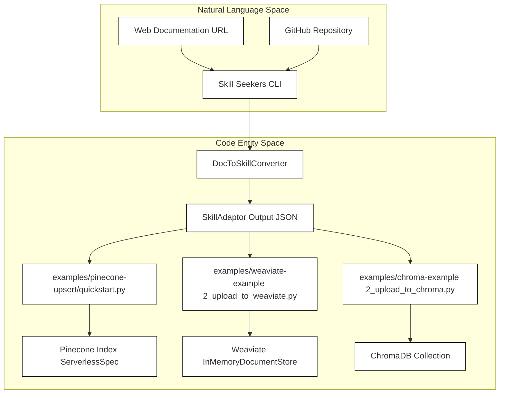
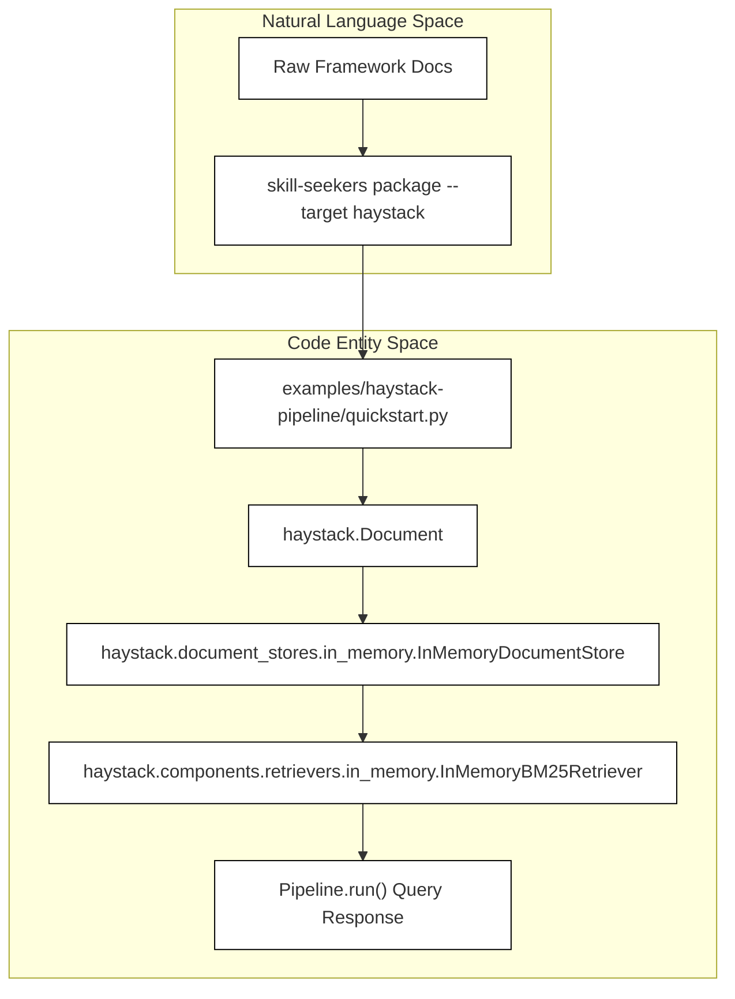
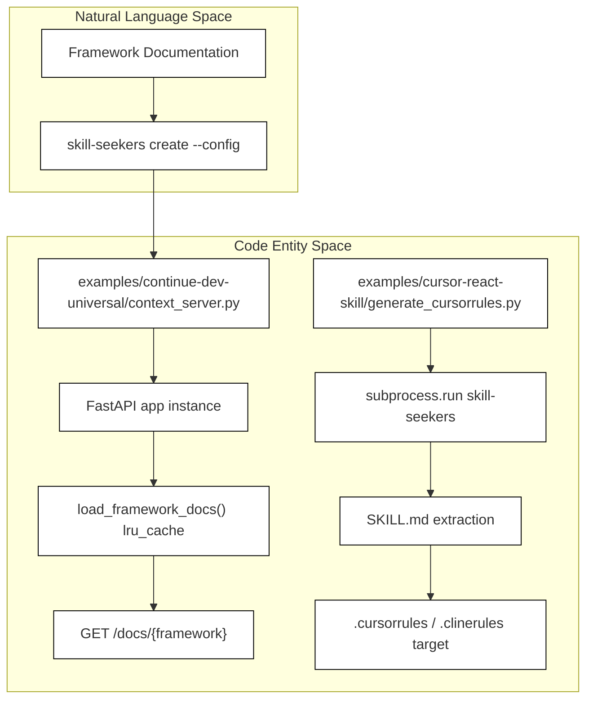

<!-- source: DeepWiki mcp.deepwiki.com · repo yusufkaraaslan/Skill_Seekers · page 20.3 Examples & Integration Recipes · fetched 2026-10-26 -->

# Examples & Integration Recipes

Relevant source files

The following files were used as context for generating this wiki page:

- [examples/chroma-example/README.md](examples/chroma-example/README.md)
- [examples/cline-django-assistant/README.md](examples/cline-django-assistant/README.md)
- [examples/continue-dev-universal/README.md](examples/continue-dev-universal/README.md)
- [examples/continue-dev-universal/context_server.py](examples/continue-dev-universal/context_server.py)
- [examples/cursor-react-skill/.cursorrules.example](examples/cursor-react-skill/.cursorrules.example)
- [examples/cursor-react-skill/README.md](examples/cursor-react-skill/README.md)
- [examples/cursor-react-skill/example-project/README.md](examples/cursor-react-skill/example-project/README.md)
- [examples/cursor-react-skill/example-project/package.json](examples/cursor-react-skill/example-project/package.json)
- [examples/cursor-react-skill/example-project/src/App.tsx](examples/cursor-react-skill/example-project/src/App.tsx)
- [examples/cursor-react-skill/example-project/src/index.tsx](examples/cursor-react-skill/example-project/src/index.tsx)
- [examples/cursor-react-skill/example-project/tsconfig.json](examples/cursor-react-skill/example-project/tsconfig.json)
- [examples/cursor-react-skill/generate_cursorrules.py](examples/cursor-react-skill/generate_cursorrules.py)
- [examples/cursor-react-skill/requirements.txt](examples/cursor-react-skill/requirements.txt)
- [examples/haystack-pipeline/README.md](examples/haystack-pipeline/README.md)
- [examples/haystack-pipeline/quickstart.py](examples/haystack-pipeline/quickstart.py)
- [examples/langchain-rag-pipeline/README.md](examples/langchain-rag-pipeline/README.md)
- [examples/langchain-rag-pipeline/quickstart.py](examples/langchain-rag-pipeline/quickstart.py)
- [examples/llama-index-query-engine/README.md](examples/llama-index-query-engine/README.md)
- [examples/llama-index-query-engine/quickstart.py](examples/llama-index-query-engine/quickstart.py)
- [examples/pinecone-upsert/README.md](examples/pinecone-upsert/README.md)
- [examples/pinecone-upsert/quickstart.py](examples/pinecone-upsert/quickstart.py)
- [examples/weaviate-example/README.md](examples/weaviate-example/README.md)
- [examples/windsurf-fastapi-context/README.md](examples/windsurf-fastapi-context/README.md)

## Purpose and Scope
This wiki page provides a comprehensive tour of the `examples/` directory in the `Skill_Seekers` codebase. It serves as a practical guide for integrating generated skills and documentation packages with various vector databases (ChromaDB, Weaviate, Pinecone, FAISS, Qdrant), RAG orchestration frameworks (LangChain, LlamaIndex, Haystack), and AI coding assistants/IDEs (Cursor, Cline, Windsurf, Continue.dev). 

Each recipe bridges raw documentation or source repositories into production-ready AI context workflows.

---

## 1. Vector Database Integration Pipelines

Skill Seekers packages documentation and codebase knowledge into structured formats optimized for vector database ingestion. The codebase provides dedicated examples for ChromaDB, Weaviate, and Pinecone.

### ChromaDB Integration
ChromaDB runs in-process without requiring an external server daemon, making it ideal for local development and rapid experimentation (`examples/chroma-example/README.md:1-18`). 
- **Generation:** `skill-seekers create --config configs/vue.json` followed by `skill-seekers package output/vue --target chroma` `[examples/chroma-example/README.md:31-48]`.
- **Data Structure:** The output JSON contains `documents`, `metadatas`, `ids`, and `collection_name` `[examples/chroma-example/README.md:52-74]`.

### Weaviate Integration
Weaviate supports hybrid search (combining BM25 keyword search with vector semantic search) and category metadata filtering (`examples/weaviate-example/README.md:1-10`).
- **Upload & Schema:** The `2_upload_to_weaviate.py` script initializes the Weaviate schema class, properties (`content`, `source`, `category`), and batch-uploads objects `[examples/weaviate-example/README.md:90-127]`.
- **Hybrid Balance:** Controlled via the `alpha` parameter (`alpha=0` for pure keyword, `alpha=0.5` for balanced, `alpha=1` for pure vector) `[examples/weaviate-example/README.md:185-197]`.

### Pinecone Serverless Integration
Pinecone provides scalable, serverless vector search infrastructure (`examples/pinecone-upsert/README.md:1-12`).
- **Quickstart Pipeline:** `examples/pinecone-upsert/quickstart.py` initializes a serverless index via `ServerlessSpec`, loads LangChain-formatted JSON documents, creates OpenAI embeddings (`text-embedding-ada-002`), and performs batch upserts (`examples/pinecone-upsert/quickstart.py:29-158`).

*Sources: `examples/pinecone-upsert/quickstart.py:1-158`, `examples/weaviate-example/README.md:1-127`, `examples/chroma-example/README.md:1-89`*

---

## 2. Framework RAG Integrations

### Haystack 2.x Pipeline
The Haystack example demonstrates building a local semantic and keyword search pipeline using Haystack 2.x components (`examples/haystack-pipeline/README.md:1-11`).
- **Loading Documents:** `examples/haystack-pipeline/quickstart.py` reads JSON outputs, wraps them in Haystack `Document` objects with metadata, and writes them to an `InMemoryDocumentStore` `[examples/haystack-pipeline/quickstart.py:40-67]`.
- **Retriever:** Uses `InMemoryBM25Retriever` to query documentation categories (`[examples/haystack-pipeline/quickstart.py:69-89]`).

### LlamaIndex Query Engine
LlamaIndex integration loads pre-packaged nodes to build persistent vector indexes with conversational memory and source attribution (`examples/llama-index-query-engine/README.md:1-11`).

### LangChain Pipeline
Documents packaged in LangChain JSON format (`output/{name}-langchain.json`) map directly to LangChain `Document` structures containing `page_content` and `metadata` dictionaries.

*Sources: `examples/haystack-pipeline/README.md:1-61`, `examples/haystack-pipeline/quickstart.py:1-94`*

---

## 3. AI Coding Agent & IDE Recipes

Skill Seekers supports direct rule generation and context server integration for major AI-powered coding assistants and IDEs.

### Cursor IDE
- **Rule Generation:** Packages React/documentation skills into markdown format, which are then copied or automated into `.cursorrules` `[examples/cursor-react-skill/README.md:1-32]`.
- **Automation Script:** `examples/cursor-react-skill/generate_cursorrules.py` executes the full CLI build pipeline, extracts archives, and deploys `.cursorrules` to target projects `[examples/cursor-react-skill/generate_cursorrules.py:90-152]`.

### Cline (VS Code Extension)
- **Integration:** Generates `.clinerules` and configures the FastMCP server (`skill_seekers.mcp.server_fastmcp`) over `stdio` transport for dynamic documentation lookup (`examples/cline-django-assistant/README.md:1-50`).

### Windsurf IDE
- **Modular Rules:** Splits large framework skills into modular files under `.windsurf/rules/` (`fastapi-core.md`, `fastapi-database.md`, etc.) to respect context limits (`examples/windsurf-fastapi-project/README.md:1-15`).
- **Activation Modes:** Frontmatter configuration defines rules as `always-on`, `model-decision`, or `manual` `[examples/windsurf-fastapi-project/README.md:132-141]`.

### Continue.dev Universal Context Server
- **HTTP Context Provider:** `examples/continue-dev-universal/context_server.py` implements a FastAPI service that serves framework documentation as Continue.dev context items across VS Code, IntelliJ, PyCharm, and WebStorm (`examples/continue-dev-universal/context_server.py:24-70`).

*Sources: `examples/continue-dev-universal/context_server.py:24-70`, `examples/cursor-react-skill/generate_cursorrules.py:90-152`, `examples/windsurf-fastapi-project/README.md:1-40`*

---

## Sources
- `examples/haystack-pipeline/README.md`
- `examples/haystack-pipeline/quickstart.py`
- `examples/cursor-react-skill/README.md`
- `examples/cursor-react-skill/generate_cursorrules.py`
- `examples/cline-django-assistant/README.md`
- `examples/windsurf-fastapi-project/README.md`
- `examples/continue-dev-universal/context_server.py`
- `examples/continue-dev-universal/README.md`
- `examples/weaviate-example/README.md`
- `examples/chroma-example/README.md`
- `examples/llama-index-query-engine/README.md`
- `examples/pinecone-upsert/README.md`
- `examples/pinecone-upsert/quickstart.py`

---

