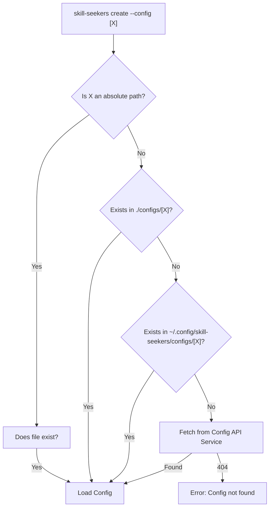
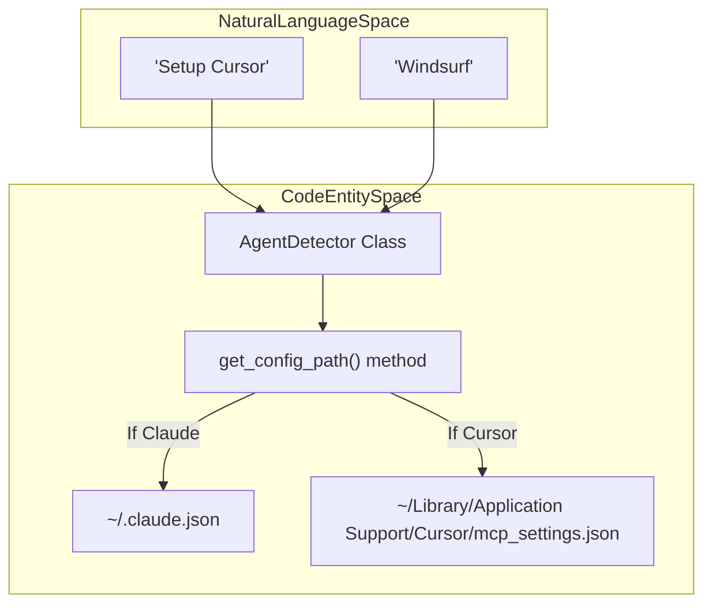

<!-- source: DeepWiki mcp.deepwiki.com · repo yusufkaraaslan/Skill_Seekers · page 21 Troubleshooting & FAQ · fetched 2026-10-26 -->

# Troubleshooting & FAQ

<details>
<summary>Relevant source files</summary>

The following files were used as context for generating this wiki page:

- [AGENTS.md](AGENTS.md)
- [docs/FAQ.md](docs/FAQ.md)
- [docs/README.md](docs/README.md)
- [docs/TROUBLESHOOTING.md](docs/TROUBLESHOOTING.md)
- [docs/features/HOW_TO_GUIDES.md](docs/features/HOW_TO_GUIDES.md)
- [docs/reference/CLI_REFERENCE.md](docs/reference/CLI_REFERENCE.md)
- [docs/zh-CN/reference/CLI_REFERENCE.md](docs/zh-CN/reference/CLI_REFERENCE.md)
- [src/skill_seekers/cli/arguments/enhance.py](src/skill_seekers/cli/arguments/enhance.py)
- [src/skill_seekers/cli/config_manager.py](src/skill_seekers/cli/config_manager.py)
- [src/skill_seekers/cli/doctor.py](src/skill_seekers/cli/doctor.py)
- [src/skill_seekers/cli/execution_context.py](src/skill_seekers/cli/execution_context.py)
- [src/skill_seekers/cli/parsers/doctor_parser.py](src/skill_seekers/cli/parsers/doctor_parser.py)
- [tests/conftest.py](tests/conftest.py)
- [tests/test_doctor.py](tests/test_doctor.py)
- [tests/test_execution_context.py](tests/test_execution_context.py)

</details>


This page provides technical solutions for common operational problems encountered when installing, running, and integrating `skill-seekers`. It covers environment health, scraping failures, API authentication, MCP connectivity, and quality check failures.

For setup instructions, see [Getting Started](2.-Getting-Started). For MCP server architecture, see [MCP Integration](4.-MCP-Integration). For enhancement configuration, see [AI Enhancement System](8.-AI-Enhancement-System).

---

## Environment Health Check (`skill-seekers doctor`)

Before investigating specific symptoms, use the built-in diagnostic tool to verify your environment. The `doctor` command runs 8 quick offline checks and prints a diagnostic summary, similar to `brew doctor` or `flutter doctor` [src/skill_seekers/cli/doctor.py:1-6]().

```bash
# Run basic health check
skill-seekers doctor

# Run with detailed diagnostic info
skill-seekers doctor --verbose

# Machine-readable JSON output (ideal for CI and agents)
skill-seekers doctor --json
```

### Diagnostic Logic
The `doctor` command is implemented in `src/skill_seekers/cli/doctor.py` and evaluates the following:

1. **Python Version**: Checks if `sys.version_info >= (3, 10)` [src/skill_seekers/cli/doctor.py:84-90]().
2. **Package Installation**: Verifies `skill_seekers._version` is importable [src/skill_seekers/cli/doctor.py:93-102]().
3. **Git Availability**: Checks `shutil.which("git")` and runs `git --version` [src/skill_seekers/cli/doctor.py:105-116]().
4. **Core Dependencies**: Attempts to import core dependencies defined in `CORE_DEPS` [src/skill_seekers/cli/doctor.py:33-48](), [src/skill_seekers/cli/doctor.py:118-146]().
5. **Optional Dependencies**: Checks status of optional packages in `OPTIONAL_DEPS` [src/skill_seekers/cli/doctor.py:51-62](), [src/skill_seekers/cli/doctor.py:149-176]().
6. **API Keys**: Checks `os.environ` for `ANTHROPIC_API_KEY`, `GITHUB_TOKEN`, `GOOGLE_API_KEY`, `OPENAI_API_KEY`, and `MOONSHOT_API_KEY` [src/skill_seekers/cli/doctor.py:64-71](), [src/skill_seekers/cli/doctor.py:179-215]().
7. **MCP Server**: Verifies the FastMCP server module is importable.
8. **Output Directory**: Confirms the current working directory is writable.

Sources: [src/skill_seekers/cli/doctor.py:1-231](), [docs/FAQ.md:161-170]()

---

## Installation Issues

### `skill-seekers: command not found`
The entry point is registered via `pip install`. If missing, the virtual environment is likely not activated or the local user binary path is not in your `PATH`.

```bash
# Add to PATH
export PATH="$HOME/.local/bin:$PATH"

# Or reinstall with --user flag
pip install --user skill-seekers
```
Sources: [docs/TROUBLESHOOTING.md:63-85](), [docs/getting-started/01-installation.md:246-254]()

### `ModuleNotFoundError`
| Missing Module | Required Extra | Installation Command |
| :--- | :--- | :--- |
| `mcp` | `[mcp]` | `pip install skill-seekers[mcp]` |
| `anthropic` / `openai` | `[all-llms]` | `pip install skill-seekers[all-llms]` |
| `chromadb` / `weaviate` | `[embedding]` | `pip install skill-seekers[embedding]` |
| `easyocr` / `torch` | `[video-full]` | `pip install skill-seekers[video-full]` |

Sources: [docs/getting-started/01-installation.md:114-142](), [docs/FAQ.md:152-159]()

---

## Scraping Failures

### Config File Not Found
The `ConfigManager` [src/skill_seekers/cli/config_manager.py:32-] searches for JSON configuration files in a specific hierarchical resolution path.

Config Resolution Flow:

Sources: [docs/TROUBLESHOOTING.md:178-203](), [docs/user-guide/02-scraping.md:64-95]()

### Scraping Returns Empty Content
This typically indicates a CSS selector mismatch or accessibility issues on target pages.

| Symptom | Problem | Potential Fix |
| :--- | :--- | :--- |
| No text extracted | `main_content` selector mismatch | Check browser dev tools for `article`, `main`, or `div.content` [docs/TROUBLESHOOTING.md:236-275]() |
| Empty references | Site is a Single Page App (SPA) | Use a static mirror, enable headless browser rendering (`--browser`), or check for `llms.txt` [docs/TROUBLESHOOTING.md:305-311]() |
| Rate Limit (429) | Request frequency too high | Add `--rate-limit 2.0` to command [docs/TROUBLESHOOTING.md:11]() |

Sources: [docs/TROUBLESHOOTING.md:236-304](), [docs/user-guide/02-scraping.md:97-100]()

---

## MCP Connection Problems

### Agent Detection Failures
The agent detection system inspects environment structures and configurations to identify installed AI coding assistants and route MCP tool settings correctly.

Natural Language to Code Entity Mapping:


Common Paths Checked:
* **Claude Code**: `~/.claude.json` [docs/TROUBLESHOOTING.md:158-162]()
* **Cursor**: `~/Library/Application Support/Cursor/mcp_settings.json` [docs/FAQ.md:55]()
* **Windsurf**: `~/.windsurf/mcp_config.json` [docs/FAQ.md:56]()

Sources: [docs/FAQ.md:54-63](), [docs/TROUBLESHOOTING.md:143-176]()

---

## Quality Check Failures

### Low Quality Score
The validation engine evaluates generated skills based on structural completeness and content presence.

| Score Range | Grade | Action Required |
| :--- | :--- | :--- |
| 90-100 | A | Ready to upload or export |
| 70-89 | B/C | Review quality report warnings; add more code examples |
| < 70 | D/F | Missing critical sections (e.g., Troubleshooting, Examples) |

Sources: [docs/user-guide/04-packaging.md:140-145](), [docs/getting-started/04-next-steps.md:183]()

---

## FAQ

### How do I handle large documentation sets?
If a site has thousands of pages, use the `estimate_pages` tool via MCP or the `estimate` command to check size before scraping. For very large skills, use `--streaming` mode during packaging to reduce memory usage [docs/user-guide/04-packaging.md:164-182]().

### Why does `llms.txt` discovery fail?
Discovery fails if the server returns HTML instead of markdown or text (often due to redirects or captive portals). The download module validates content to ensure it is not an HTML landing page [docs/FAQ.md:121]().

### Can I resume an interrupted scrape?
Yes. Converter components save execution checkpoints [src/skill_seekers/cli/config_manager.py:50](). Re-running with the `--resume` flag loads progress from `.skillseeker-cache/{name}/` [docs/user-guide/02-scraping.md:117-118]().

### How do I setup video extraction with GPU support?
Run `skill-seekers create --setup`. This auto-detects your GPU vendor (NVIDIA CUDA, AMD ROCm, or CPU-only) and installs the correct PyTorch variant along with `easyocr` and visual extraction dependencies [docs/FAQ.md:79-96]().

Sources: [docs/FAQ.md:79-96](), [docs/user-guide/04-packaging.md:164-182](), [docs/user-guide/02-scraping.md:117-118]()

---

