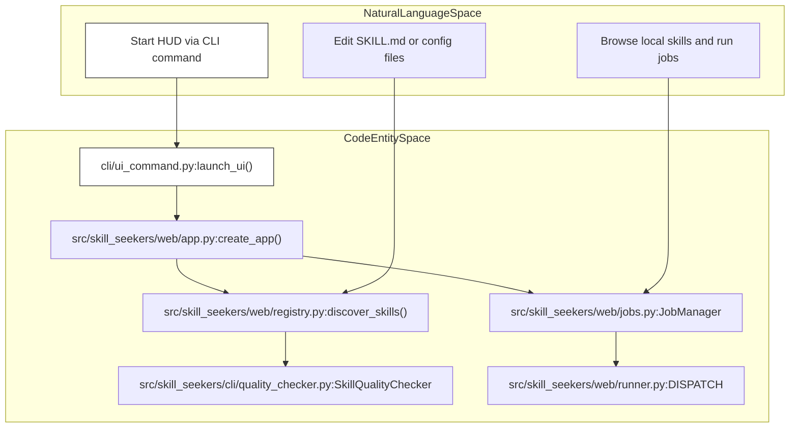
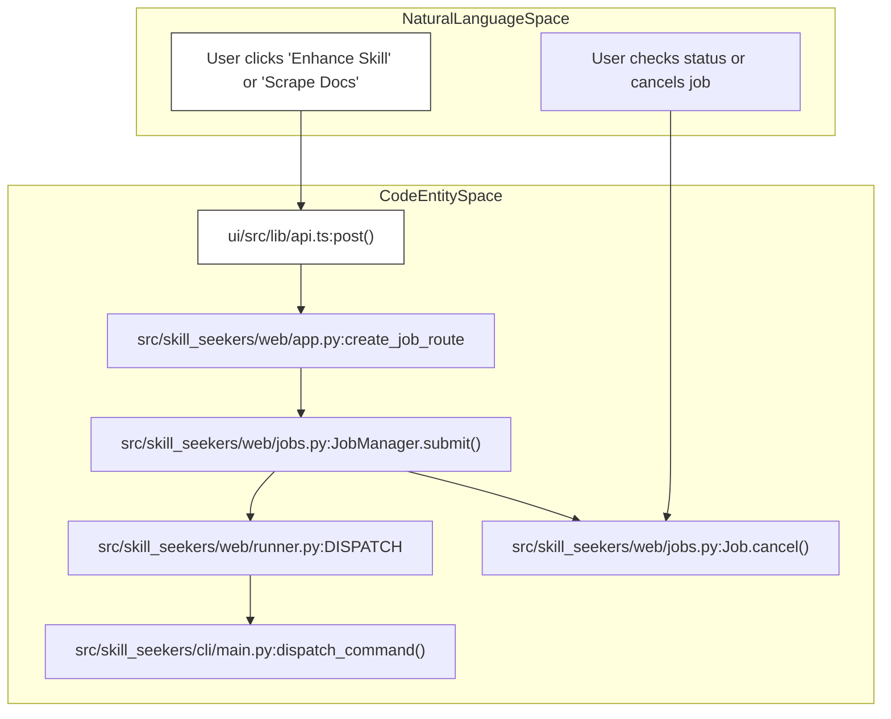

<!-- source: DeepWiki mcp.deepwiki.com · repo yusufkaraaslan/Skill_Seekers · page 22 Seeker HUD Web UI · fetched 2026-10-26 -->

# Seeker HUD Web UI

Relevant source files

The following files were used as context for generating this wiki page:

- [.github/workflows/vector-db-export.yml](.github/workflows/vector-db-export.yml)
- [docs/guides/WEB_UI.md](docs/guides/WEB_UI.md)
- [src/skill_seekers/cli/ui_command.py](src/skill_seekers/cli/ui_command.py)
- [src/skill_seekers/web/app.py](src/skill_seekers/web/app.py)
- [src/skill_seekers/web/registry.py](src/skill_seekers/web/registry.py)
- [src/skill_seekers/web/routes/__init__.py](src/skill_seekers/web/routes/__init__.py)
- [src/skill_seekers/web/routes/workflows.py](src/skill_seekers/web/routes/workflows.py)
- [tests/test_web_api.py](tests/test_web_api.py)
- [tests/test_web_regressions.py](tests/test_web_regressions.py)
- [tests/test_web_workflows.py](tests/test_web_workflows.py)
- [ui/package-lock.json](ui/package-lock.json)
- [ui/package.json](ui/package.json)
- [ui/src/App.tsx](ui/src/App.tsx)
- [ui/src/components/generate-config-form.tsx](ui/src/components/generate-config-form.tsx)
- [ui/src/lib/api.ts](ui/src/lib/api.ts)
- [ui/src/lib/store.tsx](ui/src/lib/store.tsx)
- [ui/src/sections/ConfigPage.tsx](ui/src/sections/ConfigPage.tsx)
- [ui/src/sections/SkillPage.tsx](ui/src/sections/SkillPage.tsx)
- [ui/src/sections/Workflows.tsx](ui/src/sections/Workflows.tsx)
- [ui/tests/pages.spec.ts](ui/tests/pages.spec.ts)

## Purpose and Scope

The Seeker HUD Web UI (`skill-seekers ui`) provides a local browser-based control plane for the `skill-seekers` toolchain. It pairs a FastAPI backend running on `127.0.0.1:8770` with a React Single-Page Application (SPA) bundled inside the package [src/skill_seekers/web/app.py:1-10](), [docs/guides/WEB_UI.md:5-15](). This page serves as a high-level parent overview of the Seeker HUD architecture, detailing how the FastAPI backend, background job runner, and React frontend interact. 

For deeper technical implementation details, refer to the child pages:
- For FastAPI app assembly, registry queries, and route modules, see [Web Backend: App, Routes & Registry](#22.1).
- For asynchronous job execution, `JobManager`, and process dispatch, see [Job Runner & Background Execution](#22.2).
- For React routing, `StoreProvider` state management, and UI sections, see [React Frontend (ui/)](#22.3).

Sources: `src/skill_seekers/web/app.py:1-10`, `docs/guides/WEB_UI.md:5-15`

---

## 1. System Architecture & Daemon Model

The Seeker HUD operates as a local daemon service. When launched via `skill-seekers ui`, it spawns a FastAPI instance that exposes REST endpoints under `/api/*` and serves the compiled React SPA asset bundle [src/skill_seekers/web/app.py:1-10](). The backend queries local workspace directories (such as `output/` and `configs/`) using `skill_seekers.web.registry`, discovering skills, validating frontmatter, and tracking quality metrics [src/skill_seekers/web/registry.py:1-12]().

### Natural Language to Code Entity Mapping: HUD Lifecycle

Sources: `src/skill_seekers/web/app.py:1-30`, `src/skill_seekers/web/registry.py:1-15`, `src/skill_seekers/web/jobs.py:1-75`

---

## 2. Web Backend: App, Routes & Registry

The FastAPI application is assembled via `create_app()` in `src/skill_seekers/web/app.py`, mounting static assets from `src/skill_seekers/web/dist` or `ui/dist` [src/skill_seekers/web/app.py:43-58](). Routing modules handle distinct operational domains including skill inspection, config editing, environment diagnostics, workflow management, and code analysis [src/skill_seekers/web/routes/__init__.py:1-17]().

For detailed documentation on FastAPI route definitions, request/response models, registry helpers, and API contracts, see [Web Backend: App, Routes & Registry](#22.1).

Sources: `src/skill_seekers/web/app.py:25-58`, `src/skill_seekers/web/routes/__init__.py:1-18`

---

## 3. Job Runner & Background Execution

Long-running operations such as documentation scraping, code analysis, skill packaging, and AI enhancement cannot block the HTTP event loop. The HUD relies on `src/skill_seekers/web/runner.py` and `src/skill_seekers/web/jobs.py` to dispatch actions asynchronously. Each job generates a JSON specification (`spec.json`), progress markers, and artifact bundles managed by `JobManager` [docs/guides/WEB_UI.md:36-48]().

### Natural Language to Code Entity Mapping: Background Execution

For detailed documentation on job specs, dispatch actions, progress tracking, and process isolation, see [Job Runner & Background Execution](#22.2).

Sources: `src/skill_seekers/web/jobs.py:1-80`, `docs/guides/WEB_UI.md:36-48`, `ui/src/lib/api.ts:1-30`

---

## 4. React Frontend (ui/)

The React SPA located in `ui/` provides the user interface for Seeker HUD. Built with Vite, Tailwind CSS, and React Router, it communicates with the FastAPI backend through `ui/src/lib/api.ts` [ui/src/lib/api.ts:1-25]() and synchronizes global state via `StoreProvider` in `ui/src/lib/store.tsx` [ui/src/lib/store.tsx:1-10]().

Key sections include Overview, Projects, Skills, SkillPage, Create, Marketplace, Library (Configs), ConfigPage, Workflows, Analyze, Environment, Jobs, and Settings [ui/src/App.tsx:27-39](). Playwright test suites validate routing and component states [ui/tests/pages.spec.ts:28-62]().

For detailed documentation on component architecture, routing, global store polling, and test specs, see [React Frontend (ui/)](#22.3).

Sources: `ui/src/App.tsx:1-45`, `ui/src/lib/store.tsx:1-50`, `ui/tests/pages.spec.ts:1-60`

---

