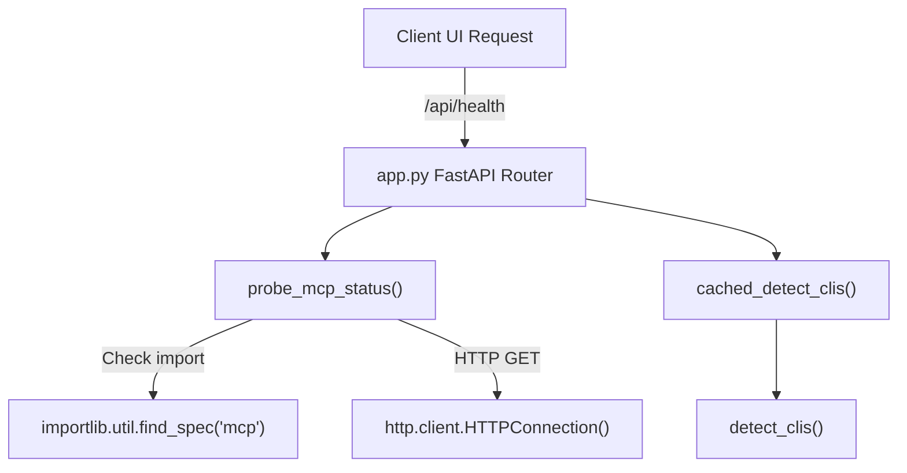
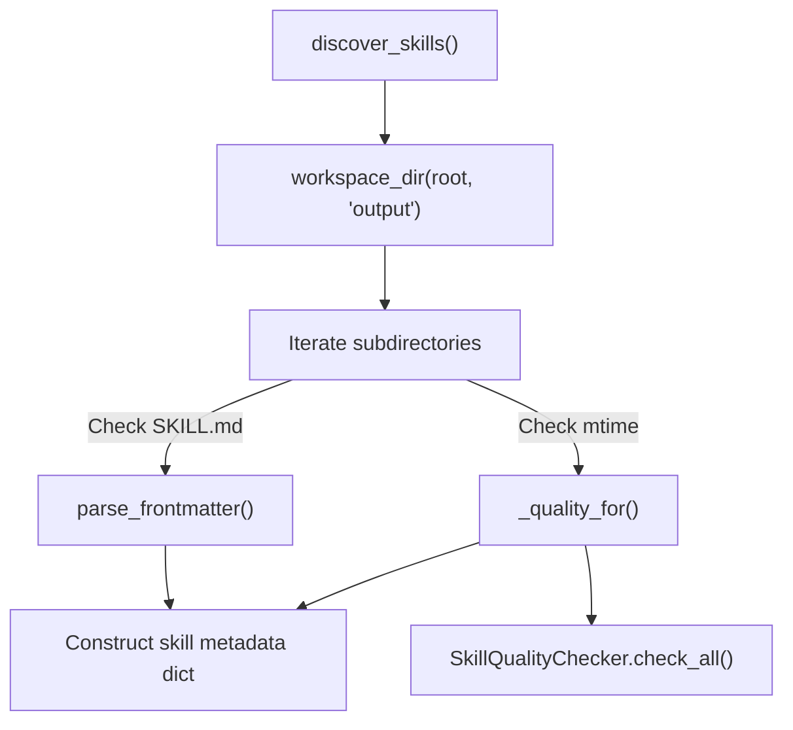
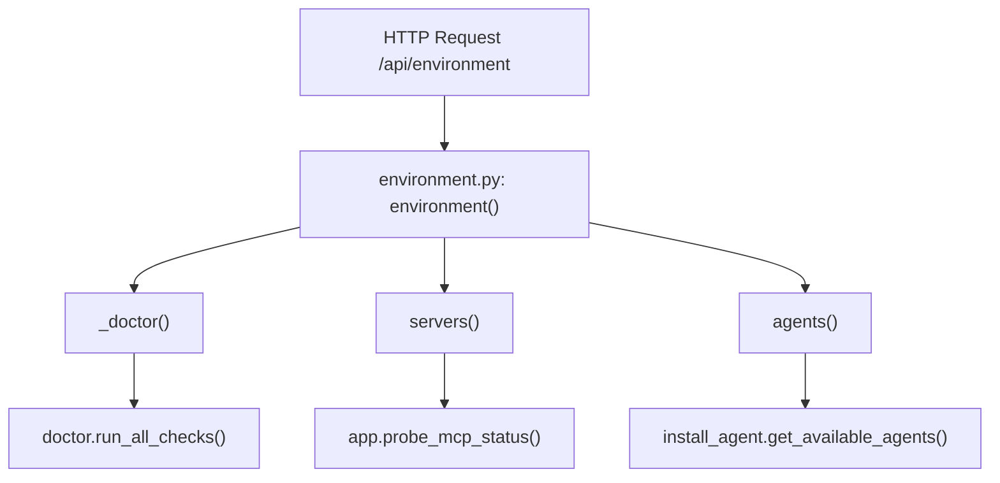
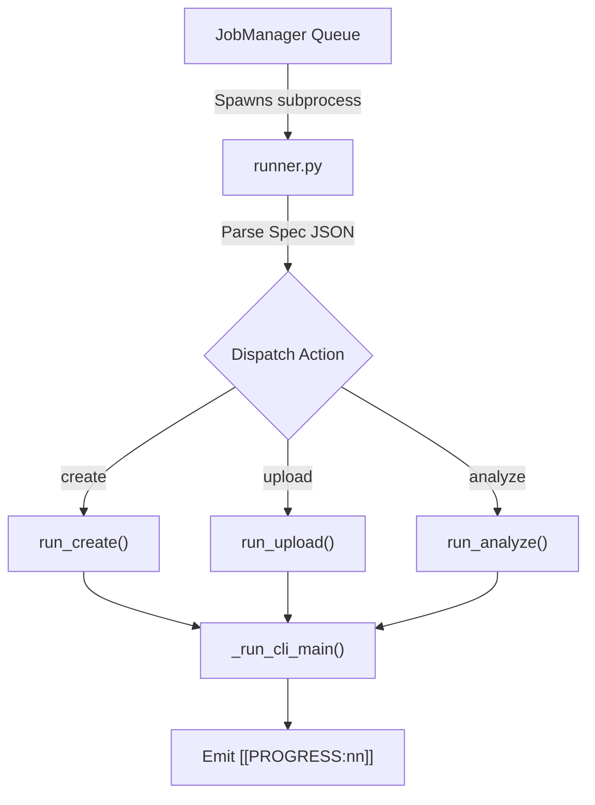

<!-- source: DeepWiki mcp.deepwiki.com · repo yusufkaraaslan/Skill_Seekers · page 22.1 Web Backend: App, Routes & Registry · fetched 2026-10-26 -->

# Web Backend: App, Routes & Registry

<details>
<summary>Relevant source files</summary>

The following files were used as context for generating this wiki page:

- [src/skill_seekers/web/analysis_store.py](src/skill_seekers/web/analysis_store.py)
- [src/skill_seekers/web/app.py](src/skill_seekers/web/app.py)
- [src/skill_seekers/web/registry.py](src/skill_seekers/web/registry.py)
- [src/skill_seekers/web/routes/__init__.py](src/skill_seekers/web/routes/__init__.py)
- [src/skill_seekers/web/routes/analyze.py](src/skill_seekers/web/routes/analyze.py)
- [src/skill_seekers/web/routes/configs.py](src/skill_seekers/web/routes/configs.py)
- [src/skill_seekers/web/routes/environment.py](src/skill_seekers/web/routes/environment.py)
- [src/skill_seekers/web/routes/skill_detail.py](src/skill_seekers/web/routes/skill_detail.py)
- [src/skill_seekers/web/routes/workflows.py](src/skill_seekers/web/routes/workflows.py)
- [src/skill_seekers/web/runner.py](src/skill_seekers/web/runner.py)
- [tests/test_web_analyze.py](tests/test_web_analyze.py)
- [tests/test_web_api.py](tests/test_web_api.py)
- [tests/test_web_configs.py](tests/test_web_configs.py)
- [tests/test_web_environment.py](tests/test_web_environment.py)
- [tests/test_web_regressions.py](tests/test_web_regressions.py)
- [tests/test_web_runner_jobs.py](tests/test_web_runner_jobs.py)
- [tests/test_web_skill_detail.py](tests/test_web_skill_detail.py)
- [tests/test_web_workflows.py](tests/test_web_workflows.py)

</details>


This page documents the internal architecture of the Seeker HUD web backend located under `src/skill_seekers/web`. It covers FastAPI application assembly (`app.py`), the state discovery and parsing registry (`registry.py`), modular routing (`routes/`), analysis manifests (`analysis_store.py`), process execution helpers (`runner.py`), and integration boundaries.

---

## 1. FastAPI Application Assembly (`app.py`)

The web backend initializes a FastAPI application instance that serves both JSON API endpoints under `/api/*` and the static single-page application (SPA) build from the embedded frontend assets `[src/skill_seekers/web/app.py:1-10]`.

### Static Asset Resolution & Frontend Fallback
The frontend is bundled inside the Python package wheel at `skill_seekers/web/dist` (produced by Vite). If running from a source repository checkout, it falls back to the workspace root's `ui/dist` folder `[src/skill_seekers/web/app.py:43-58]`:

```python
_PACKAGED_DIST = Path(__file__).resolve().parent / "dist"
_CHECKOUT_DIST = Path(__file__).resolve().parents[3] / "ui" / "dist"
```

### Remote & Offline-Tolerant Registries
The application communicates with the official remote configuration index via cached HTTP calls (`fetch_official_configs()`), falling back gracefully to local caches if the network is unreachable `[src/skill_seekers/web/app.py:60-89]`. Similarly, CLI detection (`cached_detect_clis()`) runs binary probing with a TTL cache to avoid expensive subprocess spawning on every request `[src/skill_seekers/web/app.py:91-104]`.

### MCP Status Probing
The backend probes Model Context Protocol (MCP) servers to check stdio module importability and HTTP health endpoints (`probe_mcp_status()`) `[src/skill_seekers/web/app.py:127-156]`.


*Sources: `src/skill_seekers/web/app.py`*

---

## 2. Skill & Project State Registry (`registry.py`)

The `registry.py` module discovers skills, projects, and custom configurations across the workspace `[src/skill_seekers/web/registry.py:1-12]`.

### Discovery & Frontmatter Parsing
Skills are detected by scanning the workspace `output/` directory for any subdirectory containing a valid `SKILL.md` file `[src/skill_seekers/web/registry.py:164-188]`. YAML frontmatter is parsed safely using `yaml.safe_load()` with strict fallbacks for malformed syntax `[src/skill_seekers/web/registry.py:68-79]`.

### Quality Metric Integration
Quality scores are computed dynamically using `SkillQualityChecker` and cached by file modification time (`mtime`) to optimize subsequent requests `[src/skill_seekers/web/registry.py:111-131]`. The module maps issue categories into structured dimension breakdowns for the frontend UI components `[src/skill_seekers/web/registry.py:134-162]`.


*Sources: `src/skill_seekers/web/registry.py`*

---

## 3. Modular Route Subsystem (`routes/`)

The routing layer is organized into isolated domain modules under `src/skill_seekers/web/routes/`, initialized collectively via `register_all()` `[src/skill_seekers/web/routes/__init__.py:1-18]`:

```python
def register_all(app: FastAPI, ctx: HudContext) -> None:
    from . import analyze, configs, environment, skill_detail, workflows
    skill_detail.register(app, ctx)
    analyze.register(app, ctx)
    configs.register(app, ctx)
    workflows.register(app, ctx)
    environment.register(app, ctx)
```

### Skill Detail & Management (`skill_detail.py`)
Provides granular skill inspection, upgrade states, and operational triggers:
*   `GET /api/skills/{skill_id}/detail`: Merges filesystem metadata, configuration sidecars, and quality dimensions `[src/skill_seekers/web/routes/skill_detail.py:59-83]`.
*   `POST /api/skills/{skill_id}/upload`: Submits asynchronous packaging and platform upload tasks `[src/skill_seekers/web/routes/skill_detail.py:108-127]`.
*   `POST /api/skills/{skill_id}/translate`: Triggers multi-language generation jobs `[src/skill_seekers/web/routes/skill_detail.py:129-143]`.
*   `POST /api/skills/{skill_id}/update`: Checks or applies upstream documentation changes `[src/skill_seekers/web/routes/skill_detail.py:145-155]`.

### Environment & Doctor Controls (`environment.py`)
Manages system diagnostics, server run states, and AI coding agent integrations:
*   `GET /api/environment`: Aggregates CLI doctor checks (`run_all_checks()`), server statuses, and detected agent installation directories `[src/skill_seekers/web/routes/environment.py:36-133]`.
*   `POST /api/environment/servers/{server}/start`: Submits background execution jobs for HTTP and embedding servers `[src/skill_seekers/web/routes/environment.py:139-148]`.
*   `POST /api/environment/agents/{agent}/install`: Installs bootstrap skill distributions into target agent environments safely `[src/skill_seekers/web/routes/environment.py:158-180]`.


*Sources: `src/skill_seekers/web/routes/environment.py`, `src/skill_seekers/cli/doctor.py`*

---

## 4. Analysis Stores, Runners & Supporting Helpers

### Analysis Manifests (`analysis_store.py`)
Standalone codebase analysis runs write structured JSON manifests under `output/_analysis/<slug>/manifest.json` `[src/skill_seekers/web/analysis_store.py:1-23]`. Slugs are computed by hashing target paths to prevent collisions across different source trees `[src/skill_seekers/web/analysis_store.py:25-34]`.

### Background Job Execution (`runner.py`)
The `runner.py` module executes job specifications in isolated subprocesses, parsing stdout streams and translating percent indicators into `[[PROGRESS:nn]]` markers consumed by `JobManager` `[src/skill_seekers/web/runner.py:1-47]`. It provides translators such as `_create_flag_argv()` to map wizard state flags into CLI argument vectors `[src/skill_seekers/web/runner.py:71-107]`.


*Sources: `src/skill_seekers/web/runner.py`, `src/skill_seekers/web/jobs.py`*

---

