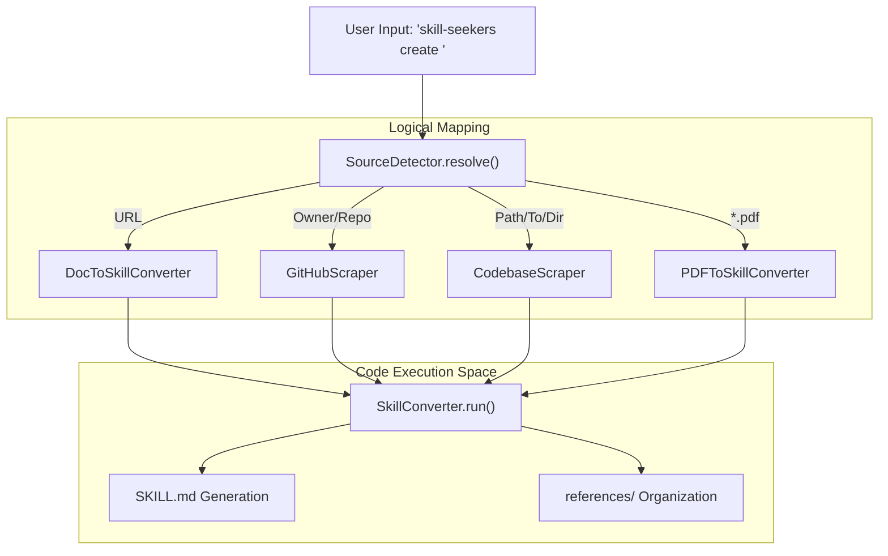
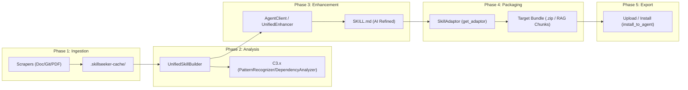

<!-- source: DeepWiki mcp.deepwiki.com · repo yusufkaraaslan/Skill_Seekers · page 23 Glossary · fetched 2026-10-26 -->

# Glossary

Relevant source files

The following files were used as context for generating this wiki page:

- [CHANGELOG.md](CHANGELOG.md)
- [CLAUDE.md](CLAUDE.md)
- [README.md](README.md)
- [pyproject.toml](pyproject.toml)
- [src/skill_seekers/_version.py](src/skill_seekers/_version.py)
- [src/skill_seekers/cli/main.py](src/skill_seekers/cli/main.py)
- [src/skill_seekers/cli/parsers/__init__.py](src/skill_seekers/cli/parsers/__init__.py)
- [src/skill_seekers/cli/skill_converter.py](src/skill_seekers/cli/skill_converter.py)
- [src/skill_seekers/cli/source_detector.py](src/skill_seekers/cli/source_detector.py)
- [src/skill_seekers/web/analysis_store.py](src/skill_seekers/web/analysis_store.py)
- [src/skill_seekers/web/routes/configs.py](src/skill_seekers/web/routes/configs.py)
- [src/skill_seekers/web/routes/environment.py](src/skill_seekers/web/routes/environment.py)
- [src/skill_seekers/web/routes/skill_detail.py](src/skill_seekers/web/routes/skill_detail.py)
- [src/skill_seekers/web/runner.py](src/skill_seekers/web/runner.py)
- [tests/test_cli_parsers.py](tests/test_cli_parsers.py)
- [tests/test_cli_paths.py](tests/test_cli_paths.py)
- [tests/test_new_source_types.py](tests/test_new_source_types.py)
- [tests/test_package_structure.py](tests/test_package_structure.py)
- [tests/test_web_configs.py](tests/test_web_configs.py)
- [tests/test_web_environment.py](tests/test_web_environment.py)
- [tests/test_web_runner_jobs.py](tests/test_web_runner_jobs.py)
- [tests/test_web_skill_detail.py](tests/test_web_skill_detail.py)
- [uv.lock](uv.lock)

## Purpose and Scope

This glossary defines the technical terms, architectural patterns, domain-specific jargon, and core classes used throughout the Skill Seekers codebase. It serves as a comprehensive technical reference for onboarding engineers, contributors, and advanced users to understand how conceptual specifications and natural language requirements translate directly into concrete Python code entities, modules, and data structures.

Sources: [CLAUDE.md:1-132](), [README.md:1-23]()

---

## Core Concepts

### Skill
The primary output unit of the system. A "Skill" is a structured knowledge asset derived from raw documentation, code repositories, or alternative data sources, designed to be consumed by an AI agent to grant it domain expertise [README.md:22-22]().
*   **Code Pointer:** `src/skill_seekers/cli/skill_converter.py` [src/skill_seekers/cli/skill_converter.py:39-40]() (see `SkillConverter` base class).

### SKILL.md
The primary instruction file and "brain" of a generated skill. It is a high-density Markdown document containing YAML frontmatter, API summaries, structural architecture overviews, and usage examples [CLAUDE.md:69-70](). It is read directly by AI coding assistants (e.g., Claude Code, Cursor, Windsurf) to load project context.
*   **Code Pointer:** `src/skill_seekers/cli/doc_scraper.py` [src/skill_seekers/cli/doc_scraper.py:21-22]() (see `build_skill` logic).

### MCP (Model Context Protocol)
An open standard protocol that enables AI models to securely access local tools and data repositories. Skill Seekers implements a FastMCP server to expose its entire ingestion, analysis, and packaging toolchain directly to IDE environments and LLM clients [README.md:114-114]().
*   **Code Pointer:** `src/skill_seekers/mcp/server_fastmcp.py` [pyproject.toml:73-80]().

### C3.x (Codebase Comprehensive Context)
A suite of advanced codebase analysis features (C3.1 through C3.10) that extract deep architectural insights, design patterns, test examples, dependency graphs, and how-to guides from local source code [CLAUDE.md:124-132]().
*   **C3.1:** Design Pattern Detection (`PatternRecognizer`) [src/skill_seekers/cli/codebase_scraper.py:35-38]()
*   **C3.2:** Test Example Extraction (`TestExampleExtractor`) [src/skill_seekers/cli/main.py:73-73]()
*   **C3.6:** Dependency Graph Analysis (`DependencyAnalyzer`) [src/skill_seekers/cli/dependency_analyzer.py:1-20]()
*   **C3.10:** Signal Flow Analysis (`SignalFlowAnalyzer`) [src/skill_seekers/cli/signal_flow_analyzer.py:1-20]()

### Three-Stream Data Architecture
An internal data architecture (`ThreeStreamData`) that cleanly separates Code analysis streams, Documentation ingestion streams, and AI-derived insights during multi-source synthesis and conflict resolution [CLAUDE.md:148-148]().
*   **Code Pointer:** `src/skill_seekers/cli/merge_sources.py` [CLAUDE.md:148-148]().

### Seeker HUD
A local web application (`skill-seekers ui`) providing a React SPA front-end backed by a FastAPI service running on loopback (`127.0.0.1:8770`) for managing jobs, workflows, skill inspections, and configurations [CHANGELOG.md:14-16]().
*   **Code Pointer:** `src/skill_seekers/web/app.py` [pyproject.toml:250-254]().

### Skill Search Index
An opt-in local SQLite-backed search index (`scripts/index.db`) leveraging FTS5 with BM25 ranking (and a LIKE-style fallback) to provide fast, token-based reference navigation inside generated skills [CHANGELOG.md:24-24]().
*   **Code Pointer:** `src/skill_seekers/cli/skill_indexer.py` [CHANGELOG.md:24-24]().

Sources: [README.md:22-22](), [CLAUDE.md:69-132](), [CHANGELOG.md:14-24](), [pyproject.toml:73-80]()

---

## Architectural Components

### AgentClient
A unified transport and abstraction layer that coordinates API communications across multiple LLM providers (Anthropic, OpenAI, Gemini, Moonshot, MiniMax, DeepSeek, Qwen) with consistent truncation guards, error handling, and timeout policies [CLAUDE.md:70-71]().
*   **Code Pointer:** `src/skill_seekers/cli/agent_client.py` [CLAUDE.md:70-71]().

### SkillAdaptor
An abstract base class implementing the **Strategy Pattern** for platform-specific exports. Each target platform (e.g., Claude, Gemini, OpenAI, LangChain, Chroma) has a concrete adaptor class handling target-specific formatting, chunking, and bundle serialization [CLAUDE.md:62-62]().
*   **Code Pointer:** `src/skill_seekers/cli/adaptors/__init__.py` [src/skill_seekers/cli/adaptors/__init__.py:1-10]().

### UnifiedScraper
The orchestrator for multi-source ingestion pipelines. It manages end-to-end execution across ingestion, conflict detection, synthesis, enhancement, and packaging for configurations with multiple source types [CLAUDE.md:94-96]().
*   **Code Pointer:** `src/skill_seekers/cli/unified_scraper.py` [CLAUDE.md:94-96]().

### DocToSkillConverter
The primary scraping engine for web documentation. It implements breadth-first search (BFS) URL traversal, `llms.txt` discovery, rate-limiting, and content extraction [CLAUDE.md:159-164]().
*   **Code Pointer:** `src/skill_seekers/cli/doc_scraper.py` [CLAUDE.md:159-164]().

### ScanCommand
An AI-driven project knowledge-base bootstrapper that inspects manifests, READMEs, CI configurations, and source file layouts to automatically generate per-framework configuration files [CLAUDE.md:67-75]().
*   **Code Pointer:** `src/skill_seekers/cli/scan_command.py` [src/skill_seekers/cli/main.py:53-53]().

### ConfigManager
The central service responsible for managing user credentials, API keys, GitHub tokens, and the persistence of operational checkpoints and scraper state [CLAUDE.md:77-77]().
*   **Code Pointer:** `src/skill_seekers/cli/config_command.py` [src/skill_seekers/cli/main.py:80-80]().

### ExecutionContext
A singleton execution context class serving as the single source of truth for runtime configuration state, active source metadata, and command flags across CLI dispatchers [CLAUDE.md:149-149]().
*   **Code Pointer:** `src/skill_seekers/cli/execution_context.py` [CLAUDE.md:149-149]().

### SourceDetector & SourceInfo
Components responsible for inspecting arbitrary inputs (URLs, local paths, repository slugs, file extensions) and identifying their precise source type (`SourceInfo`), powering the auto-detection logic in `create` [CLAUDE.md:57-58]().
*   **Code Pointer:** `src/skill_seekers/cli/source_detector.py` [CLAUDE.md:83-83]().

### WorkflowEngine & EnhancementWorkflow
Executes multi-stage AI enhancement pipelines based on YAML preset configurations, running post-processing validation and prompt-injection checks [CLAUDE.md:110-112]().
*   **Code Pointer:** `src/skill_seekers/cli/enhancement_workflow.py` [src/skill_seekers/cli/main.py:81-81]().

### QualityChecker
Validates structural integrity, frontmatter completeness, link validity, and content coverage of a generated skill, producing a numeric score (0–100) and structured diagnostic report [CHANGELOG.md:26-26]().
*   **Code Pointer:** `src/skill_seekers/cli/quality_metrics.py` [src/skill_seekers/cli/main.py:78-78]().

### RouterGenerator
Constructs a "router" hub skill that matches incoming user queries or paths against a catalog of sub-skills, routing queries across massive multi-skill documentation sets [CHANGELOG.md:42-43]().
*   **Code Pointer:** `src/skill_seekers/cli/generate_router.py` [CHANGELOG.md:42-43]().

Sources: [CLAUDE.md:57-149](), [src/skill_seekers/cli/main.py:53-81](), [CHANGELOG.md:26-43]()

---

## Technical Terms & Jargon

| Term | Definition | Code Reference |
| :--- | :--- | :--- |
| **llms.txt** | A standardized Markdown-based map providing LLM-friendly documentation links, parsed during ingestion. | `llms_txt_detector.py` [tests/test_package_structure.py:40-42]() |
| **Three-Stream** | Data separation architecture (`ThreeStreamData`) isolating code, docs, and AI insight streams. | `merge_sources.py` [CLAUDE.md:148-148]() |
| **BFS Traversal** | Breadth-First Search queue mechanism used by web scrapers for domain URL discovery. | `doc_scraper.py` [tests/test_cli_paths.py:20-22]() |
| **RAG** | Retrieval-Augmented Generation; outputs optimized chunked representations for vector DB ingestion. | `pyproject.toml` [pyproject.toml:176-176]() |
| **Router Skill** | A hub skill coordinating multiple sub-skills for large-scale documentation repositories. | `generate_router.py` [CHANGELOG.md:42-43]() |
| **WorkflowEngine** | Executes sequential enhancement workflow stages defined in YAML templates. | `workflows_command.py` [src/skill_seekers/cli/main.py:81-81]() |
| **QualityChecker** | Performs automated validation and scoring (0–100) on skill structure and content. | `quality_metrics.py` [src/skill_seekers/cli/main.py:78-78]() |
| **Job Spec** | A JSON specification defining parameters and actions for background subprocess runners. | `src/skill_seekers/web/runner.py` [src/skill_seekers/web/runner.py:1-8]() |
| **Progress Marker** | Structured output string (`[[PROGRESS:nn]] msg`) emitted by jobs for progress tracking. | `src/skill_seekers/web/runner.py` [src/skill_seekers/web/runner.py:44-47]() |
| **Artifact** | A generated file or bundle stored in cache directories or output paths as job output. | `src/skill_seekers/web/runner.py` [src/skill_seekers/web/runner.py:110-180]() |
| **Sidecar** | Metadata files (`.seeker-meta.json`, `.enhancement_status.json`) stored alongside skill outputs. | `tests/test_web_skill_detail.py` [tests/test_web_skill_detail.py:22-25]() |

Sources: [CLAUDE.md:148-148](), [pyproject.toml:176-176](), [src/skill_seekers/cli/main.py:78-81](), [src/skill_seekers/web/runner.py:1-47](), [tests/test_web_skill_detail.py:22-25]()

---

## Data Flow Diagrams

### From Natural Language Space to Code Entity Space
This diagram maps high-level user intents and system names directly to their underlying Python classes and execution modules.

Sources: [src/skill_seekers/cli/main.py:49-53](), [src/skill_seekers/cli/create_command.py:48-51](), [CLAUDE.md:57-64](), [src/skill_seekers/cli/codebase_scraper.py:31-39]()

### The Five-Phase Pipeline Architecture
This diagram illustrates the progression from raw ingestion through analysis, enhancement, packaging, and export, linking conceptual phases to implementation modules.

Sources: [CLAUDE.md:66-72](), [src/skill_seekers/cli/create_command.py:104-116](), [src/skill_seekers/cli/package_skill.py:67-70](), [src/skill_seekers/cli/main.py:62-70]()

---

## Detailed Definitions

### ThreeStreamData
A specialized data structure handling the merging of multiple ingestion streams. It prevents code-derived empirical facts from being overwritten by potentially stale documentation prose [CLAUDE.md:148-148]().
*   **Code Pointer:** `src/skill_seekers/cli/merge_sources.py` [CLAUDE.md:148-148]().

### StreamingIngester
An ingestion component providing batching and chunking mechanisms to continuously stream parsed reference documents into vector databases for real-time RAG applications [src/skill_seekers/cli/main.py:84-84]().
*   **Code Pointer:** `src/skill_seekers/cli/streaming_ingest.py` [src/skill_seekers/cli/main.py:84-84]().

### IncrementalUpdater
Monitors existing skill directories for changes in upstream sources, computes `ChangeSet` diffs, and selectively updates packaged assets or cloud storage targets [src/skill_seekers/cli/main.py:85-85]().
*   **Code Pointer:** `src/skill_seekers/cli/incremental_updater.py` [src/skill_seekers/cli/main.py:85-85]().

### Job Spec & Progress Markers
Background job execution relies on serialized JSON job specs (`spec.json`) executed in isolated subprocesses. Progress is communicated to parent managers using stdout progress marker lines (`[[PROGRESS:nn]] msg`) [src/skill_seekers/web/runner.py:1-47]().
*   **Code Pointer:** `src/skill_seekers/web/runner.py` [src/skill_seekers/web/runner.py:1-47]().

Sources: [CLAUDE.md:148-148](), [src/skill_seekers/cli/main.py:84-85](), [src/skill_seekers/web/runner.py:1-47]()