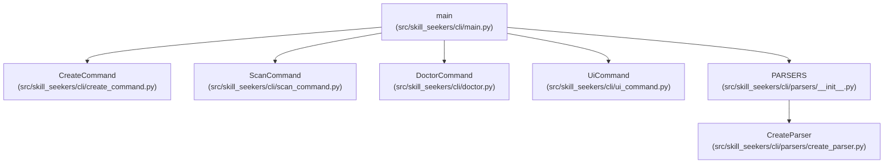
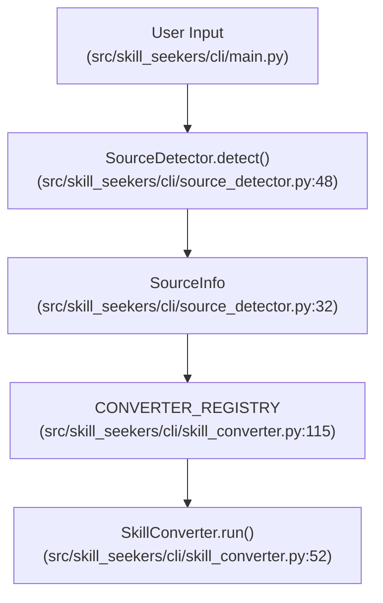

<!-- source: DeepWiki mcp.deepwiki.com · repo yusufkaraaslan/Skill_Seekers · page 3 Unified CLI Commands · fetched 2026-10-26 -->

# Unified CLI Commands

Relevant source files

The following files were used as context for generating this wiki page:

- [src/skill_seekers/cli/main.py](src/skill_seekers/cli/main.py)
- [src/skill_seekers/cli/parsers/__init__.py](src/skill_seekers/cli/parsers/__init__.py)
- [src/skill_seekers/cli/parsers/base.py](src/skill_seekers/cli/parsers/base.py)
- [src/skill_seekers/cli/parsers/config_parser.py](src/skill_seekers/cli/parsers/config_parser.py)
- [src/skill_seekers/cli/parsers/create_parser.py](src/skill_seekers/cli/parsers/create_parser.py)
- [src/skill_seekers/cli/parsers/enhance_status_parser.py](src/skill_seekers/cli/parsers/enhance_status_parser.py)
- [src/skill_seekers/cli/parsers/estimate_parser.py](src/skill_seekers/cli/parsers/estimate_parser.py)
- [src/skill_seekers/cli/parsers/install_parser.py](src/skill_seekers/cli/parsers/install_parser.py)
- [src/skill_seekers/cli/parsers/multilang_parser.py](src/skill_seekers/cli/parsers/multilang_parser.py)
- [src/skill_seekers/cli/skill_converter.py](src/skill_seekers/cli/skill_converter.py)
- [src/skill_seekers/cli/source_detector.py](src/skill_seekers/cli/source_detector.py)
- [tests/test_cli_parsers.py](tests/test_cli_parsers.py)
- [tests/test_new_source_types.py](tests/test_new_source_types.py)

This page documents the `skill-seekers` unified command-line interface. The CLI follows a git-style dispatcher pattern where a single `skill-seekers` entry point routes to individual command modules via the `COMMAND_CLASSES` and `COMMAND_MODULES` dispatch tables in [src/skill_seekers/cli/main.py:42-87](). The dispatcher supports direct class-based execution for core commands (`CreateCommand`, `ScanCommand`, `DoctorCommand`, `DetectCommand`, `UiCommand`) and module-based dispatch for the remaining subcommands [src/skill_seekers/cli/main.py:50-87]().

For detailed documentation of specific command options and flags, see the child pages:
- [Scraping Commands](#3.1) — Document create/scrape/github/pdf/analyze commands, their arguments, source auto-detection, and common flags (`--preset`, `--enhance-level`, `--dry-run`).
- [Enhancement Commands](#3.2) — Document `skill-seekers enhance` and workflow commands: target/agent flags, API vs local mode, background/daemon modes.
- [Distribution Commands](#3.3) — Document `package`, `upload`, `install`, `install-agent`: target platform selection, zip packaging, agent directory installation.
- [Workflow Commands](#3.4) — Document the `workflows` subcommand for managing enhancement workflow presets: list, view, create, delete.
- [Scan Command — AI Project Knowledge Base](#3.5) — Document `skill-seekers scan`: signal collection, AI framework detection, config resolution/generation, codebase config emission, stale config archiving, optional registry publishing, and all flags.
- [Diagnostics & Setup Commands](#3.6) — Document `skill-seekers doctor` (`run_all_checks`, environment diagnostics), `detect` (`SourceDetector` preview), setup wizard, and `ui` command for launching the Seeker HUD.

Sources: [src/skill_seekers/cli/main.py:42-87]()

---

## Overview

The unified CLI provides a single `skill-seekers` command with multiple subcommands registered through a modular parser registry [src/skill_seekers/cli/parsers/__init__.py:34-56](). This design ensures a consistent interface across all 18+ supported source types and export targets.

**Key Benefits:**
- **Single Entry Point**: All functionality accessed through `skill-seekers` [src/skill_seekers/cli/main.py:1-34]().
- **Agent-Agnostic**: All enhancement calls use the `AgentClient` transport, supporting Anthropic, Google, OpenAI, Moonshot, and more.
- **Modern Packaging**: Distributed via PyPI with `src/` layout and `pyproject.toml` entry points.
- **Direct Dispatch**: Class-based commands consume parsed argument namespaces directly without `sys.argv` round-tripping [src/skill_seekers/cli/main.py:42-56]().

Sources: [src/skill_seekers/cli/main.py:1-87](), [src/skill_seekers/cli/parsers/__init__.py:34-56]()

---

## Command Categories & Dispatch Architecture

The CLI organizes commands into functional categories. The dispatcher uses a hybrid model of class-based execution for new commands and module-based dispatch for standard workflows [src/skill_seekers/cli/main.py:50-87]().

Sources: [src/skill_seekers/cli/main.py:50-87](), [src/skill_seekers/cli/parsers/__init__.py:34-56]()

**Command Categories:**

| Category | Commands | Purpose |
|----------|----------|---------|
| **Knowledge Discovery** | `scan` | AI-driven discovery of tech stacks; emits per-framework configs. For details, see [Scan Command — AI Project Knowledge Base](#3.5). |
| **Primary Creation** | `create`, `detect` | Auto-detect source type (URL, repo, path) and route to appropriate converter or preview source classification [src/skill_seekers/cli/main.py:11-12](), [src/skill_seekers/cli/source_detector.py:48-69](). |
| **Diagnostics & UI** | `doctor`, `ui` | Health check for dependencies/environment and launching the Seeker HUD web UI [src/skill_seekers/cli/main.py:23-24](), [src/skill_seekers/cli/main.py:54-55](). |
| **Enhancement** | `enhance`, `enhance-status`, `workflows` | AI-powered improvement of `SKILL.md` using `AgentClient`. For details, see [Enhancement Commands](#3.2) and [Workflow Commands](#3.4). |
| **Distribution** | `package`, `upload`, `install`, `install-agent` | Prepare skills for platforms and install to coding agent directories [src/skill_seekers/cli/main.py:15-18](). For details, see [Distribution Commands](#3.3). |
| **Utilities** | `estimate`, `extract-test-examples`, `resume`, `quality`, `config`, `sync-config`, `stream`, `update`, `multilang` | Page count estimation, job resumption, quality grading, and credential management [src/skill_seekers/cli/main.py:19-25](). |

Sources: [src/skill_seekers/cli/main.py:10-34](), [src/skill_seekers/cli/parsers/__init__.py:34-56]()

---

## `create` Command and Source Auto-Detection

The `create` command is the primary entry point for skill generation. It utilizes `SourceDetector` to inspect user input and route it to the correct `SkillConverter` implementation via `CONVERTER_REGISTRY` [src/skill_seekers/cli/source_detector.py:48-69](), [src/skill_seekers/cli/skill_converter.py:115-138]().

Sources: [src/skill_seekers/cli/source_detector.py:48-69](), [src/skill_seekers/cli/skill_converter.py:52-138]()

For comprehensive details on individual scraping handlers, formats, and auto-detection heuristics, see [Scraping Commands](#3.1).

### Progressive Help Disclosure

To manage the extensive flag set (over 120 flags across all source types), the `create` parser implements a progressive disclosure help system [src/skill_seekers/cli/parsers/create_parser.py:1-123]().

- `skill-seekers create --help`: Shows universal arguments and core options.
- `skill-seekers create --help-web`: Displays web-scraping specific options.
- `skill-seekers create --help-github`: Displays GitHub API and repository analysis options.
- `skill-seekers create --help-local`: Displays local codebase options.
- `skill-seekers create --help-all`: Outputs every available flag.

Sources: [src/skill_seekers/cli/parsers/create_parser.py:1-123](), [src/skill_seekers/cli/main.py:160-178]()

---

## Related Documentation

- **[Scraping Commands](#3.1)**: Detailed guide for web, GitHub, and 18+ source types.
- **[Enhancement Commands](#3.2)**: Documentation for enhancement modes and `AgentClient`.
- **[Distribution Commands](#3.3)**: Reference for packaging, uploading, and agent installation.
- **[Workflow Commands](#3.4)**: Management of enhancement workflow presets.
- **[Scan Command — AI Project Knowledge Base](#3.5)**: Guide to AI-driven tech stack discovery.
- **[Diagnostics & Setup Commands](#3.6)**: Doctor checks, detection previews, and Seeker HUD web UI.

---

