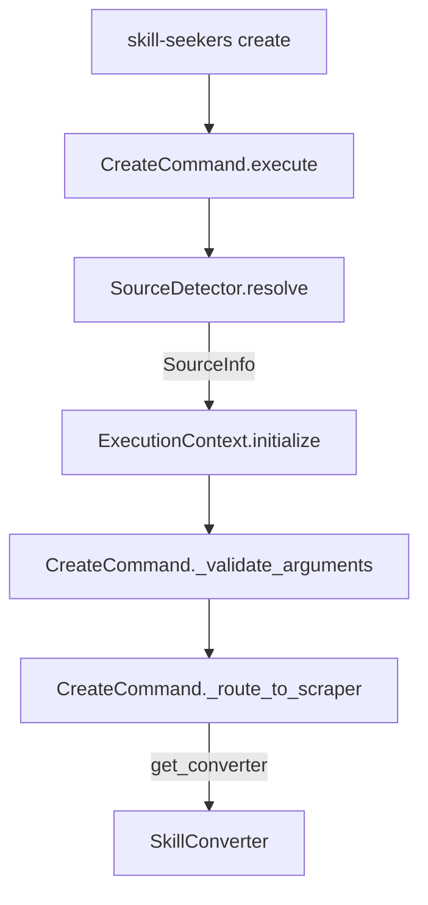
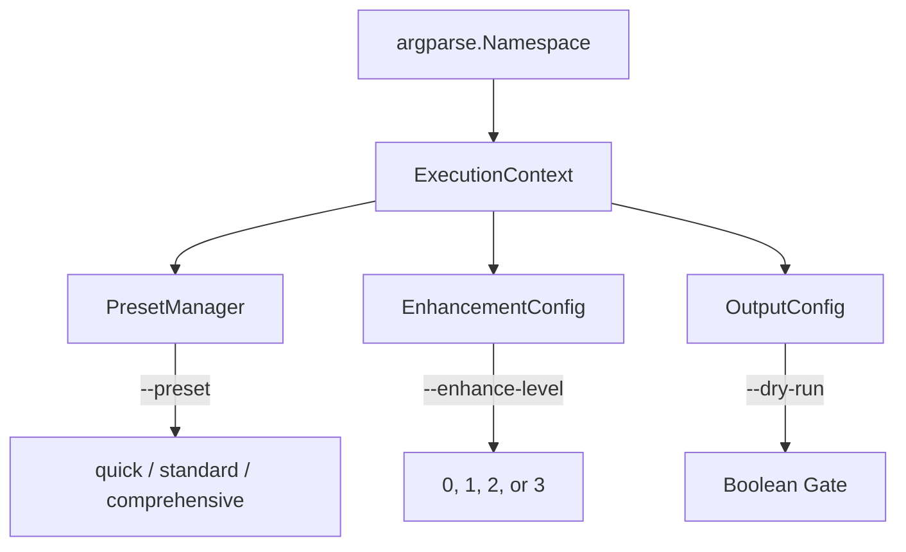

<!-- source: DeepWiki mcp.deepwiki.com · repo yusufkaraaslan/Skill_Seekers · page 3.1 Scraping Commands · fetched 2026-10-26 -->

# Scraping Commands

Relevant source files

The following files were used as context for generating this wiki page:

- [docs/features/SKILL_SEARCH_INDEX.md](docs/features/SKILL_SEARCH_INDEX.md)
- [src/skill_seekers/cli/arguments/analyze.py](src/skill_seekers/cli/arguments/analyze.py)
- [src/skill_seekers/cli/arguments/common.py](src/skill_seekers/cli/arguments/common.py)
- [src/skill_seekers/cli/arguments/create.py](src/skill_seekers/cli/arguments/create.py)
- [src/skill_seekers/cli/arguments/github.py](src/skill_seekers/cli/arguments/github.py)
- [src/skill_seekers/cli/arguments/pdf.py](src/skill_seekers/cli/arguments/pdf.py)
- [src/skill_seekers/cli/arguments/scrape.py](src/skill_seekers/cli/arguments/scrape.py)
- [src/skill_seekers/cli/arguments/unified.py](src/skill_seekers/cli/arguments/unified.py)
- [src/skill_seekers/cli/create_command.py](src/skill_seekers/cli/create_command.py)
- [src/skill_seekers/cli/skill_indexer.py](src/skill_seekers/cli/skill_indexer.py)
- [tests/test_create_arguments.py](tests/test_create_arguments.py)
- [tests/test_create_integration_basic.py](tests/test_create_integration_basic.py)

## Purpose and Scope
This page documents the scraping command suite in the Skill Seekers CLI, focusing on the unified `create` dispatcher [src/skill_seekers/cli/create_command.py:29-30](), specialized commands (`scrape`, `github`, `pdf`, `analyze`), input source auto-detection [src/skill_seekers/cli/source_detector.py:39-40](), the three-tier argument system [src/skill_seekers/cli/arguments/create.py:1-10](), and core execution flags like `--preset`, `--enhance-level`, and `--dry-run`.

Sources: [src/skill_seekers/cli/create_command.py:29-30](), [src/skill_seekers/cli/arguments/create.py:1-10](), [src/skill_seekers/cli/source_detector.py:39-40]()

---

## 1. Unified Dispatch & Source Auto-Detection

The command-line interface uses a centralized dispatcher centered around the `CreateCommand` class [src/skill_seekers/cli/create_command.py:29-30](). When a user invokes `skill-seekers create <source>`, the CLI delegates input resolution to `SourceDetector.resolve()` [src/skill_seekers/cli/create_command.py:58-60]() to inspect the target string (URL, GitHub repository slug, local directory path, file path, or JSON configuration file) and assign a recognized source type.

Once the `SourceInfo` object is resolved [src/skill_seekers/cli/create_command.py:42-45](), the execution pipeline initializes the singleton `ExecutionContext` [src/skill_seekers/cli/execution_context.py:1-20](), validates user flags against source compatibility rules [src/skill_seekers/cli/create_command.py:116-120](), and dispatches the execution to the corresponding converter instance via `get_converter()` [src/skill_seekers/cli/skill_converter.py:1-20]().

**Diagram: Natural Language Space to Code Entity Space (`CreateCommand` Dispatch)**

Sources: [src/skill_seekers/cli/create_command.py:47-91](), [src/skill_seekers/cli/skill_converter.py:1-20]()

---

## 2. Specialized Scraping Commands

While `create` provides automatic resolution, individual scraper commands can be called directly or via their explicit subcommands. Each command manages distinct ingestion engines and argument mappings.

### 2.1 `create` (Universal Auto-Detection)
* **Class**: `CreateCommand` [src/skill_seekers/cli/create_command.py:29-30]()
* **Description**: Acts as the single entry point for skill creation. It reads positional arguments or `--html-path` overrides [src/skill_seekers/cli/create_command.py:143-162](), performs automatic type detection, initializes state, and routes execution through the enhancement and indexing phases.

Sources: [src/skill_seekers/cli/create_command.py:29-114]()

### 2.2 `scrape` (Web Documentation)
* **Converter**: `DocToSkillConverter` [tests/test_create_integration_basic.py:110-118]()
* **Arguments**: Defined in `SCRAPE_ARGUMENTS` [src/skill_seekers/cli/arguments/scrape.py:23-148]()
* **Description**: Crawl documentation websites using Breadth-First Search (BFS) traversal. Supports optional headless browser rendering via Playwright (`--browser`) [src/skill_seekers/cli/arguments/scrape.py:118-124](), parallel workers (`--workers`) [src/skill_seekers/cli/arguments/scrape.py:95-101](), asynchronous processing (`--async`) [src/skill_seekers/cli/arguments/scrape.py:103-110](), and checkpoint resumption (`--resume`) [src/skill_seekers/cli/arguments/scrape.py:73-79]().

Sources: [src/skill_seekers/cli/arguments/scrape.py:23-148](), [tests/test_create_integration_basic.py:110-118]()

### 2.3 `github` (Repository Analysis)
* **Converter**: `GitHubScraper` [tests/test_create_integration_basic.py:121-128]()
* **Arguments**: Defined in `GITHUB_ARGUMENTS` [src/skill_seekers/cli/arguments/github.py:22-154]()
* **Description**: Extracts codebase overviews, READMEs, issues, pull requests, releases, and changelogs using PyGithub or a local repository clone. Supports rate-limit handling, token authentication (`--token`) [src/skill_seekers/cli/arguments/github.py:40-47](), and issue filtering by date (`--since`) [src/skill_seekers/cli/arguments/github.py:79-87]() or label (`--issue-labels`) [src/skill_seekers/cli/arguments/github.py:88-96]().

Sources: [src/skill_seekers/cli/arguments/github.py:22-154](), [tests/test_create_integration_basic.py:121-128]()

### 2.4 `pdf` (Document Extraction)
* **Converter**: `PDFToSkillConverter` [tests/test_create_integration_basic.py:131-138]()
* **Arguments**: Defined in `PDF_ARGUMENTS` [src/skill_seekers/cli/arguments/pdf.py:20-45]()
* **Description**: Extracts structured text, tables, and embedded code blocks from PDF files. Automatically adjusts default enhancement levels to `0` unless overridden [src/skill_seekers/cli/arguments/pdf.py:60-63]().

Sources: [src/skill_seekers/cli/arguments/pdf.py:20-45](), [tests/test_create_integration_basic.py:131-138]()

### 2.5 `analyze` (Local Codebase C3.x Pipeline)
* **Scraper**: `CodebaseScraper` [src/skill_seekers/cli/arguments/analyze.py:1-20]()
* **Arguments**: Defined in `ANALYZE_ARGUMENTS` [src/skill_seekers/cli/arguments/analyze.py:23-150]()
* **Description**: Scans a local directory (`--directory`) [src/skill_seekers/cli/arguments/analyze.py:25-33]() to execute the C3.x analysis suite (design patterns, test examples, how-to guides, architecture blueprints, and dependency graphs). Overrides output directories to `output/codebase/` by default [src/skill_seekers/cli/arguments/analyze.py:172-173]().

Sources: [src/skill_seekers/cli/arguments/analyze.py:23-150]()

---

## 3. Argument System & Common Flags

Skill Seekers implements a strict three-tier argument architecture (`UNIVERSAL_ARGUMENTS`, source-specific arguments, and `ADVANCED_ARGUMENTS`) to ensure command consistency [src/skill_seekers/cli/arguments/create.py:1-10](). Universal flags can be attached to any scrape or create invocation.

**Diagram: Argument Tier Resolution & ExecutionContext Flow**

Sources: [src/skill_seekers/cli/arguments/create.py:1-10](), [src/skill_seekers/cli/execution_context.py:1-20]()

### 3.1 `--preset` (`-p`)
* **Type**: `str` (`choices=["quick", "standard", "comprehensive"]`) [src/skill_seekers/cli/arguments/create.py:107-113]()
* **Role**: Configures the analysis depth and execution timeout profile:
  * `quick`: Fast execution (1–2 minutes), surface-level parsing.
  * `standard`: Balanced coverage (5–10 minutes).
  * `comprehensive`: Deep inspection (20–60 minutes), including full dependency and design pattern extraction.

Sources: [src/skill_seekers/cli/arguments/create.py:107-113]()

### 3.2 `--enhance-level`
* **Type**: `int` (`choices=[0, 1, 2, 3]`) [src/skill_seekers/cli/arguments/create.py:58-62]()
* **Role**: Controls the AI enhancement pipeline intensity:
  * `0`: Disabled (no AI processing).
  * `1`: `SKILL.md` synthesis only.
  * `2`: `SKILL.md` plus architecture and config summaries (default).
  * `3`: Full multi-stage deep enhancement.
* **Mode Selection**: Automatically selects API mode if an API key environment variable (`ANTHROPIC_API_KEY`, `OPENAI_API_KEY`, etc.) or `--api-key` is supplied; otherwise, it defaults to LOCAL mode interacting with an AI coding agent [src/skill_seekers/cli/arguments/create.py:65-70]().

Sources: [src/skill_seekers/cli/arguments/create.py:58-70]()

### 3.3 `--dry-run`
* **Type**: `action="store_true"` [src/skill_seekers/cli/arguments/create.py:82-87]()
* **Role**: Gates execution steps 6 and 7 in `CreateCommand.execute()` [src/skill_seekers/cli/create_command.py:100-102](). When active, the dispatcher validates inputs, runs source detection, and displays planned actions without executing network requests, file writes, or AI enhancement workflows.

Sources: [src/skill_seekers/cli/create_command.py:96-102](), [src/skill_seekers/cli/arguments/create.py:82-87]()

---

