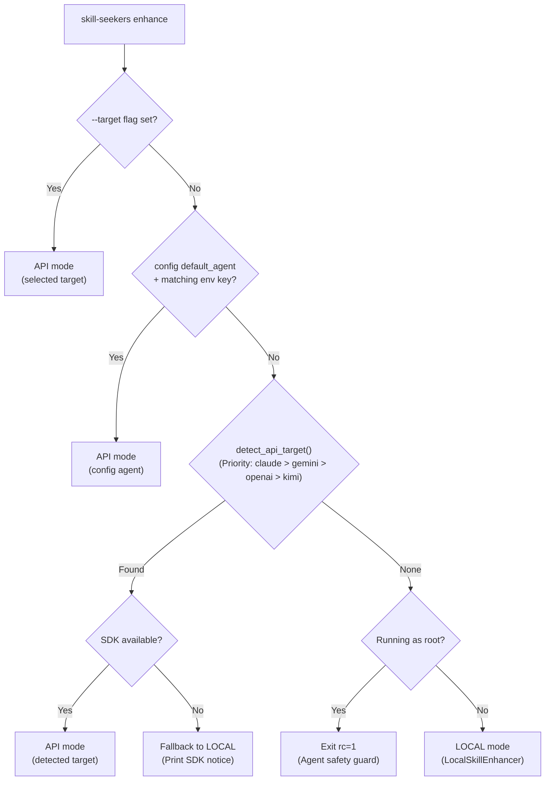
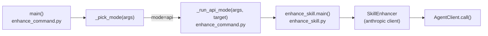
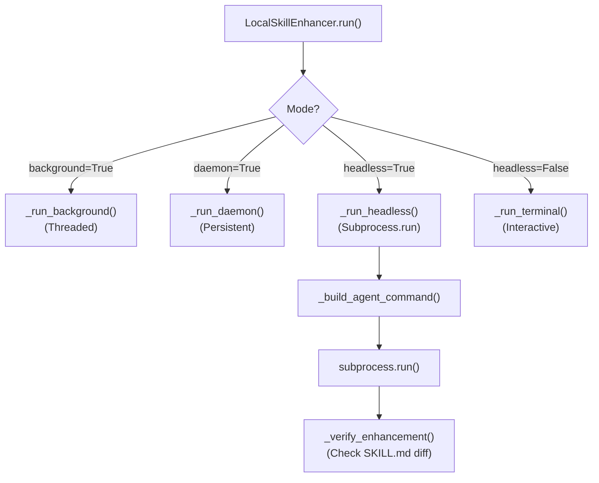

<!-- source: DeepWiki mcp.deepwiki.com · repo yusufkaraaslan/Skill_Seekers · page 3.2 Enhancement Commands · fetched 2026-10-26 -->

# Enhancement Commands

<details>
<summary>Relevant source files</summary>

The following files were used as context for generating this wiki page:

- [src/skill_seekers/cli/adaptors/claude.py](src/skill_seekers/cli/adaptors/claude.py)
- [src/skill_seekers/cli/adaptors/gemini.py](src/skill_seekers/cli/adaptors/gemini.py)
- [src/skill_seekers/cli/adaptors/openai.py](src/skill_seekers/cli/adaptors/openai.py)
- [src/skill_seekers/cli/enhance_command.py](src/skill_seekers/cli/enhance_command.py)
- [src/skill_seekers/cli/enhance_skill_local.py](src/skill_seekers/cli/enhance_skill_local.py)
- [src/skill_seekers/cli/parsers/analyze_parser.py](src/skill_seekers/cli/parsers/analyze_parser.py)
- [src/skill_seekers/cli/parsers/enhance_parser.py](src/skill_seekers/cli/parsers/enhance_parser.py)
- [src/skill_seekers/cli/parsers/github_parser.py](src/skill_seekers/cli/parsers/github_parser.py)
- [src/skill_seekers/cli/parsers/package_parser.py](src/skill_seekers/cli/parsers/package_parser.py)
- [src/skill_seekers/cli/parsers/pdf_parser.py](src/skill_seekers/cli/parsers/pdf_parser.py)
- [src/skill_seekers/cli/parsers/scrape_parser.py](src/skill_seekers/cli/parsers/scrape_parser.py)
- [src/skill_seekers/cli/parsers/unified_parser.py](src/skill_seekers/cli/parsers/unified_parser.py)
- [src/skill_seekers/cli/parsers/upload_parser.py](src/skill_seekers/cli/parsers/upload_parser.py)
- [src/skill_seekers/cli/upload_skill.py](src/skill_seekers/cli/upload_skill.py)
- [tests/test_adaptors/test_openai_adaptor.py](tests/test_adaptors/test_openai_adaptor.py)
- [tests/test_enhance_command.py](tests/test_enhance_command.py)
- [tests/test_enhance_skill_local.py](tests/test_enhance_skill_local.py)
- [tests/test_install_skill.py](tests/test_install_skill.py)
- [tests/test_install_skill_e2e.py](tests/test_install_skill_e2e.py)
- [tests/test_mcp_workflow_tools.py](tests/test_mcp_workflow_tools.py)
- [tests/test_pdf_scraper.py](tests/test_pdf_scraper.py)

</details>


This page documents the `skill-seekers enhance` command: its mode-selection logic, the `--target` and `--agent` flags, background execution modes, root-user guard, and the status-monitoring mechanism. For how enhancement fits into the broader five-phase workflow, see [Understanding the Five-Phase Workflow](#2.3). For the AI enhancement internals (API backends, workflow presets, and the `WorkflowEngine`), see [AI Enhancement System](#8) and [Enhancement Workflows & Presets](#8.3).

Sources: [src/skill_seekers/cli/enhance_command.py:3-12](), [src/skill_seekers/cli/enhance_command.py:29-33](), [src/skill_seekers/cli/enhance_skill_local.py:1-5]()

---

## Overview

`skill-seekers enhance <skill_directory>` is a smart dispatcher that routes enhancement to one of two backends:

- **API mode** — calls the platform-adaptor path (`enhance_skill.py`) using Claude, Gemini, or OpenAI API keys.
- **LOCAL mode** — calls `LocalSkillEnhancer` from `src/skill_seekers/cli/enhance_skill_local.py`, which drives a locally installed coding agent CLI (Claude Code, Kimi, Codex, Copilot CLI, or OpenCode CLI).

The dispatch logic lives in `src/skill_seekers/cli/enhance_command.py`. The CLI argument schema is defined once in `src/skill_seekers/cli/arguments/enhance.py` and shared between the dispatcher, the standalone module, and the unified CLI parser.

Sources: [src/skill_seekers/cli/enhance_command.py:3-12](), [src/skill_seekers/cli/enhance_command.py:29-33](), [src/skill_seekers/cli/enhance_skill_local.py:1-5]()

---

## Command Syntax

```bash
skill-seekers enhance <skill_directory> [OPTIONS]
```

### All flags

| Flag | Type | Applies to | Default | Description |
|------|------|-----------|---------|-------------|
| `skill_directory` | positional | both | — | Path to the skill directory |
| `--target` | choice | API mode | `None` | Force API mode: `claude`, `gemini`, `openai`, or `kimi` |
| `--model` | string | API mode | `None` | Override the default enhancement model |
| `--api-key KEY` | string | API mode | env var | Override the API key |
| `--dry-run` | flag | both | `False` | Preview without calling AI |
| `--agent AGENT` | choice | LOCAL mode | `claude` | Local agent: `claude`, `codex`, `copilot`, `opencode`, `kimi`, `custom` |
| `--agent-cmd CMD` | string | LOCAL mode | `None` | Custom command template; `{prompt_file}` placeholder or stdin |
| `--interactive-enhancement` | flag | LOCAL mode | `False` | Open a new terminal window instead of headless mode |
| `--background` | flag | LOCAL mode | `False` | Run in background thread; return immediately |
| `--daemon` | flag | LOCAL mode | `False` | Run as persistent daemon process |
| `--no-force` | flag | LOCAL mode | `False` | Disable force mode (enable confirmations) |
| `--timeout SECONDS` | int | LOCAL mode | `None` | Timeout in seconds (default: 45 minutes) |

Sources: [src/skill_seekers/cli/enhance_command.py:1-191]()

---

## Mode Selection Priority Chain

The `_pick_mode(args)` function in `src/skill_seekers/cli/enhance_command.py` decides API vs. LOCAL mode using a priority chain. It checks for explicit flags, configuration preferences, and then environment variables.

**Mode selection diagram:**



Sources: [src/skill_seekers/cli/enhance_command.py:92-132](), [src/skill_seekers/cli/enhance_command.py:41-46](), [src/skill_seekers/cli/agent_client.py:29-33]()

### Step-by-step rules

1. **Explicit `--target`** — Always routes to API mode with the specified platform [src/skill_seekers/cli/enhance_command.py:102-105]().
2. **Config `default_agent`** — Reads `ai_enhancement.default_agent` from the config manager. Used if the corresponding API key is available [src/skill_seekers/cli/enhance_command.py:107-112]().
3. **Auto-detection** — Uses `detect_api_target()` to check for `ANTHROPIC_API_KEY`, `GOOGLE_API_KEY`, `OPENAI_API_KEY`, or `MOONSHOT_API_KEY` [src/skill_seekers/cli/enhance_command.py:119-121]().
4. **SDK Verification** — If a target is detected but its Python SDK (e.g., `google.generativeai` for gemini) is missing, it falls back to LOCAL mode [src/skill_seekers/cli/enhance_command.py:122-129]().
5. **Root Guard** — If falling back to LOCAL mode while running as root, the command fails as local agents (like Claude Code) refuse root execution [src/skill_seekers/cli/enhance_command.py:21-22](), [src/skill_seekers/cli/enhance_command.py:41-46]().

Sources: [src/skill_seekers/cli/enhance_command.py:41-132]()

---

## API Mode

When resolved to `api`, `_run_api_mode` reconstructs `sys.argv` and delegates to `enhance_skill.main()`. This path uses platform-specific adaptors to format prompts and handle the API transport.

**Code path for API mode:**



Sources: [src/skill_seekers/cli/enhance_command.py:140-174](), [src/skill_seekers/cli/enhance_skill.py:29-51]()

### Enhancement Prompt Logic
The `SkillEnhancer` builds a comprehensive prompt that includes:
- Current `SKILL.md` content [src/skill_seekers/cli/enhance_skill.py:114-117]().
- Reference file breakdown by source type (GitHub, Documentation, PDF, etc.) [src/skill_seekers/cli/enhance_skill.py:136-146]().
- Reference content (truncated to limit size per file) [src/skill_seekers/cli/enhance_skill.py:156-160]().
- Priority rules (Codebase Analysis > Official Docs > Community) [src/skill_seekers/cli/enhance_skill.py:173-175]().

Sources: [src/skill_seekers/cli/enhance_skill.py:114-175]()

---

## LOCAL Mode

`LocalSkillEnhancer` manages the invocation of local coding agent CLIs. It handles prompt generation, terminal detection, and background process management.

### Agent Configuration

Agents are defined in `AGENT_PRESETS` (imported from `agent_client.py`) [src/skill_seekers/cli/enhance_skill_local.py:64]().

| Agent | Command Template | Supports Skip Perms? |
|-------|------------------|----------------------|
| `claude` | `claude {prompt_file}` | Yes (`--dangerously-skip-permissions`) |
| `kimi` | `kimi --work-dir {skill_dir}` | No |
| `codex` | `codex exec --full-auto -` | No |

Sources: [src/skill_seekers/cli/enhance_skill_local.py:64](), [tests/test_enhance_skill_local.py:38-64]()

### Terminal Selection
For interactive mode (`--interactive-enhancement`), the system detects the terminal app to use:
1. `SKILL_SEEKER_TERMINAL` env var [src/skill_seekers/cli/enhance_skill_local.py:101-103]().
2. `TERM_PROGRAM` env var (mapped to app names like "Ghostty", "iTerm", "WezTerm") [src/skill_seekers/cli/enhance_skill_local.py:105-108]().
3. Fallback to `Terminal.app` [src/skill_seekers/cli/enhance_skill_local.py:110-116]().

Sources: [src/skill_seekers/cli/enhance_skill_local.py:70-117]()

---

## Execution Workflow

`LocalSkillEnhancer.run()` dispatches to the appropriate execution method.

**Execution flow diagram:**



Sources: [src/skill_seekers/cli/enhance_skill_local.py:198-204](), [src/skill_seekers/cli/enhance_command.py:181-205]()

### Status Monitoring
`LocalSkillEnhancer` tracks progress via a hidden JSON file: `<skill_dir>/.enhancement_status.json` [src/skill_seekers/cli/enhance_skill_local.py:133]().
- `_update_status(status, message, progress)` writes state to disk [src/skill_seekers/cli/enhance_skill_local.py:600-632]().
- This allows background and daemon modes to report progress back to the user or other tools.

Sources: [src/skill_seekers/cli/enhance_skill_local.py:133](), [src/skill_seekers/cli/enhance_skill_local.py:600-632]()

---

## Usage Examples

### Standard API Enhancement
```bash
# Uses detected API key (Anthropic, Gemini, or OpenAI)
skill-seekers enhance output/my-skill/
```

### Local Enhancement with Claude Code
```bash
# Force local mode even if API keys exist
skill-seekers enhance output/my-skill/ --agent claude
```

### Background Daemon Mode
```bash
# Start enhancement in background and return immediately
skill-seekers enhance output/my-skill/ --daemon
```

### Custom Agent Command
```bash
# Use a custom agent with a specific prompt flag
skill-seekers enhance output/my-skill/ --agent custom --agent-cmd "my-ai-cli --file {prompt_file}"
```

Sources: [src/skill_seekers/cli/enhance_skill_local.py:7-29](), [src/skill_seekers/cli/arguments/enhance.py:11-126]()

---

