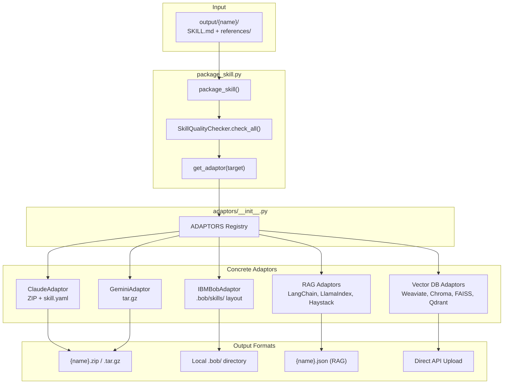
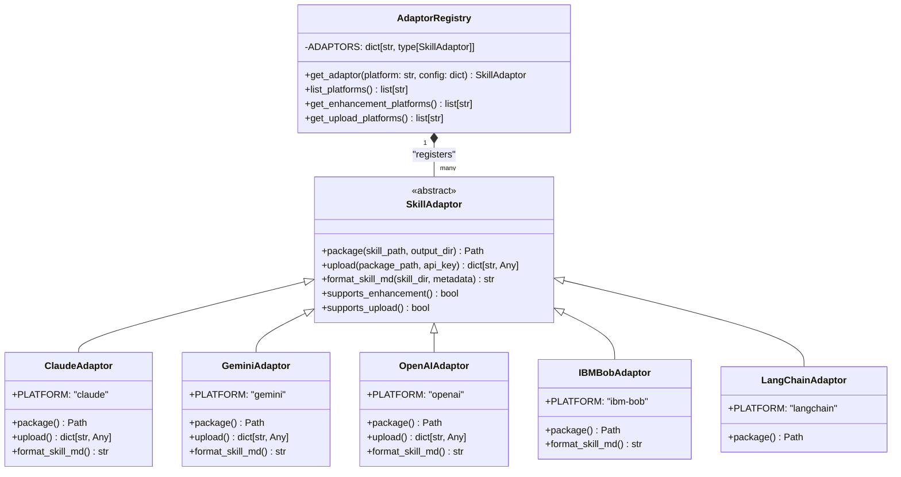

<!-- source: DeepWiki mcp.deepwiki.com · repo yusufkaraaslan/Skill_Seekers · page 3.3 Distribution Commands · fetched 2026-10-26 -->

# Distribution Commands

<details>
<summary>Relevant source files</summary>

The following files were used as context for generating this wiki page:

- [src/skill_seekers/cli/adaptors/__init__.py](src/skill_seekers/cli/adaptors/__init__.py)
- [src/skill_seekers/cli/adaptors/ibm_bob.py](src/skill_seekers/cli/adaptors/ibm_bob.py)
- [src/skill_seekers/cli/install_agent.py](src/skill_seekers/cli/install_agent.py)
- [src/skill_seekers/cli/install_skill.py](src/skill_seekers/cli/install_skill.py)
- [src/skill_seekers/cli/package_skill.py](src/skill_seekers/cli/package_skill.py)
- [src/skill_seekers/cli/parsers/install_agent_parser.py](src/skill_seekers/cli/parsers/install_agent_parser.py)
- [tests/test_adaptors/test_base.py](tests/test_adaptors/test_base.py)
- [tests/test_adaptors/test_ibm_bob_adaptor.py](tests/test_adaptors/test_ibm_bob_adaptor.py)

</details>


## Purpose and Scope

This document covers the distribution commands in the Skill Seekers unified CLI [src/skill_seekers/cli/main.py:62-84](), which handle packaging, uploading, and installing skills to various platforms and AI agents. These commands transform generated skill directories into deployable artifacts across **18+ target platforms and RAG pipelines** [src/skill_seekers/cli/adaptors/__init__.py:126-173]().

For information about creating skills, see [Scraping Commands](3.1). For information about improving skill quality, see [Enhancement Commands](3.2). For automated end-to-end workflows, see [Workflow Commands](3.4).

Sources: [src/skill_seekers/cli/main.py:62-84](), [src/skill_seekers/cli/adaptors/__init__.py:126-173]()

## Command Overview

Distribution commands transform a skill directory (`output/{name}/`) into platform-specific distributable formats:

| Command | Purpose | Platform Support | CLI Entry Point |
|---------|---------|------------------|----------------|
| `package` | Create platform-specific package | 18+ platforms (Claude, Gemini, OpenAI, LangChain, IBM Bob, etc.) | [src/skill_seekers/cli/package_skill.py:56-71]() |
| `upload` | Upload to platform API | Claude, Gemini, OpenAI, Weaviate, Chroma | [src/skill_seekers/cli/install_skill.py:32-35]() |
| `install` | End-to-end automated installation | Fetch → Scrape → Enhance → Package → Upload | [src/skill_seekers/cli/install_skill.py:42-113]() |
| `install-agent` | Install to local AI agent directories | 19+ AI coding agents (Cursor, Windsurf, Claude Code, etc.) | [src/skill_seekers/cli/install_agent.py:34-54]() |

All commands are registered as CLI subcommands in the dispatcher modules [src/skill_seekers/cli/main.py:62-84]().

Sources: [src/skill_seekers/cli/main.py:62-84](), [src/skill_seekers/cli/install_agent.py:34-54](), [src/skill_seekers/cli/package_skill.py:56-71](), [src/skill_seekers/cli/install_skill.py:42-113]()

## Distribution Command Flow

Title: Multi-Platform Distribution Architecture



Sources: [src/skill_seekers/cli/package_skill.py:101-126](), [src/skill_seekers/cli/adaptors/__init__.py:126-173](), [src/skill_seekers/cli/adaptors/ibm_bob.py:84-124]()

## Package Command

### Purpose

The `package` command creates platform-specific distributable packages from a skill directory. It supports **18+ target platforms** via the platform adaptor architecture and validates skill quality before packaging [src/skill_seekers/cli/package_skill.py:101-118]().

### Command Syntax

```bash
skill-seekers package <skill_directory> [options]

Options:
  --target PLATFORM         Target platform (default: auto-detected)
  --no-open                Don't open output folder after packaging
  --upload                 Auto-upload to platform after packaging
  --skip-quality-check     Skip quality validation before packaging
  --streaming              Use streaming ingestion for large docs
  --chunk-for-rag          Enable intelligent chunking for RAG platforms
```

Sources: [src/skill_seekers/cli/package_skill.py:56-71]()

### Platform Adaptor Architecture

The system uses the **Strategy Pattern** to handle different platform requirements. All adaptors inherit from the `SkillAdaptor` abstract base class [src/skill_seekers/cli/adaptors/base.py:11-11](). The `get_adaptor` function [src/skill_seekers/cli/adaptors/__init__.py:175-207]() acts as a factory, returning the appropriate adaptor instance based on the specified `platform`. The `ADAPTORS` dictionary [src/skill_seekers/cli/adaptors/__init__.py:126-173]() registers all available adaptors.

Title: Adaptor Registry and Factory



Sources: [src/skill_seekers/cli/adaptors/__init__.py:126-207](), [src/skill_seekers/cli/adaptors/base.py:11-11](), [src/skill_seekers/cli/adaptors/ibm_bob.py:18-27]()

### Packaging Logic

The `package_skill` function [src/skill_seekers/cli/package_skill.py:56-71]() orchestrates the packaging process. It first validates the skill directory using `validate_skill_directory` [src/skill_seekers/cli/package_skill.py:95-95]() and performs quality checks via `SkillQualityChecker` [src/skill_seekers/cli/package_skill.py:106-107](). It then retrieves the appropriate `SkillAdaptor` based on the `--target` argument [src/skill_seekers/cli/package_skill.py:122-123]() and calls the adaptor's `package` method [src/skill_seekers/cli/package_skill.py:172-178]().

For example, `IBMBobAdaptor.package` [src/skill_seekers/cli/adaptors/ibm_bob.py:75-124]() creates a Bob-ready directory structure under `.bob/skills/<normalized-name>/` containing `SKILL.md`, `references/`, `scripts/`, and `assets/`.

Sources: [src/skill_seekers/cli/package_skill.py:56-71](), [src/skill_seekers/cli/package_skill.py:95-123](), [src/skill_seekers/cli/package_skill.py:172-178](), [src/skill_seekers/cli/adaptors/ibm_bob.py:75-124]()

### RAG Platform Auto-Chunking

The packager automatically enables intelligent chunking for RAG platforms to optimize embedding generation [src/skill_seekers/cli/package_skill.py:133-146](). This is controlled by parameters such as `enable_chunking`, `chunk_max_tokens`, `preserve_code_blocks`, and `chunk_overlap_tokens` [src/skill_seekers/cli/package_skill.py:67-71]().

**RAG Platforms List:**
- `langchain`, `llama-index`, `haystack`, `weaviate`, `chroma`, `faiss`, `qdrant`, `pinecone` [src/skill_seekers/cli/package_skill.py:133-142]().

Sources: [src/skill_seekers/cli/package_skill.py:67-71](), [src/skill_seekers/cli/package_skill.py:133-146]()

## Upload Command

### Purpose

The `upload` command uploads a previously packaged skill to a target LLM platform or vector database using the `SkillAdaptor`'s `upload` interface [src/skill_seekers/cli/adaptors/base.py:11-11]().

### Command Syntax

```bash
skill-seekers upload <package_file> [options]

Options:
  --target PLATFORM         Target platform (default: auto-detected)
  --api-key API_KEY         API key (otherwise read from environment)
```

Sources: [src/skill_seekers/cli/adaptors/ibm_bob.py:126-135]()

## Install Command (End-to-End)

The `install` command orchestrates the complete skill creation and deployment workflow by invoking the `install_skill_tool` MCP function [src/skill_seekers/cli/install_skill.py:3-35](). This command requires the `mcp` optional dependency group to be installed [src/skill_seekers/cli/install_skill.py:47-56]().

**Phases of the `install` command:**
1. **Fetch Config:** Detects if the argument is a local path or a remote config name [src/skill_seekers/cli/install_skill.py:71-80]().
2. **Scrape:** Executes the ingestion phase.
3. **AI Enhancement:** Performs AI-powered enhancement.
4. **Package:** Formats the skill for the target platform.
5. **Upload:** Automatically uploads if `auto_upload` is `True` [src/skill_seekers/cli/install_skill.py:87-87]().

Sources: [src/skill_seekers/cli/install_skill.py:3-113]()

## Install-Agent Command

### Purpose

The `install-agent` command installs skills to local AI coding agent directories. This supports **local-first workflows** for tools like Cursor, Windsurf, Claude Code, and IBM Bob [src/skill_seekers/cli/install_agent.py:3-24]().

### Command Syntax

```bash
skill-seekers install-agent <skill_directory> [options]

Options:
  --agent AGENT_NAME        Target AI agent (e.g., 'cursor', 'claude', 'bob', 'all')
  --force                   Overwrite existing installation without asking
  --dry-run                 Preview installation without making changes
```

Sources: [src/skill_seekers/cli/parsers/install_agent_parser.py:6-34]()

### Agent Path Mapping

The command maps agent names to specific filesystem locations, handling both global (home directory) and project-relative paths using the `AGENT_PATHS` dictionary [src/skill_seekers/cli/install_agent.py:34-54](). The `get_agent_path` function [src/skill_seekers/cli/install_agent.py:58-91]() resolves the absolute path for a given agent.

| Agent | Path Type | Default Location |
|-------|-----------|------------------|
| `claude` | Global | `~/.claude/skills/` |
| `cursor` | Project | `.cursor/skills/` |
| `vscode` | Project | `.github/skills/` |
| `copilot` | Project | `.github/skills/` |
| `amp` | Global | `~/.amp/skills/` |
| `goose` | Global | `~/.config/goose/skills/` |
| `opencode` | Global | `~/.opencode/skills/` |
| `letta` | Global | `~/.letta/skills/` |
| `aide` | Global | `~/.aide/skills/` |
| `windsurf` | Global | `~/.windsurf/skills/` |
| `neovate` | Global | `~/.neovate/skills/` |
| `roo` | Project | `.roo/skills/` |
| `cline` | Project | `.cline/skills/` |
| `aider` | Global | `~/.aider/skills/` |
| `bolt` | Project | `.bolt/skills/` |
| `kilo` | Project | `.kilo/skills/` |
| `continue` | Global | `~/.continue/skills/` |
| `kimi-code` | Global | `~/.kimi/skills/` |
| `bob` | Project | `.bob/skills/` |

Sources: [src/skill_seekers/cli/install_agent.py:34-91]()

### Installation Logic and File Filtering

The `install_to_agent` function handles the copying of files while excluding temporary files, backups (`*.backup`), and hidden files [src/skill_seekers/cli/install_agent.py:173-191](). It validates the skill directory using `validate_skill_directory` [src/skill_seekers/cli/install_agent.py:144-169]() and the agent name using `validate_agent_name` [src/skill_seekers/cli/install_agent.py:103-142]().

Sources: [src/skill_seekers/cli/install_agent.py:103-191]()

---

