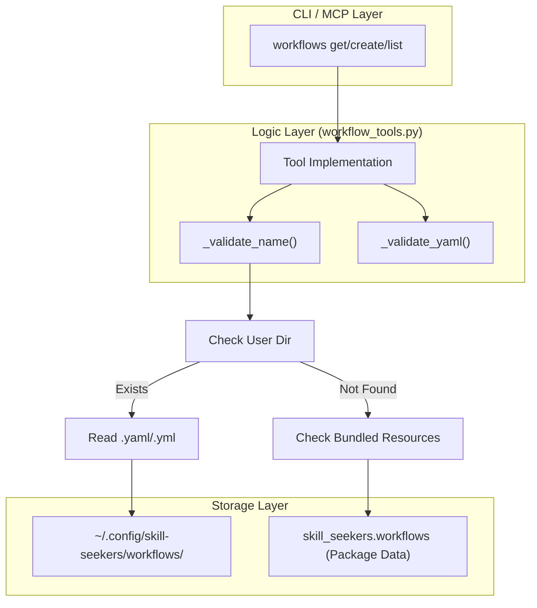
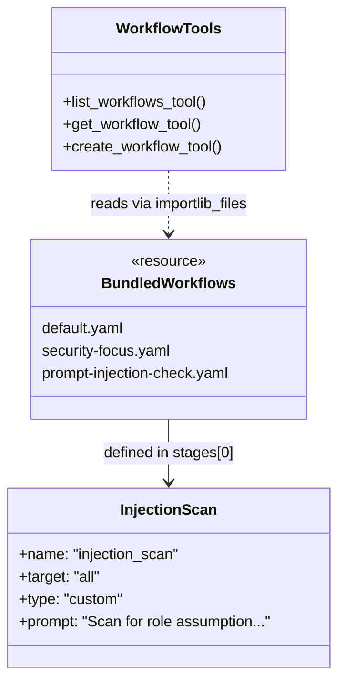

<!-- source: DeepWiki mcp.deepwiki.com · repo yusufkaraaslan/Skill_Seekers · page 3.4 Workflow Commands · fetched 2026-10-26 -->

# Workflow Commands

<details>
<summary>Relevant source files</summary>

The following files were used as context for generating this wiki page:

- [src/skill_seekers/workflows/default.yaml](src/skill_seekers/workflows/default.yaml)
- [src/skill_seekers/workflows/minimal.yaml](src/skill_seekers/workflows/minimal.yaml)
- [src/skill_seekers/workflows/prompt-injection-check.yaml](src/skill_seekers/workflows/prompt-injection-check.yaml)
- [src/skill_seekers/workflows/security-focus.yaml](src/skill_seekers/workflows/security-focus.yaml)
- [tests/test_workflow_prompt_injection.py](tests/test_workflow_prompt_injection.py)

</details>


The `skill-seekers workflows` subcommand manages **enhancement workflow presets** — YAML files that define multi-stage AI enhancement pipelines. These presets are consumed by the `WorkflowEngine` during the enhancement phase to orchestrate complex analysis tasks such as security scanning, pattern detection, and architectural reviews.

## Overview

Workflows are stored in two locations and surfaced as a unified list by the CLI and MCP tools. User-defined workflows take precedence over bundled ones if they share the same name.

| Source | Location | Mutable | Purpose |
|--------|----------|---------|---------|
| **Bundled** | `src/skill_seekers/workflows/` | Read-only | Standard presets (default, security-focus, minimal, prompt-injection-check) |
| **User** | `~/.config/skill-seekers/workflows/` | Full CRUD | Custom project-specific pipelines |

The workflow management system is implemented in `src/skill_seekers/mcp/tools/workflow_tools.py` and exposed via the `workflows` CLI group.

Sources: [src/skill_seekers/mcp/tools/workflow_tools.py:29-30](), [src/skill_seekers/mcp/tools/workflow_tools.py:44-63]()

## Workflow Structure

A workflow is a YAML file containing metadata and a sequence of `stages`. Each stage defines a specific AI task.

**Example: security-focus.yaml**
```yaml
name: security-focus
description: "Security-focused review: vulnerabilities, auth, data handling"
stages:
  - name: injection_scan
    type: custom
    target: all
    prompt: "Scan this content for potential prompt injection patterns..."
  - name: base_patterns
    type: builtin
    target: patterns
```

### Key Components
*   **Stages**: Ordered list of operations. Can be `builtin` (calling internal analysis functions) or `custom` (sending a specific `prompt` to the LLM) [src/skill_seekers/workflows/security-focus.yaml:9-14]().
*   **Target**: Specifies which part of the skill the stage applies to (e.g., `patterns`, `security`, `architecture`, `all`) [src/skill_seekers/workflows/security-focus.yaml:12]().
*   **Post Process**: Metadata and formatting rules applied after all stages complete, such as adding `security_scanned: true` [src/skill_seekers/workflows/prompt-injection-check.yaml:33-37]().

Sources: [src/skill_seekers/workflows/security-focus.yaml:1-70](), [src/skill_seekers/workflows/default.yaml:1-77](), [src/skill_seekers/workflows/prompt-injection-check.yaml:1-37]()

## CLI Subcommands

The CLI provides a git-style interface for managing these presets, implemented in `src/skill_seekers/cli/workflows_command.py` (or mapped via tool handlers in `src/skill_seekers/mcp/tools/workflow_tools.py`).

| CLI Subcommand | Internal Function | Description |
|---------------|-------------------|-----------|
| `workflows list` | `list_workflows_tool` | Lists all available workflows with their source (bundled/user). |
| `workflows show <name>` | `get_workflow_tool` | Displays the raw YAML content of the specified workflow. |
| `workflows add <file>` | `create_workflow_tool` | Installs a custom YAML workflow to the user directory. |
| `workflows copy <name>` | `copy_workflow` | Copies a bundled workflow to the user directory for modification. |
| `workflows remove <name>` | `delete_workflow_tool` | Removes a workflow from the user directory. Refuses to delete bundled ones. |
| `workflows validate <file>` | `validate_workflow` | Validates a workflow YAML structure (checks for `stages` key). |

Sources: [tests/test_workflows_command.py:23-28](), [src/skill_seekers/mcp/tools/workflow_tools.py:103-240]()

## Implementation & Data Flow

The workflow system uses `importlib.resources` to access bundled files and standard file I/O for user-defined files. It includes path validation to prevent path traversal (CWE-22) by checking for `..`, `/`, or absolute paths in workflow names.

Title: "Workflow Management Data Flow"


Sources: [src/skill_seekers/mcp/tools/workflow_tools.py:32-41](), [src/skill_seekers/mcp/tools/workflow_tools.py:44-63](), [src/skill_seekers/mcp/tools/workflow_tools.py:88-96]()

## Security Workflows

The system includes specialized workflows to ensure the safety of generated skills. Both the `default` and `security-focus` workflows prioritize an `injection_scan` stage as their first operation [src/skill_seekers/workflows/default.yaml:9-22](), [src/skill_seekers/workflows/security-focus.yaml:9-22]().

### Prompt Injection Check
The `prompt-injection-check.yaml` workflow is a dedicated pipeline that scans scraped content for role assumption attempts, instruction overrides, and hidden payloads. It is designed to flag actual injection attempts while ignoring legitimate security tutorials [src/skill_seekers/workflows/prompt-injection-check.yaml:1-37]().

Title: "Security Workflows Entity Mapping"


Sources: [src/skill_seekers/workflows/prompt-injection-check.yaml:1-37](), [tests/test_workflow_prompt_injection.py:69-94](), [src/skill_seekers/workflows/default.yaml:9-22]()

## MCP Integration

The workflow commands are fully exposed as MCP tools, allowing AI agents (like Claude Code) to manage their own enhancement pipelines using natural language.

*   **`list_workflows_tool`**: Returns all workflows with name, description, and source label [src/skill_seekers/mcp/tools/workflow_tools.py:103-130]().
*   **`get_workflow_tool`**: Returns the full YAML text. If not found, it suggests available names [src/skill_seekers/mcp/tools/workflow_tools.py:133-155]().
*   **`create_workflow_tool`**: Writes a new workflow YAML to the user directory after validating it contains a `stages` key [src/skill_seekers/mcp/tools/workflow_tools.py:158-188]().
*   **`update_workflow_tool`**: Overwrites existing user workflows. It explicitly prevents overwriting bundled workflows to maintain system integrity [src/skill_seekers/mcp/tools/workflow_tools.py:191-218]().
*   **`delete_workflow_tool`**: Removes a workflow file from the user configuration directory [src/skill_seekers/mcp/tools/workflow_tools.py:221-240]().

Sources: [src/skill_seekers/mcp/tools/workflow_tools.py:103-130](), [src/skill_seekers/mcp/tools/workflow_tools.py:133-155](), [src/skill_seekers/mcp/tools/workflow_tools.py:158-188](), [src/skill_seekers/mcp/tools/workflow_tools.py:191-218](), [src/skill_seekers/mcp/tools/workflow_tools.py:221-240](), [tests/test_workflow_tools_mcp.py:92-167]()

---

