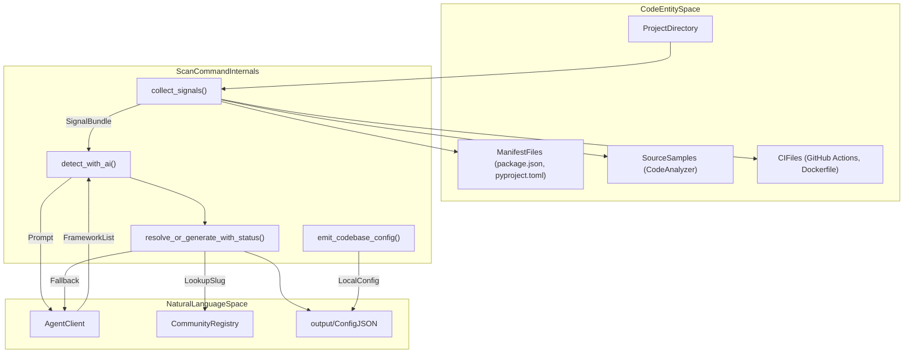
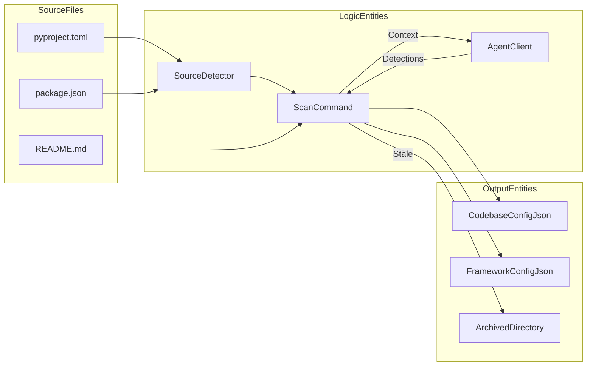

<!-- source: DeepWiki mcp.deepwiki.com · repo yusufkaraaslan/Skill_Seekers · page 3.5 Scan Command — AI Project Knowledge Base · fetched 2026-10-26 -->

# Scan Command — AI Project Knowledge Base

<details>
<summary>Relevant source files</summary>

The following files were used as context for generating this wiki page:

- [src/skill_seekers/cli/architectural_pattern_detector.py](src/skill_seekers/cli/architectural_pattern_detector.py)
- [src/skill_seekers/cli/code_analyzer.py](src/skill_seekers/cli/code_analyzer.py)
- [src/skill_seekers/cli/codebase_scraper.py](src/skill_seekers/cli/codebase_scraper.py)
- [src/skill_seekers/cli/dependency_analyzer.py](src/skill_seekers/cli/dependency_analyzer.py)
- [src/skill_seekers/cli/main.py](src/skill_seekers/cli/main.py)
- [src/skill_seekers/cli/parsers/__init__.py](src/skill_seekers/cli/parsers/__init__.py)
- [src/skill_seekers/cli/signal_flow_analyzer.py](src/skill_seekers/cli/signal_flow_analyzer.py)
- [src/skill_seekers/cli/skill_converter.py](src/skill_seekers/cli/skill_converter.py)
- [src/skill_seekers/cli/source_detector.py](src/skill_seekers/cli/source_detector.py)
- [tests/test_cli_parsers.py](tests/test_cli_parsers.py)
- [tests/test_code_analyzer.py](tests/test_code_analyzer.py)
- [tests/test_codebase_scraper.py](tests/test_codebase_scraper.py)
- [tests/test_dependency_analyzer.py](tests/test_dependency_analyzer.py)
- [tests/test_framework_detection.py](tests/test_framework_detection.py)
- [tests/test_kotlin_support.py](tests/test_kotlin_support.py)
- [tests/test_new_source_types.py](tests/test_new_source_types.py)

</details>


The `scan` command serves as an AI-driven project knowledge-base bootstrapper that automatically discovers a codebase's technology stack and emits per-framework configurations along with a unified codebase configuration `[src/skill_seekers/cli/main.py:53]()`.

## Overview and Purpose

The `scan` command automates the initial "Ingestion" and "Analysis" phases of the skill-seekers pipeline by probing a local directory for technical signatures and framework manifests. Instead of requiring manual JSON configuration writing for every library in a complex project, `scan` combines deterministic manifest collection with LLM-driven detection to output ready-to-use skill configurations `[src/skill_seekers/cli/main.py:53]()`.

### Key Features
*   **Signal Collection**: Gathers manifests, READMEs, CI configurations, and source samples within strict byte budgets `[src/skill_seekers/cli/main.py:53]()`.
*   **AI Framework Detection**: Utilizes an LLM agent to identify frameworks from gathered project signals with structured JSON output `[src/skill_seekers/cli/main.py:53]()`.
*   **Config Resolution Pipeline**: Attempts to resolve detected frameworks against the community registry before triggering AI generation `[src/skill_seekers/cli/main.py:53]()`.
*   **Stale Config Archiving**: Automatically moves outdated configurations to a timestamped `.archived/` directory `[src/skill_seekers/cli/main.py:53]()`.
*   **Community Registry Publishing**: Optional async submission of generated configurations to the remote community repository `[src/skill_seekers/cli/main.py:53]()`.

Sources: `[src/skill_seekers/cli/main.py:53]()`

## Implementation Architecture

The core logic is implemented in the `ScanCommand` class (`src/skill_seekers/cli/scan_command.py`), which is dispatched directly through the `COMMAND_CLASSES` registry inside the unified CLI entry point `[src/skill_seekers/cli/main.py:50-56]()`.

### Data Flow Diagram: From Code to Config

The following diagram maps the physical codebase ("Code Entity Space") to internal methods and structured outputs ("Natural Language Space").

Title: Scan Command Execution Pipeline

Sources: `[src/skill_seekers/cli/main.py:50-56]()`, `[src/skill_seekers/cli/code_analyzer.py:76-88]()`

## Key Internal Components

### 1. Signal Collection (`collect_signals`)
The collector performs a deterministic gathering pass across the repository, organizing files into per-kind byte budgets:
*   **Manifests**: 24 KB (e.g., `package.json`, `Cargo.toml`, `pyproject.toml`).
*   **README**: 6 KB.
*   **CI/Docker**: 6 KB.
*   **Source Samples**: 28 KB (first 2 KB of sampled files).
*   **Total Budget**: 64 KB limit.

Sources: `[src/skill_seekers/cli/code_analyzer.py:76-88]()`

### 2. AI Detection and Resolution
The resolution pipeline follows a strict fallback order for every identified framework:
1.  **Local Cache**: Inspects existing output directories for prior configuration matches.
2.  **Registry Match**: Attempts to resolve canonical slugs against known community configurations.
3.  **AI Generation**: Falls back to `generate_config_with_ai` via `AgentClient` if no canonical configuration exists.

Sources: `[src/skill_seekers/cli/architectural_pattern_detector.py:148-167]()`

### 3. Output Management and Safety
*   **Atomic Writes**: Configuration files are written atomically using temporary staging files followed by replacement (`os.replace`) to prevent corruption.
*   **Archiving**: Frameworks no longer detected during a subsequent scan are moved to `.archived/<timestamp>/` rather than permanently deleted.
*   **Codebase Config**: Always emits a project-level codebase configuration pointing to the local directory root as a `local` source type `[src/skill_seekers/cli/codebase_scraper.py:8-19]()`.

Title: Component Mapping: Code to Logic

Sources: `[src/skill_seekers/cli/source_detector.py:48-58]()`, `[src/skill_seekers/cli/codebase_scraper.py:36-41]()`

## CLI Reference

### Command Syntax
```bash
skill-seekers scan <directory> [options]
```

### Arguments and Flags
| Flag | Description | Default |
| :--- | :--- | :--- |
| `--out`, `-o` | Directory where generated `.json` configurations are saved. | `./configs` |
| `--max-ai-generations` | Maximum number of new configurations the AI is allowed to generate in a single run. | 10 |
| `--probe-urls` | Performs `HEAD` verification checks on AI-generated documentation URLs. | False |
| `--publish` | Opt-in flag to submit newly generated configurations to the community registry via GitHub Issues. | False |
| `--dry-run` | Previews detected technologies and signals without executing AI calls or writing files. | False |

Sources: `[src/skill_seekers/cli/main.py:50-56]()`, `[src/skill_seekers/cli/parsers/__init__.py:30-37]()`

## Community Registry Publishing
The `--publish` flag triggers an asynchronous publishing pipeline (`maybe_publish`) that submits valid configurations to the remote repository.

*   **Idempotency**: Queries the GitHub Search API (`_find_existing_issue`) to prevent duplicate submissions of identical configuration slugs.
*   **Authentication**: Requires a valid `GITHUB_TOKEN` environment variable for API authorization.
*   **Resilience**: Implements exponential backoff retry logic to handle transient network errors or API rate limits.

Sources: `[src/skill_seekers/cli/parsers/__init__.py:30-37]()`

---

