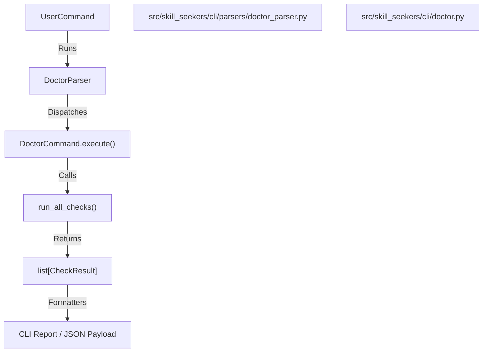
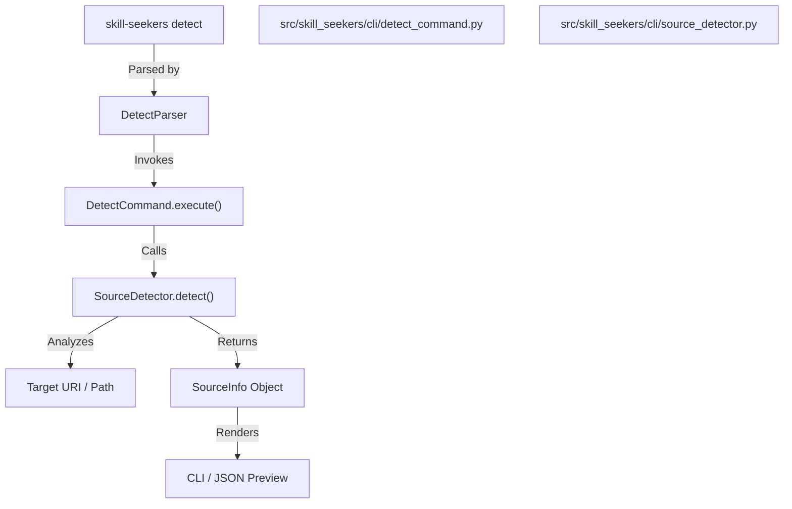
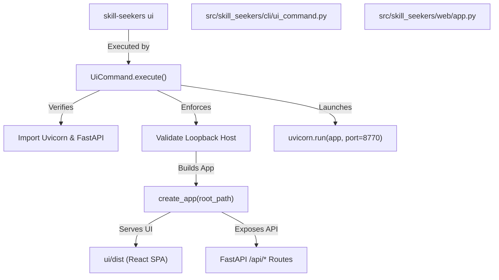

<!-- source: DeepWiki mcp.deepwiki.com · repo yusufkaraaslan/Skill_Seekers · page 3.6 Diagnostics & Setup Commands · fetched 2026-10-26 -->

# Diagnostics & Setup Commands

Relevant source files

The following files were used as context for generating this wiki page:

- [.github/workflows/vector-db-export.yml](.github/workflows/vector-db-export.yml)
- [AGENTS.md](AGENTS.md)
- [docs/README.md](docs/README.md)
- [docs/guides/WEB_UI.md](docs/guides/WEB_UI.md)
- [docs/reference/CLI_REFERENCE.md](docs/reference/CLI_REFERENCE.md)
- [docs/zh-CN/reference/CLI_REFERENCE.md](docs/zh-CN/reference/CLI_REFERENCE.md)
- [scripts/bootstrap_skill.sh](scripts/bootstrap_skill.sh)
- [scripts/skill_header.md](scripts/skill_header.md)
- [src/skill_seekers/cli/detect_command.py](src/skill_seekers/cli/detect_command.py)
- [src/skill_seekers/cli/doctor.py](src/skill_seekers/cli/doctor.py)
- [src/skill_seekers/cli/parsers/detect_parser.py](src/skill_seekers/cli/parsers/detect_parser.py)
- [src/skill_seekers/cli/parsers/doctor_parser.py](src/skill_seekers/cli/parsers/doctor_parser.py)
- [src/skill_seekers/cli/setup_wizard.py](src/skill_seekers/cli/setup_wizard.py)
- [src/skill_seekers/cli/ui_command.py](src/skill_seekers/cli/ui_command.py)
- [tests/test_bootstrap_skill.py](tests/test_bootstrap_skill.py)
- [tests/test_bootstrap_skill_e2e.py](tests/test_bootstrap_skill_e2e.py)
- [tests/test_doctor.py](tests/test_doctor.py)
- [ui/package-lock.json](ui/package-lock.json)
- [ui/package.json](ui/package.json)

This document provides technical documentation for the diagnostic, source preview, configuration setup, and user interface commands in `skill-seekers`. These commands enable users and AI coding agents to verify environment health, preview ingestion source classification, configure credentials interactively, and launch the Seeker HUD web interface.

---

## 1. Environmental Diagnostics (`skill-seekers doctor`)

The `doctor` subcommand executes a suite of offline diagnostic checks to verify system dependencies, Python version compatibility, optional package availability, and environment variable configurations [src/skill_seekers/cli/doctor.py:1-6]().

### Implementation & Data Structures

The diagnostic subsystem centers around the `CheckResult` dataclass, which encapsulates the outcome of an individual health check [src/skill_seekers/cli/doctor.py:21-30](). Command-line arguments are parsed via `DoctorParser`, supporting `--verbose` for detailed inspection and `--json` for machine-readable output [src/skill_seekers/cli/parsers/doctor_parser.py:6-26]().

*Diagram 1: Diagnostic execution flow bridging CLI invocation to `run_all_checks()` and `CheckResult` generation.*

**Sources:** `[src/skill_seekers/cli/doctor.py:1-30](), [src/skill_seekers/cli/parsers/doctor_parser.py:6-26]()`

### Diagnostic Checks

`run_all_checks()` executes eight distinct validation functions:
1. **Python Version**: Validates that `sys.version_info >= (3, 10)` [src/skill_seekers/cli/doctor.py:84-91]().
2. **Package Installation**: Confirms `skill_seekers` is importable and reads `__version__` [src/skill_seekers/cli/doctor.py:93-102]().
3. **Git Availability**: Checks if `git` is present in `PATH` via `shutil.which` [src/skill_seekers/cli/doctor.py:105-116]().
4. **Core Dependencies**: Verifies core import names (such as `requests`, `bs4`, `github`, `git`, `httpx`, `anthropic`, `fitz`, `pydantic`) [src/skill_seekers/cli/doctor.py:33-48, 118-146]().
5. **Optional Dependencies**: Reports availability of optional extras (such as `mammoth`, `yt_dlp`, `mcp`, `chromadb`, `weaviate`) [src/skill_seekers/cli/doctor.py:51-62, 149-176]().
6. **API Keys**: Evaluates presence and presence-masking of environment variables (`ANTHROPIC_API_KEY`, `GITHUB_TOKEN`, `GOOGLE_API_KEY`, `OPENAI_API_KEY`, `MOONSHOT_API_KEY`) [src/skill_seekers/cli/doctor.py:64-71, 179-215]().
7. **MCP Server**: Validates Model Context Protocol availability.
8. **Output Directory**: Confirms write permissions on local output directories.

**Sources:** `[src/skill_seekers/cli/doctor.py:33-215]()`

---

## 2. Source Detection Preview (`skill-seekers detect`)

The `detect` subcommand allows users to preview how `skill-seekers create` would classify a target URI, path, or repository without performing any scraping, file generation, or enhancement work [docs/reference/CLI_REFERENCE.md:41]().

### Implementation & Data Flow

`DetectCommand` interfaces directly with `SourceDetector` to inspect user inputs, resolve input types (documentation URL, GitHub repository shorthand, local file path, PDF, etc.), and emit a structured classification summary.

*Diagram 2: Source detection architecture routing input strings through `SourceDetector` to resolve target metadata.*

**Sources:** `[docs/reference/CLI_REFERENCE.md:41](), [src/skill_seekers/cli/detect_command.py:1-50](), [src/skill_seekers/cli/source_detector.py:1-60]()`

---

## 3. Interactive Configuration & Setup Wizard (`skill-seekers config`)

The `config` subcommand initiates an interactive setup wizard or direct credential management operations to establish user preferences, API keys, and environment settings [docs/reference/CLI_REFERENCE.md:19, 251-285]().

### Key Operations & Flags

- **Interactive Wizard**: Prompts for missing provider keys and default behaviors.
- `--github`: Directly provisions or validates `GITHUB_TOKEN`.
- `--api-keys`: Directly configures LLM platform API tokens.
- `--show`: Dumps current configuration state.
- `--test`: Executes live connectivity tests against configured services.

**Sources:** `[docs/reference/CLI_REFERENCE.md:251-285](), [src/skill_seekers/cli/setup_wizard.py:1-50]()`

---

## 4. Seeker HUD Web Interface (`skill-seekers ui`)

The `ui` subcommand starts a local FastAPI application serving the Seeker HUD single-page React frontend, providing a visual control plane for the entire toolchain [docs/guides/WEB_UI.md:1-15]().

### Implementation & Execution Flow

`UiCommand` checks for optional FastAPI and Uvicorn dependencies, enforces strict loopback binding (`127.0.0.1`, `localhost`, or `::1`), resolves the workspace root, and boots the application using `uvicorn.run()` [src/skill_seekers/cli/ui_command.py:16-55]().

*Diagram 3: Seeker HUD bootstrap lifecycle, validating dependencies and starting the local FastAPI/Uvicorn server.*

**Sources:** `[src/skill_seekers/cli/ui_command.py:16-55](), [docs/guides/WEB_UI.md:1-15]()`

---

