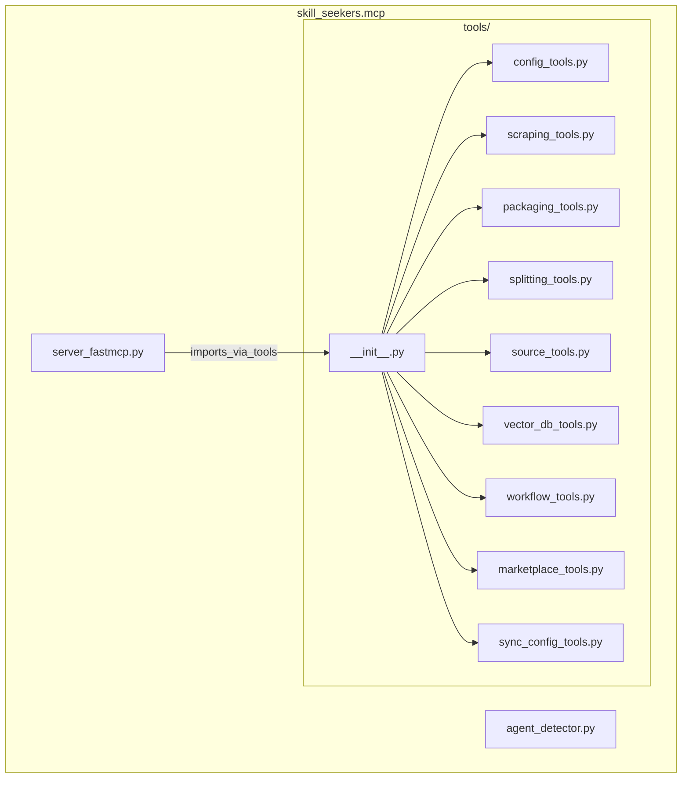
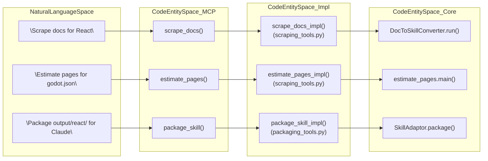
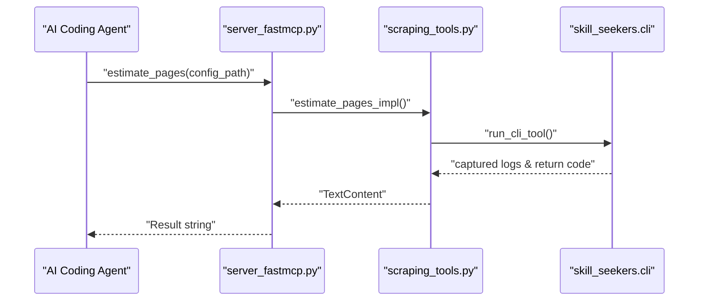

<!-- source: DeepWiki mcp.deepwiki.com · repo yusufkaraaslan/Skill_Seekers · page 4 MCP Integration · fetched 2026-10-26 -->

# MCP Integration

Relevant source files

The following files were used as context for generating this wiki page:

- [configs/godot.json](configs/godot.json)
- [configs/react.json](configs/react.json)
- [docs/zh-CN/reference/CLAUDE_INTEGRATION.md](docs/zh-CN/reference/CLAUDE_INTEGRATION.md)
- [docs/zh-CN/reference/LARGE_DOCUMENTATION.md](docs/zh-CN/reference/LARGE_DOCUMENTATION.md)
- [docs/zh-CN/reference/SKILL_ARCHITECTURE.md](docs/zh-CN/reference/SKILL_ARCHITECTURE.md)
- [src/skill_seekers/__init__.py](src/skill_seekers/__init__.py)
- [src/skill_seekers/cli/__init__.py](src/skill_seekers/cli/__init__.py)
- [src/skill_seekers/mcp/README.md](src/skill_seekers/mcp/README.md)
- [src/skill_seekers/mcp/__init__.py](src/skill_seekers/mcp/__init__.py)
- [src/skill_seekers/mcp/tools/__init__.py](src/skill_seekers/mcp/tools/__init__.py)

This page covers the Model Context Protocol (MCP) integration layer in skill-seekers: what it enables, which AI coding agents are supported, how the server is structured at a high level, and what tools it exposes. 

As a parent page, this section provides a high-level overview. For detailed technical information, see the child pages below:
- [MCP Server Architecture](#4.1) — FastMCP server implementation, tool registration, transport modes, and tool dispatch.
- [Multi-Agent Support](#4.2) — Supported AI coding agents, the `AgentDetector` class, and config file formats.
- [Setup & Auto-Configuration](#4.3) — Setup scripts, virtual environment preparation, and auto-generation of agent configurations.
- [MCP Tools Reference](#4.4) — Complete reference of tool categories, schemas, and wrapped CLI commands.
- [Natural Language Workflow Examples](#4.5) — Concrete conversational examples triggering multi-tool sequences.

---

## What MCP Integration Enables

The MCP layer exposes skill-seekers functionality as a set of modular tools that AI coding agents can invoke directly via natural language instructions [src/skill_seekers/mcp/__init__.py:1-10](). Instead of manual CLI execution, developers can prompt supported agents to generate configurations, estimate pages, scrape documentation, and package skills [src/skill_seekers/mcp/README.md:8-20]().

The server is implemented using **FastMCP** in `src/skill_seekers/mcp/server_fastmcp.py` [src/skill_seekers/mcp/__init__.py:6-7](). Each tool uses decorator-based registration and delegates execution to modular implementation functions defined across `src/skill_seekers/mcp/tools/` [src/skill_seekers/mcp/tools/__init__.py:1-14]().

Sources: [src/skill_seekers/mcp/__init__.py:1-10](), [src/skill_seekers/mcp/README.md:8-20](), [src/skill_seekers/mcp/tools/__init__.py:1-14]()

---

## Supported AI Coding Agents

Skill-seekers supports multiple AI coding environments through the `AgentDetector` component, which automatically detects installed tools and generates appropriate configuration structures [src/skill_seekers/mcp/__init__.py:21-25]().

| Agent | Config File / Location | Transport Mode |
|---|---|---|
| Claude Code | `~/.claude.json` or `~/.config/claude-code/mcp.json` [src/skill_seekers/mcp/__init__.py:26-29]() | stdio [docs/guides/MCP_SETUP.md:49]() |
| Cursor | Cursor Settings -> MCP | HTTP / SSE [docs/guides/MCP_SETUP.md:68]() |
| Windsurf | Windsurf MCP settings | HTTP / SSE [docs/guides/MCP_SETUP.md:68]() |
| VS Code + Cline | Cline MCP configuration | stdio [docs/guides/MCP_SETUP.md:49]() |
| IntelliJ IDEA | IntelliJ MCP settings | HTTP / SSE [docs/guides/MCP_SETUP.md:68]() |

For details on configuration generation and platform-specific setup, see [Multi-Agent Support](#4.2) and [Setup & Auto-Configuration](#4.3).

Sources: [src/skill_seekers/mcp/__init__.py:21-29](), [docs/guides/MCP_SETUP.md:49-68]()

---

## Package Architecture & Layout

The MCP package organizes its logic into the FastMCP server entry point, agent detection utilities, and specialized implementation modules under `src/skill_seekers/mcp/tools/` [src/skill_seekers/mcp/__init__.py:6-8]().

**Diagram: MCP Package Structure**

Sources: [src/skill_seekers/mcp/tools/__init__.py:19-135](), [src/skill_seekers/mcp/__init__.py:6-8]()

---

## Tool Categories & CLI Mapping

The server registers tools across nine functional categories [src/skill_seekers/mcp/tools/__init__.py:5-14](). Each tool wraps underlying CLI commands and core engine classes.

**Diagram: Natural Language Space to Code Entity Space**

Sources: [src/skill_seekers/mcp/tools/__init__.py:19-135](), [src/skill_seekers/mcp/README.md:88-165]()

### Registered Tool Overview

| Category | Description | Implementation Module |
|---|---|---|
| **Config** | Generate, list, and validate skill configs | `config_tools.py` [src/skill_seekers/mcp/tools/__init__.py:7]() |
| **Scraping** | Doc, GitHub, PDF, video, and codebase scraping | `scraping_tools.py` [src/skill_seekers/mcp/tools/__init__.py:8]() |
| **Packaging** | Packaging, uploading, enhancement, installation | `packaging_tools.py` [src/skill_seekers/mcp/tools/__init__.py:9]() |
| **Splitting** | Config splitting and router generation | `splitting_tools.py` [src/skill_seekers/mcp/tools/__init__.py:10]() |
| **Source** | Remote config sources management | `source_tools.py` [src/skill_seekers/mcp/tools/__init__.py:11]() |
| **Marketplace** | Marketplace publishing and integration | `marketplace_tools.py` [src/skill_seekers/mcp/tools/__init__.py:12]() |
| **Vector DB** | Exporting skills to vector stores | `vector_db_tools.py` [src/skill_seekers/mcp/tools/__init__.py:13]() |
| **Sync Config** | Documentation change monitoring | `sync_config_tools.py` [src/skill_seekers/mcp/tools/__init__.py:118-120]() |
| **Workflow** | Enhancement workflow presets management | `workflow_tools.py` [src/skill_seekers/mcp/tools/__init__.py:121-135]() |

For complete parameter schemas and return types, see [MCP Tools Reference](#4.4).

Sources: [src/skill_seekers/mcp/tools/__init__.py:7-135]()

---

## Request Execution Flow

When an AI agent invokes an MCP tool, the server dispatches the request to the corresponding implementation function, captures CLI logs, and structures the response as MCP `TextContent` [src/skill_seekers/mcp/tools/scraping_tools.py:23-61]().

**Diagram: MCP Request Lifecycle**

For advanced server architecture and transport configuration details, refer to [MCP Server Architecture](#4.1) and [Setup & Auto-Configuration](#4.3).

Sources: [src/skill_seekers/mcp/tools/scraping_tools.py:23-61]()

---

