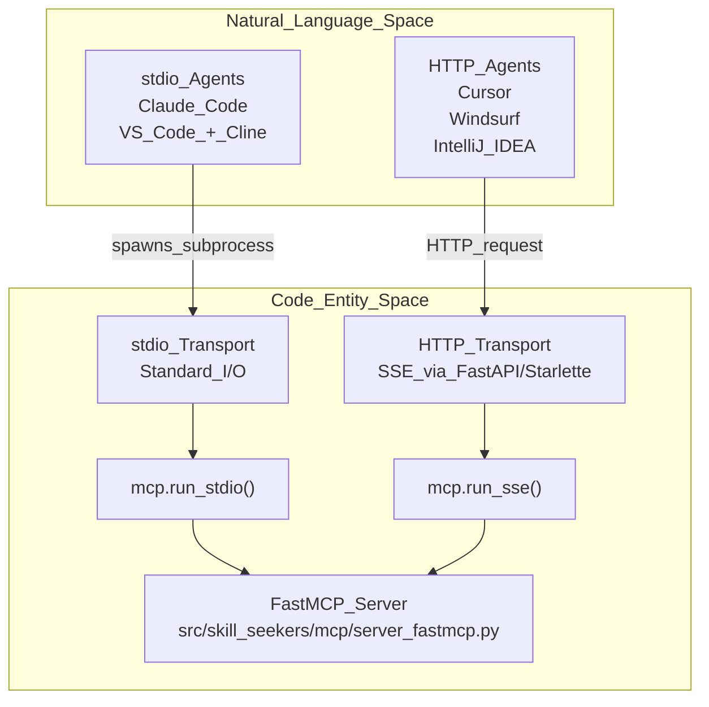
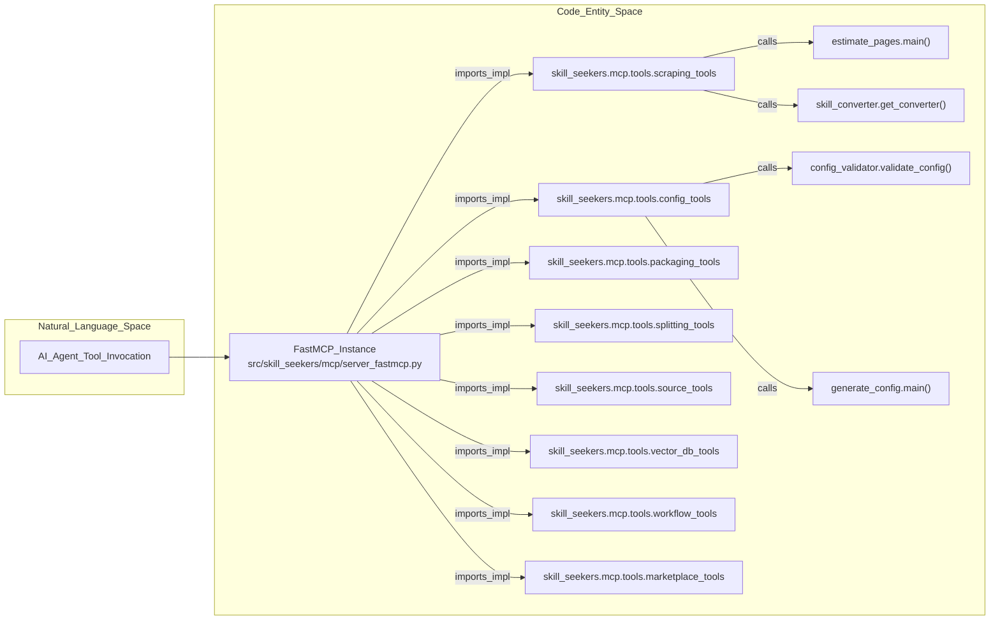

<!-- source: DeepWiki mcp.deepwiki.com · repo yusufkaraaslan/Skill_Seekers · page 4.1 MCP Server Architecture · fetched 2026-10-26 -->

# MCP Server Architecture

Relevant source files

The following files were used as context for generating this wiki page:

- [docs/BUG_AUDIT.md](docs/BUG_AUDIT.md)
- [src/skill_seekers/cli/merge_sources.py](src/skill_seekers/cli/merge_sources.py)
- [src/skill_seekers/mcp/server.py](src/skill_seekers/mcp/server.py)
- [src/skill_seekers/mcp/server_fastmcp.py](src/skill_seekers/mcp/server_fastmcp.py)
- [src/skill_seekers/mcp/tools/scraping_tools.py](src/skill_seekers/mcp/tools/scraping_tools.py)
- [tests/test_agent_client.py](tests/test_agent_client.py)
- [tests/test_create_pipeline_regressions.py](tests/test_create_pipeline_regressions.py)
- [tests/test_mcp_scrape_generic_word.py](tests/test_mcp_scrape_generic_word.py)
- [tests/test_mcp_server.py](tests/test_mcp_server.py)
- [tests/test_unified_mcp_integration.py](tests/test_unified_mcp_integration.py)

## Purpose and Scope

This document describes the architecture of the Skill Seekers MCP (Model Context Protocol) server, including the FastMCP framework, dual transport system, and tool organization. For information about configuring specific AI agents, see [Multi-Agent Support](#4.2). For setup instructions, see [Setup & Auto-Configuration](#4.3). For detailed tool documentation, see [MCP Tools Reference](#4.4).

The MCP server provides a standardized interface that allows AI coding agents to execute Skill Seekers functionality through natural language commands. The server acts as a bridge between conversational AI and the underlying CLI tools.

Sources: [src/skill_seekers/mcp/server_fastmcp.py:1-50]()

---

## FastMCP Framework

The Skill Seekers MCP server uses the **FastMCP framework** [src/skill_seekers/mcp/server_fastmcp.py:3-5](). This represents a significant architectural improvement over the previous implementation, reducing the codebase by approximately 68% (from ~2200 lines in `server.py` to ~708 lines in `server_fastmcp.py`) [src/skill_seekers/mcp/server_fastmcp.py:8-9]().

### Framework Benefits

- **Decorator-based tool registration**: Tools are defined using `@mcp.tool()` or a `safe_tool_decorator` wrapper for safe fallback and testing [src/skill_seekers/mcp/server_fastmcp.py:136-146]().
- **Automatic schema generation**: Input schemas are automatically generated from Python function type annotations and signatures [src/skill_seekers/mcp/server_fastmcp.py:153-164]().
- **Modular architecture**: Tool implementations are separated into dedicated modules under the `src/skill_seekers/mcp/tools/` package [src/skill_seekers/mcp/server_fastmcp.py:75-124]().
- **Built-in transport handling**: Native support for both standard I/O (stdio) and HTTP/SSE transports [src/skill_seekers/mcp/server_fastmcp.py:24-49]().

### Backward Compatibility Shim (`server.py`)

The legacy `server.py` file serves as a compatibility shim that delegates to `server_fastmcp.py` [src/skill_seekers/mcp/server.py:3-5](). It re-exports tool functions for backward compatibility with older test suites and issues a `DeprecationWarning` alerting users to migrate to `server_fastmcp` [src/skill_seekers/mcp/server.py:16-25]().

Sources: [src/skill_seekers/mcp/server.py:1-26](), [src/skill_seekers/mcp/server_fastmcp.py:1-146]()

---

## Dual Transport Architecture

The MCP server supports two transport modes, selected based on the AI coding agent's runtime requirements.

### Transport Mode Overview

Title: MCP Transport Architecture

Sources: [src/skill_seekers/mcp/server_fastmcp.py:24-50](), [src/skill_seekers/mcp/server_fastmcp.py:127-132]()

### stdio Transport

- **Execution Model**: The agent spawns the MCP server as a subprocess, communicating via `stdin` and `stdout` pipes [src/skill_seekers/mcp/server_fastmcp.py:24-25]().
- **Command**: `python -m skill_seekers.mcp.server_fastmcp` [src/skill_seekers/mcp/server_fastmcp.py:25]()
- **Supported Agents**: Claude Code, VS Code + Cline [src/skill_seekers/mcp/server_fastmcp.py:31-40]()

Sources: [src/skill_seekers/mcp/server_fastmcp.py:24-40]()

### HTTP Transport

- **Execution Model**: The MCP server runs as a standalone server using Server-Sent Events (SSE) [src/skill_seekers/mcp/server_fastmcp.py:42-43]().
- **Command**: `python -m skill_seekers.mcp.server_fastmcp --http --port 8080` [src/skill_seekers/mcp/server_fastmcp.py:28-29]()
- **Supported Agents**: Cursor, Windsurf, IntelliJ IDEA [src/skill_seekers/mcp/server_fastmcp.py:42-49]()

Sources: [src/skill_seekers/mcp/server_fastmcp.py:27-49]()

---

## Tool System Organization

The MCP server exposes 34 tools organized into functional categories [src/skill_seekers/mcp/server_fastmcp.py:12-21](). Each category is implemented in modular files within the `src/skill_seekers/mcp/tools/` package and imported into `server_fastmcp.py`.

### Tool Registration and Dispatch

Title: Tool Registration and Dispatch

Sources: [src/skill_seekers/mcp/server_fastmcp.py:75-124](), [src/skill_seekers/mcp/tools/scraping_tools.py:103-105](), [src/skill_seekers/mcp/tools/scraping_tools.py:180-181]()

### Tool Categories and Modules

| Category | Key Tools | Implementation Module |
|----------|-----------|-----------------------|
| **Config** | `generate_config`, `list_configs`, `validate_config`, `sync_config` | `skill_seekers.mcp.tools.config_tools` [src/skill_seekers/mcp/server_fastmcp.py:14-15]() |
| **Scraping** | `estimate_pages`, `scrape_docs`, `scrape_github`, `scrape_pdf`, `scrape_video`, `scrape_codebase`, `detect_patterns`, `extract_test_examples`, `build_how_to_guides`, `extract_config_patterns`, `scrape_generic` | `skill_seekers.mcp.tools.scraping_tools` [src/skill_seekers/mcp/server_fastmcp.py:15]() |
| **Packaging** | `package_skill`, `upload_skill`, `enhance_skill`, `install_skill` | `skill_seekers.mcp.tools.packaging_tools` [src/skill_seekers/mcp/server_fastmcp.py:16]() |
| **Splitting** | `split_config`, `generate_router` | `skill_seekers.mcp.tools.splitting_tools` [src/skill_seekers/mcp/server_fastmcp.py:17]() |
| **Source** | `fetch_config`, `submit_config`, `push_config`, `add_config_source`, `list_config_sources`, `remove_config_source` | `skill_seekers.mcp.tools.source_tools` [src/skill_seekers/mcp/server_fastmcp.py:18]() |
| **Marketplace** | `add_marketplace`, `list_marketplaces`, `remove_marketplace`, `publish_to_marketplace` | `skill_seekers.mcp.tools.marketplace_tools` [src/skill_seekers/mcp/server_fastmcp.py:19]() |
| **Vector DB** | `export_to_weaviate`, `export_to_chroma`, `export_to_faiss`, `export_to_qdrant` | `skill_seekers.mcp.tools.vector_db_tools` [src/skill_seekers/mcp/server_fastmcp.py:20]() |
| **Workflow** | `list_workflows`, `get_workflow`, `create_workflow`, `update_workflow`, `delete_workflow` | `skill_seekers.mcp.tools.workflow_tools` [src/skill_seekers/mcp/server_fastmcp.py:21]() |

Sources: [src/skill_seekers/mcp/server_fastmcp.py:12-21]()

---

## Server Implementation Details

### Tool Execution Flow and Log Capture

Tools execute in-process to minimize overhead and latency. Short-running utilities such as `estimate_pages_tool` invoke `estimate_pages.main()` directly via `run_cli_tool` [src/skill_seekers/mcp/tools/scraping_tools.py:103-105]().

For long-running conversions, the server uses the `_run_converter` helper function. This function instantiates an `io.StringIO` buffer, intercepts standard output during converter execution via `capture_cli_logs`, and packages the result into MCP `TextContent` responses [src/skill_seekers/mcp/tools/scraping_tools.py:26-60]().

Sources: [src/skill_seekers/mcp/tools/scraping_tools.py:26-60](), [src/skill_seekers/mcp/tools/scraping_tools.py:103-105]()

---

## Testing and Verification

The MCP server architecture is validated by automated test suites verifying tool schemas, initializations, and end-to-end integration:
- `tests/test_mcp_server.py`: Validates FastMCP initialization, tool registration, parameter schemas, and core tools like `generate_config` and `estimate_pages` [tests/test_mcp_server.py:48-229]().
- `tests/test_unified_mcp_integration.py`: Validates MCP interactions with unified multi-source configurations and format detections [tests/test_unified_mcp_integration.py:42-194]().

Sources: [tests/test_mcp_server.py:1-229](), [tests/test_unified_mcp_integration.py:1-194]()

---

