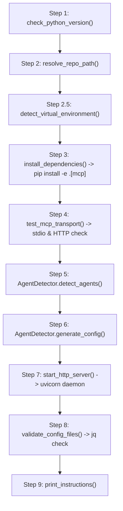
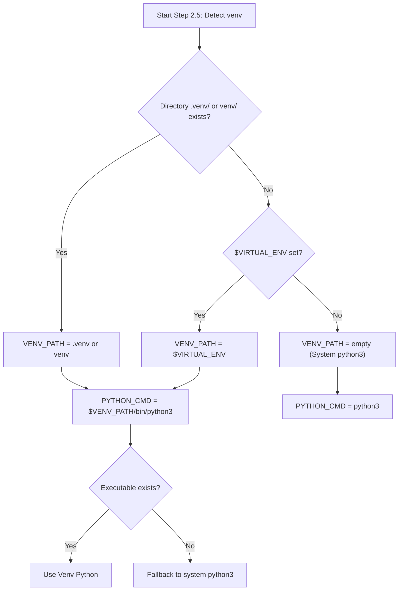
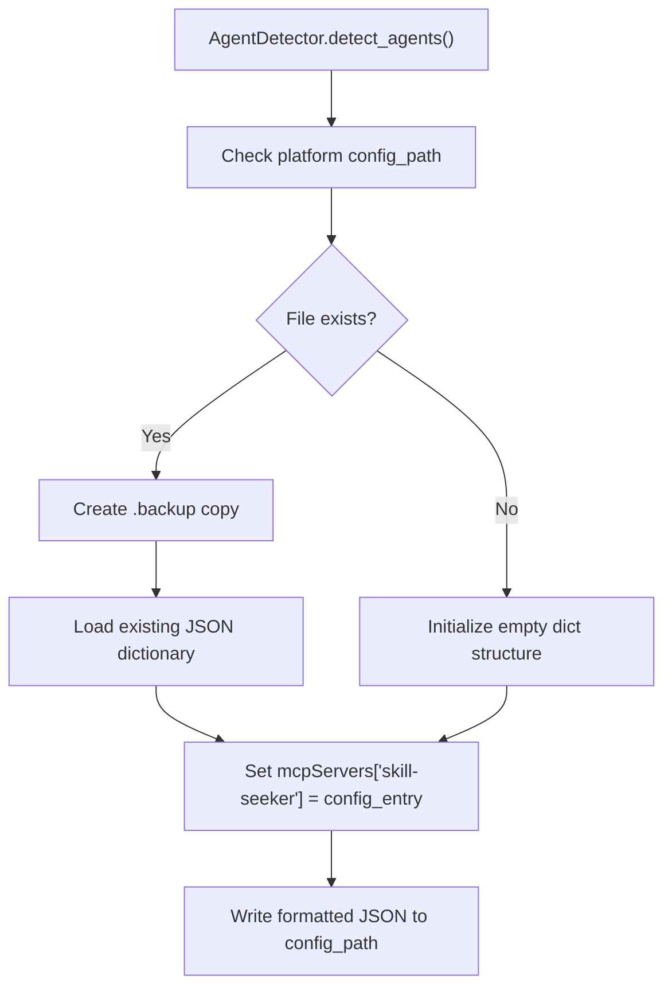
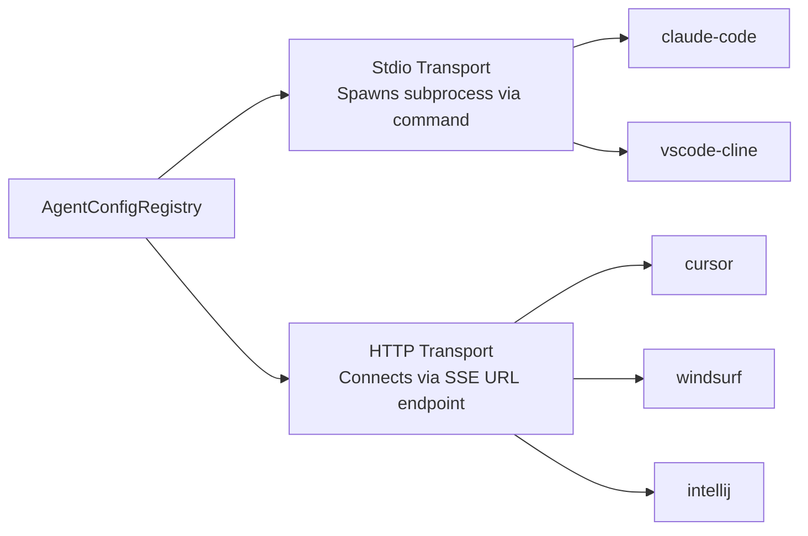

<!-- source: DeepWiki mcp.deepwiki.com · repo yusufkaraaslan/Skill_Seekers · page 4.3 Setup & Auto-Configuration · fetched 2026-10-26 -->

# Setup & Auto-Configuration

<details>
<summary>Relevant source files</summary>

The following files were used as context for generating this wiki page:

- [.claude/mcp_config.example.json](.claude/mcp_config.example.json)
- [docs/archive/legacy/QUICK_REFERENCE.md](docs/archive/legacy/QUICK_REFERENCE.md)
- [docs/features/ENHANCEMENT.md](docs/features/ENHANCEMENT.md)
- [docs/guides/MCP_SETUP.md](docs/guides/MCP_SETUP.md)
- [docs/guides/MIGRATION_GUIDE.md](docs/guides/MIGRATION_GUIDE.md)
- [docs/guides/UPLOAD_GUIDE.md](docs/guides/UPLOAD_GUIDE.md)
- [docs/integrations/MULTI_LLM_SUPPORT.md](docs/integrations/MULTI_LLM_SUPPORT.md)
- [docs/integrations/WINDSURF.md](docs/integrations/WINDSURF.md)
- [docs/reference/CLAUDE_INTEGRATION.md](docs/reference/CLAUDE_INTEGRATION.md)
- [docs/reference/CODE_QUALITY.md](docs/reference/CODE_QUALITY.md)
- [docs/reference/LARGE_DOCUMENTATION.md](docs/reference/LARGE_DOCUMENTATION.md)
- [example-mcp-config.json](example-mcp-config.json)
- [examples/http_transport_examples.sh](examples/http_transport_examples.sh)
- [setup_mcp.sh](setup_mcp.sh)
- [src/skill_seekers/mcp/agent_detector.py](src/skill_seekers/mcp/agent_detector.py)
- [tests/test_adaptors/test_minimax_adaptor.py](tests/test_adaptors/test_minimax_adaptor.py)

</details>


This page details the automated setup and configuration system for the Skill Seekers Model Context Protocol (MCP) server layer. The primary automation entry point is the `setup_mcp.sh` script, which inspects the local host environment, resolves virtual environments, installs Python dependencies with MCP extras, tests both stdio and HTTP transport mechanisms, detects supported AI coding agents via `src/skill_seekers/mcp/agent_detector.py`, and auto-generates agent configuration files.

Sources: [setup_mcp.sh:1-11](), [docs/guides/MCP_SETUP.md:1-12]()

---

## Setup Execution Flow

The `setup_mcp.sh` shell script orchestrates a sequential nine-step workflow to transition from raw repository checkout to fully configured agent integrations.

**`setup_mcp.sh` — Execution Pipeline**



Sources: [setup_mcp.sh:30-100](), [setup_mcp.sh:174-214](), [setup_mcp.sh:220-465]()

---

## Virtual Environment & Python Version Resolution

Before installing packages or configuring agents, the script validates that Python 3.10 or higher is active and detects existing isolated Python environments (`.venv`, `venv`, or `$VIRTUAL_ENV`).

### Python Version Check

The script checks `python3 --version` and parses the major and minor components to ensure compatibility with `fastmcp` and `mcp` SDK requirements [setup_mcp.sh:32-54](). If the version is below 3.10, it prompts the user for confirmation before proceeding [setup_mcp.sh:43-52]().

### Virtual Environment Detection

Step 2.5 establishes the exact Python executable path (`PYTHON_CMD`) and packaging installation command (`PIP_INSTALL_CMD`) [setup_mcp.sh:67-100]().

**`PYTHON_CMD` Resolution Strategy — `setup_mcp.sh`**



Sources: [setup_mcp.sh:67-100]()

---

## Dependency Installation & Transport Testing

Step 3 installs the package in editable mode with MCP extras [setup_mcp.sh:105-169]():

```bash
pip install -e ".[mcp]"
```

This installs the required protocol bindings, including `mcp`, `fastmcp`, `requests`, `beautifulsoup4`, and `uvicorn` [setup_mcp.sh:154-163]().

### Transport Testing

Step 4 validates both communication channels prior to writing agent configuration files [setup_mcp.sh:173-214]():

1. **Stdio Transport Test**: Spawns `python3 -m skill_seekers.mcp.server_fastmcp` under a 3-second timeout constraint to verify that the entrypoint runs cleanly without immediate import errors or crashes [setup_mcp.sh:180-188]().
2. **HTTP Transport Test**: Checks if the FastAPI/Uvicorn HTTP background daemon responds on the designated port (`http://127.0.0.1:8765/health`) [setup_mcp.sh:195-205]().

Sources: [setup_mcp.sh:154-214]()

---

## Agent Detection & Auto-Configuration

Step 5 and Step 6 leverage `AgentDetector` (`src/skill_seekers/mcp/agent_detector.py`) to discover installed coding assistants and write configuration files tailored to each agent's expected JSON format and transport protocol [setup_mcp.sh:220-465]().

### Supported Agents and Configuration Paths

| Agent ID | Agent Name | Transport Protocol | OS-Specific Config Path |
|----------|-----------|--------------------|------------------------|
| `claude-code` | Claude Code | `stdio` | `~/.claude.json` |
| `cursor` | Cursor | `HTTP` | `~/Library/Application Support/Cursor/mcp_settings.json` |
| `windsurf` | Windsurf | `HTTP` | `~/Library/Application Support/Windsurf/mcp_config.json` |
| `vscode-cline` | VS Code + Cline | `stdio` | `~/Library/Application Support/Code/User/globalStorage/saoudrizwan.claude-dev/settings/cline_mcp_settings.json` |
| `intellij` | IntelliJ IDEA | `HTTP` | `~/Library/Application Support/JetBrains/IntelliJIdea2024.3/mcp.xml` |

Sources: [docs/guides/MCP_SETUP.md:10-12](), [src/skill_seekers/mcp/agent_detector.py:25-71]()

### Config Generation Architecture

The config generation process checks whether configuration files already exist, creates automatic timestamped backups (`.backup.TIMESTAMP`), loads existing JSON structures, updates the `mcpServers["skill-seeker"]` entry, and writes the file back safely [src/skill_seekers/mcp/agent_detector.py:141-198]().

**`AgentDetector` Config Generation & Merging**



Sources: [src/skill_seekers/mcp/agent_detector.py:77-198]()

---

## Transport Mode Selection: Stdio vs. HTTP

The `AgentDetector.AGENT_CONFIG` mapping assigns transport mechanisms based on agent capabilities [src/skill_seekers/mcp/agent_detector.py:25-71]().

**Transport Assignment Hierarchy**



- **Stdio Transport**: Used by Claude Code and VS Code + Cline. The agent manages the subprocess lifecycle directly by spawning `PYTHON_CMD` with `-m skill_seekers.mcp.server_fastmcp` [example-mcp-config.json:1-14]().
- **HTTP Transport**: Used by Cursor, Windsurf, and IntelliJ. The server runs independently as a background daemon (started via Uvicorn), and agents connect over Server-Sent Events (`http://localhost:port/sse`) [docs/guides/MCP_SETUP.md:144-164]().

Sources: [src/skill_seekers/mcp/agent_detector.py:25-71](), [docs/guides/MCP_SETUP.md:144-164]()

---

## Verification & Troubleshooting

After running `./setup_mcp.sh`, verify the MCP installation across agents:

1. **Test Stdio Execution**:
   ```bash
   python3 -m skill_seekers.mcp.server_fastmcp
   ```
2. **Verify JSON Syntax**: Step 8 runs `jq empty` on all modified configuration files to guarantee valid JSON formatting before agent startup [setup_mcp.sh:550-579]().
3. **Common Resolution (`ModuleNotFoundError`)**: Ensure `PYTHON_CMD` points to the correct virtual environment executable inside `mcpServers["skill-seeker"]["command"]` [setup_mcp.sh:85-95](), [example-mcp-config.json:1-14]().

Sources: [setup_mcp.sh:550-579](), [example-mcp-config.json:1-14]()

---

