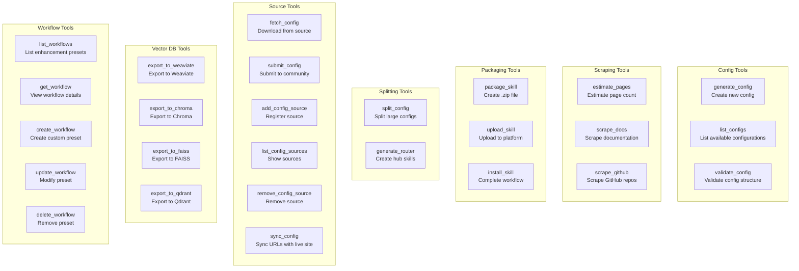
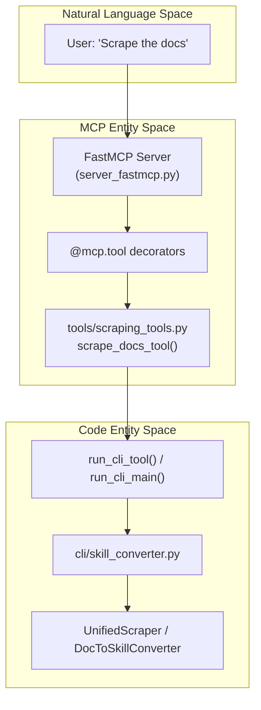
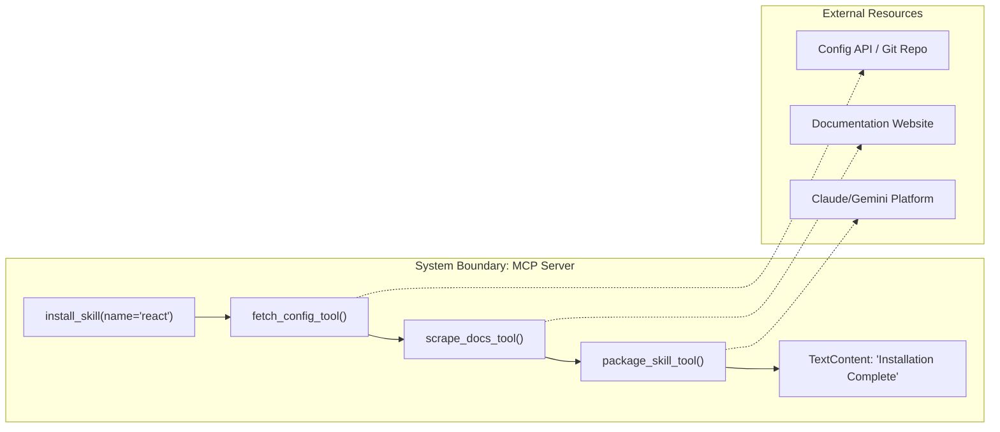

<!-- source: DeepWiki mcp.deepwiki.com · repo yusufkaraaslan/Skill_Seekers · page 4.4 MCP Tools Reference · fetched 2026-10-26 -->

# MCP Tools Reference

Relevant source files

The following files were used as context for generating this wiki page:

- [src/skill_seekers/cli/config_fetcher.py](src/skill_seekers/cli/config_fetcher.py)
- [src/skill_seekers/mcp/server_legacy.py](src/skill_seekers/mcp/server_legacy.py)
- [src/skill_seekers/mcp/tools/_common.py](src/skill_seekers/mcp/tools/_common.py)
- [src/skill_seekers/mcp/tools/config_tools.py](src/skill_seekers/mcp/tools/config_tools.py)
- [src/skill_seekers/mcp/tools/marketplace_tools.py](src/skill_seekers/mcp/tools/marketplace_tools.py)
- [src/skill_seekers/mcp/tools/packaging_tools.py](src/skill_seekers/mcp/tools/packaging_tools.py)
- [src/skill_seekers/mcp/tools/source_tools.py](src/skill_seekers/mcp/tools/source_tools.py)
- [src/skill_seekers/mcp/tools/splitting_tools.py](src/skill_seekers/mcp/tools/splitting_tools.py)
- [src/skill_seekers/mcp/tools/sync_config_tools.py](src/skill_seekers/mcp/tools/sync_config_tools.py)
- [src/skill_seekers/mcp/tools/vector_db_tools.py](src/skill_seekers/mcp/tools/vector_db_tools.py)
- [src/skill_seekers/mcp/tools/workflow_tools.py](src/skill_seekers/mcp/tools/workflow_tools.py)
- [src/skill_seekers/services/config_publisher.py](src/skill_seekers/services/config_publisher.py)
- [src/skill_seekers/services/git_repo.py](src/skill_seekers/services/git_repo.py)
- [src/skill_seekers/services/marketplace_publisher.py](src/skill_seekers/services/marketplace_publisher.py)
- [src/skill_seekers/services/path_safety.py](src/skill_seekers/services/path_safety.py)
- [tests/test_git_repo.py](tests/test_git_repo.py)
- [tests/test_mcp_git_sources.py](tests/test_mcp_git_sources.py)
- [tests/test_mcp_tools_common.py](tests/test_mcp_tools_common.py)

This page provides a complete technical reference for all MCP (Model Context Protocol) tools exposed by the Skill Seeker MCP server. Each tool's parameters, return format, and underlying implementation are documented here.

For setup instructions and configuration, see [MCP Integration](4.1) [src/skill_seekers/mcp/server_fastmcp.py:1-49](). For natural language usage examples, see [Natural Language Workflow](4.5). For server architecture details, see [MCP Server Architecture](4.1).

---

## Overview

The MCP server exposes tools organized into functional categories. All tools are implemented using the FastMCP framework and support both stdio and HTTP transport modes.

**Architecture:** FastMCP-based server ([src/skill_seekers/mcp/server_fastmcp.py:1-708]()) achieving significant code reduction vs the legacy implementation. All tool implementations are delegated to modular files in the `tools/` directory ([src/skill_seekers/mcp/tools/__init__.py:1-187]()).

**Transports:** stdio (Claude Code, VS Code + Cline) and HTTP (Cursor, Windsurf, IntelliJ IDEA) ([src/skill_seekers/mcp/server_fastmcp.py:23-49]()).

**Sources:** [src/skill_seekers/mcp/tools/__init__.py:1-187](), [src/skill_seekers/mcp/server_fastmcp.py:1-50]()

---

## Tool Categories Reference

The MCP tools are organized into functional categories covering the entire skill lifecycle:

**Sources:** [src/skill_seekers/mcp/tools/__init__.py:1-187]()

---

## Tool Implementation Architecture

Each MCP tool is implemented in a dedicated module within `src/skill_seekers/mcp/tools/`. Tools use in-process execution helpers like `run_cli_tool` or `run_cli_main` for efficient CLI dispatch.

**Sources:** [src/skill_seekers/mcp/tools/scraping_tools.py:108-224](), [src/skill_seekers/mcp/server_fastmcp.py:126-145]()

---

### 1. Config Tools
Manage JSON configuration files that drive ingestion.

| Tool | Wrapped CLI / Module | Key Input | Purpose |
|------|----------------------|-----------|---------|
| `generate_config` | `src/skill_seekers/mcp/tools/config_tools.py` | `name`, `url`, `description` | Interactively creates a JSON config with default selectors. |
| `list_configs` | `src/skill_seekers/mcp/tools/config_tools.py` | None | Scans the `configs/` directory and returns metadata. |
| `validate_config` | `src/skill_seekers/cli/config_validator.py` | `config_path` | Checks for required fields and schema for unified/legacy formats. |

**Sources:** [src/skill_seekers/mcp/tools/config_tools.py:1-271]()

---

### 2. Scraping Tools
The core ingestion engine executing documentation and repository collection.

| Tool | Wrapped CLI / Module | Key Input | Purpose |
|------|----------------------|-----------|---------|
| `estimate_pages` | `src/skill_seekers/mcp/tools/scraping_tools.py` | `config_path`, `max_discovery` | Fast preview of page counts without downloading full content. |
| `scrape_docs` | `src/skill_seekers/cli/skill_converter.py` | `config_path`, `unlimited`, `enhance_local` | Scrapes documentation, auto-detects `llms.txt`, and builds `SKILL.md`. |
| `scrape_github` | `src/skill_seekers/cli/github_scraper.py` | `repo`, `token` | Extracts code structures, issues, releases, and documentation from GitHub. |

**Sources:** [src/skill_seekers/mcp/tools/scraping_tools.py:1-300]()

---

### 3. Packaging Tools
Transform raw scraped output into structured skill distributions.

| Tool | Wrapped CLI / Module | Key Input | Purpose |
|------|----------------------|-----------|---------|
| `package_skill` | `src/skill_seekers/cli/package_skill.py` | `skill_dir`, `target`, `auto_upload` | Zips outputs and builds platform adaptors (Claude, Gemini, OpenAI). |
| `upload_skill` | `src/skill_seekers/cli/upload_skill.py` | `skill_zip`, `target` | Uploads generated skill packages directly to target LLM platforms. |
| `install_skill` | `src/skill_seekers/mcp/tools/packaging_tools.py` | `config_path` | High-level wrapper executing the end-to-end pipeline: scrape → enhance → package → install. |

**Sources:** [src/skill_seekers/mcp/tools/packaging_tools.py:30-300]()

---

### 4. Splitting Tools
Handle large documentation volumes and routing architectures.

| Tool | Wrapped CLI / Module | Key Input | Purpose |
|------|----------------------|-----------|---------|
| `split_config` | `src/skill_seekers/cli/split_config.py` | `config_path`, `strategy`, `target_pages` | Splits large documentation or unified configs into focused sub-skills. |
| `generate_router` | `src/skill_seekers/cli/generate_router.py` | `config_pattern`, `router_name` | Creates a hub/router skill to navigate between split sub-skills. |

**Sources:** [src/skill_seekers/mcp/tools/splitting_tools.py:1-119]()

---

### 5. Source Tools
Manage external configuration sources, community repositories, and synchronization.

| Tool | Wrapped CLI / Module | Key Input | Purpose |
|------|----------------------|-----------|---------|
| `fetch_config` | `src/skill_seekers/services/git_repo.py` | `config_name`, `git_url`, `source` | Downloads configuration files from remote Git URLs, registries, or APIs. |
| `submit_config` | `src/skill_seekers/services/source_manager.py` | `config_path` | Submits validated configurations to community repositories. |
| `add_config_source` | `src/skill_seekers/services/source_manager.py` | `name`, `git_url`, `branch` | Registers a Git repository as a named configuration provider. |
| `list_config_sources` | `src/skill_seekers/services/source_manager.py` | None | Lists all registered configuration sources. |
| `remove_config_source` | `src/skill_seekers/services/source_manager.py` | `name` | Removes a registered configuration source. |
| `sync_config` | `src/skill_seekers/cli/sync_config.py` | `config_path` | Diffs config URLs against live documentation sites and applies updates. |

**Sources:** [src/skill_seekers/mcp/tools/source_tools.py:1-673](), [tests/test_mcp_git_sources.py:1-178]()

---

### 6. Vector DB Tools
Export structured skill references into vector store indexes for Retrieval-Augmented Generation (RAG).

| Tool | Wrapped CLI / Module | Key Input | Purpose |
|------|----------------------|-----------|---------|
| `export_to_weaviate` | `src/skill_seekers/cli/adaptors/weaviate_adaptor.py` | `skill_dir`, `endpoint` | Exports processed skills into Weaviate collection schemas. |
| `export_to_chroma` | `src/skill_seekers/cli/adaptors/chroma_adaptor.py` | `skill_dir`, `collection_name` | Exports chunked skill data into local Chroma database format. |
| `export_to_faiss` | `src/skill_seekers/cli/adaptors/faiss_adaptor.py` | `skill_dir`, `index_path` | Builds and exports FAISS vector search index files. |
| `export_to_qdrant` | `src/skill_seekers/cli/adaptors/qdrant_adaptor.py` | `skill_dir`, `url` | Exports skill chunks to Qdrant vector storage collections. |

**Sources:** [src/skill_seekers/mcp/tools/vector_db_tools.py:1-450]()

---

### 7. Workflow Tools
Manage enhancement workflow configurations, letting agents orchestrate multi-stage pipelines.

| Tool | Wrapped CLI / Module | Key Input | Purpose |
|------|----------------------|-----------|---------|
| `list_workflows` | `src/skill_seekers/mcp/tools/workflow_tools.py` | None | Lists bundled and user-defined enhancement workflow specifications. |
| `get_workflow` | `src/skill_seekers/mcp/tools/workflow_tools.py` | `name` | Returns full YAML contents for a specific workflow preset. |
| `create_workflow` | `src/skill_seekers/mcp/tools/workflow_tools.py` | `name`, `content` | Writes a new workflow YAML document to user configuration directories. |
| `update_workflow` | `src/skill_seekers/mcp/tools/workflow_tools.py` | `name`, `content` | Overwrites an existing user-defined workflow definition. |
| `delete_workflow` | `src/skill_seekers/mcp/tools/workflow_tools.py` | `name` | Deletes a user-defined workflow preset by name. |

**Sources:** [src/skill_seekers/mcp/tools/workflow_tools.py:1-250]()

---

## Technical Data Flow: `install_skill`

The `install_skill` workflow composes multiple underlying subsystem tools into a coordinated pipeline.

**Sources:** [src/skill_seekers/mcp/tools/packaging_tools.py:30-158](), [src/skill_seekers/mcp/tools/source_tools.py:57-178]()

---

