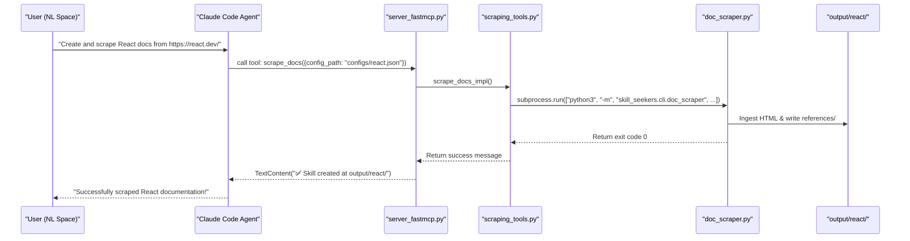

<!-- source: DeepWiki mcp.deepwiki.com · repo yusufkaraaslan/Skill_Seekers · page 4.5 Natural Language Workflow Examples · fetched 2026-10-26 -->

# Natural Language Workflow Examples

<details>
<summary>Relevant source files</summary>

The following files were used as context for generating this wiki page:

- [docs/archive/legacy/QUICK_REFERENCE.md](docs/archive/legacy/QUICK_REFERENCE.md)
- [docs/features/ENHANCEMENT.md](docs/features/ENHANCEMENT.md)
- [docs/guides/MCP_SETUP.md](docs/guides/MCP_SETUP.md)
- [docs/guides/MIGRATION_GUIDE.md](docs/guides/MIGRATION_GUIDE.md)
- [docs/guides/UPLOAD_GUIDE.md](docs/guides/UPLOAD_GUIDE.md)
- [docs/integrations/MULTI_LLM_SUPPORT.md](docs/integrations/MULTI_LLM_SUPPORT.md)
- [docs/integrations/WINDSURF.md](docs/integrations/WINDSURF.md)
- [docs/reference/CLAUDE_INTEGRATION.md](docs/reference/CLAUDE_INTEGRATION.md)
- [docs/reference/CODE_QUALITY.md](docs/reference/CODE_QUALITY.md)
- [docs/reference/LARGE_DOCUMENTATION.md](docs/reference/LARGE_DOCUMENTATION.md)
- [docs/zh-CN/reference/CLAUDE_INTEGRATION.md](docs/zh-CN/reference/CLAUDE_INTEGRATION.md)
- [docs/zh-CN/reference/LARGE_DOCUMENTATION.md](docs/zh-CN/reference/LARGE_DOCUMENTATION.md)
- [docs/zh-CN/reference/SKILL_ARCHITECTURE.md](docs/zh-CN/reference/SKILL_ARCHITECTURE.md)
- [src/skill_seekers/mcp/README.md](src/skill_seekers/mcp/README.md)
- [tests/test_adaptors/test_minimax_adaptor.py](tests/test_adaptors/test_minimax_adaptor.py)

</details>


This page provides concrete, technical examples of using natural language commands with AI coding agents (such as Claude Code) to orchestrate complex multi-step tool chains through the Model Context Protocol (MCP) server layer.

The Skill Seekers MCP implementation (`[src/skill_seekers/mcp/server_fastmcp.py:1-48]()`) bridges natural language space to code entity space by converting conversational user intents into direct invocations of registered FastMCP tools (`[src/skill_seekers/mcp/README.md:1-213]()`).

Sources: [src/skill_seekers/mcp/server_fastmcp.py:1-48](), [src/skill_seekers/mcp/README.md:1-213]()

## Natural Language Translation Architecture

The architecture maps natural language utterances into structured Python function calls within `[src/skill_seekers/mcp/server_fastmcp.py]()`, which in turn delegate to backend CLI scripts via subprocess execution (`[src/skill_seekers/mcp/tools/scraping_tools.py]()`, `[src/skill_seekers/mcp/tools/packaging_tools.py]()`).

### Translation Flow: Natural Language Space to Code Entity Space

**Diagram: Natural Language to Code Execution Pipeline**

```mermaid
graph TB
    subgraph "Natural Language Space"
        User["User Utterance: \"Generate React skill and package it\""]
    end

    subgraph "AI Agent Layer (5 Supported Agents)"
        Agent["AI Coding Agent Interpreter\n(Claude Code, Cursor, Windsurf, Cline, IntelliJ)"]
    end

    subgraph "MCP Server Layer [src/skill_seekers/mcp/server_fastmcp.py]"
        FastMCP["FastMCP Instance\n`mcp = FastMCP('skill-seeker')`"]
    end

    subgraph "Tool Module Registry [src/skill_seekers/mcp/tools/]"
        ConfigTools["Config Tools\n`config_tools.py`\n`generate_config_impl()`"]
        ScrapingTools["Scraping Tools\n`scraping_tools.py`\n`scrape_docs_tool()`"]
        PackagingTools["Packaging Tools\n`packaging_tools.py`\n`package_skill_tool()`"]
    end

    subgraph "CLI Code Entity Space"
        DocScraper["`skill_seekers.cli.doc_scraper.py`\n(`DocToSkillConverter`)"]
        Packager["`skill_seekers.cli.package_skill.py`\n(`SkillAdaptor` subclasses)"]
    end

    User -->|"Conversational Prompt"| Agent
    Agent -->|"JSON-RPC / Tool Call"| FastMCP
    FastMCP -->|"Dispatch"| ConfigTools
    FastMCP -->|"Dispatch"| ScrapingTools
    FastMCP -->|"Dispatch"| PackagingTools
    ScrapingTools -->|"Subprocess"| DocScraper
    PackagingTools -->|"Subprocess"| Packager
    DocScraper -->|"File Artifacts"| OutputDir["`output/{name}/`"]
    Packager -->|"Archive"| Archive["`output/{name}.zip`"]
```

Sources: [src/skill_seekers/mcp/server_fastmcp.py:1-100](), [src/skill_seekers/mcp/README.md:83-148]()

### Translation Stages and Component Mapping

| Stage | System Name | Code Symbol / Path | Role |
|-------|-------------|--------------------|------|
| **Ingress** | AI Coding Agent | Agent interpreter | Parses natural language intent and maps parameters to MCP tool schemas. |
| **Transport** | FastMCP Server | `[src/skill_seekers/mcp/server_fastmcp.py:1-708]()` | Exposes 40+ tools via stdio or HTTP SSE transport. |
| **Tool Dispatch** | Tool Modules | `[src/skill_seekers/mcp/tools/__init__.py]()` | Implements tool logic (`generate_config_impl`, `scrape_docs_impl`, etc.). |
| **Execution** | CLI Subsystems | `[src/skill_seekers/cli/doc_scraper.py]()` | Executes core workflow logic via Python subprocesses. |

Sources: [src/skill_seekers/mcp/server_fastmcp.py:1-708](), [src/skill_seekers/mcp/README.md:83-148]()

## Command Examples by Tool Category

The MCP server exposes over 40 tools across 10 distinct categories (`[docs/guides/MCP_SETUP.md:1-12]()`). Below are common natural language commands mapped to their underlying tool implementations.

### Configuration Management Tools

| Natural Language Command | Tool Module | Core Function / Class | Result |
|--------------------------|-------------|-----------------------|--------|
| "List all available presets" | `[src/skill_seekers/mcp/tools/config_tools.py]()` | `list_configs_impl()` | Returns JSON configuration file listing from `configs/`. |
| "Generate config for Tailwind" | `[src/skill_seekers/mcp/tools/config_tools.py]()` | `generate_config_impl()` | Writes a new configuration file to `configs/{name}.json`. |
| "Validate configs/react.json" | `[src/skill_seekers/mcp/tools/config_tools.py]()` | `validate_config_impl()` | Invokes `UniSkillConfigValidator` on target schema. |

Sources: [src/skill_seekers/mcp/README.md:85-209]()

### Scraping & Analysis Tools

| Natural Language Command | Tool Module | Core Function / Class | Result |
|--------------------------|-------------|-----------------------|--------|
| "Estimate pages for React" | `[src/skill_seekers/mcp/tools/scraping_tools.py]()` | `estimate_pages_tool()` | Runs BFS sampling via `[src/skill_seekers/cli/estimate_pages.py]()`. |
| "Scrape documentation" | `[src/skill_seekers/mcp/tools/scraping_tools.py]()` | `scrape_docs_tool()` | Invokes `[src/skill_seekers/cli/doc_scraper.py]()`. |
| "Analyze GitHub repo" | `[src/skill_seekers/mcp/tools/scraping_tools.py]()` | `scrape_github_tool()` | Invokes `[src/skill_seekers/cli/github_scraper.py]()`. |

Sources: [src/skill_seekers/mcp/README.md:102-127]()

### Packaging & Distribution Tools

| Natural Language Command | Tool Module | Core Function / Class | Result |
|--------------------------|-------------|-----------------------|--------|
| "Enhance skill locally" | `[src/skill_seekers/mcp/tools/packaging_tools.py]()` | `enhance_skill_tool()` | Triggers `[src/skill_seekers/cli/enhance_skill.py]()`. |
| "Package for Claude" | `[src/skill_seekers/mcp/tools/packaging_tools.py]()` | `package_skill_tool()` | Uses `SkillAdaptor` factory to build `.zip` or `.tar.gz`. |
| "Upload to OpenAI" | `[src/skill_seekers/mcp/tools/packaging_tools.py]()` | `upload_skill_tool()` | Calls Assistants API via `[src/skill_seekers/cli/upload_skill.py]()`. |

Sources: [src/skill_seekers/mcp/README.md:128-188]()

## Complete Workflow Examples

### Workflow 1: Single-Command End-to-End Skill Creation

**Diagram: End-to-End Execution Sequence**



Sources: [src/skill_seekers/mcp/README.md:114-127](), [src/skill_seekers/mcp/server_fastmcp.py:1-100]()

### Workflow 2: Handling Large Documentation Sets (Godot Split & Router)

When dealing with documentation exceeding 10,000 pages, natural language instructions coordinate config splitting and router generation (`[docs/reference/LARGE_DOCUMENTATION.md:1-100]()`).

```
User: Estimate pages for configs/godot.json
Claude: [Calls estimate_pages_tool] 📊 40,000 pages detected. Splitting is recommended.

User: Split configs/godot.json using router strategy
Claude: [Calls split_config tool with strategy="router"]
✅ Created sub-configs: configs/godot-scripting.json, configs/godot-physics.json...

User: Generate router for configs/godot-*.json
Claude: [Calls generate_router tool]
✅ Router skill generated at output/godot/SKILL.md
```

Sources: [src/skill_seekers/mcp/README.md:210-220](), [docs/reference/LARGE_DOCUMENTATION.md:180-228]()

### Workflow 3: Multi-Platform Adaptor Export

```
User: Package the react skill for Gemini and OpenAI
Claude: [Calls package_skill_tool with target="gemini"]
[Calls package_skill_tool with target="openai"]
✅ Created output/react-gemini.tar.gz and output/react-openai.zip.
```

Sources: [src/skill_seekers/mcp/README.md:128-148](), [docs/guides/UPLOAD_GUIDE.md:248-274]()

## AI Enhancement Workflow Execution

Enhancement transforms raw scraped templates into comprehensive operational guides (`[docs/features/ENHANCEMENT.md:1-50]()`).

**Diagram: Enhancement Tool Architecture**

```mermaid
graph LR
    subgraph "MCP Tool Layer"
        EnhanceTool["`enhance_skill_tool()`\nin `packaging_tools.py`"]
    end

    subgraph "Enhancement Engine"
        Enhancer["`skill_seekers.cli.enhance_skill.py`"]
        LocalEnhancer["`LocalSkillEnhancer`\n(CLI-based Agentic Mode)"]
        AgentClient["`AgentClient`\n(API Mode: Anthropic, Gemini, OpenAI)"]
    end

    subgraph "Target Artifacts"
        SkillMD["`SKILL.md` (500+ lines)"]
    end

    EnhanceTool --> Enhancer
    Enhancer -->|"Mode: local"| LocalEnhancer
    Enhancer -->|"Mode: api"| AgentClient
    LocalEnhancer --> SkillMD
    AgentClient --> SkillMD
```

Sources: [docs/features/ENHANCEMENT.md:24-46](), [src/skill_seekers/mcp/README.md:165-188]()

## Common Command Patterns

| Intent Classification | Natural Language Utterance | Underlying MCP Tool |
|-----------------------|----------------------------|---------------------|
| **Discovery** | "Show available documentation configs" | `list_configs` |
| **Scaffolding** | "Generate a config for FastAPI at [url]" | `generate_config` |
| **Pre-flight** | "Estimate page count for configs/django.json" | `estimate_pages` |
| **Execution** | "Scrape documentation using configs/react.json" | `scrape_docs` |
| **Refinement** | "Enhance the React skill locally" | `enhance_skill` |
| **Distribution** | "Package and upload the React skill to Claude" | `package_skill`, `upload_skill` |

Sources: [src/skill_seekers/mcp/README.md:83-220](), [docs/reference/CLAUDE_INTEGRATION.md:188-194]()

---

