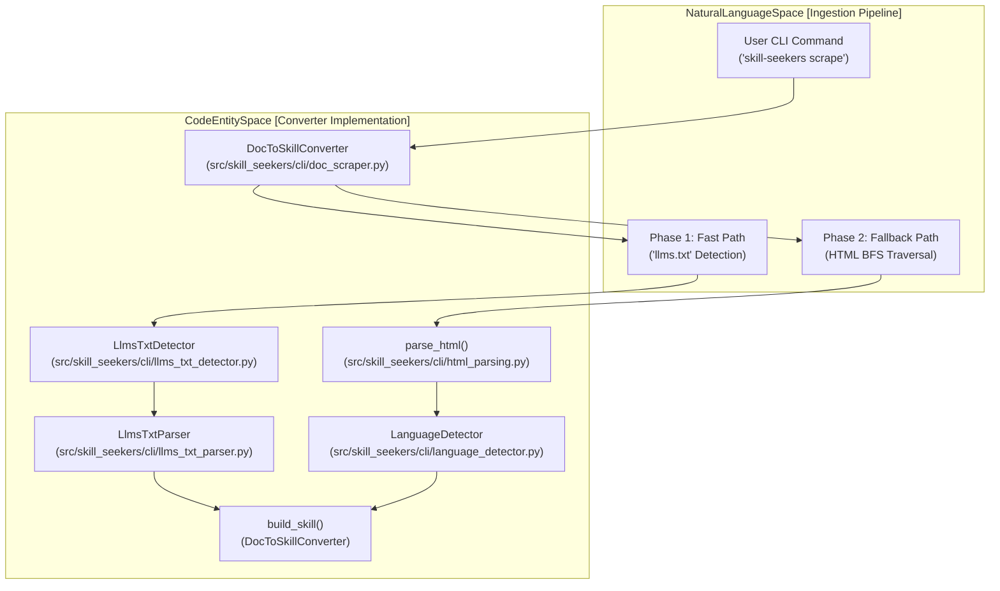
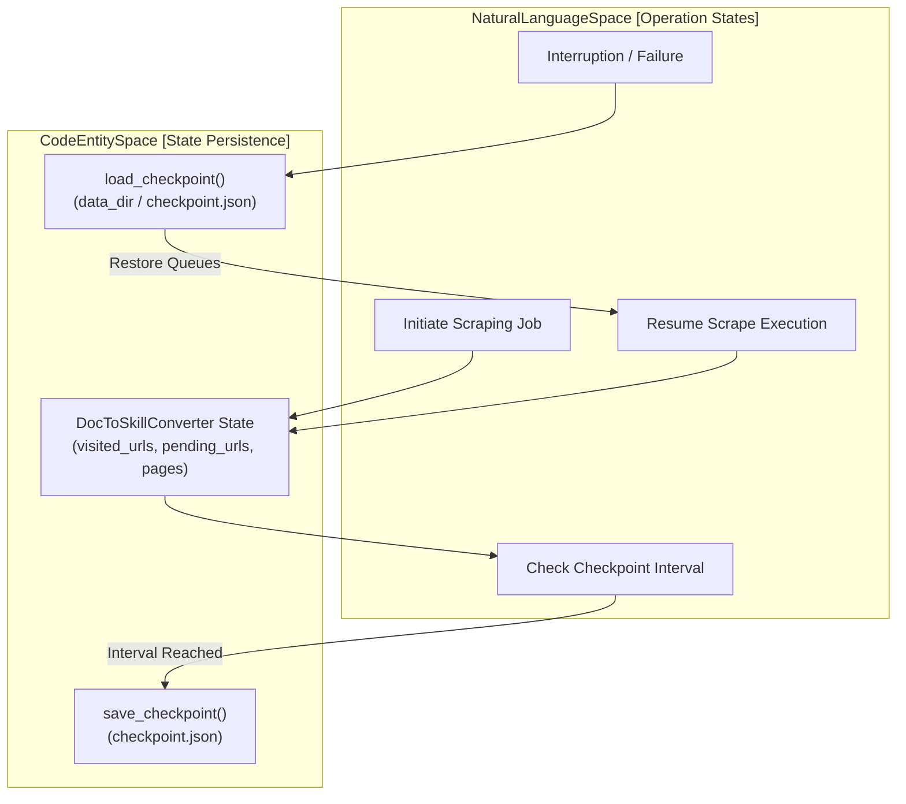

<!-- source: DeepWiki mcp.deepwiki.com · repo yusufkaraaslan/Skill_Seekers · page 5.1 Documentation Scraper · fetched 2026-10-26 -->

# Documentation Scraper

Relevant source files

The following files were used as context for generating this wiki page:

- [.github/create_issues.sh](.github/create_issues.sh)
- [src/skill_seekers/cli/doc_scraper.py](src/skill_seekers/cli/doc_scraper.py)
- [src/skill_seekers/cli/enhance_skill.py](src/skill_seekers/cli/enhance_skill.py)
- [src/skill_seekers/cli/unified_scraper.py](src/skill_seekers/cli/unified_scraper.py)
- [src/skill_seekers/cli/unified_skill_builder.py](src/skill_seekers/cli/unified_skill_builder.py)
- [src/skill_seekers/cli/utils.py](src/skill_seekers/cli/utils.py)
- [tests/test_c3_integration.py](tests/test_c3_integration.py)
- [tests/test_config_validation.py](tests/test_config_validation.py)
- [tests/test_issue_277_discord_e2e.py](tests/test_issue_277_discord_e2e.py)
- [tests/test_issue_277_real_world.py](tests/test_issue_277_real_world.py)
- [tests/test_markdown_parsing.py](tests/test_markdown_parsing.py)
- [tests/test_multi_source.py](tests/test_multi_source.py)
- [tests/test_scraper_features.py](tests/test_scraper_features.py)
- [tests/test_unified.py](tests/test_unified.py)
- [tests/test_unified_scraper_orchestration.py](tests/test_unified_scraper_orchestration.py)
- [tests/test_url_conversion.py](tests/test_url_conversion.py)

The Documentation Scraper converts web-based documentation into structured AI skills through intelligent content extraction. Centered around the `DocToSkillConverter` class located in `src/skill_seekers/cli/doc_scraper.py`, this system implements a two-phase ingestion workflow: attempting fast `llms.txt` extraction first, then falling back to comprehensive HTML scraping with Breadth-First Search (BFS) traversal when needed [src/skill_seekers/cli/doc_scraper.py:3-50]().

For scraping GitHub repositories, see [GitHub Scraper](#5.2). For PDF extraction, see [PDF Scraper](#5.3). For combining multiple sources, see [Unified Multi-Source Scraping](#6).

---

## System Architecture

The documentation scraper pipeline orchestrates URL discovery, content extraction, language detection, and skill generation within the `DocToSkillConverter` class framework.

**Sources**: [src/skill_seekers/cli/doc_scraper.py:29-50](), [src/skill_seekers/cli/doc_scraper.py:199-250]()

---

## Two-Phase Scraping Strategy

The scraper prioritizes `llms.txt` specifications which provide pre-rendered markdown, significantly reducing scraping overhead and improving extraction quality [src/skill_seekers/cli/doc_scraper.py:47-50]().

1. **Phase 1: llms.txt Detection**: Attempts to find `llms-full.txt`, `llms.txt`, or `llms-small.txt` using detector modules. For details, see [llms.txt Detection & Processing](#5.1.2).
2. **Phase 2: HTML Fallback**: If no valid `llms.txt` is available, it initiates a BFS traversal of the target documentation site starting from the configured `base_url`. For details, see [HTML Scraping & BFS Traversal](#5.1.1).

### URL Normalization
To prevent crawling loops and duplicate processing across tracking variants, the converter invokes `_normalize_url()` to drop tracking parameters (such as `utm_`, `gclid`, etc.) and sort query strings before deduplication [src/skill_seekers/cli/doc_scraper.py:105-120]().

**Sources**: [src/skill_seekers/cli/doc_scraper.py:47-50](), [src/skill_seekers/cli/doc_scraper.py:105-120]()

---

## Sub-Topic Overview

The documentation scraper functionality is modularized into dedicated components covering HTML parsing, file format detection, code syntax classification, and semantic categorization.

### HTML Scraping & BFS Traversal

The scraper maintains a BFS URL queue (`pending_urls`) and a visited set (`visited_urls`) within `DocToSkillConverter` [src/skill_seekers/cli/doc_scraper.py:243-247](). It filters candidate links using `is_valid_url()` rules against include and exclude patterns [tests/test_scraper_features.py:20-59](). Content extraction relies on BeautifulSoup and fallback selectors (`FALLBACK_MAIN_SELECTORS`) to isolate core documentation text from navigation chrome [src/skill_seekers/cli/doc_scraper.py:63-71]().

For deep technical details on rate limiting, async parallel execution, retry logic, and page state management, see [HTML Scraping & BFS Traversal](#5.1.1).

**Sources**: [src/skill_seekers/cli/doc_scraper.py:63-71](), [src/skill_seekers/cli/doc_scraper.py:243-247](), [tests/test_scraper_features.py:20-59]()

### llms.txt Detection & Processing

When documentation sites expose an `llms.txt` or `llms-full.txt` manifest, the scraper bypasses traditional HTML crawling. The `LlmsTxtDetector` scans standard locations, `LlmsTxtDownloader` fetches content with validation and retry logic, and `LlmsTxtParser` extracts structured markdown sections to establish an active skills catalog [src/skill_seekers/cli/doc_scraper.py:47-49]().

For details on downloader retry policies and parser internals, see [llms.txt Detection & Processing](#5.1.2).

**Sources**: [src/skill_seekers/cli/doc_scraper.py:47-49]()

### Language Detection & Code Extraction

Code blocks extracted during scraping are analyzed by the `LanguageDetector` class and helper heuristics (`detect_language`) [src/skill_seekers/cli/doc_scraper.py:46](). The detector evaluates CSS classes (such as `language-python` or `lang-javascript`), parent `<pre>` element attributes, and regex pattern matching against snippet contents to assign language identifiers and confidence scores [tests/test_scraper_features.py:77-168]().

For detailed information on `LANGUAGE_PATTERNS`, confidence thresholds, and CSS extraction rules, see [Language Detection & Code Extraction](#5.1.3).

**Sources**: [src/skill_seekers/cli/doc_scraper.py:46](), [tests/test_scraper_features.py:77-168]()

### Smart Categorization & Skill Output

Once page extraction completes, `smart_categorize()` evaluates scraped pages against keyword definitions configured in the skill specification [src/skill_seekers/cli/doc_scraper.py:42](). It scores URL paths, page titles, and body content to assign pages into reference topic buckets. Finally, `build_skill()` compiles these categorized pages into organized markdown files under `references/` and generates the primary `SKILL.md` document.

For information on keyword scoring rules and bucketing logic, see [Smart Categorization](#5.1.4).

**Sources**: [src/skill_seekers/cli/doc_scraper.py:36-43](), [src/skill_seekers/cli/doc_scraper.py:1000-1080]()

---

## Checkpoint & Resume System

The `DocToSkillConverter` implements a checkpoint and resumption mechanism to handle large documentation sets without losing progress [src/skill_seekers/cli/doc_scraper.py:215-225](). 

- **State Persistence**: At intervals defined by `DEFAULT_CHECKPOINT_INTERVAL`, progress variables including `visited_urls`, `pending_urls`, and collected `pages` are serialized to `checkpoint.json` inside `data_dir` [src/skill_seekers/cli/doc_scraper.py:38]().
- **Resumption**: When invoked with resume flags, the converter loads previous checkpoint data to repopulate traversal queues and skip already-processed endpoints.

**Sources**: [src/skill_seekers/cli/doc_scraper.py:38](), [src/skill_seekers/cli/doc_scraper.py:215-248]()

---

