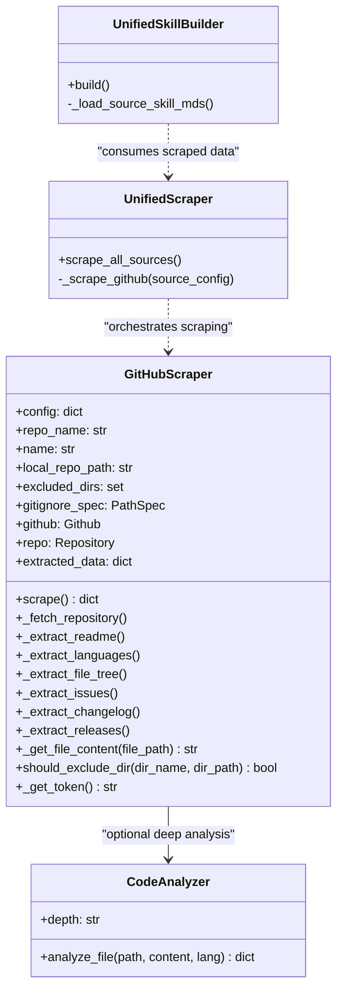
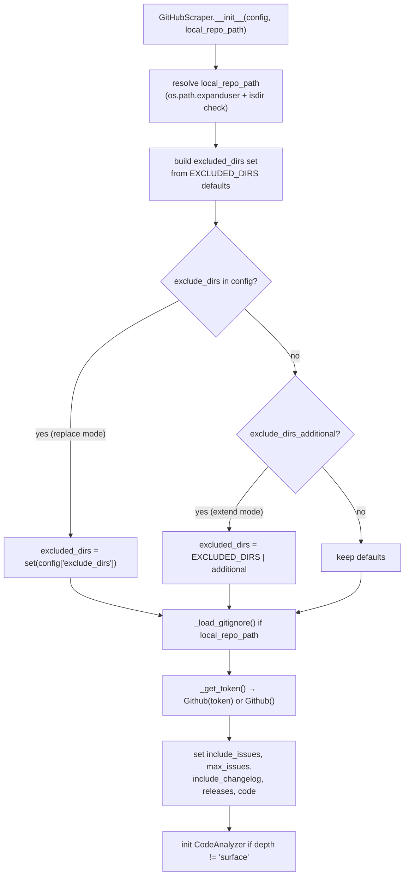
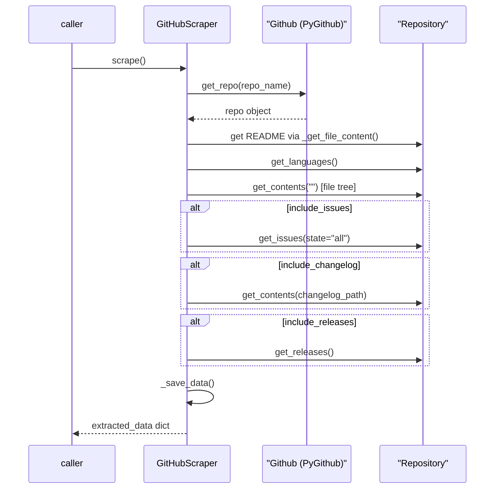
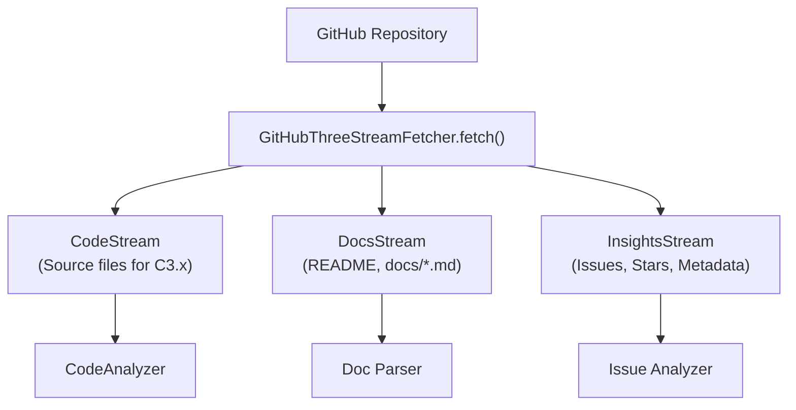

<!-- source: DeepWiki mcp.deepwiki.com · repo yusufkaraaslan/Skill_Seekers · page 5.2 GitHub Scraper · fetched 2026-10-26 -->

# GitHub Scraper

Relevant source files

The following files were used as context for generating this wiki page:

- [src/skill_seekers/cli/config_validator.py](src/skill_seekers/cli/config_validator.py)
- [src/skill_seekers/cli/generate_router.py](src/skill_seekers/cli/generate_router.py)
- [src/skill_seekers/cli/github_fetcher.py](src/skill_seekers/cli/github_fetcher.py)
- [src/skill_seekers/cli/github_scraper.py](src/skill_seekers/cli/github_scraper.py)
- [src/skill_seekers/cli/pdf_scraper.py](src/skill_seekers/cli/pdf_scraper.py)
- [src/skill_seekers/cli/split_config.py](src/skill_seekers/cli/split_config.py)
- [tests/test_github_fetcher.py](tests/test_github_fetcher.py)
- [tests/test_github_scraper.py](tests/test_github_scraper.py)

This page describes `GitHubScraper` in [src/skill_seekers/cli/github_scraper.py](), which extracts repository data from GitHub and converts it into a structured AI skill. It covers the initialization pipeline, authentication, the core extraction tasks (C1.1–C1.9), and the dual operating modes (GitHub API vs. local filesystem).

For details on API scraping vs. local repository analysis, token configuration via `ConfigManager`, environment variable fallbacks, and rate-limit strategies, see [GitHub API vs Local Mode](#5.2.1). For details on large file handling, symlink resolution, `download_url` fallbacks, issue limits, and `.gitignore` exclusions, see [Large File Handling & Rate Limits](#5.2.2). For how the extracted data is consumed downstream by the skill builder, see [Output Structure & Files](#12).

---

## Overview

The GitHub Scraper converts a GitHub repository into structured JSON data, which is subsequently used to produce a skill directory. Extraction follows a sequential task pipeline labeled C1.1–C1.9 in the codebase:

| Task | Method | Produces |
|------|--------|----------|
| C1.1 | `_fetch_repository` | `repo_info` dict |
| C1.2 | `_extract_readme` | `readme` string |
| C1.3–C1.6 | `_extract_code_structure` | `file_tree`, `languages`, `signatures`, `test_examples` |
| C1.4 | `_extract_languages` | `languages` dict |
| C1.7 | `_extract_issues` | `issues` list |
| C1.8 | `_extract_changelog` | `changelog` string |
| C1.9 | `_extract_releases` | `releases` list |

All extracted data is accumulated in `self.extracted_data` and persisted to disk via `_save_data`.

Sources: [src/skill_seekers/cli/github_scraper.py:310-353]()

---

## Class Structure

`GitHubScraper` handles data extraction from remote repositories or local paths, while downstream builders like `UnifiedSkillBuilder` assemble the skill directory.

**Diagram: Class relationships in github_scraper.py**

Sources: [src/skill_seekers/cli/github_scraper.py:185-286](), [src/skill_seekers/cli/unified_scraper.py:179-180](), [src/skill_seekers/cli/unified_skill_builder.py:103-121]()

---

## Initialization & Authentication

`GitHubScraper.__init__` performs configuration parsing, local path resolution, directory exclusion setup, and PyGithub client initialization.

**Diagram: `__init__` initialization sequence**

Authentication relies on environment variables and configuration parameters. For complete details on token resolution via `ConfigManager`, fallback behavior, and rate-limit mitigation strategies, see [GitHub API vs Local Mode](#5.2.1).

Sources: [src/skill_seekers/cli/github_scraper.py:201-286](), [src/skill_seekers/cli/github_scraper.py:288-308]()

---

## Extraction Pipeline

`scrape` executes the extraction sequence, invoking specialized methods for repository metadata, README documentation, language statistics, file trees, issues, changelogs, and releases.

**Diagram: `scrape()` method call sequence**

For information regarding large file handling, symlink resolution, raw download fallback URLs, `.gitignore` matching, and issue volume limits, see [Large File Handling & Rate Limits](#5.2.2).

Sources: [src/skill_seekers/cli/github_scraper.py:310-353]()

---

## Three-Stream Fetcher Architecture

The package also incorporates `GitHubThreeStreamFetcher` in [src/skill_seekers/cli/github_fetcher.py](), which partitions a repository into code, documentation, and insights streams to support advanced codebase analysis.

**Diagram: Three-Stream Data Flow**

Sources: [src/skill_seekers/cli/github_fetcher.py:25-77]()

---

## Configuration Reference

The following table outlines top-level configuration options recognized by `GitHubScraper`:

| Field | Type | Default | Purpose |
|-------|------|---------|---------|
| `repo` | str | required | `owner/repo` repository identifier |
| `name` | str | last segment of `repo` | skill output name |
| `description` | str | auto from README | description override |
| `local_repo_path` | str | `None` | enables local filesystem analysis mode |
| `github_token` | str | `None` | API token fallback |
| `exclude_dirs` | list | — | replaces default exclusion set |
| `exclude_dirs_additional` | list | — | extends default exclusion set |
| `include_issues` | bool | `True` | extracts GitHub issues |
| `max_issues` | int | `100` | maximum number of issues to fetch |
| `include_changelog` | bool | `True` | extracts repository changelog |
| `include_releases` | bool | `True` | extracts release tags and notes |
| `include_code` | bool | `False` | runs code analysis tasks |
| `code_analysis_depth` | str | `"surface"` | analysis depth level |

Sources: [src/skill_seekers/cli/github_scraper.py:201-286](), [docs/reference/CONFIG_FORMAT.md:143-165]()

---

