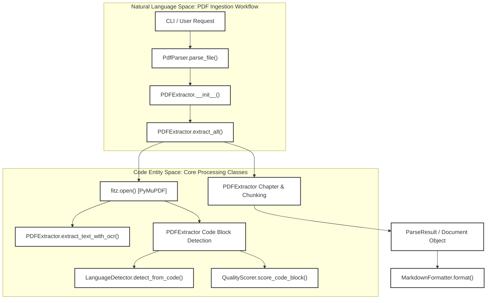
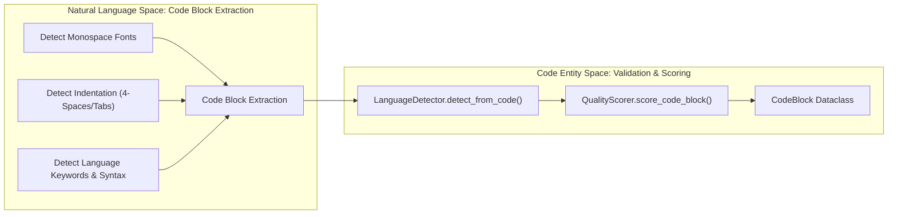
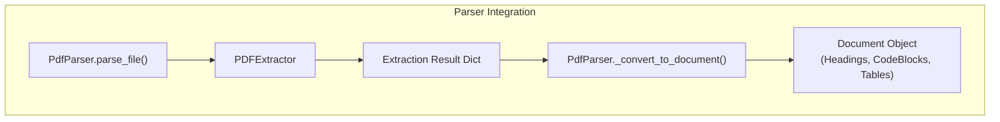

<!-- source: DeepWiki mcp.deepwiki.com · repo yusufkaraaslan/Skill_Seekers · page 5.3 PDF Scraper · fetched 2026-10-26 -->

# PDF Scraper

<details>
<summary>Relevant source files</summary>

The following files were used as context for generating this wiki page:

- [docs/UML/exports/04_analysis.png](docs/UML/exports/04_analysis.png)
- [src/skill_seekers/cli/language_detector.py](src/skill_seekers/cli/language_detector.py)
- [src/skill_seekers/cli/parsers/extractors/__init__.py](src/skill_seekers/cli/parsers/extractors/__init__.py)
- [src/skill_seekers/cli/parsers/extractors/base_parser.py](src/skill_seekers/cli/parsers/extractors/base_parser.py)
- [src/skill_seekers/cli/parsers/extractors/formatters.py](src/skill_seekers/cli/parsers/extractors/formatters.py)
- [src/skill_seekers/cli/parsers/extractors/markdown_parser.py](src/skill_seekers/cli/parsers/extractors/markdown_parser.py)
- [src/skill_seekers/cli/parsers/extractors/pdf_parser.py](src/skill_seekers/cli/parsers/extractors/pdf_parser.py)
- [src/skill_seekers/cli/parsers/extractors/quality_scorer.py](src/skill_seekers/cli/parsers/extractors/quality_scorer.py)
- [src/skill_seekers/cli/parsers/extractors/rst_parser.py](src/skill_seekers/cli/parsers/extractors/rst_parser.py)
- [src/skill_seekers/cli/parsers/extractors/unified_structure.py](src/skill_seekers/cli/parsers/extractors/unified_structure.py)
- [src/skill_seekers/cli/pdf_extractor_poc.py](src/skill_seekers/cli/pdf_extractor_poc.py)
- [src/skill_seekers/cli/swift_patterns.py](src/skill_seekers/cli/swift_patterns.py)
- [tests/test_pdf_extractor.py](tests/test_pdf_extractor.py)
- [tests/test_swift_detection.py](tests/test_swift_detection.py)
- [tests/test_unified_parsers.py](tests/test_unified_parsers.py)

</details>


## Purpose and Scope

The PDF scraper subsystem handles the ingestion, extraction, and conversion of PDF documentation files into structured skill artifacts. Implemented primarily via `PDFExtractor` [src/skill_seekers/cli/pdf_extractor_poc.py:87](), `PdfParser` [src/skill_seekers/cli/parsers/extractors/pdf_parser.py:33](), and supporting orchestrators, this subsystem executes multi-modal code block detection (font, indent, and pattern-based), optical character recognition (OCR) for scanned documents, table extraction, chunking, chapter detection, and parallel execution.

---

## Architecture Overview

The PDF extraction pipeline bridges high-level document processing requests to low-level parsing routines using PyMuPDF (`fitz`) and language scoring engines. 


Sources: [src/skill_seekers/cli/pdf_extractor_poc.py:87-155](), [src/skill_seekers/cli/parsers/extractors/pdf_parser.py:33-136]()

---

## `PDFExtractor` Implementation & Code Block Detection Strategies

The `PDFExtractor` class (`[src/skill_seekers/cli/pdf_extractor_poc.py:87-155]()`) processes PDF files page by page. It applies three distinct strategies to identify code snippets embedded within prose documentation.


Sources: [src/skill_seekers/cli/pdf_extractor_poc.py:233-490](), [src/skill_seekers/cli/language_detector.py:54-109]()

### Detection Strategies
1. **Font-based Detection:** Inspects text spans for monospace font family descriptors (e.g., `courier`, `mono`, `consolas`, `menlo`).
2. **Indent-based Detection:** Identifies block indentations consisting of consistent tab or 4-space alignments across consecutive lines.
3. **Pattern-based Detection:** Evaluates regex signatures matching language-specific constructs (e.g., function definitions, class keywords, and structural braces).

Each discovered code block is evaluated by `LanguageDetector` [src/skill_seekers/cli/language_detector.py:11]() and scored for quality via `QualityScorer` [src/skill_seekers/cli/parsers/extractors/quality_scorer.py:15]().

---

## OCR, Table Extraction, and Chapter Chunking

### OCR Support
When processing scanned documents where extracted text length falls below threshold bounds (`len(text) < 50`), `PDFExtractor.extract_text_with_ocr()` falls back to rendering page pixmaps via PyMuPDF and processing them using `pytesseract` [src/skill_seekers/cli/pdf_extractor_poc.py:161-193]():

```python
# Conceptual invocation pattern within PDFExtractor
pix = page.get_pixmap()
text = pytesseract.image_to_string(Image.frombytes("RGB", [pix.width, pix.height], pix.samples))
```
Sources: [src/skill_seekers/cli/pdf_extractor_poc.py:161-193]()

### Table Extraction
Structured tables are parsed when `extract_tables=True` is supplied to `PDFExtractor` [src/skill_seekers/cli/pdf_extractor_poc.py:121]() and wrapped into `Table` entities via `PdfParser` [src/skill_seekers/cli/parsers/extractors/pdf_parser.py:53]().

### Chapter Detection and Chunking
Documents are broken into manageable slices using `chunk_size` (pages per chunk) [src/skill_seekers/cli/pdf_extractor_poc.py:114]() and chapter boundary heuristics, facilitating balanced downstream processing and RAG indexing.

---

## Parallel Processing and Caching

To optimize ingestion performance on large manuals, `PDFExtractor` supports multi-threaded worker pools and operation caching [src/skill_seekers/cli/pdf_extractor_poc.py:122-124]():

- **Parallel Execution:** When `parallel=True`, page extraction distributes workloads across `concurrent.futures.ThreadPoolExecutor` workers up to `max_workers` (`os.cpu_count()`) [src/skill_seekers/cli/pdf_extractor_poc.py:80-84, 122-139]().
- **Caching:** Expensive parsing and OCR passes are stored in an internal `self._cache` dictionary to prevent redundant re-computation during iterative skill generation [src/skill_seekers/cli/pdf_extractor_poc.py:124, 151]().

Sources: [src/skill_seekers/cli/pdf_extractor_poc.py:79-151]()

---

## Integration with Parsers and Unified Structure

`PdfParser` (`[src/skill_seekers/cli/parsers/extractors/pdf_parser.py:33]`) inherits from `BaseParser` (`[src/skill_seekers/cli/parsers/extractors/base_parser.py:35]()`) and standardizes PDF extraction results into the universal `Document` schema (`[src/skill_seekers/cli/parsers/extractors/unified_structure.py:203]()`).


Sources: [src/skill_seekers/cli/parsers/extractors/pdf_parser.py:81-136](), [src/skill_seekers/cli/parsers/extractors/unified_structure.py:203-223]()

---
Sources: [src/skill_seekers/cli/pdf_extractor_poc.py:1-1735](), [src/skill_seekers/cli/parsers/extractors/pdf_parser.py:1-279](), [src/skill_seekers/cli/language_detector.py:1-740]()

---

