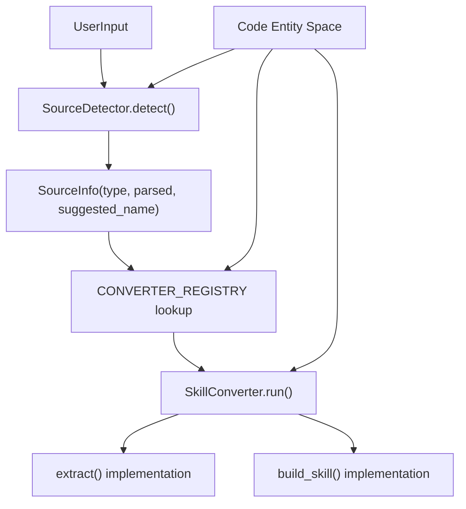
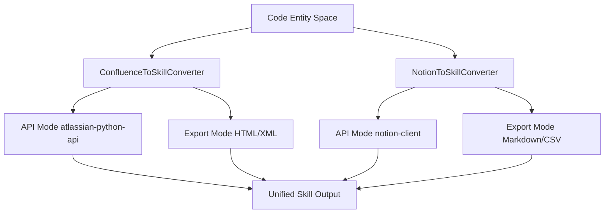

<!-- source: DeepWiki mcp.deepwiki.com · repo yusufkaraaslan/Skill_Seekers · page 5.5 Additional Source Types · fetched 2026-10-26 -->

# Additional Source Types

<details>
<summary>Relevant source files</summary>

The following files were used as context for generating this wiki page:

- [src/skill_seekers/cli/asciidoc_scraper.py](src/skill_seekers/cli/asciidoc_scraper.py)
- [src/skill_seekers/cli/chat_scraper.py](src/skill_seekers/cli/chat_scraper.py)
- [src/skill_seekers/cli/confluence_scraper.py](src/skill_seekers/cli/confluence_scraper.py)
- [src/skill_seekers/cli/epub_scraper.py](src/skill_seekers/cli/epub_scraper.py)
- [src/skill_seekers/cli/html_scraper.py](src/skill_seekers/cli/html_scraper.py)
- [src/skill_seekers/cli/jupyter_scraper.py](src/skill_seekers/cli/jupyter_scraper.py)
- [src/skill_seekers/cli/main.py](src/skill_seekers/cli/main.py)
- [src/skill_seekers/cli/notion_scraper.py](src/skill_seekers/cli/notion_scraper.py)
- [src/skill_seekers/cli/parsers/__init__.py](src/skill_seekers/cli/parsers/__init__.py)
- [src/skill_seekers/cli/pptx_scraper.py](src/skill_seekers/cli/pptx_scraper.py)
- [src/skill_seekers/cli/skill_converter.py](src/skill_seekers/cli/skill_converter.py)
- [src/skill_seekers/cli/source_detector.py](src/skill_seekers/cli/source_detector.py)
- [src/skill_seekers/cli/word_scraper.py](src/skill_seekers/cli/word_scraper.py)
- [tests/test_cli_parsers.py](tests/test_cli_parsers.py)
- [tests/test_new_source_types.py](tests/test_new_source_types.py)
- [tests/test_word_scraper.py](tests/test_word_scraper.py)

</details>


## Purpose and Scope

This page provides full technical documentation for the remaining 12 ingestion engines supported by `skill-seekers`: **Word (`.docx`)**, **EPUB (`.epub`)**, **Jupyter Notebooks (`.ipynb`)**, **HTML (`.html`/`.htm`)**, **OpenAPI/Swagger (`.yaml`/`.json`)**, **AsciiDoc (`.adoc`)**, **PowerPoint (`.pptx`)**, **RSS/Atom Feeds (`.rss`/`.atom`)**, **Man Pages (`.1`-`.8`, `.man`)**, **Confluence**, **Notion**, and **Chat scrapers (Slack/Discord)**. 

All of these ingestion engines inherit from the abstract base class `SkillConverter` [src/skill_seekers/cli/skill_converter.py:19-112]() and are registered in the unified `CONVERTER_REGISTRY` mapping [src/skill_seekers/cli/skill_converter.py:115-139](). They share a common execution flow managed by the `create` command dispatcher [src/skill_seekers/cli/main.py:50-56]() via `SourceDetector` [src/skill_seekers/cli/source_detector.py:48-175]().

---

## 5.5.1 Ingestion Architecture & Converter Registry

When a user executes `skill-seekers create <source>` [src/skill_seekers/cli/main.py:11](), the input string is evaluated by `SourceDetector.detect()` [src/skill_seekers/cli/source_detector.py:58-175]() to determine the correct source type and extract parsing parameters into a `SourceInfo` dataclass [src/skill_seekers/cli/source_detector.py:32-46](). 

The resulting source type string is then used to look up the concrete implementation class in `CONVERTER_REGISTRY` [src/skill_seekers/cli/skill_converter.py:115-139]().


*Sources: [src/skill_seekers/cli/source_detector.py:48-175](), [src/skill_seekers/cli/skill_converter.py:19-139]()*

The following table summarizes the registered source types, their optional dependency groups, and their corresponding backing classes:

| Source Type | Key in `CONVERTER_REGISTRY` | Backing Class | Optional Dependency Group |
| :--- | :--- | :--- | :--- |
| **Word** | `word` | `WordToSkillConverter` [src/skill_seekers/cli/word_scraper.py:78-83]() | `[docx]` (`mammoth`, `python-docx`) |
| **EPUB** | `epub` | `EpubToSkillConverter` [src/skill_seekers/cli/epub_scraper.py:72-77]() | `[epub]` (`ebooklib`) |
| **Jupyter** | `jupyter` | `JupyterToSkillConverter` | `[jupyter]` (`nbconvert`, `nbformat`) |
| **HTML** | `html` | `HtmlToSkillConverter` [src/skill_seekers/cli/html_scraper.py:102-119]() | Core (`beautifulsoup4`) |
| **OpenAPI** | `openapi` | `OpenAPIToSkillConverter` | Core (`PyYAML`) |
| **AsciiDoc** | `asciidoc` | `AsciiDocToSkillConverter` | `[asciidoc]` (`asciidoctor` or Python parser) |
| **PowerPoint** | `pptx` | `PptxToSkillConverter` | `[pptx]` (`python-pptx`) |
| **RSS/Atom** | `rss` | `RssToSkillConverter` | Core (`feedparser`, `beautifulsoup4`) |
| **Manpage** | `manpage` | `ManPageToSkillConverter` | Core (`man` binary or pure-Python fallback) |
| **Confluence** | `confluence` | `ConfluenceToSkillConverter` [src/skill_seekers/cli/confluence_scraper.py:182-198]() | `[confluence]` (`atlassian-python-api`) |
| **Notion** | `notion` | `NotionToSkillConverter` [src/skill_seekers/cli/notion_scraper.py:75-81]() | `[notion]` (`notion-client`) |
| **Chat** | `chat` | `ChatToSkillConverter` | `[chat]` (`slack_sdk`, `discord.py`) |

*Sources: [src/skill_seekers/cli/skill_converter.py:115-139](), [src/skill_seekers/cli/word_scraper.py:36-44](), [src/skill_seekers/cli/epub_scraper.py:37-45](), [src/skill_seekers/cli/confluence_scraper.py:137-145](), [src/skill_seekers/cli/notion_scraper.py:48-56]()*

---

## 5.5.2 Document & Text Formats

### Word Documents (`.docx`)
* **Implementation**: `WordToSkillConverter` inherits from `DocumentSkillBuilder` [src/skill_seekers/cli/word_scraper.py:78-83]().
* **Extraction Pipeline**: Utilizes `mammoth` to convert body paragraphs to HTML, respecting native Word styling [src/skill_seekers/cli/word_scraper.py:156-160](). Metadata (title, author, created, modified) is extracted via `python-docx` [src/skill_seekers/cli/word_scraper.py:141-150]().
* **Data Flow**: HTML is parsed using `BeautifulSoup` and segmented by `<h1>`/`<h2>` heading boundaries into structured sections [src/skill_seekers/cli/word_scraper.py:162-196](). Code blocks are identified and scored for quality via `LanguageDetector` [src/skill_seekers/cli/word_scraper.py:131]().

### EPUB E-Books (`.epub`)
* **Implementation**: `EpubToSkillConverter` inherits from `DocumentSkillBuilder` [src/skill_seekers/cli/epub_scraper.py:72-77]().
* **Extraction Pipeline**: Reads EPUB files using `ebooklib` with `ignore_ncx=True` to bypass common EPUB 3 Table of Contents parsing bugs [src/skill_seekers/cli/epub_scraper.py:151-153](). Fails fast if DRM protection is detected via `encryption.xml` checks [src/skill_seekers/cli/epub_scraper.py:157-163]().
* **Data Flow**: Iterates through spine items in reading order, parses XHTML content, extracts embedded images, and segments chapters into markdown reference files [src/skill_seekers/cli/epub_scraper.py:176-194]().

### AsciiDoc (`.adoc`) & Man Pages (`.man`, `.1`-`.8`)
* **AsciiDoc**: Parses technical manuals written in AsciiDoc syntax, extracting attributes, admonitions, and source code blocks into structured markdown.
* **Man Pages**: Ingests UNIX/Linux manual pages, parsing section headers (`SYNOPSIS`, `DESCRIPTION`, `OPTIONS`, `EXAMPLES`) into structured AI-ready reference documentation.

*Sources: [src/skill_seekers/cli/word_scraper.py:78-196](), [src/skill_seekers/cli/epub_scraper.py:72-194]()*, `tests/test_new_source_types.py`

---

## 5.5.3 Structured Data & Code Formats

### Jupyter Notebooks (`.ipynb`)
* **Extraction Pipeline**: Parses JSON-based notebook structures, separating markdown explanation cells from executable code cells (`code`, `markdown`, `raw`).
* **Output Shape**: Converts code cells into fenced code blocks with detected language identifiers and captures execution outputs (text/HTML/images) as reference documentation.

### HTML Files and Directories (`.html`, `.htm`, `.xhtml`)
* **Implementation**: `HtmlToSkillConverter` inherits from `DocumentSkillBuilder` [src/skill_seekers/cli/html_scraper.py:102-119]().
* **Directory Auto-Detection**: `SourceDetector` scans directory contents; if dominated by `.html` files (e.g., Doxygen or Sphinx documentation mirrors), the path is routed to `html` rather than `local` [src/skill_seekers/cli/source_detector.py:132-137]().
* **Extraction Pipeline**: Uses `parse_html` with a lenient HTML parser fallback to extract headings, article tags, code blocks, tables, and links [src/skill_seekers/cli/html_scraper.py:171-181]().

### OpenAPI & Swagger Specifications (`.yaml`, `.json`)
* **Extraction Pipeline**: Validates and parses OpenAPI 3.0+ or Swagger 2.0 specifications.
* **Data Flow**: Iterates through paths, operations, query parameters, request bodies, and response schemas, transforming API endpoints into structured markdown reference guides for AI coding agents.

### PowerPoint Presentations (`.pptx`)
* **Extraction Pipeline**: Iterates through slide decks using `python-pptx`, extracting slide titles, body text frames, speaker notes, and tables into sequential reference files.

### RSS / Atom Feeds (`.rss`, `.atom`)
* **Extraction Pipeline**: Fetches feed items using `feedparser`, parses HTML description payloads with `BeautifulSoup`, and generates chronologically organized reference documentation.

*Sources: [src/skill_seekers/cli/source_detector.py:71-137](), [src/skill_seekers/cli/html_scraper.py:102-181]()*, `tests/test_new_source_types.py`

---

## 5.5.4 API & Workspace Platforms

### Confluence Spaces
* **Implementation**: `ConfluenceToSkillConverter` [src/skill_seekers/cli/confluence_scraper.py:182-198]().
* **Modes**: Supports **API Mode** (connecting to Confluence REST APIs using `atlassian-python-api`) and **Export Mode** (parsing offline HTML/XML export directories) [src/skill_seekers/cli/confluence_scraper.py:185-194]().
* **Data Flow**: Preserves parent-child page hierarchies, strips Confluence-specific storage format macros (`ac:structured-macro`), and converts tables and code macros into standard markdown [src/skill_seekers/cli/confluence_scraper.py:58-90]().

### Notion Workspaces
* **Implementation**: `NotionToSkillConverter` [src/skill_seekers/cli/notion_scraper.py:75-81]().
* **Modes**: Supports **API Mode** (querying databases and page trees via `notion-client`) and **Export Mode** (parsing Markdown/CSV exports from Notion settings) [src/skill_seekers/cli/notion_scraper.py:5-10]().
* **Data Flow**: Recursively fetches block children up to `MAX_BLOCK_DEPTH = 5` [src/skill_seekers/cli/notion_scraper.py:45], handling rate limits with delays (`RATE_LIMIT_DELAY = 0.35s`) [src/skill_seekers/cli/notion_scraper.py:44].

### Chat Scrapers (Slack / Discord)
* **Extraction Pipeline**: Ingests channel export histories or live workspace archives, structuring threaded conversations, code snippets, and Q&A pairs into searchable skill reference files.


*Sources: [src/skill_seekers/cli/confluence_scraper.py:182-198](), [src/skill_seekers/cli/notion_scraper.py:75-81]()*

---

## 5.5.5 Configuration Schemas & Optional Dependencies

When invoking ingestion engines requiring optional third-party packages, `skill-seekers` enforces **fail-fast validation** at converter initialization time rather than mid-extraction [src/skill_seekers/cli/skill_converter.py:141-147]().

If an optional dependency is missing, the converter invokes its check helper function (e.g., `_check_word_deps()` [src/skill_seekers/cli/word_scraper.py:36-44](), `_check_epub_deps()` [src/skill_seekers/cli/epub_scraper.py:37-45](), `_check_atlassian_deps()` [src/skill_seekers/cli/confluence_scraper.py:137-145](), or `_check_notion_deps()` [src/skill_seekers/cli/notion_scraper.py:48-56]()), which raises a `RuntimeError` with installation instructions.

### Example Unified JSON Configuration for Additional Sources
```json
{
  "name": "enterprise-wiki",
  "description": "Use when referencing enterprise architecture and documentation",
  "sources": [
    {
      "type": "confluence",
      "base_url": "https://wiki.example.com",
      "space_key": "ARCH",
      "username": "user@example.com",
      "token": "${CONFLUENCE_TOKEN}"
    },
    {
      "type": "word",
      "docx_path": "./docs/specification.docx"
    }
  ]
}
```
*Sources: [src/skill_seekers/cli/word_scraper.py:36-44](), [src/skill_seekers/cli/epub_scraper.py:37-45](), [src/skill_seekers/cli/confluence_scraper.py:137-145](), [src/skill_seekers/cli/notion_scraper.py:48-56]()*

---

