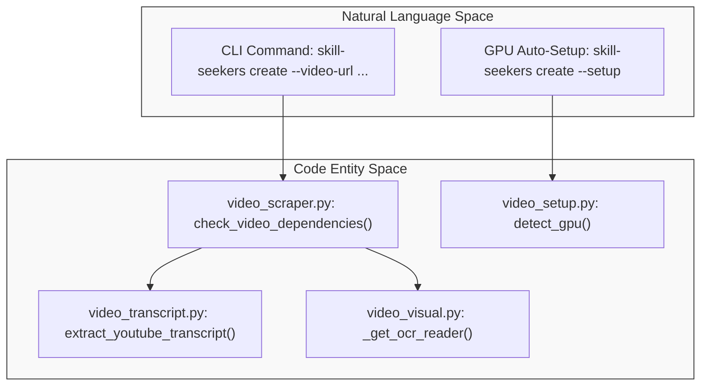
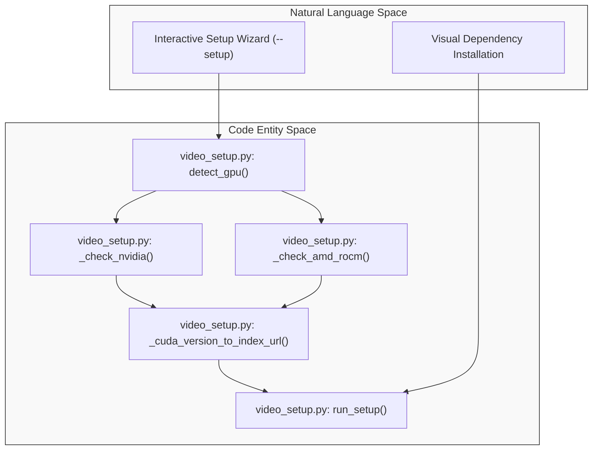

<!-- source: DeepWiki mcp.deepwiki.com · repo yusufkaraaslan/Skill_Seekers · page 5.6 Video & Multimedia Ingestion · fetched 2026-10-26 -->

# Video & Multimedia Ingestion

<details>
<summary>Relevant source files</summary>

The following files were used as context for generating this wiki page:

- [docs/ARCHITECTURE.md](docs/ARCHITECTURE.md)
- [docs/BEST_PRACTICES.md](docs/BEST_PRACTICES.md)
- [docs/VIDEO_GUIDE.md](docs/VIDEO_GUIDE.md)
- [docs/features/ENHANCEMENT_MODES.md](docs/features/ENHANCEMENT_MODES.md)
- [docs/reference/MCP_REFERENCE.md](docs/reference/MCP_REFERENCE.md)
- [docs/zh-CN/README.md](docs/zh-CN/README.md)
- [docs/zh-CN/user-guide/04-packaging.md](docs/zh-CN/user-guide/04-packaging.md)
- [src/skill_seekers/cli/arguments/video.py](src/skill_seekers/cli/arguments/video.py)
- [src/skill_seekers/cli/video_scraper.py](src/skill_seekers/cli/video_scraper.py)
- [src/skill_seekers/cli/video_setup.py](src/skill_seekers/cli/video_setup.py)
- [src/skill_seekers/cli/video_transcript.py](src/skill_seekers/cli/video_transcript.py)
- [src/skill_seekers/cli/video_visual.py](src/skill_seekers/cli/video_visual.py)
- [tests/test_video_scraper.py](tests/test_video_scraper.py)
- [tests/test_video_setup.py](tests/test_video_setup.py)

</details>


## Overview and Scope

The video and multimedia ingestion subsystem of `skill-seekers` enables the conversion of video tutorials, courses, and local recordings into structured AI skills. It is architected into two distinct capability tiers:

1. **Tier 1 (Transcript & Metadata Only)**: Lightweight extraction (`~15 MB`) utilizing `yt-dlp` for metadata and chapter extraction, and `youtube-transcript-api` or subtitle files (`.srt`/`.vtt`) for text transcripts [docs/VIDEO_GUIDE.md:32-40]().
2. **Tier 2 (Full Visual Extraction & ASR)**: Heavyweight extraction utilizing OpenCV, SceneDetect, EasyOCR, Tesseract, and `faster-whisper` for audio-visual alignment, OCR on code editors and terminals, and speech-to-text transcription [src/skill_seekers/cli/video_visual.py:1-10]().

This leaf page documents the core modules comprising this subsystem: `video_scraper.py`, `video_transcript.py`, `video_visual.py`, and `video_setup.py`.

---

## 1. Video Scraper & Ingestion Orchestration (`video_scraper.py`)

The main entry point for video ingestion orchestrates metadata retrieval, transcript fetching, and optional visual analysis. It inherits from the base `SkillConverter` interface [src/skill_seekers/cli/video_scraper.py:23]().

### Dependency Guards & Source Options
The module implements defensive imports via `check_video_dependencies(require_full: bool)` to ensure required libraries (`yt-dlp`, `youtube-transcript-api`) are present before execution, raising a descriptive `RuntimeError` with installation hints (`pip install "skill-seekers[video]"` or `[video-full]`) if missing [src/skill_seekers/cli/video_scraper.py:57-94]().

Supported source types defined in `VideoSourceType` include YouTube videos/playlists (`youtube`), local files (`local_file`), and Vimeo (`vimeo`) [src/skill_seekers/cli/video_scraper.py:30]().

### Helper Utilities
- **`parse_time_to_seconds(time_str: str) -> float`**: Parses time strings in plain seconds (`"330"`), `MM:SS` (`"5:30"`), or `HH:MM:SS` (`"00:05:30"`). Raises `ValueError` on malformed inputs [src/skill_seekers/cli/video_scraper.py:111-147]().
- **`infer_description_from_video(video_info: VideoInfo, name: str) -> str`**: Generates fallback skill descriptions based on video metadata or descriptions [src/skill_seekers/cli/video_scraper.py:167-181]().

### Diagram: Video Ingestion Pipeline (Natural Language to Code Entities)



*Sources: [src/skill_seekers/cli/video_scraper.py:57](), [src/skill_seekers/cli/video_transcript.py:45](), [src/skill_seekers/cli/video_visual.py:128](), [src/skill_seekers/cli/video_setup.py:119]()*

---

## 2. Transcript Extraction (`video_transcript.py`)

The transcript extraction module handles acquiring time-stamped text segments from various sources.

### YouTube Caption Extraction (Tier 1)
`extract_youtube_transcript(video_id: str, languages: list[str] | None)` utilizes `YouTubeTranscriptApi` to query caption tracks [src/skill_seekers/cli/video_transcript.py:45-60](). It inspects available transcripts to prioritize manually created captions (`TranscriptSource.YOUTUBE_MANUAL`) over auto-generated ones (`TranscriptSource.YOUTUBE_AUTO`) [src/skill_seekers/cli/video_transcript.py:74-101](). Each snippet is mapped into a `TranscriptSegment` dataclass containing `text`, `start`, `end`, `confidence`, and `source` [src/skill_seekers/cli/video_transcript.py:102-118]().

### Subtitle File Parsing (Tier 1)
- **`parse_srt(path: str)`**: Reads `.srt` subtitle files, parses timestamps via `_parse_timestamp_srt` (`HH:MM:SS,mmm`), strips HTML markup, and returns a list of `TranscriptSegment` objects marked with `TranscriptSource.SUBTITLE_FILE` [src/skill_seekers/cli/video_transcript.py:134-210]().
- **WebVTT Parsing**: Similar logic parses `.vtt` files using `_parse_timestamp_vtt` [src/skill_seekers/cli/video_transcript.py:144-154]().

### Whisper ASR Fallback (Tier 2)
For local video files lacking accompanying subtitle files, `faster-whisper` is invoked if installed, transcribing raw audio streams into time-aligned segments [src/skill_seekers/cli/video_transcript.py:31-38]().

---

## 3. Visual & Frame Analysis (`video_visual.py`)

Visual extraction processes video frames to identify code editors, terminals, and slides, performing OCR and audio-visual alignment.

### GPU & MIOpen Environment Tuning
Before loading PyTorch via EasyOCR, the module configures environment variables to prevent ROCm/MIOpen memory allocation lockups:
```python
os.environ["MIOPEN_FIND_MODE"] = "FAST"
```
It defines `_detect_gpu()` and `_cpu_supports_quantized_ops()` to verify CUDA/ROCm availability and check for CPU AVX2 instruction support, dynamically disabling model quantization on legacy x86 CPUs to avoid illegal instruction exceptions (`SIGILL`) [src/skill_seekers/cli/video_visual.py:39-126]().

### OCR Pipeline & Preprocessing
- **`_get_ocr_reader()`**: Implements a lazy singleton pattern for the `easyocr.Reader` instance [src/skill_seekers/cli/video_visual.py:128-143]().
- **`_detect_theme(gray_img)`**: Classifies frame themes as `"dark"` or `"light"` based on median pixel brightness (`< 128`) [src/skill_seekers/cli/video_visual.py:146-155]().
- **`_preprocess_frame_for_ocr(frame_path, frame_type)`**: Applies specialized preprocessing for code and terminal frames. For dark themes, it inverts BGR colors to preserve syntax highlighting distinction, converts to grayscale, upscales low-resolution frames using `cv2.INTER_CUBIC`, and applies CLAHE (Contrast Limited Adaptive Histogram Equalization) [src/skill_seekers/cli/video_visual.py:157-209]().

### Audio-Visual Alignment
`_build_audio_visual_alignments(timeline, transcript_segments)` pairs on-screen text appearances with overlapping transcript segments based on active timestamp windows [src/skill_seekers/cli/video_scraper.py:188-216]().

---

## 4. GPU-Aware Dependency Setup (`video_setup.py`)

Visual extraction dependencies require native compilation matching specific hardware configurations. `video_setup.py` provides automated detection and installation orchestration.

### Hardware Detection without Torch
`detect_gpu() -> GPUInfo` probes system binaries without importing heavy Python packages:
1. Checks for NVIDIA via `nvidia-smi` and extracts CUDA compute version [src/skill_seekers/cli/video_setup.py:123-187]().
2. Checks for AMD ROCm via `rocminfo` and `/opt/rocm/.info/version` [src/skill_seekers/cli/video_setup.py:190-221]().
3. Falls back to `lspci` to check for unconfigured AMD hardware or defaults to CPU-only [src/skill_seekers/cli/video_setup.py:138-149]().

### Version-to-Index URL Mappings
Helper functions map detected major/minor versions to official PyTorch wheel repository index URLs [src/skill_seekers/cli/video_setup.py:78-112]():
- `_cuda_version_to_index_url(version)`: Maps CUDA versions `>= 12.4` to `/cu124`, `12.1` to `/cu121`, `11.8` to `/cu118`, else `/cpu`.
- `_rocm_version_to_index_url(version)`: Maps ROCm versions `>= 6.3` to `/rocm6.3`, `>= 6.0` to `/rocm6.2.4`, else `/cpu`.

### Diagram: GPU Auto-Detection and Setup Architecture (Natural Language to Code Entities)



*Sources: [src/skill_seekers/cli/video_setup.py:78](), [src/skill_seekers/cli/video_setup.py:119](), [src/skill_seekers/cli/video_setup.py:152](), [src/skill_seekers/cli/video_setup.py:190]()*

---

## 5. CLI Arguments & Integration Flags

Video ingestion parameters are exposed via the CLI argument parser group [src/skill_seekers/cli/arguments/video.py](). Key flags include:
- `--video-url`: Target URL for YouTube or Vimeo videos [docs/VIDEO_GUIDE.md:102]()
- `--video-file`: Path to a local video file [docs/VIDEO_GUIDE.md:103]()
- `--playlist`: Playlist URL for batch video ingestion [docs/VIDEO_GUIDE.md:104]()
- `--visual`: Enables Tier 2 visual and frame OCR extraction [docs/VIDEO_GUIDE.md:105]()
- `--setup`: Triggers GPU detection and dependency setup wizard [docs/VIDEO_GUIDE.md:111]()
- `--visual-interval`: Frame sampling frequency in seconds (default `0.7`) [docs/VIDEO_GUIDE.md:112]()

---
Sources:
- [src/skill_seekers/cli/video_scraper.py:1-1026]()
- [src/skill_seekers/cli/video_transcript.py:1-425]()
- [src/skill_seekers/cli/video_visual.py:1-2518]()
- [src/skill_seekers/cli/video_setup.py:1-833]()
- [docs/VIDEO_GUIDE.md:1-169]()
- [tests/test_video_scraper.py:1-215]()
- [tests/test_video_setup.py:1-187]()

---

