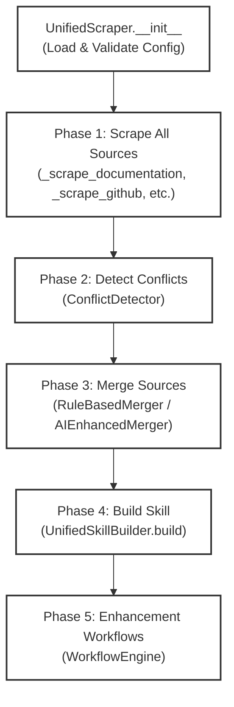

<!-- source: DeepWiki mcp.deepwiki.com · repo yusufkaraaslan/Skill_Seekers · page 6 Unified Multi-Source Scraping · fetched 2026-10-26 -->

# Unified Multi-Source Scraping

Relevant source files

The following files were used as context for generating this wiki page:

- [docs/features/UNIFIED_SCRAPING.md](docs/features/UNIFIED_SCRAPING.md)
- [src/skill_seekers/cli/doc_scraper.py](src/skill_seekers/cli/doc_scraper.py)
- [src/skill_seekers/cli/scraper_utils.py](src/skill_seekers/cli/scraper_utils.py)
- [src/skill_seekers/cli/unified_scraper.py](src/skill_seekers/cli/unified_scraper.py)
- [src/skill_seekers/cli/unified_skill_builder.py](src/skill_seekers/cli/unified_skill_builder.py)
- [tests/test_c3_integration.py](tests/test_c3_integration.py)
- [tests/test_multi_source.py](tests/test_multi_source.py)
- [tests/test_scraper_utils.py](tests/test_scraper_utils.py)
- [tests/test_unified.py](tests/test_unified.py)
- [tests/test_unified_scraper_orchestration.py](tests/test_unified_scraper_orchestration.py)

This page introduces the `UnifiedScraper` phase orchestration pipeline, explaining how skill-seekers combines multiple ingestion sources into a single comprehensive skill. It covers when to choose unified configurations over single-source configurations and provides a high-level overview of the five-phase scraping and synthesis process.

For detailed technical references, refer to the child pages:
- For the unified JSON schema and per-source-type fields, see [Unified Configuration Schema](#6.1).
- For conflict detection algorithms and reporting, see [Conflict Detection System](#6.2).
- For merger classes (`RuleBasedMerger`, `AIEnhancedMerger`) and synthesis formulas, see [Synthesis Strategies & Formulas](#6.3).

Sources: [src/skill_seekers/cli/unified_scraper.py:41-75](), [docs/features/UNIFIED_SCRAPING.md:1-20]()

---

## Overview & Unified vs. Single-Source Configs

When building an AI skill, knowledge about a technology often spans multiple formats: official web documentation, code repositories, PDF manuals, and local source directories. Running scrapers independently results in fragmented or conflicting outputs. The `UnifiedScraper` orchestrates multiple sources concurrently, detects discrepancies between them, and merges them into a cohesive skill directory.

### When to Use Unified vs. Single-Source Configs

| Scenario | Recommended Approach | CLI Command |
|---|---|---|
| Single documentation site | Single-source config | `skill-seekers scrape --config ...` |
| Single GitHub repository | Single-source config | `skill-seekers github --repo ...` |
| Single PDF manual | Single-source config | `skill-seekers pdf --path ...` |
| Multiple sources of the same or mixed types | Unified config | `skill-seekers unified --config ...` |
| Doc-vs-code discrepancy detection required | Unified config | `skill-seekers unified --config ...` |

Sources: [src/skill_seekers/cli/unified_scraper.py:41-51](), [docs/features/UNIFIED_SCRAPING.md:5-20]()

---

## The Five-Phase Orchestration Pipeline

The unified ingestion pipeline executes through five distinct phases managed by `UnifiedScraper` [src/skill_seekers/cli/unified_scraper.py:45-51]() and `UnifiedSkillBuilder` [src/skill_seekers/cli/unified_skill_builder.py:26-36]().

### Phase 1: Ingestion & Source Dispatch
The scraper iterates through the `sources` array defined in the configuration, routing each entry via `SOURCE_DISPATCH` to specialized sub-scrapers (documentation, GitHub, PDF, local codebases, and 13 other supported types) [src/skill_seekers/cli/unified_scraper.py:57-75](). Intermediate artifacts are isolated in `.skillseeker-cache/{name}/sources/` [src/skill_seekers/cli/unified_skill_builder.py:135-136]().

### Phase 2: Conflict Identification
Once raw data is collected across sources, conflict analysis identifies discrepancies between developer documentation and actual codebase implementations. For details on how discrepancies are isolated, see [Conflict Detection System](#6.2).

### Phase 3: Intelligent Merging
Conflicting API definitions, method signatures, or parameter types are reconciled according to the configured `merge_mode` (`rule-based` or `ai-enhanced`). For details on synthesis algorithms and streaming structures, see [Synthesis Strategies & Formulas](#6.3).

### Phase 4: Skill Assembly
`UnifiedSkillBuilder` synthesizes the cleaned data into the final skill directory structure, generating the master `SKILL.md`, organized `references/` subdirectories, and a `conflicts.md` summary if discrepancies were found [src/skill_seekers/cli/unified_skill_builder.py:108-122]().

### Phase 5: Post-Processing & Enhancement
Optional AI enhancement workflows are executed against the assembled skill directory to polish documentation tone, expand examples, and adapt formatting for target AI agents.

Sources: [src/skill_seekers/cli/unified_scraper.py:41-75](), [src/skill_seekers/cli/unified_skill_builder.py:26-122]()

---

## Child Pages & Detailed References

- **Unified Configuration Schema**: For detailed documentation on the root JSON structure (`name`, `description`, `merge_mode`, `sources`), validation rules via `ConfigValidator`, and per-source configuration blocks, see [Unified Configuration Schema](#6.1).
- **Conflict Detection System**: For deep technical details on `ConflictDetector`, discrepancy data structures (missing-in-docs, missing-in-code, signature mismatches), and `conflicts.md` reporting, see [Conflict Detection System](#6.2).
- **Synthesis Strategies & Formulas**: For architectural specifications on `RuleBasedMerger`, `AIEnhancedMerger`, the `ThreeStreamData` model, and `UnifiedSkillBuilder` synthesis formulas, see [Synthesis Strategies & Formulas](#6.3).

Sources: [src/skill_seekers/cli/unified_scraper.py:30-32](), [src/skill_seekers/cli/config_validator.py]()

---

