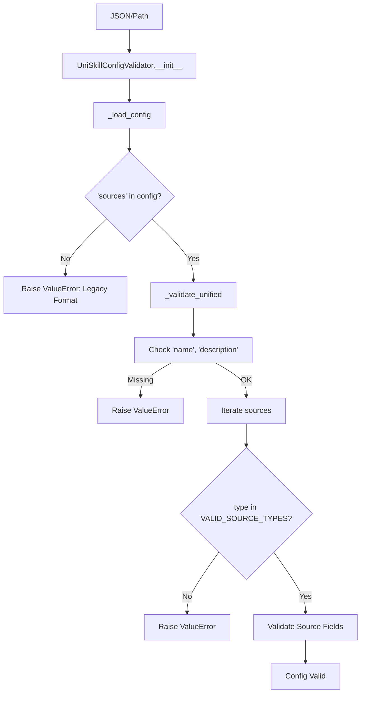
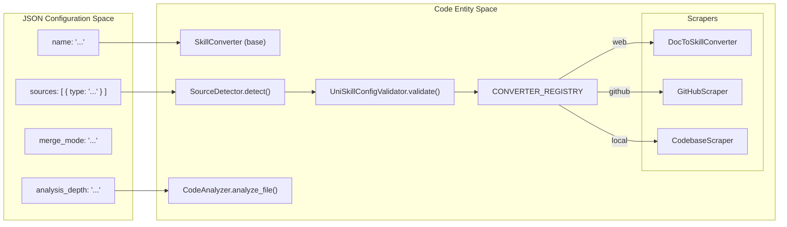
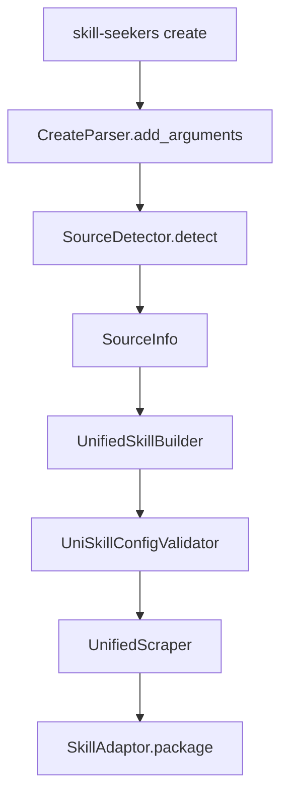

<!-- source: DeepWiki mcp.deepwiki.com · repo yusufkaraaslan/Skill_Seekers · page 6.1 Unified Configuration Schema · fetched 2026-10-26 -->

# Unified Configuration Schema

<details>
<summary>Relevant source files</summary>

The following files were used as context for generating this wiki page:

- [configs/godot_unified.json](configs/godot_unified.json)
- [docs/blog/UNIVERSAL_RAG_PREPROCESSOR.md](docs/blog/UNIVERSAL_RAG_PREPROCESSOR.md)
- [docs/features/BOOTSTRAP_SKILL_TECHNICAL.md](docs/features/BOOTSTRAP_SKILL_TECHNICAL.md)
- [docs/guides/TESTING_GUIDE.md](docs/guides/TESTING_GUIDE.md)
- [docs/integrations/CLINE.md](docs/integrations/CLINE.md)
- [docs/integrations/INTEGRATIONS.md](docs/integrations/INTEGRATIONS.md)
- [docs/reference/API_REFERENCE.md](docs/reference/API_REFERENCE.md)
- [docs/reference/CONFIG_FORMAT.md](docs/reference/CONFIG_FORMAT.md)
- [tests/test_scraper_retry.py](tests/test_scraper_retry.py)

</details>


This page documents the JSON configuration format used by the `unified` command and the `UnifiedScraper` class [docs/reference/CONFIG_FORMAT.md:1-32](). It covers every top-level field, each source type and their per-source fields, validation rules enforced by `UniSkillConfigValidator`, and the workflow extension fields added to the config [docs/reference/CONFIG_FORMAT.md:1-24]().

For how the config is consumed during scraping execution, see page [Unified Multi-Source Scraping](#6). For conflict detection that runs after scraping, see page [Conflict Detection System](#6.2). For the merge strategies applied after conflict detection, see page [Synthesis Strategies & Formulas](#6.3). For per-field validation rules enforced programmatically, see page [Configuration Schema & Validation](#7.1).

Sources: [docs/reference/CONFIG_FORMAT.md:1-32](), [configs/godot_unified.json:1-108]()

---

## Format Overview

All unified configs are JSON files with a mandatory `sources` array [docs/reference/CONFIG_FORMAT.md:27-32](). Legacy flat configs (no `sources` key) were removed in v2.11.0; passing one raises a `ValueError` with migration guidance. The configuration is validated using the `UniSkillConfigValidator` class [src/skill_seekers/cli/config_validator.py:39-42]().

**Minimal valid config:**

```json
{
  "name": "my-skill",
  "description": "What this skill covers.",
  "sources": [
    {
      "type": "documentation",
      "base_url": "https://example.com/docs/"
    }
  ]
}
```

Sources: [src/skill_seekers/cli/config_validator.py:39-42](), [src/skill_seekers/cli/config_validator.py:114-136](), [docs/reference/CONFIG_FORMAT.md:27-32]()

---

## Top-Level Fields

| Field | Type | Required | Default | Description |
|---|---|---|---|---|
| `name` | string | ✅ | — | Unique skill identifier. Used as directory name under `output/`. |
| `description` | string | ✅ | — | Human-readable description of the skill. |
| `sources` | array | ✅ | — | One or more source objects (see below). Cannot be empty. |
| `merge_mode` | string | ❌ | `"rule-based"` | How conflicting API data is merged. Options: `rule-based`, `ai-enhanced`. |
| `output_dir` | string | ❌ | `"output/{name}"` | Custom path for the generated skill. |
| `analysis_features`| object | ❌ | `{}` | Toggle for C3.x features (e.g., `pattern_detection`, `how_to_guides`). |
| `enhancement` | object | ❌ | `{}` | Config for AI enhancement: `enabled`, `level`, `mode`. |
| `marketplace_targets` | array | ❌ | `[]` | List of objects specifying marketplaces to target for skill distribution. |

Sources: [src/skill_seekers/cli/config_validator.py:145-184](), [configs/godot_unified.json:1-108](), [docs/reference/CONFIG_FORMAT.md:85-101]()

---

## Source Types

A config must have at least one source. Each source object requires a `type` field identifying which scraper to invoke. The `SourceDetector` class is responsible for auto-detecting these types from user input (CLI), while `UniSkillConfigValidator` ensures they match the supported set [src/skill_seekers/cli/config_validator.py:45-63]().

**Valid source types** (enforced by `UniSkillConfigValidator.VALID_SOURCE_TYPES`):

| `type` | Scraper invoked | Required field |
|---|---|---|
| `documentation` | `DocToSkillConverter` | `base_url` |
| `github` | `GitHubScraper` | `repo` |
| `pdf` | `PDFToSkillConverter` | `pdf_path` |
| `local` | `CodebaseAnalyzer` | `path` |
| `word` | `WordToSkillConverter` | `file_path` |
| `video` | `VideoToSkillConverter` | `url` or `file_path` |
| `epub` | `EpubToSkillConverter` | `file_path` |
| `jupyter` | `JupyterToSkillConverter` | `file_path` |
| `html` | `HtmlToSkillConverter` | `file_path` |
| `openapi` | `OpenAPIToSkillConverter` | `file_path` |
| `asciidoc` | `AsciiDocToSkillConverter` | `file_path` |
| `pptx` | `PptxToSkillConverter` | `file_path` |
| `confluence` | `ConfluenceToSkillConverter` | `base_url` |
| `notion` | `NotionToSkillConverter` | `base_url` |
| `rss` | `RssToSkillConverter` | `url` |
| `manpage` | `ManPageToSkillConverter` | `file_path` |
| `chat` | `ChatToSkillConverter` | `file_path` |

Sources: [src/skill_seekers/cli/config_validator.py:45-63](), [src/skill_seekers/cli/skill_converter.py:115-132](), [docs/reference/API_REFERENCE.md:148-163]()

---

### `documentation` Source Fields

| Field | Type | Required | Default | Description |
|---|---|---|---|---|
| `base_url` | string | ✅ | — | Root URL for BFS traversal. |
| `selectors` | object | ❌ | defaults | CSS selectors: `main_content`, `title`, `code_blocks`. |
| `url_patterns` | object | ❌ | `{}` | `include` and `exclude` substring lists. |
| `categories` | object | ❌ | `{}` | Keyword/path lists for smart categorization. |
| `rate_limit` | number | ❌ | `0.5` | Delay in seconds between requests. |
| `max_pages` | integer | ❌ | `500` | Maximum pages to scrape. |
| `max_retries` | integer | ❌ | `3` | Attempts per page with exponential backoff. |

Sources: [docs/reference/CONFIG_FORMAT.md:87-101](), [src/skill_seekers/cli/config_validator.py:192-205](), [tests/test_scraper_retry.py:33-45]()

---

### `github` Source Fields

| Field | Type | Required | Default | Description |
|---|---|---|---|---|
| `repo` | string | ✅ | — | Repository in `owner/repo` format. |
| `github_token` | string | ❌ | env var | Overrides `GITHUB_TOKEN`. |
| `code_analysis_depth` | string | ❌ | `"standard"` | `surface`, `standard`, `deep`. |
| `fetch_issues` | boolean | ❌ | `true` | Whether to fetch GitHub issues. |
| `issue_state` | string | ❌ | `"open"` | Filter issues by state (`open`, `closed`, `all`). |
| `max_issues` | number | ❌ | `20` | Maximum issues to fetch. |
| `fetch_releases` | boolean | ❌ | `true` | Whether to extract release notes. |

Sources: [src/skill_seekers/cli/github_scraper.py:202-212](), [docs/reference/CONFIG_FORMAT.md:143-165]()

---

### `local` Source Fields

| Field | Type | Required | Default | Description |
|---|---|---|---|---|
| `path` | string | ✅ | — | Absolute or relative path to local directory. |
| `analysis_depth` | string | ❌ | `"deep"` | AST analysis depth (`surface`, `deep`, `full`). |
| `file_patterns` | array | ❌ | `[]` | Glob patterns to include (e.g., `["*.py"]`). |
| `skip_patterns` | array | ❌ | `[]` | Glob patterns to exclude. |
| `extract_signals` | boolean | ❌ | `false` | Enable Godot signal flow analysis (C3.10). |

Sources: [configs/godot_unified.json:8-65](), [docs/features/BOOTSTRAP_SKILL_TECHNICAL.md:165-175]()

---

## Merge Modes

The `merge_mode` selects how conflicting data between sources (e.g., `documentation` vs `local` codebase) is resolved [src/skill_seekers/cli/config_validator.py:65-70]().

| Value | Behavior |
|---|---|
| `rule-based` | Deterministic priority rules based on source weights. |
| `ai-enhanced` | Uses LLM (Claude) to reason about discrepancies. |
| `claude-enhanced` | Alias for `ai-enhanced`. |

Sources: [src/skill_seekers/cli/config_validator.py:65-70](), [configs/godot_unified.json:68-70]()

---

## Validation Flow

The `UniSkillConfigValidator` ensures that the JSON structure conforms to the unified schema. It strictly prohibits legacy formats and validates source-specific requirements [src/skill_seekers/cli/config_validator.py:114-190]().

### Validation Logic Diagram



Sources: [src/skill_seekers/cli/config_validator.py:114-190]()

---

## Code Entity Mapping

This diagram bridges the Natural Language configuration fields to the specific Python classes and methods responsible for processing them [src/skill_seekers/cli/source_detector.py:49-143]().

### Configuration to Code Entity Mapping



Sources: [src/skill_seekers/cli/source_detector.py:49-143](), [src/skill_seekers/cli/skill_converter.py:115-138](), [src/skill_seekers/cli/config_validator.py:103-112](), [docs/features/BOOTSTRAP_SKILL_TECHNICAL.md:114-118]()

---

## CLI Parser Integration

The `CreateParser` handles the `create` command, which is the primary consumer of these configuration files. It uses `SourceDetector` to interpret inputs and `UniSkillConfigValidator` to ensure the resulting configuration is actionable [src/skill_seekers/cli/parsers/create_parser.py:1-50]().

### Command Flow Diagram



Sources: [src/skill_seekers/cli/parsers/create_parser.py:1-50](), [docs/reference/API_REFERENCE.md:148-183](), [src/skill_seekers/cli/source_detector.py:22-37]()

---

