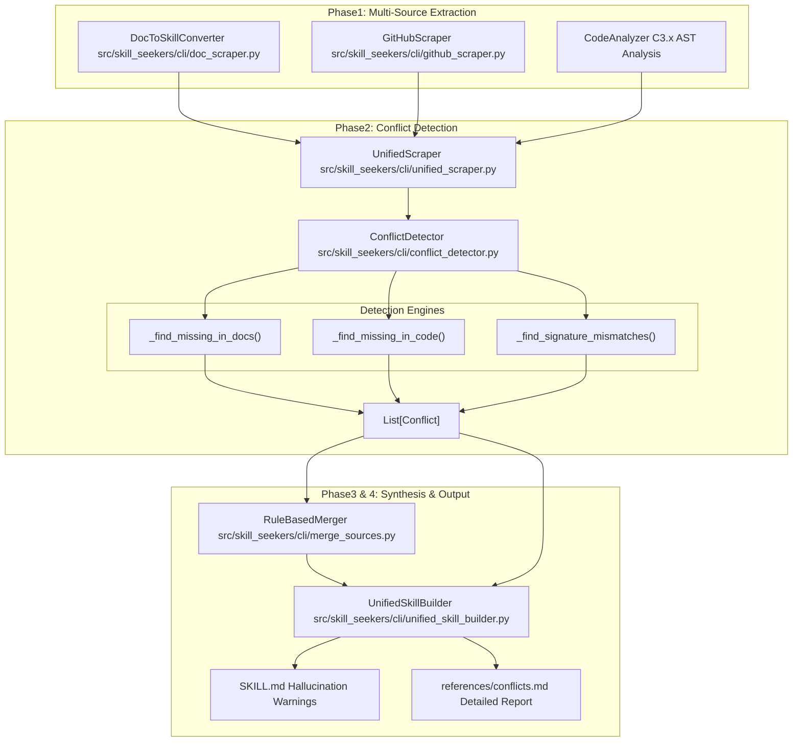

<!-- source: DeepWiki mcp.deepwiki.com · repo yusufkaraaslan/Skill_Seekers · page 6.2 Conflict Detection System · fetched 2026-10-26 -->

# Conflict Detection System

<details>
<summary>Relevant source files</summary>

The following files were used as context for generating this wiki page:

- [src/skill_seekers/cli/doc_scraper.py](src/skill_seekers/cli/doc_scraper.py)
- [src/skill_seekers/cli/unified_scraper.py](src/skill_seekers/cli/unified_scraper.py)
- [src/skill_seekers/cli/unified_skill_builder.py](src/skill_seekers/cli/unified_skill_builder.py)
- [tests/test_c3_integration.py](tests/test_c3_integration.py)
- [tests/test_conflict_detector.py](tests/test_conflict_detector.py)
- [tests/test_multi_source.py](tests/test_multi_source.py)
- [tests/test_unified.py](tests/test_unified.py)
- [tests/test_unified_scraper_orchestration.py](tests/test_unified_scraper_orchestration.py)

</details>


## Purpose and Scope

The Conflict Detection System identifies discrepancies between documentation (Natural Language Space) and actual implementation (Code Entity Space). It acts as a validator during the multi-source merge process, ensuring that the final AI Skill accurately represents the codebase. The system categorizes discrepancies into specific types with severity levels, allowing `UnifiedSkillBuilder` [src/skill_seekers/cli/unified_skill_builder.py:26-36]() to warn users about potential "hallucinations" where documentation describes non-existent features.

This system is a core component of the `UnifiedScraper` [src/skill_seekers/cli/unified_scraper.py:41-51]() pipeline, bridging the gap between Phase 1 (Data Extraction) and Phase 3 (Synthesis).

Sources: [src/skill_seekers/cli/unified_scraper.py:28-28](), [src/skill_seekers/cli/unified_skill_builder.py:26-36]()

---

## System Architecture

The conflict detection system operates as Phase 2 of the `UnifiedScraper` workflow. It ingests data from multiple streams—specifically the documentation stream and the codebase analysis stream—to perform cross-referencing.

**Diagram: Conflict Detection Pipeline**



Sources: [src/skill_seekers/cli/unified_scraper.py:41-51](), [src/skill_seekers/cli/unified_skill_builder.py:26-36](), [tests/test_unified.py:152-220]()

---

## Conflict Types and Severity Levels

Discrepancies are categorized to help `UnifiedSkillBuilder` [src/skill_seekers/cli/unified_skill_builder.py:26-36]() decide how to present the information to the AI agent.

| Conflict Type | Severity | Logic | Impact |
|---------------|----------|-------|--------|
| `missing_in_code` | `high` | API is in `docs_data` but not found by `CodeAnalyzer`. | **Critical**: Agent may try to call functions that don't exist (Hallucination). |
| `missing_in_docs` | `medium` | API exists in source code but is missing from `docs_data`. | **Discovery**: Agent will be unaware of available functionality. |
| `signature_mismatch` | `medium` | API exists in both, but parameters or return types differ. | **Execution**: Agent may pass wrong arguments or expect wrong return types. |
| `description_mismatch`| `info` | Signatures match, but the intent/description differs significantly. | **Clarity**: Potential confusion regarding API usage. |

Sources: [tests/test_conflict_detector.py:38-48](), [tests/test_unified.py:185-220]()

---

## ConflictDetector Implementation

The `ConflictDetector` class is the engine for cross-source validation.

### Data Mapping: Docs vs. Code

The detector bridges two distinct representations of the same system.

**Diagram: Natural Language to Code Entity Mapping**

```mermaid
graph LR
    subgraph "Natural Language Space Documentation"
        DocPage["Page /api/reference.html"]
        DocAPI["Function documented_func Params x:int Returns str"]
    end

    subgraph "Code Entity Space AST Analysis"
        SourceFile["File src/core.py"]
        CodeAPI["Function undocumented_func Params y:float Returns bool"]
    end

    Detector["ConflictDetector src/skill_seekers/cli/conflict_detector.py"]

    DocAPI -->|docs_data| Detector
    CodeAPI -->|github_data| Detector

    Detector -->|detect_all_conflicts()| Conflicts["List[Conflict]"]
```

Sources: [tests/test_unified.py:152-182](), [tests/test_conflict_detector.py:9-22]()

### The Conflict Data Structure

The system uses a `Conflict` dataclass to provide structured discrepancy data to `RuleBasedMerger` and `UnifiedSkillBuilder` [tests/test_conflict_detector.py:38-48]().

| Field | Description | Source |
|-------|-------------|--------|
| `type` | The category of conflict. | `missing_in_docs`, `missing_in_code`, `signature_mismatch`. |
| `severity` | Impact level (`high`, `medium`, `info`). | Hardcoded per type. |
| `api_name` | The identifier of the entity (e.g., `Class.method`). | Extracted from both sources. |
| `docs_info` | Parameter and type metadata from HTML/PDF. | `docs_data["pages"][i]["apis"]` |
| `code_info` | Parameter and type metadata from AST. | `github_data["code_analysis"]` |
| `difference` | Detailed string explaining the mismatch. | Generated by `ConflictDetector`. |
| `suggestion` | AI-ready fix (e.g., "Add parameter 'z' to documentation"). | Generated by `ConflictDetector`. |

Sources: [tests/test_conflict_detector.py:38-76]()

---

## Reporting and Resolution

### Conflict Report (conflicts.md)

`UnifiedSkillBuilder` generates a detailed report in `references/conflicts.md` [src/skill_seekers/cli/unified_skill_builder.py:68-68](). This report serves as a debugging log for developers to sync their documentation with their code.

1. **Summary Table**: High-level counts of conflicts by severity.
2. **API Breakdown**: For each conflict, the report lists the `api_name`, the `difference`, and the `suggestion`.
3. **Signature Diffs**: For `signature_mismatch`, it shows a side-by-side view of the documented signature versus the actual implementation.

Sources: [src/skill_seekers/cli/unified_skill_builder.py:68-68](), [src/skill_seekers/cli/unified_skill_builder.py:118-120]()

### Merging Logic

During Phase 3, `RuleBasedMerger` uses the detected conflicts to decide which source to trust.
* **Ground Truth**: The code analysis (`CodeStream`) is generally treated as the ground truth for signatures.
* **Enrichment**: Documentation (`DocsStream`) is used to provide the human-readable descriptions and examples that the code lacks.
* **Hybrid Generation**: Combines these streams while embedding the `conflict_summary` for the AI agent's awareness.

Sources: [src/skill_seekers/cli/unified_scraper.py:41-51](), [src/skill_seekers/cli/unified_skill_builder.py:26-36]()

---

