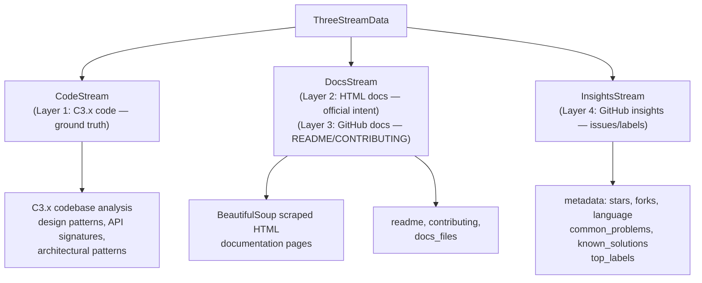
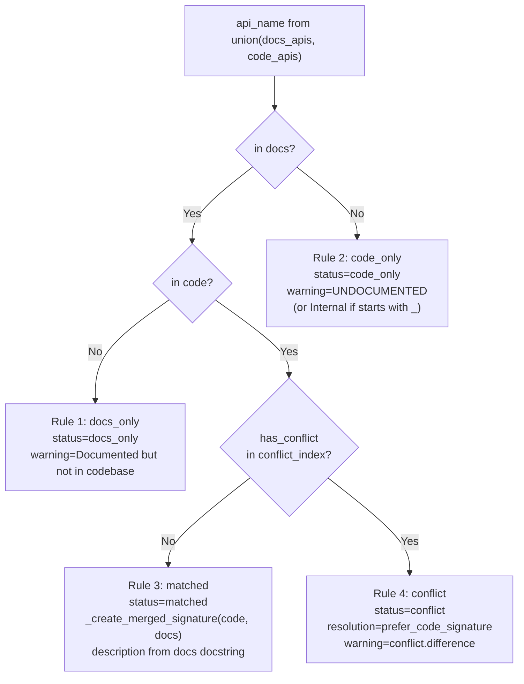
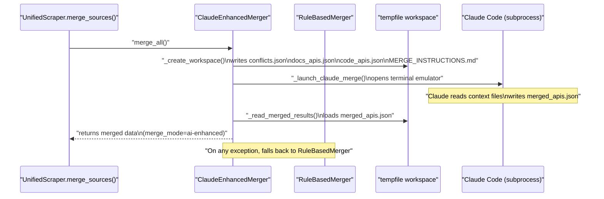
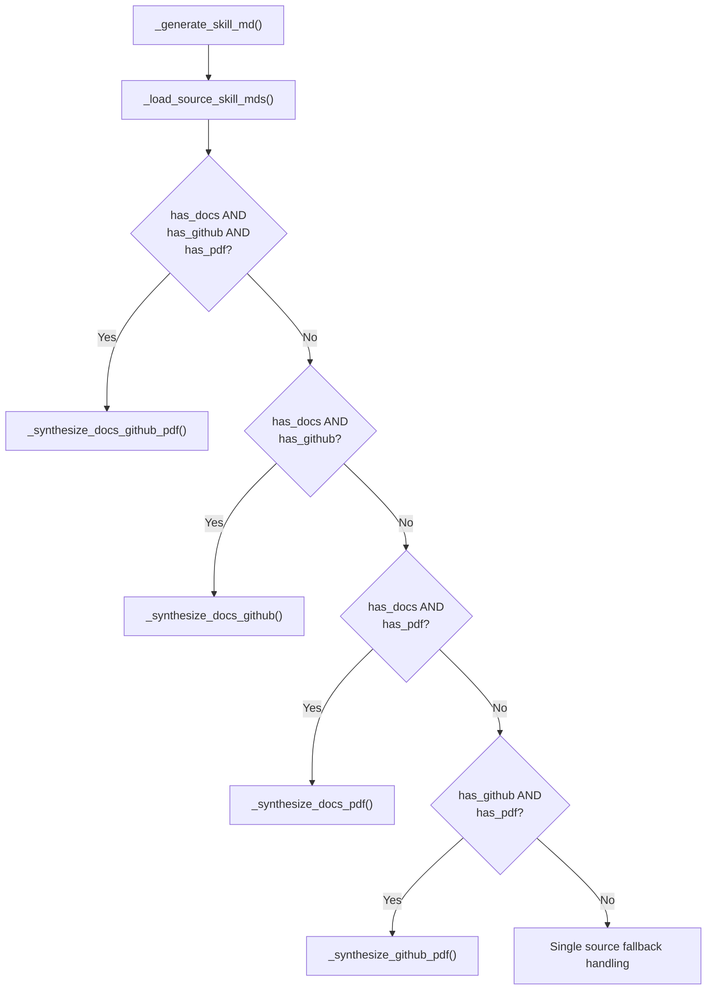
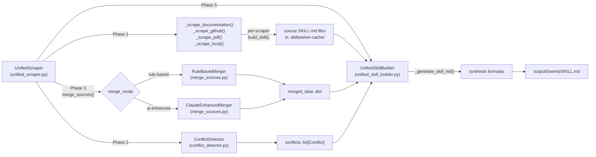

<!-- source: DeepWiki mcp.deepwiki.com · repo yusufkaraaslan/Skill_Seekers · page 6.3 Synthesis Strategies & Formulas · fetched 2026-10-26 -->

# Synthesis Strategies & Formulas

<details>
<summary>Relevant source files</summary>

The following files were used as context for generating this wiki page:

- [docs/BUG_AUDIT.md](docs/BUG_AUDIT.md)
- [src/skill_seekers/cli/doc_scraper.py](src/skill_seekers/cli/doc_scraper.py)
- [src/skill_seekers/cli/merge_sources.py](src/skill_seekers/cli/merge_sources.py)
- [src/skill_seekers/cli/unified_scraper.py](src/skill_seekers/cli/unified_scraper.py)
- [src/skill_seekers/cli/unified_skill_builder.py](src/skill_seekers/cli/unified_skill_builder.py)
- [src/skill_seekers/mcp/server.py](src/skill_seekers/mcp/server.py)
- [tests/test_agent_client.py](tests/test_agent_client.py)
- [tests/test_c3_integration.py](tests/test_c3_integration.py)
- [tests/test_create_pipeline_regressions.py](tests/test_create_pipeline_regressions.py)
- [tests/test_mcp_server.py](tests/test_mcp_server.py)
- [tests/test_multi_source.py](tests/test_multi_source.py)
- [tests/test_unified.py](tests/test_unified.py)
- [tests/test_unified_mcp_integration.py](tests/test_unified_mcp_integration.py)
- [tests/test_unified_scraper_orchestration.py](tests/test_unified_scraper_orchestration.py)

</details>


This page documents how skill-seekers merges content from multiple scraped sources into a single unified skill. It covers the `RuleBasedMerger` and `ClaudeEnhancedMerger` classes, the `ThreeStreamData` architecture, and the per-combination synthesis formulas implemented in `UnifiedSkillBuilder`.

For details on conflict detection (the step that precedes merging), see [6.2 Conflict Detection System](). For the full five-phase orchestration that calls into these systems, see [6 Unified Multi-Source Scraping]().

---

## Scope

The synthesis layer sits between Phase 3 (conflict detection) and Phase 5 (skill building) of the unified pipeline (`UnifiedScraper`). Its responsibilities are:

1. **API-level merge** — Reconcile function signatures, descriptions, and statuses between documentation and code sources using either deterministic rules (`RuleBasedMerger`) or AI-assisted reconciliation (`ClaudeEnhancedMerger`).
2. **SKILL.md synthesis** — Combine the standalone `SKILL.md` files produced by each individual scraper into one unified document using source-combination-specific formulas (`UnifiedSkillBuilder`).

Sources: [src/skill_seekers/cli/merge_sources.py:1-16](), [src/skill_seekers/cli/unified_scraper.py:40-51]()

---

## ThreeStreamData Architecture

The merge layer uses a multi-layer model of information sourcing (`ThreeStreamData`). These layers are represented by data classes that organize ground truth code, official documentation, and community insights.

### ThreeStreamData Layer Model



Sources: [src/skill_seekers/cli/merge_sources.py:1-36](), [src/skill_seekers/cli/merge_sources.py:215-280]()

When `ThreeStreamData` is not available (e.g., only documentation and code streams are present without GitHub stream data), the mergers degrade gracefully and operate on available streams.

Sources: [src/skill_seekers/cli/merge_sources.py:27-35](), [src/skill_seekers/cli/merge_sources.py:282-335]()

---

## RuleBasedMerger

`RuleBasedMerger` defined in `src/skill_seekers/cli/merge_sources.py` applies deterministic rules to reconcile each API found across documentation and code.

### Initialization

The constructor extracts API lists from both sources by re-using `ConflictDetector` internally:
- `self.docs_apis` — APIs parsed from HTML documentation
- `self.code_apis` — APIs extracted from C3.x codebase analysis
- `self.conflict_index` — `{api_name: Conflict}` dictionary for O(1) lookup

Sources: [src/skill_seekers/cli/merge_sources.py:232-280](), [src/skill_seekers/cli/conflict_detector.py:1-50]()

### The Four Merge Rules

### RuleBasedMerger Decision Flow



Sources: [src/skill_seekers/cli/merge_sources.py:337-408](), [tests/test_unified.py:152-240]()

### Signature Merging

`_create_merged_signature(code_info, docs_info)` always prefers code data for parameter names, type hints, defaults, and return type. Documentation data is only used as a fallback when code data is absent.

Sources: [src/skill_seekers/cli/merge_sources.py:410-440]()

### Output Structure

`merge_all()` returns a comprehensive dictionary including the `merge_mode`, `apis` (merged records), and a `summary` of counts for matched, conflict, and source-only APIs.

Sources: [src/skill_seekers/cli/merge_sources.py:282-335]()

---

## ClaudeEnhancedMerger

`ClaudeEnhancedMerger` wraps `RuleBasedMerger` and uses it as a baseline. It attempts to open a local Claude Code session in a subprocess to intelligently resolve conflicts using AI.

### ClaudeEnhancedMerger Process



Sources: [src/skill_seekers/cli/merge_sources.py:443-708](), [src/skill_seekers/cli/unified_scraper.py:118-121]()

### Fallback Behavior

If `_launch_claude_merge()` raises any exception (e.g., no terminal emulator found), `merge_all()` catches it and delegates execution to `self.rule_merger.merge_all()`.

Sources: [src/skill_seekers/cli/merge_sources.py:481-509]()

### Mode Selection in UnifiedScraper

`UnifiedScraper` selects the merger class based on `self.merge_mode`:

```python
raw_mode = merge_mode or self.config.get("merge_mode", "rule-based")
self.merge_mode = "ai-enhanced" if raw_mode == "claude-enhanced" else raw_mode
```

Sources: [src/skill_seekers/cli/unified_scraper.py:118-121](), [src/skill_seekers/cli/unified_scraper.py:908-918]()

---

## UnifiedSkillBuilder Synthesis Formulas

After merging, `UnifiedSkillBuilder.build()` generates the final `SKILL.md`. The synthesis strategy is chosen based on which source types have produced a standalone `SKILL.md` file during scraping.

### Source SKILL.md Loading

`_load_source_skill_mds()` scans the cache directory for per-source `SKILL.md` files. It handles multiple sources of the same type (e.g., multiple GitHub repos) by concatenating them with separators.

Sources: [src/skill_seekers/cli/unified_skill_builder.py:91-188](), [tests/test_multi_source.py:88-102]()

### Formula Dispatch

### UnifiedSkillBuilder Synthesis Formula Selection



Sources: [src/skill_seekers/cli/unified_skill_builder.py:431-489]()

### `_synthesize_docs_github()` Formula

This is the primary formula for combined documentation and code sources. It assembles the output document by prioritizing official documentation for high-level concepts and GitHub analysis (C3.x) for technical ground truth, design patterns, and real-world test examples.

Sources: [src/skill_seekers/cli/unified_skill_builder.py:199-356](), [tests/test_c3_integration.py:179-193]()

### Merged API Formatting

When `merged_data` is present, `_format_merged_apis()` groups APIs by status (Verified, Conflicts, Undocumented, Documentation-Only) and renders them with inline warnings and side-by-side code blocks for discrepancies.

Sources: [src/skill_seekers/cli/unified_skill_builder.py:674-759](), [tests/test_unified.py:220-240]()

---

## End-to-End Pipeline

### Full Synthesis Pipeline: Code Entities



Sources: [src/skill_seekers/cli/unified_scraper.py:40-100](), [src/skill_seekers/cli/unified_scraper.py:882-920](), [src/skill_seekers/cli/unified_skill_builder.py:64-78](), [tests/test_unified_scraper_orchestration.py:103-164]()

---

