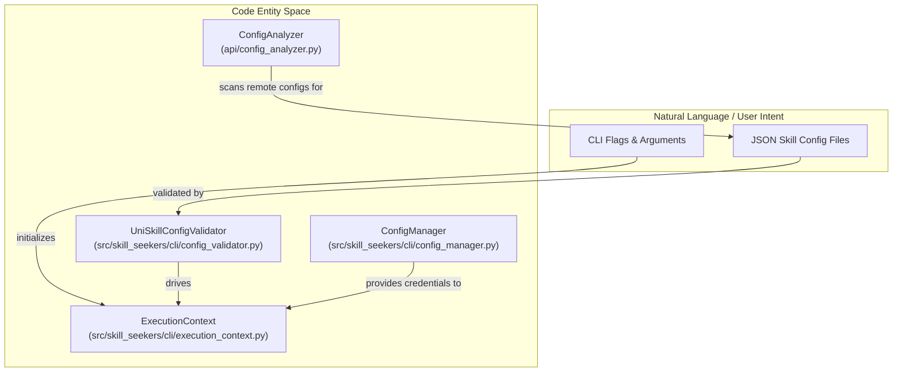
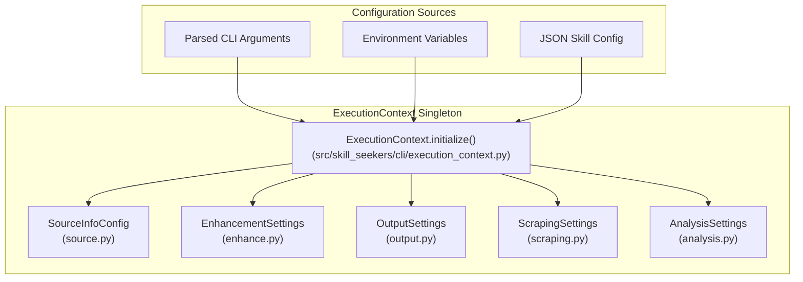
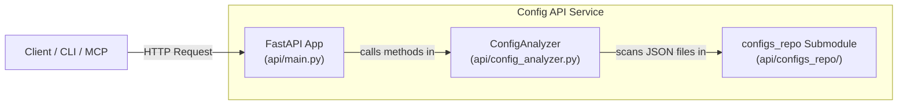

<!-- source: DeepWiki mcp.deepwiki.com · repo yusufkaraaslan/Skill_Seekers · page 7 Configuration System · fetched 2026-10-26 -->

# Configuration System

Relevant source files

The following files were used as context for generating this wiki page:

- [docs/FAQ.md](docs/FAQ.md)
- [docs/TROUBLESHOOTING.md](docs/TROUBLESHOOTING.md)
- [docs/blog/UNIVERSAL_RAG_PREPROCESSOR.md](docs/blog/UNIVERSAL_RAG_PREPROCESSOR.md)
- [docs/features/BOOTSTRAP_SKILL_TECHNICAL.md](docs/features/BOOTSTRAP_SKILL_TECHNICAL.md)
- [docs/features/HOW_TO_GUIDES.md](docs/features/HOW_TO_GUIDES.md)
- [docs/guides/TESTING_GUIDE.md](docs/guides/TESTING_GUIDE.md)
- [docs/integrations/CLINE.md](docs/integrations/CLINE.md)
- [docs/integrations/INTEGRATIONS.md](docs/integrations/INTEGRATIONS.md)
- [docs/reference/API_REFERENCE.md](docs/reference/API_REFERENCE.md)
- [docs/reference/CONFIG_FORMAT.md](docs/reference/CONFIG_FORMAT.md)
- [src/skill_seekers/cli/arguments/enhance.py](src/skill_seekers/cli/arguments/enhance.py)
- [src/skill_seekers/cli/config_manager.py](src/skill_seekers/cli/config_manager.py)
- [src/skill_seekers/cli/execution_context.py](src/skill_seekers/cli/execution_context.py)
- [tests/conftest.py](tests/conftest.py)
- [tests/test_execution_context.py](tests/test_execution_context.py)
- [tests/test_scraper_retry.py](tests/test_scraper_retry.py)

This page provides an overview of the configuration mechanisms in skill-seekers, which manage everything from per-skill JSON specifications and runtime execution parameters to user credentials, remote configuration discovery via the Config API, and analysis presets. 

For detailed technical breakdowns, refer to the child pages:
- [Configuration Schema & Validation](#7.1) — UniSkillConfigValidator and schema enforcement.
- [Analysis Presets](#7.2) — PresetManager and analysis/scraping presets.
- [Config API Service](#7.3) — The standalone FastAPI service in `api/`.
- [Private Config Repositories & Publishing](#7.4) — Private config source repos and sync-config monitoring.
- [Creating Custom Configurations](#7.5) — Step-by-step guide to writing custom JSON configs.

---

## System Overview

The configuration architecture bridges user intent, runtime options, persistent credentials, and remote repositories across several core components.

Sources: [src/skill_seekers/cli/config_manager.py:31-75](), [src/skill_seekers/cli/execution_context.py:1-13](), [src/skill_seekers/cli/execution_context.py:139-162]()

---

## ConfigManager — User Credentials & State

`ConfigManager` (`src/skill_seekers/cli/config_manager.py:31-60`) is a singleton class responsible for persisting user-level settings, GitHub token profiles, API keys, and global AI enhancement defaults.

### Storage Locations

| Platform | Config File Path | Progress Files Path |
|---|---|---|
| Linux / macOS | `~/.config/skill-seekers/config.json` | `~/.local/share/skill-seekers/progress/` |
| Windows | `%APPDATA%\skill-seekers\config.json` | `%LOCALAPPDATA%\skill-seekers\progress\` |

Directory paths are resolved via `_get_config_dir()` and `_get_progress_dir()` (`src/skill_seekers/cli/config_manager.py:18-30`), ensuring secure permissions (`700` for directories, `600` for files on Unix systems) (`src/skill_seekers/cli/config_manager.py:76-90`).

### Configuration Structure

The authoritative default schema defined in `ConfigManager.DEFAULT_CONFIG` (`src/skill_seekers/cli/config_manager.py:41-59`) covers:
- `version`: Schema version string.
- `github`: Default profiles and multi-token profile definitions for rate-limit rotation.
- `rate_limit`: Default timeout and auto-switching configurations.
- `resume`: Auto-save intervals and progress retention periods.
- `api_keys`: Stored keys for Anthropic, Google, OpenAI, and Moonshot.
- `ai_enhancement`: Default enhancement levels, agents, and local batch sizes.

Sources: [src/skill_seekers/cli/config_manager.py:31-60]()

---

## ExecutionContext — Runtime Singleton

`ExecutionContext` (`src/skill_seekers/cli/execution_context.py:1-13`) serves as the single source of truth for all runtime configuration during an execution run. It aggregates arguments parsed from the CLI, configuration files, and environment variables into structured Pydantic models.

All subsystem components read from `ExecutionContext.get()` rather than parsing `sys.argv` independently (`src/skill_seekers/cli/execution_context.py:1-13`).

Sources: [src/skill_seekers/cli/execution_context.py:1-162](), [tests/test_execution_context.py:22-76]()

---

## JSON Skill Config Files & Validation

Scraping and building jobs are driven by unified JSON configuration files. As of v2.11.0, legacy configuration files lacking a `sources` array are deprecated; all configurations must use the unified schema (`docs/reference/CONFIG_FORMAT.md:27-37`).

Validation is handled by `UniSkillConfigValidator`, which enforces required fields (`name`, `description`, and a non-empty `sources` array) and verifies source-specific parameters (`docs/reference/CONFIG_FORMAT.md:44-165`). For details on schema enforcement and validation rules, see [Configuration Schema & Validation](#7.1) and [Creating Custom Configurations](#7.5).

Sources: [docs/reference/CONFIG_FORMAT.md:1-240](), [src/skill_seekers/cli/config_validator.py:1-50]()

---

## Analysis Presets

Analysis and scraping workflows support pre-configured presets (such as quick, standard, or comprehensive profiles) that dictate depth, timeout thresholds, and feature flags without requiring manual parameter specification. Presets are managed by `PresetManager` and can be applied via the `--preset` flag. For detailed breakdown, see [Analysis Presets](#7.2).

Sources: [docs/reference/CONFIG_FORMAT.md:140-153]()

---

## Config API Service & Private Repositories

The standalone FastAPI application located in `api/` provides remote configuration discovery. 

- **Config API Service**: Exposes endpoints to search, filter, and download community configurations, backed by `ConfigAnalyzer` (`api/config_analyzer.py:13-60`) and deployed via `render.yaml` (`render.yaml:1-18`). For details, see [Config API Service](#7.3).
- **Private Config Repositories**: Supports adding private config source repositories via `add_config_source`, publishing custom configurations, and monitoring documentation changes via sync services. For details, see [Private Config Repositories & Publishing](#7.4).

Sources: [api/config_analyzer.py:13-60](), [render.yaml:1-17]()

---

## Child Pages

| Section | Child Topic | Description |
|---|---|---|
| [Configuration Schema & Validation](#7.1) | Configuration Schema & Validation | `UniSkillConfigValidator`: schema enforcement, per-source validation rules, and entrypoints. |
| [Analysis Presets](#7.2) | Analysis Presets | `PresetManager` and analysis presets (`--preset`), estimated execution times. |
| [Config API Service](#7.3) | Config API Service | FastAPI backend in `api/`, `ConfigAnalyzer` internals, category resolution, and deployment. |
| [Private Config Repositories & Publishing](#7.4) | Private Config Repositories & Publishing | Private source repos, `add_config_source`, publishing services, and sync-config monitoring. |
| [Creating Custom Configurations](#7.5) | Creating Custom Configurations | Step-by-step guide for authoring custom JSON configs with examples. |

Sources: [src/skill_seekers/cli/config_manager.py:1-579](), [src/skill_seekers/cli/execution_context.py:1-162]()

---

