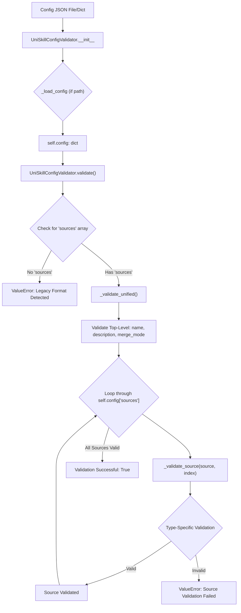
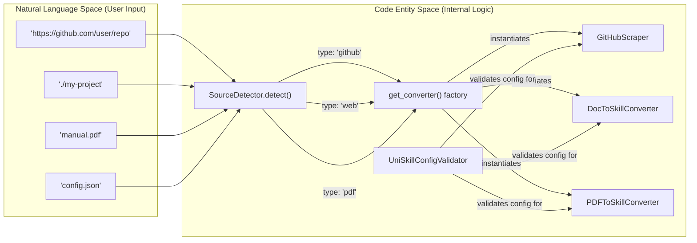

<!-- source: DeepWiki mcp.deepwiki.com · repo yusufkaraaslan/Skill_Seekers · page 7.1 Configuration Schema & Validation · fetched 2026-10-26 -->

# Configuration Schema & Validation

<details>
<summary>Relevant source files</summary>

The following files were used as context for generating this wiki page:

- [src/skill_seekers/cli/config_validator.py](src/skill_seekers/cli/config_validator.py)
- [src/skill_seekers/cli/generate_router.py](src/skill_seekers/cli/generate_router.py)
- [src/skill_seekers/cli/github_scraper.py](src/skill_seekers/cli/github_scraper.py)
- [src/skill_seekers/cli/pdf_scraper.py](src/skill_seekers/cli/pdf_scraper.py)
- [src/skill_seekers/cli/split_config.py](src/skill_seekers/cli/split_config.py)
- [tests/test_config_fetcher.py](tests/test_config_fetcher.py)
- [tests/test_github_scraper.py](tests/test_github_scraper.py)

</details>


## Overview

The `skill_seekers` project utilizes a robust configuration system to define how skills are scraped, analyzed, and built. This page details the configuration schema and the validation processes that ensure configurations are correctly formatted and semantically sound.

As of v2.11.0, all configurations must adhere to a **unified format** that uses a `sources` array [src/skill_seekers/cli/config_validator.py:24-25](). The `UniSkillConfigValidator` class is responsible for enforcing this unified schema. Any attempt to use the older, legacy single-source format will result in a `ValueError` with guidance on how to migrate [src/skill_seekers/cli/config_validator.py:113-136]().

The `UniSkillConfigValidator` class, defined in `src/skill_seekers/cli/config_validator.py` [src/skill_seekers/cli/config_validator.py:39-42](), is the primary mechanism for validating configuration files. It checks for required fields, correct data types, and source-specific validation rules for multiple source types including `documentation`, `github`, `pdf`, `local`, `jupyter`, and `openapi` [src/skill_seekers/cli/config_validator.py:45-63]().

Sources: [src/skill_seekers/cli/config_validator.py:1-26](), [src/skill_seekers/cli/config_validator.py:39-63](), [src/skill_seekers/cli/config_validator.py:113-136]()

---

## Schema Structure

The unified configuration format is a JSON object with top-level fields and a `sources` array, where each element in the array defines a specific data source.

```json
{
  "name": "string (required)",
  "description": "string (required)",
  "merge_mode": "string (optional, default: rule-based)",
  "marketplace_targets": [
    {
      "marketplace": "string (required)"
    }
  ],
  "sources": [
    {
      "type": "documentation",
      "base_url": "https://docs.example.com/",
      "selectors": {
        "main_content": "article",
        "title": "h1"
      }
    },
    {
      "type": "github",
      "repo": "user/repo",
      "fetch_issues": true
    }
  ]
}
```

Sources: [src/skill_seekers/cli/config_validator.py:140-188](), [docs/reference/CONFIG_FORMAT.md:48-83](), [docs/reference/CONFIG_FORMAT.md:109-141]()

---

## Configuration to Code Mapping

### Diagram: ConfigValidator Data Flow



Sources: [src/skill_seekers/cli/config_validator.py:78-103](), [src/skill_seekers/cli/config_validator.py:113-138](), [src/skill_seekers/cli/config_validator.py:140-190]()

### Diagram: Source Detection & Processing Entity Mapping

This diagram bridges the Natural Language input strings from the CLI to the specific Code Entities responsible for processing them.



Sources: [docs/reference/API_REFERENCE.md:64-78](), [docs/reference/API_REFERENCE.md:141-163](), [src/skill_seekers/cli/config_validator.py:39-63]()

---

## Required Fields

The `UniSkillConfigValidator` enforces several top-level required fields for the unified configuration, as well as type-specific required fields for each source.

### Top-Level Required Fields

- `name` (string): Unique identifier for the skill [src/skill_seekers/cli/config_validator.py:145-146]().
- `description` (string): Short summary of the skill's purpose [src/skill_seekers/cli/config_validator.py:148-149]().
- `sources` (array): A non-empty list of source objects [src/skill_seekers/cli/config_validator.py:151-161]().

### Source-Specific Required Fields

Each source object within the `sources` array must have a `type` field [src/skill_seekers/cli/config_validator.py:195-196](). Specific fields are required based on the `type`:

| Source Type | Required Field | Code Reference |
|---|---|---|
| `documentation` | `base_url` | [docs/reference/CONFIG_FORMAT.md:88]() |
| `github` | `repo` | [docs/reference/CONFIG_FORMAT.md:149]() |
| `pdf` | `pdf_path` | [docs/reference/CONFIG_FORMAT.md:206]() |
| `local` | `path` | [docs/reference/CONFIG_FORMAT.md:237]() |

Sources: [src/skill_seekers/cli/config_validator.py:140-161](), [src/skill_seekers/cli/config_validator.py:192-203](), [docs/reference/CONFIG_FORMAT.md:87-240]()

---

## Optional Fields & Validation Rules

### Top-Level Optional Fields

- `merge_mode` (string): Defaults to `"rule-based"`. Valid values: `"rule-based"`, `"ai-enhanced"`, `"claude-enhanced"` [src/skill_seekers/cli/config_validator.py:65-70](), [src/skill_seekers/cli/config_validator.py:164-168]().
- `marketplace_targets` (array): List of target platforms (e.g., `{"marketplace": "gemini"}`) [src/skill_seekers/cli/config_validator.py:171-184]().

### Source-Specific Optional Fields

- **Documentation**: `selectors` (dict), `url_patterns` (dict with `include`/`exclude`), `rate_limit` (number), `max_pages` (int) [docs/reference/CONFIG_FORMAT.md:87-101]().
- **GitHub**: `code_analysis_depth` (string: surface/standard/deep), `fetch_issues` (bool), `max_issues` (int) [docs/reference/CONFIG_FORMAT.md:145-165](), [src/skill_seekers/cli/config_validator.py:72-73]().
- **PDF**: `enable_ocr` (bool), `extract_tables` (bool), `chunk_size` (int) [docs/reference/CONFIG_FORMAT.md:202-217]().
- **Local**: `enable_c3_analysis` (bool), `exclude_patterns` (array) [docs/reference/CONFIG_FORMAT.md:233-250]().

Sources: [src/skill_seekers/cli/config_validator.py:65-70](), [src/skill_seekers/cli/config_validator.py:164-184](), [docs/reference/CONFIG_FORMAT.md:87-250]()

---

## Validation Flow

The `UniSkillConfigValidator` class provides a `validate()` method that orchestrates the entire validation process.

### `validate_config` Function

A legacy standalone `validate_config` function exists in `src/skill_seekers/cli/doc_scraper.py` [tests/test_config_validation.py:14](). This function returns a tuple `(errors, warnings)` [tests/test_config_validation.py:23](). 

- **Errors (Critical)**: Issues that prevent processing, such as missing `name` or invalid `base_url` protocols [tests/test_config_validation.py:47-56](), [tests/test_config_validation.py:74-78]().
- **Warnings (Non-Critical)**: Issues that allow processing but may result in sub-optimal quality, such as missing recommended `selectors` or high `rate_limit` [tests/test_config_validation.py:95-107](), [tests/test_config_validation.py:159-163]().

Sources: [tests/test_config_validation.py:14-23](), [tests/test_config_validation.py:47-163]()

---

## Codebase Analysis & C3.x Validation

When `local` or `github` sources are used with codebase analysis enabled, the validator checks for valid depth levels and AI enhancement modes.

- **Depth Levels**: `surface`, `deep`, `full` [src/skill_seekers/cli/config_validator.py:72-73]().
- **AI Modes**: `auto`, `api`, `local`, `none` [src/skill_seekers/cli/config_validator.py:75-76]().

These settings control the behavior of the `CodeAnalyzer` and the `SkillEnhancer` during the analysis and enhancement phases [src/skill_seekers/cli/github_scraper.py:47-53](), [src/skill_seekers/cli/enhance_skill.py:29-52]().

Sources: [src/skill_seekers/cli/config_validator.py:72-76](), [src/skill_seekers/cli/github_scraper.py:47-53](), [src/skill_seekers/cli/enhance_skill.py:29-52]()

---

