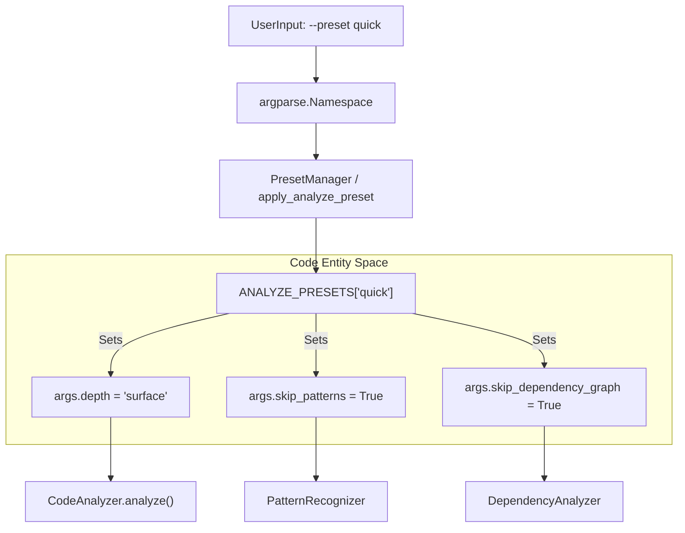
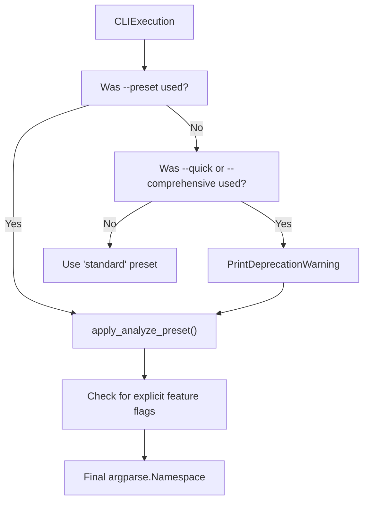

<!-- source: DeepWiki mcp.deepwiki.com · repo yusufkaraaslan/Skill_Seekers · page 7.2 Analysis Presets · fetched 2026-10-26 -->

# Analysis Presets

Relevant source files

The following files were used as context for generating this wiki page:

- [src/skill_seekers/cli/presets/analyze_presets.py](src/skill_seekers/cli/presets/analyze_presets.py)
- [src/skill_seekers/cli/presets/github_presets.py](src/skill_seekers/cli/presets/github_presets.py)
- [src/skill_seekers/cli/presets/scrape_presets.py](src/skill_seekers/cli/presets/scrape_presets.py)
- [tests/test_preset_system.py](tests/test_preset_system.py)

## Purpose and Scope

This page details the **Analysis Presets** subsystem of the Skill Seekers project. Presets provide predefined configurations that control the depth, performance, and feature selection across different ingestion and analysis commands (`scrape`, `github`, and `analyze`). They allow users to quickly choose between different levels of detail, resource consumption, and execution speed by specifying a single `--preset` flag.

The system is implemented across three primary modules:
1.  **Analyze Presets**: Controls codebase analysis depth and feature toggles (e.g., dependency graphs, design patterns).
2.  **Scrape Presets**: Controls documentation scraping behavior (e.g., rate limits, worker threads, RAG chunking).
3.  **GitHub Presets**: Controls repository data extraction (e.g., issue limits, changelogs, releases).

Sources: [src/skill_seekers/cli/presets/analyze_presets.py:1-12](), [src/skill_seekers/cli/presets/scrape_presets.py:1-9](), [src/skill_seekers/cli/presets/github_presets.py:1-9]()

---

## Analysis Command Presets

Analysis presets control the depth and feature selection for local codebase analysis. They are defined via the `AnalysisPreset` dataclass [src/skill_seekers/cli/presets/analyze_presets.py:20-39]().

### `ANALYZE_PRESETS` Definitions

| Preset | Depth | Key Features Enabled | Est. Time | Recommended Use |
| :--- | :--- | :--- | :--- | :--- |
| **quick** | `surface` | API Reference, Docs | 1-2 min | Fast testing or large codebases |
| **standard** | `deep` | Patterns, Dep Graph, Tests, Configs | 5-10 min | General purpose (Default) |
| **comprehensive** | `full` | All features + How-To Guides | 20-60 min | Deep architectural understanding |

Sources: [src/skill_seekers/cli/presets/analyze_presets.py:42-85]()

### Implementation: `apply_analyze_preset`
The `apply_analyze_preset` function modifies the `argparse.Namespace` to set the depth and feature flags [src/skill_seekers/cli/presets/analyze_presets.py:88-117](). It inverts the enabled status of a feature to the CLI's internal `skip_*` attributes.

**Note on AI Enhancement:** Presets explicitly do **not** set AI enhancement levels. This is resolved separately via `resolve_enhance_level(args)`, which checks for `--enhance` (sets level 1) or `--enhance-level N` [src/skill_seekers/cli/presets/analyze_presets.py:169-193]().

Sources: [src/skill_seekers/cli/presets/analyze_presets.py:88-193]()

---

## Scrape Command Presets

Scrape presets manage the performance and intensity of the documentation BFS crawler. They are defined via the `ScrapePreset` dataclass [src/skill_seekers/cli/presets/scrape_presets.py:17-37]().

### `SCRAPE_PRESETS` Definitions

| Preset | Workers | Rate Limit | RAG Chunking | Est. Time |
| :--- | :--- | :--- | :--- | :--- |
| **quick** | 5 | 0.1s | Disabled | 2-5 min | Initial URL discovery |
| **standard** | 3 | 0.5s | Enabled | 10-30 min | Standard documentation (Default) |
| **comprehensive**| 2 | 1.0s | Enabled | 1-3 hours | Large enterprise documentation |

Sources: [src/skill_seekers/cli/presets/scrape_presets.py:40-77]()

### Implementation: `apply_scrape_preset`
This function modifies `args.rate_limit`, `args.workers`, and `args.async_mode` [src/skill_seekers/cli/presets/scrape_presets.py:80-109](). It ensures that if a user has manually specified a value (e.g., `--workers 10`), the preset does not override the explicit user choice.

Sources: [src/skill_seekers/cli/presets/scrape_presets.py:80-109]()

---

## GitHub Command Presets

GitHub presets control the volume of metadata retrieved from the GitHub API. They are defined via the `GitHubPreset` dataclass [src/skill_seekers/cli/presets/github_presets.py:17-33]().

### `GITHUB_PRESETS` Definitions

| Preset | Max Issues | Changelog | Releases | Est. Time |
| :--- | :--- | :--- | :--- | :--- |
| **quick** | 10 | Yes | No | 1-3 min | README and source only |
| **standard** | 100 | Yes | Yes | 5-15 min | Balanced metadata (Default) |
| **comprehensive**| 500 | Yes | Yes | 20-60 min | Full project history |

Sources: [src/skill_seekers/cli/presets/github_presets.py:36-70]()

---

## Preset Management Logic and Data Flows

The preset system utilizes manager classes and functions to resolve configuration parameters from CLI flags.

### Natural Language to Code Entity Mapping
This diagram bridges the natural language preset input space to internal code entities and feature toggles.

Title: Natural Language to Code Entity Mapping

Sources: [src/skill_seekers/cli/presets/analyze_presets.py:88-117](), [tests/test_preset_system.py:127-140]()

### Logic Flow: Preset Application Priority
The system handles legacy flags and explicit overrides using specific priority rules.

Title: Logic Execution Path

Sources: [src/skill_seekers/cli/presets/analyze_presets.py:195-225](), [tests/test_preset_system.py:171-185]()

---

## Technical Implementation Details

### Preset Icons
For visual feedback in the CLI and web interfaces, presets are associated with descriptive icons:
- ⚡ **Quick**: High speed, low depth.
- 🎯 **Standard**: Precision and balance.
- 🚀 **Comprehensive**: Maximum power and coverage.

Sources: [tests/test_preset_system.py:32-74]()

### Helper Functions
- `show_preset_list()`: Iterates through the relevant preset dictionary and prints a formatted table of features, estimated times, and descriptions to stdout [src/skill_seekers/cli/presets/analyze_presets.py:136-167]().
- `get_preset_help_text()`: Returns a concise string for individual preset summaries [src/skill_seekers/cli/presets/analyze_presets.py:119-133]().
- `apply_github_preset()`: Handles GitHub-related flags like `max_issues` and toggles for `include_changelog` or `include_releases` [src/skill_seekers/cli/presets/github_presets.py:73-94]().

Sources: [src/skill_seekers/cli/presets/analyze_presets.py:119-167](), [src/skill_seekers/cli/presets/github_presets.py:73-94]()

### Validation and Testing
The preset system is validated against the following criteria:
1.  **Case Insensitivity**: `PresetManager.get_preset("QUICK")` correctly resolves to the "quick" configuration [tests/test_preset_system.py:89-93]().
2.  **Immutability**: Presets are defined as `frozen=True` dataclasses to prevent unauthorized runtime mutation [src/skill_seekers/cli/presets/analyze_presets.py:20]().
3.  **CLI Override**: Explicit CLI flags (e.g., `--enhance-level 2`) always take priority over preset defaults [src/skill_seekers/cli/presets/analyze_presets.py:183-186]().

Sources: [src/skill_seekers/cli/presets/analyze_presets.py:20](), [tests/test_preset_system.py:89-93]()

---

