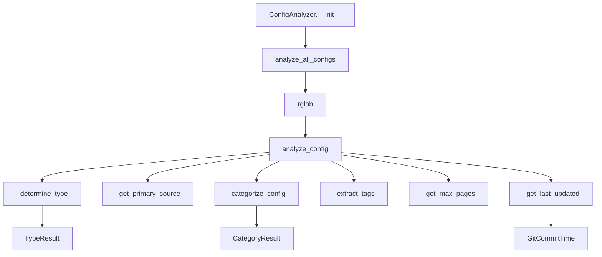
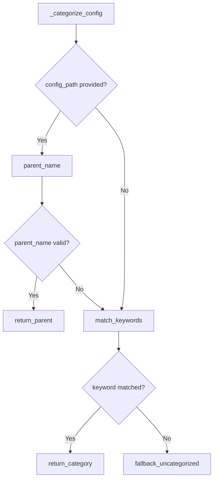
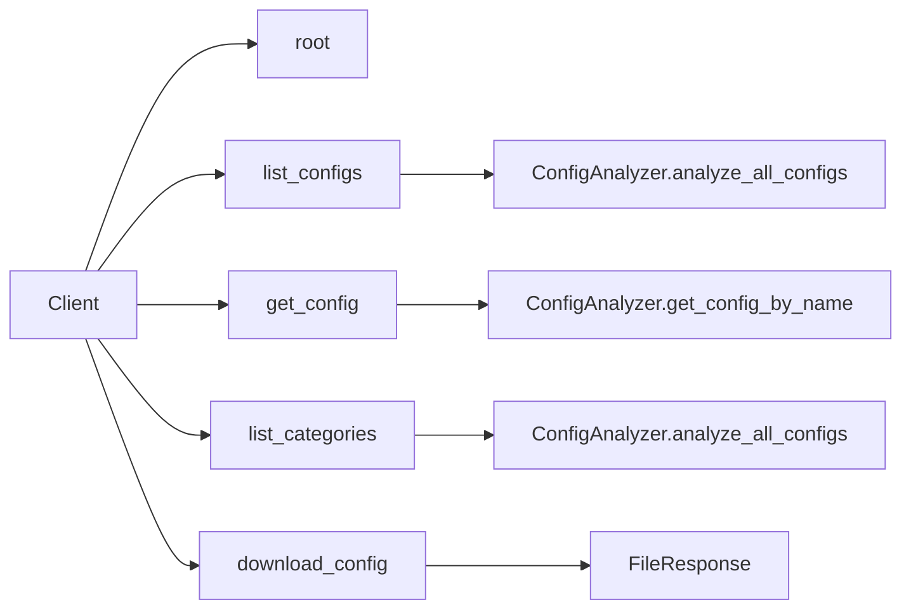

<!-- source: DeepWiki mcp.deepwiki.com · repo yusufkaraaslan/Skill_Seekers · page 7.3 Config API Service · fetched 2026-10-26 -->

# Config API Service

<details>
<summary>Relevant source files</summary>

The following files were used as context for generating this wiki page:

- [.gitmodules](.gitmodules)
- [Dockerfile](Dockerfile)
- [Dockerfile.mcp](Dockerfile.mcp)
- [api/.gitignore](api/.gitignore)
- [api/README.md](api/README.md)
- [api/__init__.py](api/__init__.py)
- [api/config_analyzer.py](api/config_analyzer.py)
- [api/main.py](api/main.py)
- [api/requirements.txt](api/requirements.txt)
- [docker-compose.yml](docker-compose.yml)
- [render.yaml](render.yaml)
- [src/skill_seekers/cors_config.py](src/skill_seekers/cors_config.py)
- [src/skill_seekers/embedding/server.py](src/skill_seekers/embedding/server.py)
- [tests/test_cors_config.py](tests/test_cors_config.py)

</details>


This page documents the standalone FastAPI service in the `api/` directory that exposes a discovery and download interface for pre-built skill configuration files. It covers the service's endpoints, the `ConfigAnalyzer` internals, category resolution logic, `render.yaml` deployment, and the `configs_repo` git submodule that backs the config catalog.

Sources: [api/main.py:1-22](), [render.yaml:1-17]()

---

## Overview

The Config API is a lightweight HTTP service that sits in front of the `configs_repo` git submodule. It reads JSON config files on disk, extracts metadata from each file, and exposes that metadata through a REST API. Users and MCP tools can query the API to discover available skill configs by category or tag, then download the raw JSON files directly.

The service is deployed at `https://api.skillseekersweb.com` and runs on Render using the configuration in [render.yaml:1-17]().

**Directory layout relevant to this service:**

```
api/
├── main.py             # FastAPI app and route handlers
├── config_analyzer.py  # ConfigAnalyzer class
├── requirements.txt    # fastapi, uvicorn, python-multipart
├── __init__.py
└── configs_repo/       # git submodule → skill-seekers-configs
    └── official/
        ├── web-frameworks/
        │   ├── react.json
        │   └── django.json
        └── ...
```

Sources: [api/main.py:1-53](), [api/config_analyzer.py:1-54](), [render.yaml:1-17](), [.gitmodules:1-3]()

---

## The `configs_repo` Git Submodule

Config files are not stored in the main repository. They live in a separate repository (`https://github.com/yusufkaraaslan/skill-seekers-configs`) registered as a git submodule at `api/configs_repo`.

[.gitmodules:1-3]() defines this relationship:

```
[submodule "api/configs_repo"]
    path = api/configs_repo
    url = https://github.com/yusufkaraaslan/skill-seekers-configs.git
```

The Render build command initializes the submodule before starting the server [render.yaml:7-9]():

```
git submodule update --init --recursive &&
pip install -r api/requirements.txt
```

At startup, `main.py` selects the config directory with a fallback for local development [api/main.py:48-51]():

```python
CONFIG_DIR = Path(__file__).parent / "configs_repo" / "official"
if not CONFIG_DIR.exists():
    CONFIG_DIR = Path(__file__).parent.parent / "configs"
```

This means the production server reads from `api/configs_repo/official/`, while local development falls back to a `configs/` directory in the project root.

Sources: [.gitmodules:1-3](), [api/main.py:48-51](), [render.yaml:7-9]()

---

## `ConfigAnalyzer` Internals

`ConfigAnalyzer` (defined in [api/config_analyzer.py:13-366]()) is the single class responsible for all config file reading and metadata extraction. The FastAPI app creates one instance of it at module load time [api/main.py:52-52]().

**Key responsibility diagram:**



Sources: [api/config_analyzer.py:41-78](), [api/config_analyzer.py:80-144](), [api/main.py:52-52]()

### `analyze_all_configs`

[api/config_analyzer.py:55-78]() scans all `*.json` files recursively under `config_dir`, skipping any file whose path contains a `test-examples` directory segment. For each valid file it calls `analyze_config` and appends the result to the output list.

Sources: [api/config_analyzer.py:55-78]()

### `analyze_config`

[api/config_analyzer.py:80-144]() reads a single file and returns a metadata dict. Files missing a `name` field are skipped (return `None`). The returned dict always contains these keys:

| Field | Source |
|---|---|
| `name` | `config_data["name"]` [api/config_analyzer.py:99-99]() |
| `description` | `config_data.get("description", "")` [api/config_analyzer.py:100-100]() |
| `type` | `_determine_type()` [api/config_analyzer.py:103-103]() |
| `category` | `_categorize_config()` [api/config_analyzer.py:110-110]() |
| `tags` | `_extract_tags()` [api/config_analyzer.py:113-113]() |
| `primary_source` | `_get_primary_source()` [api/config_analyzer.py:106-106]() |
| `max_pages` | `_get_max_pages()` [api/config_analyzer.py:123-123]() |
| `file_size` | `config_path.stat().st_size` [api/config_analyzer.py:116-116]() |
| `last_updated` | `_get_last_updated()` [api/config_analyzer.py:117-117]() |
| `download_url` | `{base_url}/api/download/{config_path.name}` [api/config_analyzer.py:120-120]() |
| `config_file` | `config_path.name` [api/config_analyzer.py:136-136]() |

Sources: [api/config_analyzer.py:80-144]()

### Type Detection

[api/config_analyzer.py:162-180]() determines config type by inspecting top-level keys:

- Presence of `"sources"` or `"merge_mode"` → `"unified"`
- Otherwise → `"single-source"`

Sources: [api/config_analyzer.py:162-180]()

### `_get_last_updated`

[api/config_analyzer.py:338-366]() calls `git log -1 --format=%cI` for the specific file to get the ISO 8601 commit timestamp. If git is unavailable or the file has no history, it falls back to the filesystem modification time.

Sources: [api/config_analyzer.py:338-366]()

---

## Category Resolution Decision Tree

Category assignment is handled by `_categorize_config` [api/config_analyzer.py:216-263](). It applies multiple strategies in priority order.

**Category resolution flowchart:**



**`CATEGORY_MAPPING` keyword table** [api/config_analyzer.py:17-25]():

| Category | Keywords |
|---|---|
| `web-frameworks` | react, vue, django, fastapi, laravel, astro, hono |
| `game-engines` | godot, unity, unreal |
| `devops` | kubernetes, ansible, docker, terraform |
| `css-frameworks` | tailwind, bootstrap, bulma |
| `development-tools` | claude-code, vscode, git |
| `gaming` | steam |
| `testing` | pytest, jest, test |

Sources: [api/config_analyzer.py:17-25](), [api/config_analyzer.py:216-263]()

---

## Tag Extraction

`_extract_tags` [api/config_analyzer.py:265-314]() builds a set of tags from matching configuration text against `TAG_KEYWORDS` [api/config_analyzer.py:28-39]() and inspecting sources.

**`TAG_KEYWORDS` reference** [api/config_analyzer.py:28-39]():

| Tag | Trigger Keywords |
|---|---|
| `javascript` | react, vue, astro, hono, javascript, js, node |
| `python` | django, fastapi, ansible, python, flask |
| `php` | laravel, php |
| `frontend` | react, vue, astro, tailwind, frontend, ui |
| `backend` | django, fastapi, laravel, backend, server, api |
| `css` | tailwind, css, styling |
| `game-development` | godot, unity, unreal, game |
| `devops` | kubernetes, ansible, docker, k8s, devops |
| `documentation` | docs, documentation |
| `testing` | test, testing, pytest, jest |

Sources: [api/config_analyzer.py:28-39](), [api/config_analyzer.py:265-314]()

---

## API Endpoints

The FastAPI app is defined in [api/main.py:16-208]() and exposes several routes.

**Route map diagram:**



### `GET /api/configs` [api/main.py:74-121]()

Lists all config metadata with optional query parameters (`category`, `tag`, `type`).

Sources: [api/main.py:74-121]()

### `GET /api/configs/{name}` [api/main.py:123-146]()

Returns detailed metadata for a specific config by name.

Sources: [api/main.py:123-146]()

### `GET /api/categories` [api/main.py:148-170]()

Lists all categories with config counts.

Sources: [api/main.py:148-170]()

### `GET /api/download/{config_name}` [api/main.py:172-207]()

Downloads a specific configuration JSON file safely using `FileResponse`.

Sources: [api/main.py:172-207]()

---

## Deployment

The service is deployed on Render via [render.yaml:1-17]():

| Phase | Command |
|---|---|
| Build | `git submodule update --init --recursive && pip install -r api/requirements.txt` [render.yaml:7-9]() |
| Start | `cd api && uvicorn main:app --host 0.0.0.0 --port $PORT` [render.yaml:10-10]() |

Sources: [render.yaml:1-17]()

---

