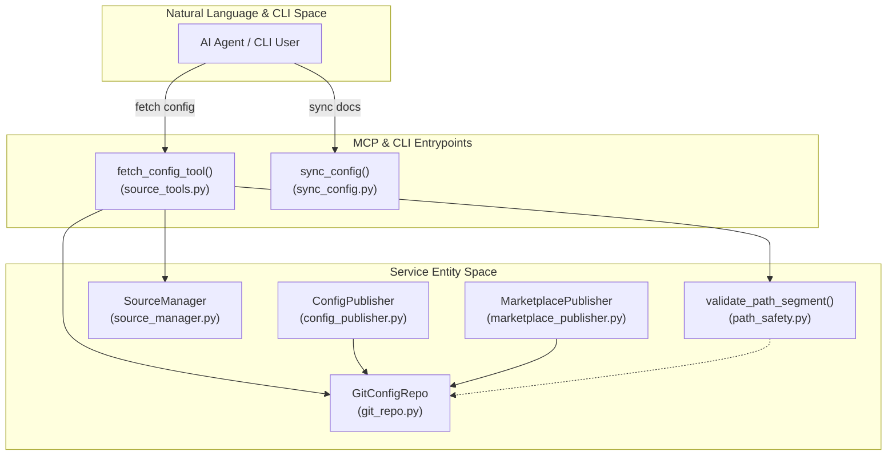
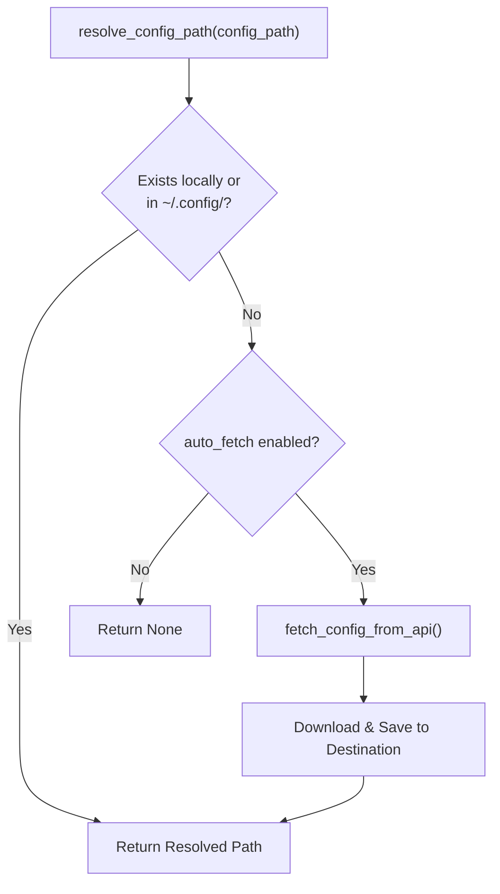
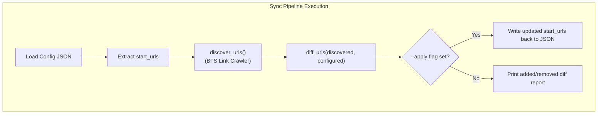

<!-- source: DeepWiki mcp.deepwiki.com · repo yusufkaraaslan/Skill_Seekers · page 7.4 Private Config Repositories & Publishing · fetched 2026-10-26 -->

# Private Config Repositories & Publishing

Relevant source files

The following files were used as context for generating this wiki page:

- [src/skill_seekers/cli/arguments/sync_config.py](src/skill_seekers/cli/arguments/sync_config.py)
- [src/skill_seekers/cli/config_fetcher.py](src/skill_seekers/cli/config_fetcher.py)
- [src/skill_seekers/cli/parsers/sync_config_parser.py](src/skill_seekers/cli/parsers/sync_config_parser.py)
- [src/skill_seekers/cli/sync_config.py](src/skill_seekers/cli/sync_config.py)
- [src/skill_seekers/mcp/server_legacy.py](src/skill_seekers/mcp/server_legacy.py)
- [src/skill_seekers/mcp/tools/source_tools.py](src/skill_seekers/mcp/tools/source_tools.py)
- [src/skill_seekers/mcp/tools/workflow_tools.py](src/skill_seekers/mcp/tools/workflow_tools.py)
- [src/skill_seekers/services/config_publisher.py](src/skill_seekers/services/config_publisher.py)
- [src/skill_seekers/services/git_repo.py](src/skill_seekers/services/git_repo.py)
- [src/skill_seekers/services/marketplace_publisher.py](src/skill_seekers/services/marketplace_publisher.py)
- [src/skill_seekers/services/path_safety.py](src/skill_seekers/services/path_safety.py)
- [tests/test_git_repo.py](tests/test_git_repo.py)
- [tests/test_mcp_git_sources.py](tests/test_mcp_git_sources.py)
- [tests/test_sync_config.py](tests/test_sync_config.py)

## Purpose and Scope

This document specifies the private configuration repository and publishing subsystems within `skill-seekers`. It covers how teams manage private config source repositories via `add_config_source`, interact with `source_tools` MCP tools [src/skill_seekers/mcp/tools/source_tools.py:1-10](), utilize `config_fetcher` [src/skill_seekers/cli/config_fetcher.py:1-6](), execute Git-backed operations via `GitConfigRepo` [src/skill_seekers/services/git_repo.py:1-15](), publish configs and plugins via `ConfigPublisher` [src/skill_seekers/services/config_publisher.py:76-108]() and `MarketplacePublisher` [src/skill_seekers/services/marketplace_publisher.py:21-44](), secure paths via `path_safety` [src/skill_seekers/services/path_safety.py:1-7](), and monitor documentation changes via the `sync-config` engine [src/skill_seekers/cli/sync_config.py:1-10]().

**Related pages:**
- For the configuration schema and validation rules, see [7.1 Configuration Schema & Validation]().
- For public preset configurations available via API, see [7.3 Config API Service]().
- For creating custom configuration files, see [7.5 Creating Custom Configurations]().

---

## Overview

The private configuration repository and publishing engine extends `skill-seekers` to support version-controlled JSON configuration storage across distributed Git hosts, alongside automated publishing flows for both configuration files and AI agent marketplace plugins. Key capabilities include:
- **Secure Path Resolution**: Defending against path traversal (CWE-22) via strict path segment validation (`validate_path_segment`) [src/skill_seekers/services/path_safety.py:1-32]().
- **Git-Backed Repository Management**: Cloning, shallow pulling, caching, and token injection via `GitConfigRepo` [src/skill_seekers/services/git_repo.py:24-134]().
- **Config Publishing**: Pushing validated JSON configs to registered repositories via `ConfigPublisher` [src/skill_seekers/services/config_publisher.py:76-182]().
- **Marketplace Publishing**: Packaging and committing skill directories into plugin marketplaces via `MarketplacePublisher` [src/skill_seekers/services/marketplace_publisher.py:21-167]().
- **Documentation Drift Monitoring**: Crawling live documentation sites and diffing them against configured `start_urls` using `sync_config` [src/skill_seekers/cli/sync_config.py:1-147]().

Sources: [src/skill_seekers/mcp/tools/source_tools.py:1-10](), [src/skill_seekers/cli/config_fetcher.py:1-6](), [src/skill_seekers/services/git_repo.py:1-15](), [src/skill_seekers/cli/sync_config.py:1-10]()

---

## Architecture: Natural Language to Code Entity Space

The subsystem bridges high-level agent requests or CLI dispatcher commands directly to concrete Python classes and service modules.

Sources: [src/skill_seekers/mcp/tools/source_tools.py:57-180](), [src/skill_seekers/services/git_repo.py:24-72](), [src/skill_seekers/services/path_safety.py:19-32]()

---

## Path Safety & CWE-22 Mitigation

All configuration names, source names, workflow names, and skill names must conform to a strict slug format when interacting with local caches or destinations to prevent path traversal exploits [src/skill_seekers/services/path_safety.py:1-7]().

- **Allowlist Regex**: `SAFE_SEGMENT_RE = re.compile(r"^[A-Za-z0-9][A-Za-z0-9._-]*$")` [src/skill_seekers/services/path_safety.py:16]().
- **Validation Function**: `validate_path_segment(name, label="name")` checks for type correctness, allowlist matching, and explicit absence of `..` sequences, raising `ValueError` otherwise [src/skill_seekers/services/path_safety.py:19-32]().

Sources: [src/skill_seekers/services/path_safety.py:1-32](), [tests/test_git_repo.py:132-155]()

---

## Git Repository & Publishing Services

### GitConfigRepo Class

The `GitConfigRepo` class manages local caching, shallow cloning, token injection, and error recovery for remote Git repositories [src/skill_seekers/services/git_repo.py:24-134]().

- **Initialization**: Sets `self.cache_dir` from an optional constructor argument, the `SKILL_SEEKERS_CACHE_DIR` environment variable, or defaults to `~/.skill-seekers/cache/` [src/skill_seekers/services/git_repo.py:27-46]().
- **URL Validation**: `validate_git_url(git_url)` validates HTTPS, HTTP, SSH, and file-scheme Git URLs [tests/test_git_repo.py:57-91]().
- **Token Injection**: `inject_token(url, token)` securely embeds authentication tokens into HTTPS URLs (converting SSH remotes to HTTPS when tokens are supplied) [tests/test_git_repo.py:93-127]().
- **Clone or Pull**: `clone_or_pull(source_name, git_url, branch, token, force_refresh)` validates path segments, checks out or shallow-clones repositories (`depth=1`, `single_branch=True`), and handles corrupted cache recovery by dropping and re-cloning [src/skill_seekers/services/git_repo.py:48-117]().

Sources: [src/skill_seekers/services/git_repo.py:24-134](), [tests/test_git_repo.py:30-185]()

### ConfigPublisher Class

The `ConfigPublisher` service pushes validated local JSON configuration files to registered Git-backed config sources [src/skill_seekers/services/config_publisher.py:76-108]().

- **Category Detection**: `detect_category(config)` evaluates configuration metadata against `CATEGORY_KEYWORDS` to assign categories (e.g., `game-engines`, `web-frameworks`, `ai-ml`) [src/skill_seekers/services/config_publisher.py:23-73]().
- **Publish Workflow**: `publish(config_path, source_name, category, create_branch, force)` validates the config JSON, retrieves source metadata via `SourceManager`, authenticates via environment tokens, clones/pulls the repository, stages updates, commits, and pushes [src/skill_seekers/services/config_publisher.py:89-182]().

Sources: [src/skill_seekers/services/config_publisher.py:1-182]()

### MarketplacePublisher Class

The `MarketplacePublisher` service handles packaging and pushing generated skills to Claude Code plugin marketplace repositories [src/skill_seekers/services/marketplace_publisher.py:21-44]().

- **Metadata Parsing**: Reads `SKILL.md` frontmatter to extract plugin names, descriptions, and authors [src/skill_seekers/services/marketplace_publisher.py:65-75]().
- **Plugin Generation**: Copies skill assets into `plugins/{skill_name}`, generates `.claude-plugin/plugin.json`, updates `marketplace.json`, and commits/pushes changes to the marketplace branch [src/skill_seekers/services/marketplace_publisher.py:125-167]().

Sources: [src/skill_seekers/services/marketplace_publisher.py:21-167]()

---

## Config Fetcher & API Fallback

When local configurations are missing, `skill-seekers` queries the remote API via `fetch_config_from_api` or resolves paths through `resolve_config_path` [src/skill_seekers/cli/config_fetcher.py:22-140]().

- **Resolution Order**: 
  1. Exact provided path [src/skill_seekers/cli/config_fetcher.py:175-178]().
  2. With `configs/` prefix in the current directory [src/skill_seekers/cli/config_fetcher.py:180-185]().
  3. User config directory (`~/.config/skill-seekers/configs/`) [src/skill_seekers/cli/config_fetcher.py:187-196]().
  4. Remote API fetch [src/skill_seekers/cli/config_fetcher.py:22-107]().

Sources: [src/skill_seekers/cli/config_fetcher.py:22-205]()

---

## Sync-Config Documentation Monitoring

The `sync_config` engine monitors whether a configuration file's `start_urls` are current with respect to a live documentation site [src/skill_seekers/cli/sync_config.py:1-10]().

- **URL Filtering**: `_is_valid_url` ensures crawled links stay within `base_url` constraints while honoring `include_patterns` and `exclude_patterns` [src/skill_seekers/cli/sync_config.py:34-45]().
- **BFS Discovery**: `discover_urls()` crawls seed pages up to the designated `depth` and `max_pages` limits [src/skill_seekers/cli/sync_config.py:53-129]().
- **Diffing**: `diff_urls()` computes added and removed endpoints between live documentation sites and static configuration files [src/skill_seekers/cli/sync_config.py:137-146]().

Sources: [src/skill_seekers/cli/sync_config.py:1-197](), [src/skill_seekers/cli/arguments/sync_config.py:1-66]()

---

## MCP Source & Workflow Tools Reference

The Model Context Protocol integration layers expose tool functions that wrap repository and publishing operations:
- `fetch_config`: Supports named sources, direct Git URLs, and API fallbacks [src/skill_seekers/mcp/tools/source_tools.py:57-180]().
- `add_config_source`, `list_config_sources`, `remove_config_source`: Manage source registries [src/skill_seekers/mcp/tools/source_tools.py:1-10]().
- `submit_config`: Submits configurations to community repositories [src/skill_seekers/mcp/tools/source_tools.py:19-26]().
- Workflow management tools (`list_workflows`, `get_workflow`, `create_workflow`, `update_workflow`, `delete_workflow`) handle enhancement workflow presets [src/skill_seekers/mcp/tools/workflow_tools.py:4-10]().

Sources: [src/skill_seekers/mcp/tools/source_tools.py:1-212](), [src/skill_seekers/mcp/tools/workflow_tools.py:1-202]()

---

