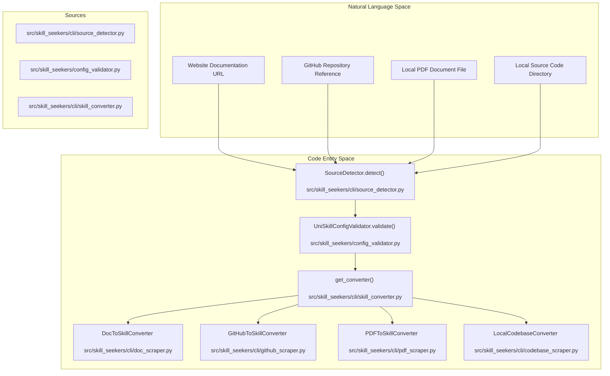
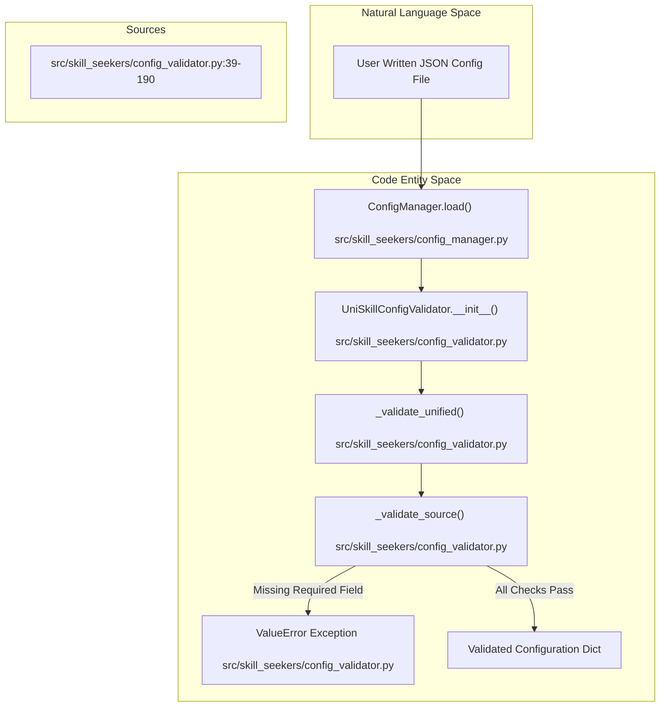

<!-- source: DeepWiki mcp.deepwiki.com · repo yusufkaraaslan/Skill_Seekers · page 7.5 Creating Custom Configurations · fetched 2026-10-26 -->

# Creating Custom Configurations

Relevant source files

The following files were used as context for generating this wiki page:

- [configs/claude-code.json](configs/claude-code.json)
- [configs/godot_unified.json](configs/godot_unified.json)
- [docs/blog/UNIVERSAL_RAG_PREPROCESSOR.md](docs/blog/UNIVERSAL_RAG_PREPROCESSOR.md)
- [docs/features/BOOTSTRAP_SKILL_TECHNICAL.md](docs/features/BOOTSTRAP_SKILL_TECHNICAL.md)
- [docs/guides/TESTING_GUIDE.md](docs/guides/TESTING_GUIDE.md)
- [docs/integrations/CLINE.md](docs/integrations/CLINE.md)
- [docs/integrations/INTEGRATIONS.md](docs/integrations/INTEGRATIONS.md)
- [docs/reference/API_REFERENCE.md](docs/reference/API_REFERENCE.md)
- [docs/reference/CONFIG_FORMAT.md](docs/reference/CONFIG_FORMAT.md)
- [src/skill_seekers/cli/llms_txt_downloader.py](src/skill_seekers/cli/llms_txt_downloader.py)
- [tests/test_scraper_retry.py](tests/test_scraper_retry.py)

This page is a step-by-step guide to writing a custom skill-seekers JSON configuration file from scratch: choosing source types, writing selectors, setting url patterns, configuring categories, and validating before use. It covers the unified config format enforced by `UniSkillConfigValidator` (`[src/skill_seekers/config_validator.py:39-190]()`) and the fields consumed by core scrapers (`[src/skill_seekers/cli/skill_converter.py:64-78]()`).

For a reference of every accepted field with types and defaults, see `[docs/reference/CONFIG_FORMAT.md:1-210]()`. For how the Config API discovers and serves configs, see `[docs/reference/API_REFERENCE.md:1-184]()`.

---

## Config Format Requirements

Every configuration must use the **unified format** with a `sources` array. Attempting to use the legacy format (flat JSON with `base_url` at the top level) will trigger a `ValueError` from the validator (`[src/skill_seekers/config_validator.py:114-136]()`).

**Top-level required fields:**

| Field | Type | Description |
|---|---|---|
| `name` | string | Unique identifier for the skill (alphanumeric, dashes, underscores) `[docs/reference/CONFIG_FORMAT.md:89]()` |
| `description` | string | Human-readable summary used in `SKILL.md` `[docs/reference/CONFIG_FORMAT.md:91]()` |
| `sources` | array | One or more source objects (at least one required) `[src/skill_seekers/config_validator.py:151-161]()` |

**Top-level optional fields:**

| Field | Type | Default | Description |
|---|---|---|---|
| `merge_mode` | string | `"rule-based"` | Strategy for merging sources (`rule-based`, `ai-enhanced`) `[src/skill_seekers/config_validator.py:164-169]()` |
| `output_dir` | string | — | Custom path for generated skill files `[configs/godot_unified.json:4]()` |
| `analysis_features` | object | — | Enables C3.x modules (patterns, guides, signals) `[configs/godot_unified.json:72-81]()` |

Sources: `[src/skill_seekers/config_validator.py:141-190]()`, `[docs/reference/CONFIG_FORMAT.md:27-38]`, `[configs/godot_unified.json:1-108]()`

---

## Choosing Source Types & Code Entity Mapping

The `type` field in each source object defines which scraper module and converter class will process it. `UniSkillConfigValidator` (`[src/skill_seekers/config_validator.py:39]()`) supports 18 distinct source types mapped to concrete parser implementations via `CONVERTER_REGISTRY` (`[src/skill_seekers/cli/skill_converter.py:74-77]()`).

Sources: `[src/skill_seekers/cli/source_detector.py]`, `[src/skill_seekers/config_validator.py:39-190]`, `[src/skill_seekers/cli/skill_converter.py:64-78]()`

---

## Documentation Source Configuration

Use `type: "documentation"` to scrape a website via BFS URL traversal. The `DocToSkillConverter` uses these settings to filter and extract content.

### Content Selectors
Selectors tell the scraper where to find the primary content of the page:
*   `main_content`: The CSS selector for the primary text (e.g., `"article"`, `".content"`) `[docs/reference/CONFIG_FORMAT.md:63]()`.
*   `title`: The page title selector (default: `"h1"`) `[docs/reference/CONFIG_FORMAT.md:64]()`.
*   `code_blocks`: Selector for code snippets (e.g., `"pre code"`) `[docs/reference/CONFIG_FORMAT.md:65]()`.

### URL Patterns
Control the crawl scope using `url_patterns`:
*   `include`: Only scrape URLs matching these strings `[docs/reference/CONFIG_FORMAT.md:69]()`.
*   `exclude`: Skip URLs matching these strings (e.g., `"/blog/"`) `[docs/reference/CONFIG_FORMAT.md:70]()`.

### Smart Categorization
The `categories` object maps category names to lists of keywords. If a URL or page title contains a keyword, the content is saved to that category's reference file `[configs/godot_unified.json:22-28]()`.

Sources: `[docs/reference/CONFIG_FORMAT.md:48-82]`, `[configs/godot_unified.json:22-28]()`

---

## GitHub Source Configuration

Use `type: "github"` to analyze a repository. This requires the `repo` field in `owner/repo` format `[docs/reference/CONFIG_FORMAT.md:149]()`.

**Key GitHub-specific fields:**
*   `enable_codebase_analysis`: If true, performs AST-based signature extraction `[docs/reference/CONFIG_FORMAT.md:151]()`.
*   `code_analysis_depth`: Controls parsing intensity (`surface`, `standard`, `deep`) `[docs/reference/CONFIG_FORMAT.md:152]()`.
*   `fetch_issues`: Scrapes issues to provide troubleshooting context `[docs/reference/CONFIG_FORMAT.md:153]()`.
*   `issue_state`: Set to `"open"` (default) to avoid stale data bloat `[docs/reference/CONFIG_FORMAT.md:154]()`.

Sources: `[docs/reference/CONFIG_FORMAT.md:109-165]()`

---

## Validation Pipeline & Schema Enforcement

Before a configuration is executed, it passes through the `UniSkillConfigValidator` (`[src/skill_seekers/config_validator.py:39]()`). This ensures all required fields for the specific source types are present and correctly typed.

Sources: `[src/skill_seekers/config_validator.py:39-190]`, `[docs/reference/API_REFERENCE.md:141-163]()`

---

## Bundled Configurations & Examples

The codebase includes production-ready examples under `configs/`. Studying these files provides templates for custom configurations:

1.  **`configs/claude-code.json`**: Illustrates documentation scraping with complex CSS selectors, extensive include/exclude `url_patterns`, and detailed `categories` mapping (`[configs/claude-code.json:1-164]()`).
2.  **`configs/godot_unified.json`**: Illustrates multi-source orchestration combining local documentation RST/Markdown files with C++ source code analysis, C3.x analysis features, and merging strategy configuration (`[configs/godot_unified.json:1-108]()`).

Sources: `[configs/claude-code.json:1-164]`, `[configs/godot_unified.json:1-108]()`

---

## Step-by-Step Creation Guide

1.  **Define Top-Level Metadata**: Set your `name` and `description` `[docs/reference/CONFIG_FORMAT.md:89-91]()`.
2.  **Add Sources**: 
    *   For a website, add a source with `type: "documentation"` and a `base_url` `[docs/reference/CONFIG_FORMAT.md:54-55]()`.
    *   For code, add a source with `type: "github"` or `type: "local"` `[configs/godot_unified.json:8-32]()`.
3.  **Refine Extraction**: Add `selectors` for documentation sources to avoid scraping navigation menus `[docs/reference/CONFIG_FORMAT.md:62-66]()`.
4.  **Configure Analysis**: Enable C3.x features like `extract_patterns` or `how_to_guides` in the top-level `analysis_features` `[configs/godot_unified.json:72-81]()`.
5.  **Validate**: Run `skill-seekers scan --probe-urls` or use the `UniSkillConfigValidator` programmatically to check for errors `[docs/reference/API_REFERENCE.md:172-183]()`.

Sources: `[configs/godot_unified.json:1-108]`, `[docs/reference/CONFIG_FORMAT.md:27-38]`, `[src/skill_seekers/cli/skill_converter.py:64-78]()`

---

