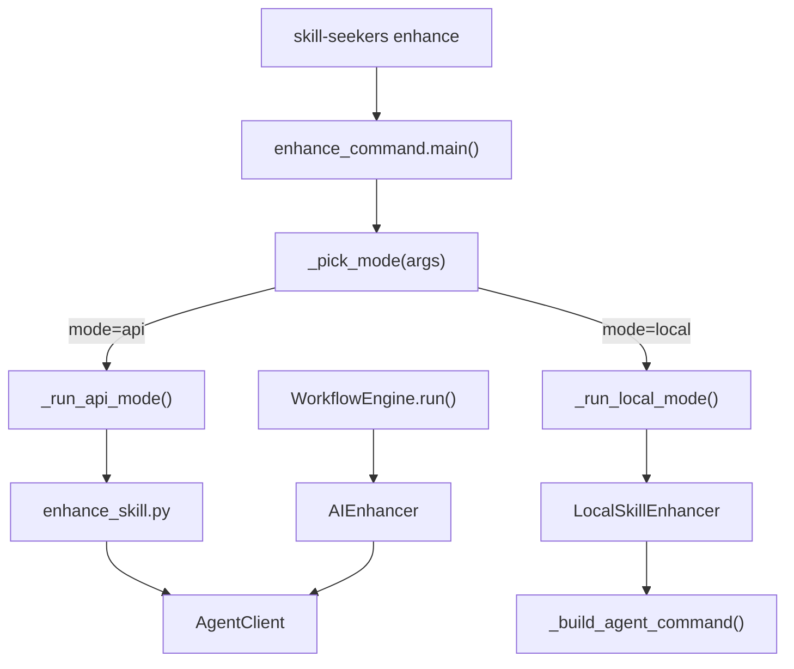
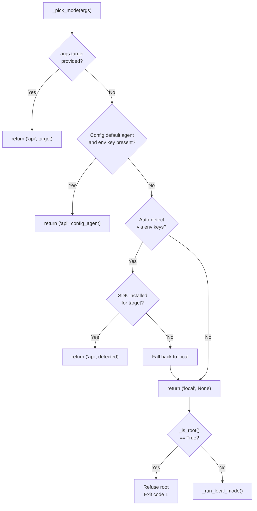

<!-- source: DeepWiki mcp.deepwiki.com · repo yusufkaraaslan/Skill_Seekers · page 8 AI Enhancement System · fetched 2026-10-26 -->

# AI Enhancement System

Relevant source files

The following files were used as context for generating this wiki page:

- [.env.example](.env.example)
- [docs/ARCHITECTURE.md](docs/ARCHITECTURE.md)
- [docs/BEST_PRACTICES.md](docs/BEST_PRACTICES.md)
- [docs/UNIFICATION_PLAN.md](docs/UNIFICATION_PLAN.md)
- [docs/VIDEO_GUIDE.md](docs/VIDEO_GUIDE.md)
- [docs/features/ENHANCEMENT_MODES.md](docs/features/ENHANCEMENT_MODES.md)
- [docs/integrations/MINIMAX_INTEGRATION.md](docs/integrations/MINIMAX_INTEGRATION.md)
- [docs/reference/MCP_REFERENCE.md](docs/reference/MCP_REFERENCE.md)
- [docs/zh-CN/README.md](docs/zh-CN/README.md)
- [docs/zh-CN/user-guide/04-packaging.md](docs/zh-CN/user-guide/04-packaging.md)
- [src/skill_seekers/cli/adaptors/minimax.py](src/skill_seekers/cli/adaptors/minimax.py)
- [src/skill_seekers/cli/adaptors/openai_compatible.py](src/skill_seekers/cli/adaptors/openai_compatible.py)
- [src/skill_seekers/cli/agent_client.py](src/skill_seekers/cli/agent_client.py)
- [src/skill_seekers/cli/minimax_config.py](src/skill_seekers/cli/minimax_config.py)
- [tests/test_minimax_multimodal.py](tests/test_minimax_multimodal.py)

The AI Enhancement System is responsible for refining scraped documentation, synthesizing structured instructions, and generating comprehensive `SKILL.md` and reference files using either cloud-based LLM APIs or local coding agent CLIs [src/skill_seekers/cli/enhance_command.py:1-40](), [src/skill_seekers/cli/enhance_skill.py:29-51](). 

This parent page provides a high-level overview of the enhancement architecture, mode priority resolution, and execution pipelines. For specific implementation details, refer to the following child pages:
- For local CLI-based execution, see [Local Enhancement (CLI-based)](#8.1).
- For API transport mechanisms and platform support, see [API-Based Enhancement & AgentClient](#8.2).
- For multi-stage pipeline orchestration, see [Enhancement Workflows & Presets](#8.3).

---

## Architecture Overview

The enhancement subsystem is organized around three primary layers: the CLI dispatcher (`enhance_command.py`), the execution backends (`LocalSkillEnhancer` and API `SkillEnhancer`), and the pipeline coordinator (`WorkflowEngine`) [src/skill_seekers/cli/enhance_command.py:5-22](), [src/skill_seekers/cli/enhancement_workflow.py:75-110]().

Diagram: Enhancement System Architecture

Sources: [src/skill_seekers/cli/enhance_command.py:1-60](), [src/skill_seekers/cli/enhance_skill.py:29-51](), [src/skill_seekers/cli/enhancement_workflow.py:75-110]()

---

## Mode Selection Priority Chain

When a user triggers `skill-seekers enhance`, `enhance_command.py` evaluates the environment and flags via `_pick_mode(args)` to determine whether to execute via cloud API or a local coding assistant CLI [src/skill_seekers/cli/enhance_command.py:92-132](). 

For full details on the priority rules, fallback conditions, and root guards, see [API-Based Enhancement & AgentClient](#8.2).

Diagram: Mode Selection Priority Chain

Sources: [src/skill_seekers/cli/enhance_command.py:65-132]()

---

## Local Enhancement

`LocalSkillEnhancer` (implemented in `enhance_skill_local.py`) delegates prompt execution to locally installed coding agents such as Claude Code, OpenAI Codex CLI, GitHub Copilot CLI, OpenCode, or Kimi Code CLI [src/skill_seekers/cli/agent_client.py:48-97](), [src/skill_seekers/cli/enhance_skill_local.py:1-50](). It supports headless foreground execution, background thread execution, detached daemon processes, and interactive terminal windows.

For comprehensive documentation on prompt generation, status file tracking, and terminal detection, see [Local Enhancement (CLI-based)](#8.1).

Sources: [src/skill_seekers/cli/enhance_skill_local.py:1-120](), [src/skill_seekers/cli/agent_client.py:48-97]()

---

## API-Based Enhancement & AgentClient

API-based enhancement utilizes `AgentClient` in `agent_client.py` to standardize calls across providers including Anthropic, Google Gemini, OpenAI, Moonshot/Kimi, and MiniMax [src/skill_seekers/cli/agent_client.py:1-35](). It handles truncation guards, multimodal attachments (images and video frames), and platform-specific request formatting [src/skill_seekers/cli/agent_client.py:100-189]().

For details on configuration objects, API transport modes, and model resolution, see [API-Based Enhancement & AgentClient](#8.2).

Sources: [src/skill_seekers/cli/agent_client.py:1-189](), [src/skill_seekers/cli/enhance_skill.py:60-120]()

---

## Enhancement Workflows & Presets

The `WorkflowEngine` (in `enhancement_workflow.py`) coordinates multi-stage enhancement pipelines [src/skill_seekers/cli/enhancement_workflow.py:75-110](). Each workflow comprises sequential `WorkflowStage` items that apply specific analytical tasks—such as design pattern recognition (C3.1), test example extraction (C3.2), how-to guide generation (C3.3), and configuration extraction (C3.4)—followed by post-processing cleanup [src/skill_seekers/cli/ai_enhancer.py:5-111]().

For details on bundled YAML workflow definitions, security validation, and custom pipelines, see [Enhancement Workflows & Presets](#8.3).

Sources: [src/skill_seekers/cli/enhancement_workflow.py:38-110](), [src/skill_seekers/cli/ai_enhancer.py:5-111]()

---

