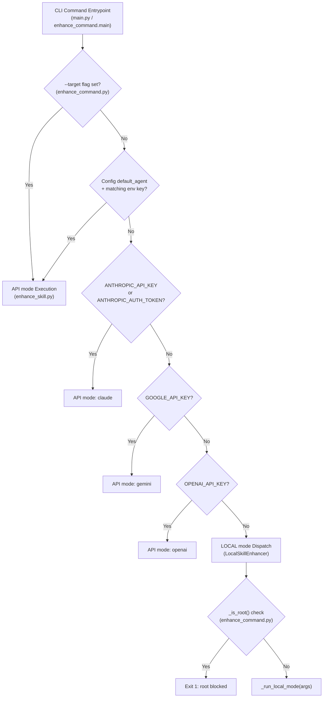
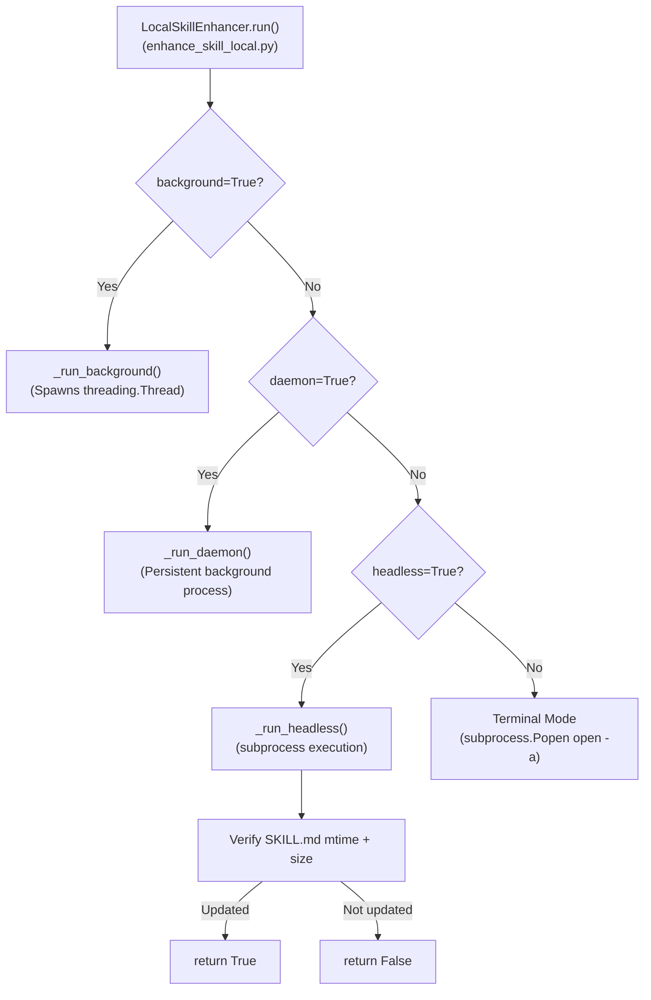
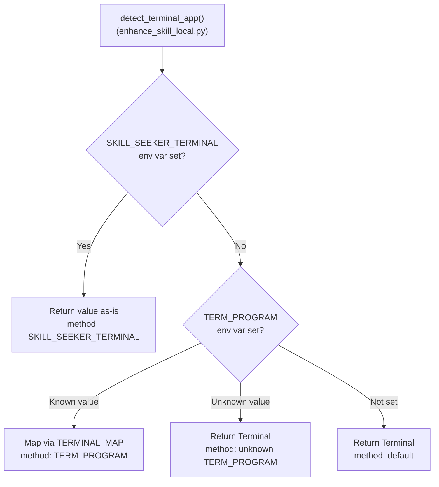

<!-- source: DeepWiki mcp.deepwiki.com · repo yusufkaraaslan/Skill_Seekers · page 8.1 Local Enhancement (CLI-based) · fetched 2026-10-26 -->

# Local Enhancement (CLI-based)

<details>
<summary>Relevant source files</summary>

The following files were used as context for generating this wiki page:

- [src/skill_seekers/cli/enhance_skill_local.py](src/skill_seekers/cli/enhance_skill_local.py)
- [tests/test_enhance_skill_local.py](tests/test_enhance_skill_local.py)
- [tests/test_install_skill.py](tests/test_install_skill.py)
- [tests/test_install_skill_e2e.py](tests/test_install_skill_e2e.py)
- [tests/test_mcp_workflow_tools.py](tests/test_mcp_workflow_tools.py)
- [tests/test_pdf_scraper.py](tests/test_pdf_scraper.py)
- [tests/test_terminal_detection.py](tests/test_terminal_detection.py)

</details>


## Purpose and Scope

This page documents the local CLI enhancement path in `skill-seekers`: how the `LocalSkillEnhancer` class works, how the smart mode dispatcher routes to it, and all relevant execution modes, agent presets, prompt generation, and status tracking.

This page covers only the **local** (no-API-key) path. For API-based enhancement via Claude, Gemini, or OpenAI, see [API-Based Enhancement](8.2). For enhancement workflows and multi-stage presets, see [Enhancement Workflows & Presets](8.3). For the broader enhancement system overview, see [AI Enhancement System](8).

Sources: [src/skill_seekers/cli/enhance_command.py:32-89](), [src/skill_seekers/cli/enhance_skill_local.py:119-134]()

---

## Role in the Enhancement System

The `skill-seekers enhance` command does not always invoke the local path. A smart dispatcher (`enhance_command.py`) decides at runtime whether to use API mode or local mode.

### Diagram: Mode Selection Dispatcher (Natural Language to Code Space)


Sources: [src/skill_seekers/cli/enhance_command.py:32-163]()

The `_pick_mode` function returns a `(mode, target)` tuple. If `mode == "local"`, the `_run_local_mode` helper instantiates `LocalSkillEnhancer` and calls `.run()`.

Sources: [src/skill_seekers/cli/enhance_command.py:32-89](), [src/skill_seekers/cli/enhance_command.py:140-163]()

---

## `LocalSkillEnhancer` Class

**File:** [src/skill_seekers/cli/enhance_skill_local.py:119-134]()

The `LocalSkillEnhancer` class orchestrates the full local enhancement flow: reading references, building a prompt, dispatching to a coding agent CLI, and verifying the output.

### Constructor

```python
LocalSkillEnhancer(skill_dir, force=True, agent=None, agent_cmd=None)
```

| Parameter | Type | Description |
|---|---|---|
| `skill_dir` | `str | Path` | Path to the skill output directory |
| `force` | `bool` | If `True`, skip all agent confirmations (default). Pass `--no-force` to disable |
| `agent` | `str | None` | Agent identifier: `claude`, `codex`, `copilot`, `opencode`, `kimi`, `custom` |
| `agent_cmd` | `str | None` | Override command template (for `custom` agent). Use `{prompt_file}` placeholder |

On construction, the following paths are resolved:

| Attribute | Value |
|---|---|
| `self.skill_dir` | Resolved `Path(skill_dir)` |
| `self.references_dir` | `skill_dir / "references"` |
| `self.skill_md_path` | `skill_dir / "SKILL.md"` |
| `self.status_file` | `skill_dir / ".enhancement_status.json"` |

Sources: [src/skill_seekers/cli/enhance_skill_local.py:120-134]()

---

## Supported Agents

The `AGENT_PRESETS` dict (imported from `agent_client.py`) defines the built-in agents:

| Key | Display Name | Command | `supports_skip_permissions` | `uses_stdin` |
|---|---|---|---|---|
| `claude` | Claude Code | `claude {prompt_file}` | `True` | `False` |
| `codex` | OpenAI Codex CLI | `codex exec --full-auto --skip-git-repo-check -` | `False` | `False` |
| `copilot` | GitHub Copilot CLI | `gh copilot chat` | `False` | `False` |
| `opencode` | OpenCode CLI | `opencode` | `False` | `False` |
| `kimi` | Kimi Code CLI | `kimi --print --input-format text --work-dir {skill_dir}` | `False` | `True` |

For `claude`, the `--dangerously-skip-permissions` flag is injected automatically when running in headless mode (via `_build_agent_command` with `include_permissions_flag=True`). 

For agents that use `uses_stdin: True` (e.g., `kimi`) or do **not** use a `{prompt_file}` placeholder (e.g., `codex`), the prompt is piped to the agent's stdin instead of passed as a file argument.

### Agent Resolution Priority

`_resolve_agent(agent, agent_cmd)` applies this priority chain:
1. Explicit `agent` argument to constructor
2. `ExecutionContext` (if available)
3. `SKILL_SEEKER_AGENT` environment variable
4. Fallback to `"claude"`

Alias normalization via `_normalize_agent_name`:
- `claude-code`, `claude_code` $\rightarrow$ `claude`
- `codex-cli` $\rightarrow$ `codex`
- `copilot-cli` $\rightarrow$ `copilot`
- `open-code`, `open_code` $\rightarrow$ `opencode`
- `kimi-cli` $\rightarrow$ `kimi`

For `custom` agents, `--agent-cmd` or `SKILL_SEEKER_AGENT_CMD` must be set. The `_validate_custom_command` method rejects commands containing shell metacharacters (`;`, `&`, `|`, `$`, `` ` ``, newlines) and verifies the executable exists on `PATH`.

Sources: [src/skill_seekers/cli/enhance_skill_local.py:64-65](), [src/skill_seekers/cli/enhance_skill_local.py:136-218](), [tests/test_enhance_skill_local.py:26-170]()

---

## Prompt Generation

`create_enhancement_prompt(use_summarization=False, summarization_ratio=0.3)` builds the text block sent to the agent.

**Steps:**
1. Read all reference files via `read_reference_files()`.
2. If `use_summarization=True` or total reference size exceeds **30,000 characters**, invoke `summarize_reference` on each file.
3. Read current `SKILL.md`.
4. Detect whether `conflicts.md` is present in references.
5. Group references by `(source_type, repo_id)` for multi-source awareness.
6. Emit a structured prompt with: skill overview, source breakdown, reference content, priority rules, multi-repo handling, and explicit task instructions.

The prompt tells the agent to create a backup `SKILL.md.backup` before writing, write the enhanced content to `SKILL.md`, and ensure the output is larger than the original (200–1,000+ lines).

### Smart Summarization

When reference content is large, `summarize_reference(content, target_ratio=0.3)` reduces each file to approximately 30% of its original size using this strategy:
- Keep first 20% of lines (introduction/overview)
- Extract up to 5 code blocks (fenced with ` ``` `)
- Keep up to 10 headings (`#`) with the following 3 lines
- Append `[Content intelligently summarized...]` notice

Sources: [src/skill_seekers/cli/enhance_skill_local.py:292-361](), [src/skill_seekers/cli/enhance_skill_local.py:363-598]()

---

## Execution Modes

### Diagram: Execution Mode Pipeline (Natural Language to Code Space)


Sources: [src/skill_seekers/cli/enhance_skill_local.py:634-810]()

### Mode Summary

| Mode | Flag | Behavior | Return |
|---|---|---|---|
| **Headless** (default) | _(none)_ | Runs agent via `subprocess.run`, blocks until done | `True` if `SKILL.md` was updated |
| **Background** | `--background` | Spawns a thread, returns immediately | `True` if thread started |
| **Daemon** | `--daemon` | Runs as persistent background process with monitoring | `True` if started |
| **Terminal** (interactive) | `--interactive-enhancement` | Opens new terminal window (macOS only) | `True` if window launched |

### Headless Mode Detail

`_run_headless(prompt_file, timeout)` records `SKILL.md` initial `mtime` and `size`, calls `_run_agent_command` (blocks up to `timeout` seconds, default 600), re-reads `SKILL.md` and checks both `mtime > initial_mtime` and `size > initial_size`. If unupdated, returns `False` and prints debug info. On `FileNotFoundError`, prints a hint to check `PATH`. On `TimeoutExpired`, prints suggestions. If stderr contains `"root"` or `"permission"` with exit code `1` or `126`, a specific hint to switch to API mode is printed.

### Background Mode Detail

`_run_background(headless, timeout)` calls `write_status("pending", "Starting background enhancement...")`, spawns a `threading.Thread` running a `background_worker` closure, and returns `True` immediately without waiting.

Sources: [src/skill_seekers/cli/enhance_skill_local.py:811-979]()

---

## Status File

`LocalSkillEnhancer` maintains a JSON status file at `skill_dir/.enhancement_status.json` to support background/daemon monitoring.

### `write_status(status, message="", progress=0.0, error=None)`

Writes a JSON object with `status`, `message`, `progress`, `timestamp`, `skill_dir`, and `error`. `read_status()` returns the parsed JSON dict, or `None` if absent or invalid.

Sources: [src/skill_seekers/cli/enhance_skill_local.py:600-632]()

---

## Root User Guard

When local mode is selected, `enhance_command.main()` calls `_is_root()` before running:
```python
def _is_root() -> bool:
    try:
        return os.getuid() == 0
    except AttributeError:
        return False
```
If the process is running as root (UID 0), local mode exits with code `1` and prints instructions to use API mode instead, because Claude Code CLI refuses to run as root by design. API mode is **not** blocked by root detection.

Sources: [src/skill_seekers/cli/enhance_command.py:32-37](), [src/skill_seekers/cli/enhance_command.py:244-256]()

---

## Terminal Detection

When running in interactive terminal mode (non-headless, macOS), `detect_terminal_app()` determines which terminal application to launch.

### Diagram: Terminal Detection Cascading Priority


Sources: [src/skill_seekers/cli/enhance_skill_local.py:70-117](), [tests/test_terminal_detection.py:17-137]()

`TERMINAL_MAP` maps `Apple_Terminal` $\rightarrow$ `Terminal`, `iTerm.app` $\rightarrow$ `iTerm`, `ghostty` $\rightarrow$ `Ghostty`, and `WezTerm` $\rightarrow$ `WezTerm`. Used via `subprocess.Popen(["open", "-a", terminal_app, script_file])`.

Sources: [src/skill_seekers/cli/enhance_skill_local.py:70-117](), [src/skill_seekers/cli/enhance_skill_local.py:759-808](), [tests/test_terminal_detection.py:17-137]()

---

## Environment Variable Reference

| Variable | Used By | Effect |
|---|---|---|
| `SKILL_SEEKER_AGENT` | `_resolve_agent` | Sets the default agent (e.g., `codex`) |
| `SKILL_SEEKER_AGENT_CMD` | `_resolve_agent` | Sets command template for custom agents |
| `SKILL_SEEKER_TERMINAL` | `detect_terminal_app` | Forces a specific terminal app for interactive mode |
| `ANTHROPIC_API_KEY` | `_pick_mode`, `_get_api_keys` | Selects Claude API mode |
| `ANTHROPIC_AUTH_TOKEN` | `_pick_mode`, `_get_api_keys` | Fallback for Claude API auth |
| `GOOGLE_API_KEY` | `_pick_mode`, `_get_api_keys` | Selects Gemini API mode |
| `OPENAI_API_KEY` | `_pick_mode`, `_get_api_keys` | Selects OpenAI API mode |
| `TERM_PROGRAM` | `detect_terminal_app` | Auto-detects current terminal for interactive mode |

Sources: [src/skill_seekers/cli/enhance_skill_local.py:101-108](), [src/skill_seekers/cli/enhance_skill_local.py:173-174](), [src/skill_seekers/cli/enhance_command.py:40-46]()

---

