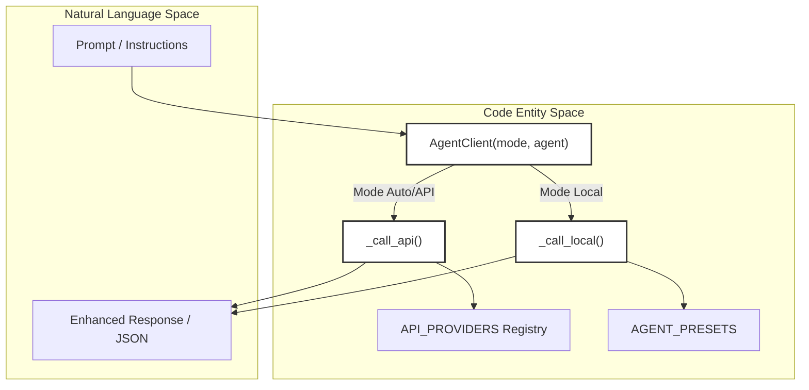
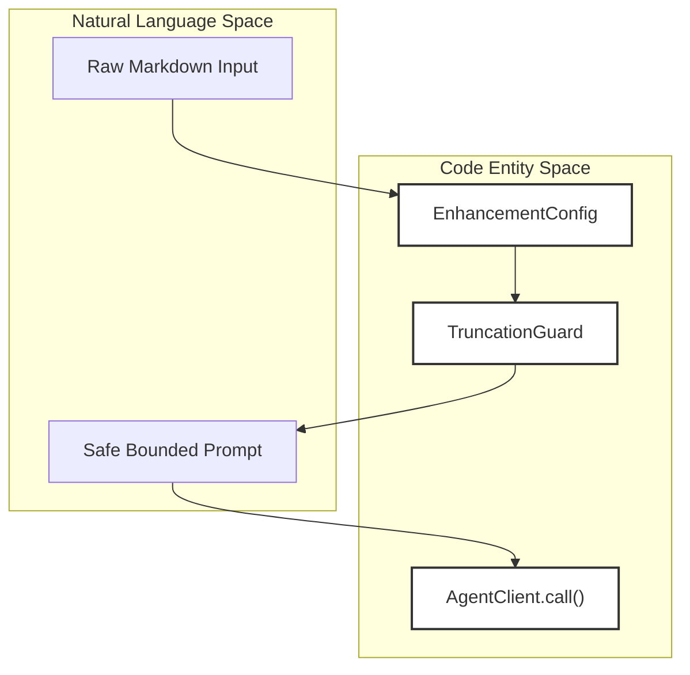
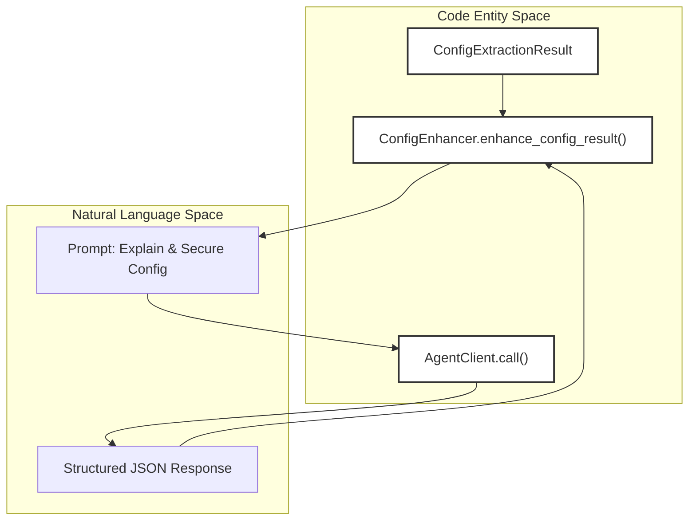

<!-- source: DeepWiki mcp.deepwiki.com · repo yusufkaraaslan/Skill_Seekers · page 8.2 API-Based Enhancement & AgentClient · fetched 2026-10-26 -->

# API-Based Enhancement & AgentClient

<details>
<summary>Relevant source files</summary>

The following files were used as context for generating this wiki page:

- [.env.example](.env.example)
- [docs/UNIFICATION_PLAN.md](docs/UNIFICATION_PLAN.md)
- [docs/archive/legacy/QUICK_REFERENCE.md](docs/archive/legacy/QUICK_REFERENCE.md)
- [docs/features/ENHANCEMENT.md](docs/features/ENHANCEMENT.md)
- [docs/guides/MCP_SETUP.md](docs/guides/MCP_SETUP.md)
- [docs/guides/MIGRATION_GUIDE.md](docs/guides/MIGRATION_GUIDE.md)
- [docs/guides/UPLOAD_GUIDE.md](docs/guides/UPLOAD_GUIDE.md)
- [docs/integrations/MINIMAX_INTEGRATION.md](docs/integrations/MINIMAX_INTEGRATION.md)
- [docs/integrations/MULTI_LLM_SUPPORT.md](docs/integrations/MULTI_LLM_SUPPORT.md)
- [docs/integrations/WINDSURF.md](docs/integrations/WINDSURF.md)
- [docs/reference/CLAUDE_INTEGRATION.md](docs/reference/CLAUDE_INTEGRATION.md)
- [docs/reference/CODE_QUALITY.md](docs/reference/CODE_QUALITY.md)
- [docs/reference/LARGE_DOCUMENTATION.md](docs/reference/LARGE_DOCUMENTATION.md)
- [src/skill_seekers/cli/adaptors/claude.py](src/skill_seekers/cli/adaptors/claude.py)
- [src/skill_seekers/cli/adaptors/gemini.py](src/skill_seekers/cli/adaptors/gemini.py)
- [src/skill_seekers/cli/adaptors/minimax.py](src/skill_seekers/cli/adaptors/minimax.py)
- [src/skill_seekers/cli/adaptors/openai.py](src/skill_seekers/cli/adaptors/openai.py)
- [src/skill_seekers/cli/adaptors/openai_compatible.py](src/skill_seekers/cli/adaptors/openai_compatible.py)
- [src/skill_seekers/cli/agent_client.py](src/skill_seekers/cli/agent_client.py)
- [src/skill_seekers/cli/enhance_command.py](src/skill_seekers/cli/enhance_command.py)
- [src/skill_seekers/cli/minimax_config.py](src/skill_seekers/cli/minimax_config.py)
- [src/skill_seekers/cli/upload_skill.py](src/skill_seekers/cli/upload_skill.py)
- [tests/test_adaptors/test_minimax_adaptor.py](tests/test_adaptors/test_minimax_adaptor.py)
- [tests/test_adaptors/test_openai_adaptor.py](tests/test_adaptors/test_openai_adaptor.py)
- [tests/test_enhance_command.py](tests/test_enhance_command.py)
- [tests/test_minimax_multimodal.py](tests/test_minimax_multimodal.py)

</details>


This page documents the unified `AgentClient` transport layer and the API-based enhancement system that transforms basic `SKILL.md` templates and code analysis results into production-grade documentation using AI platform APIs (Claude, Gemini, OpenAI, Moonshot, and MiniMax). For free local enhancement alternatives using CLI coding agents, see [Local Enhancement (CLI-based)](#8.1).

**Purpose:** `AgentClient` provides a single, unified abstraction for all AI invocations across Skill Seekers, handling both API modes and local CLI modes, automatic mode selection via priority chains, environment auto-detection, configuration handling via `EnhancementConfig`, and token truncation guards [src/skill_seekers/cli/agent_client.py:1-24]().

---

## 1. AgentClient Unified Transport Architecture

The `AgentClient` class centralizes all AI operations, decoupling enhancer logic from underlying provider SDKs and local CLI binaries [src/skill_seekers/cli/agent_client.py:1-12](). It supports two primary execution modes:

- **API Mode:** Direct programmatic calls to cloud LLM providers using official or compatible SDKs (`anthropic`, `google-generativeai`, `openai`). Supports Anthropic, Google Gemini, OpenAI, Moonshot/Kimi, and MiniMax [src/skill_seekers/cli/agent_client.py:7-10]().
- **LOCAL Mode:** Subprocess delegation to local CLI coding tools (Claude Code, OpenAI Codex CLI, GitHub Copilot CLI, OpenCode CLI, Kimi Code CLI) [src/skill_seekers/cli/agent_client.py:8-10](), [src/skill_seekers/cli/agent_client.py:55-97]().



Sources: [src/skill_seekers/cli/agent_client.py:1-24](), [src/skill_seekers/cli/agent_client.py:55-168]()

---

## 2. Mode Selection & Priority Chain (`_pick_mode`)

The system determines whether to use API mode or Local CLI mode using a strict priority chain implemented during enhancement dispatch [src/skill_seekers/cli/enhance_command.py:92-132]().

1. **Explicit Target Override:** If `--target <platform>` or an explicit mode is specified by the user, the dispatcher prioritizes that path [src/skill_seekers/cli/enhance_command.py:102-105]().
2. **Configuration Preference:** If `ai_enhancement.default_agent` or a config-level default is declared, the system checks for corresponding environment credentials [src/skill_seekers/cli/enhance_command.py:107-112]().
3. **Environment Auto-Detection:** The system iterates through the ordered `API_PROVIDERS` registry in `AgentClient`, inspecting environment variables (`ANTHROPIC_API_KEY`, `GOOGLE_API_KEY`, `OPENAI_API_KEY`, `MOONSHOT_API_KEY`, `MINIMAX_API_KEY`) and verifying SDK availability [src/skill_seekers/cli/agent_client.py:123-168](), [src/skill_seekers/cli/enhance_command.py:114-124]().
4. **Local Fallback:** If no cloud API keys or matching SDKs are present, the system defaults to **LOCAL mode**, leveraging installed local CLI coding agents [src/skill_seekers/cli/enhance_command.py:131-132]().

Sources: [src/skill_seekers/cli/agent_client.py:123-182](), [src/skill_seekers/cli/enhance_command.py:92-132]()

---

## 3. EnhancementConfig & Truncation Guards

To prevent context window overflow and excessive token expenditures, `AgentClient` and related enhancement routines incorporate strict safeguards:

- **Truncation Guards:** Large reference markdown documents or extracted codebase segments are measured against platform token limits. Content exceeding safety thresholds is truncated or intelligently batched using sliding windows.
- **EnhancementConfig:** Parameters such as `batch_size`, `parallel_workers`, `timeout`, and `max_tokens` are standardized through configuration objects [src/skill_seekers/cli/config_manager.py:41-58]().



Sources: [src/skill_seekers/cli/config_manager.py:41-58](), [src/skill_seekers/cli/ai_enhancer.py:82-88]()

---

## 4. Platform Adaptor Integration

`AgentClient` integrates directly with the platform adaptor hierarchy to format system instructions, handle model parameters, and execute remote validation or uploading [src/skill_seekers/cli/adaptors/base.py:1-40]().

### Supported Platform Adaptors

| Platform | Adaptor Class | Default Wire Protocol | Key Configuration |
| :--- | :--- | :--- | :--- |
| **Claude AI** | `ClaudeAdaptor` | `anthropic` | `ANTHROPIC_API_KEY` [src/skill_seekers/cli/adaptors/claude.py:18-31]() |
| **Google Gemini** | `GeminiAdaptor` | `google` | `GOOGLE_API_KEY` [src/skill_seekers/cli/adaptors/gemini.py:19-33]() |
| **OpenAI ChatGPT** | `OpenAIAdaptor` | `openai` | `OPENAI_API_KEY` [src/skill_seekers/cli/adaptors/openai.py:18-32]() |
| **Moonshot Kimi** | `MoonshotAdaptor` | `anthropic` | `MOONSHOT_API_KEY` [src/skill_seekers/cli/agent_client.py:147-152]() |
| **MiniMax AI** | `MiniMaxAdaptor` | `openai` / `anthropic` | `MINIMAX_API_KEY`, `MINIMAX_API_REGION` [docs/integrations/MINIMAX_INTEGRATION.md:40-47]() |

Sources: [src/skill_seekers/cli/adaptors/claude.py:18-31](), [src/skill_seekers/cli/adaptors/gemini.py:19-33](), [src/skill_seekers/cli/adaptors/openai.py:18-32](), [src/skill_seekers/cli/agent_client.py:123-168](), [docs/integrations/MINIMAX_INTEGRATION.md:40-47]()

---

## 5. Specialized Enhancement Modules & Data Flow

Specialized components such as `ConfigEnhancer` and pattern-matching modules leverage `AgentClient` to perform structured enhancements (e.g., security audits, explanation generation, and test refactoring) [src/skill_seekers/cli/config_enhancer.py:49-57]().



Sources: [src/skill_seekers/cli/config_enhancer.py:49-86](), [src/skill_seekers/cli/ai_enhancer.py:41-50]()

---

## 6. Workflow & Usage Examples

### MiniMax API Enhancement Example
MiniMax-M3 supports adaptive thinking modes and regional base URLs configured via environment variables and passed through `AgentClient` [docs/integrations/MINIMAX_INTEGRATION.md:40-55]().

```bash
export MINIMAX_API_KEY=your-api-key
export MINIMAX_API_REGION=global_en
export MINIMAX_API_PROTOCOL=openai
export MINIMAX_THINKING=adaptive

# Enhance skill using MiniMax API mode
skill-seekers enhance output/react/ --target minimax --model MiniMax-M3
```

Sources: [docs/integrations/MINIMAX_INTEGRATION.md:40-92](), [src/skill_seekers/cli/agent_client.py:154-167]()

---

