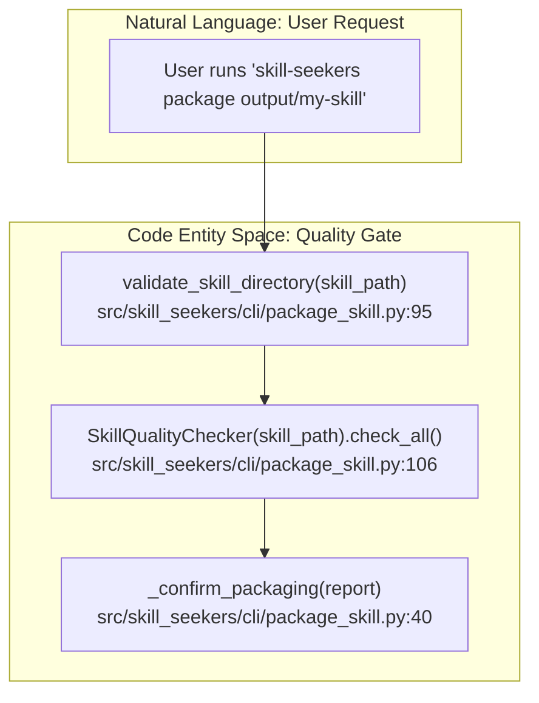
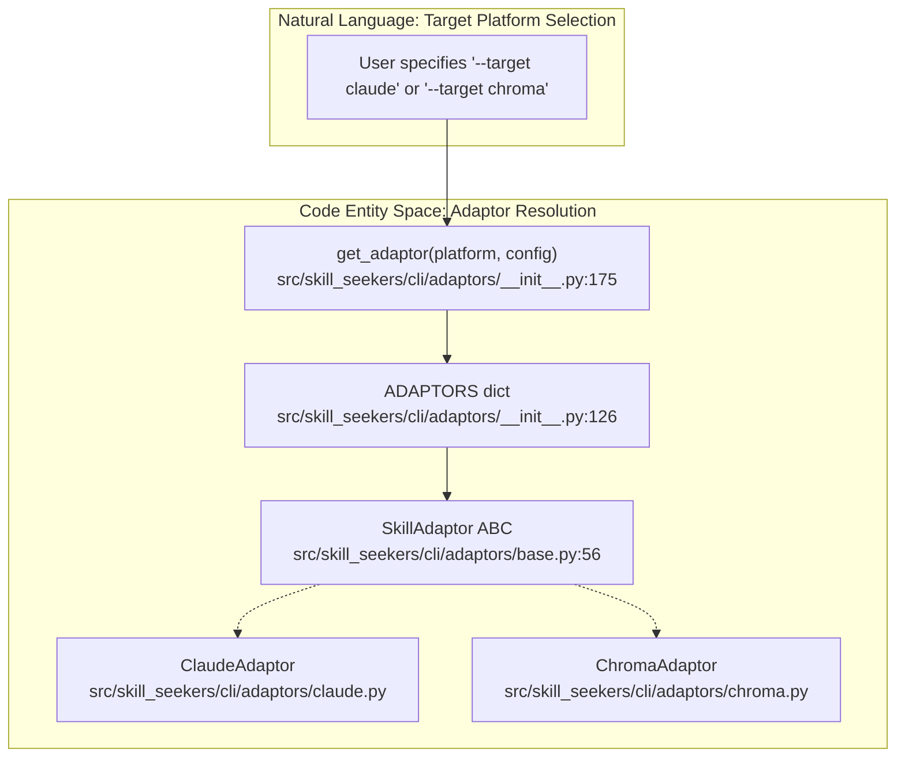

<!-- source: DeepWiki mcp.deepwiki.com · repo yusufkaraaslan/Skill_Seekers · page 9 Skill Packaging & Distribution · fetched 2026-10-26 -->

# Skill Packaging & Distribution

Relevant source files

The following files were used as context for generating this wiki page:

- [src/skill_seekers/cli/adaptors/__init__.py](src/skill_seekers/cli/adaptors/__init__.py)
- [src/skill_seekers/cli/adaptors/base.py](src/skill_seekers/cli/adaptors/base.py)
- [src/skill_seekers/cli/adaptors/chroma.py](src/skill_seekers/cli/adaptors/chroma.py)
- [src/skill_seekers/cli/adaptors/faiss_helpers.py](src/skill_seekers/cli/adaptors/faiss_helpers.py)
- [src/skill_seekers/cli/adaptors/haystack.py](src/skill_seekers/cli/adaptors/haystack.py)
- [src/skill_seekers/cli/adaptors/langchain.py](src/skill_seekers/cli/adaptors/langchain.py)
- [src/skill_seekers/cli/adaptors/llama_index.py](src/skill_seekers/cli/adaptors/llama_index.py)
- [src/skill_seekers/cli/adaptors/qdrant.py](src/skill_seekers/cli/adaptors/qdrant.py)
- [src/skill_seekers/cli/adaptors/weaviate.py](src/skill_seekers/cli/adaptors/weaviate.py)
- [src/skill_seekers/cli/package_skill.py](src/skill_seekers/cli/package_skill.py)

This page documents the skill packaging and distribution system, which transforms completed skill directories into deployable artifacts. It covers quality validation, platform-specific packaging, RAG-optimized chunking, and installation to local AI agent directories.

This is a parent page. For deep technical details, refer to the child pages:
- [Quality Validation & Checks](#9.1)
- [Platform Adaptors & Strategy Pattern](#9.2)
- [Chunking & Vector Database Export](#9.3)
- [Uploading to Platforms](#9.4)
- [Installing to AI Agents](#9.5)

---

## Overview

The packaging and distribution phase is the final transformation step in the five-phase skill creation pipeline. After scraping, building, and enhancement, skills must be validated, transformed, packaged, and distributed.

The system uses the **Strategy pattern** with various platform adaptors (`SkillAdaptor`), enabling a single skill to be exported for LLM platforms (Claude, Gemini, OpenAI), RAG frameworks (LangChain, LlamaIndex), and Vector Databases (Chroma, Weaviate, Qdrant, FAISS).

Sources: [src/skill_seekers/cli/adaptors/__init__.py:175-208](), [src/skill_seekers/cli/adaptors/base.py:56-65]()

---

## Quality Validation & Checks

Before packaging, skills pass through a quality gate managed by `SkillQualityChecker`. For full details on structure checks, grading, and quality metrics, see [Quality Validation & Checks](#9.1).

Sources: [src/skill_seekers/cli/package_skill.py:40-118]()

---

## Platform Adaptors & Strategy Pattern

The `get_adaptor(platform, config)` factory function resolves platform-specific subclasses of `SkillAdaptor` from the `ADAPTORS` registry. For detailed adaptor implementations, see [Platform Adaptors & Strategy Pattern](#9.2).

Sources: [src/skill_seekers/cli/adaptors/__init__.py:126-208](), [src/skill_seekers/cli/adaptors/base.py:56-65]()

---

## Chunking & Vector Database Export

For vector database and RAG targets (such as Chroma, Weaviate, Qdrant, FAISS, LangChain, and LlamaIndex), the packaging process applies token chunking and deterministic ID generation. For full details, see [Chunking & Vector Database Export](#9.3).

Vector adaptors make use of `StreamingAdaptorMixin` and support configurable parameters such as `chunk_max_tokens` and `preserve_code_blocks`.

Sources: [src/skill_seekers/cli/adaptors/chroma.py:18-150](), [src/skill_seekers/cli/adaptors/weaviate.py:18-113](), [src/skill_seekers/cli/adaptors/faiss_helpers.py:18-150]()

---

## Uploading to Platforms

The `upload` command dispatches to API upload routines, validating API keys and executing remote calls. For platform-specific endpoints, retry logic, and the `upload_skill` MCP tool, see [Uploading to Platforms](#9.4).

Sources: [src/skill_seekers/cli/main.py:68-68](), [src/skill_seekers/cli/adaptors/base.py:130-149]()

---

## Installing to AI Agents

Skills can be deployed directly to local AI coding assistant directories using the `install-agent` command. For supported agent paths (`~/.claude/skills/`, `.cursor/skills/`, etc.) and the `install_skill_tool` flow, see [Installing to AI Agents](#9.5).

Sources: [src/skill_seekers/cli/main.py:17-70]()

---

## CLI Reference for Distribution

| Command | Purpose | Example |
|---------|---------|---------|
| `package` | Create a .zip or JSON package | `skill-seekers package output/my-skill --target claude` |
| `upload` | Push package to a platform | `skill-seekers upload output/my-skill.zip --target claude` |
| `install` | Workflow: Scrape + Enhance + Package + Upload | `skill-seekers install --config react` |
| `install-agent` | Deploy to local AI agent | `skill-seekers install-agent output/my-skill --agent cursor` |
| `quality` | Run quality validation standalone | `skill-seekers quality output/my-skill` |

Sources: [src/skill_seekers/cli/main.py:11-23](), [src/skill_seekers/cli/package_skill.py:7-10]()

---

