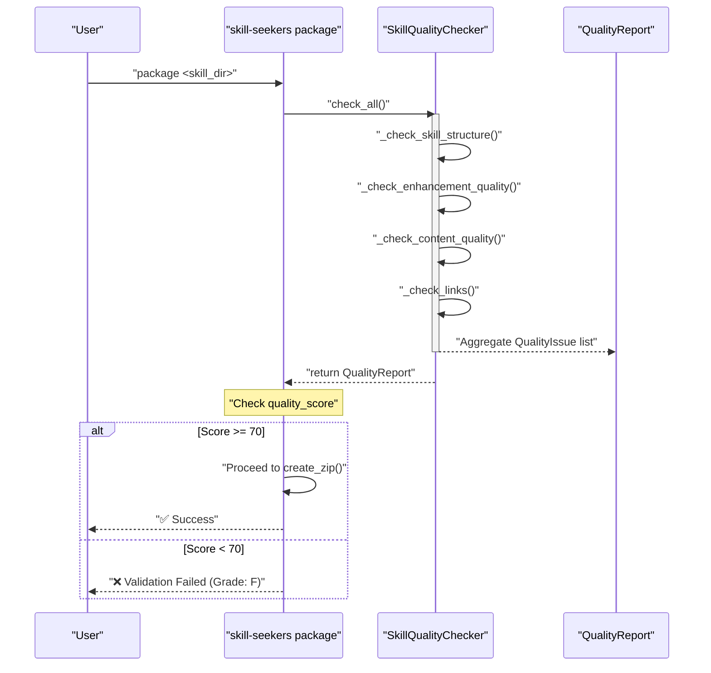
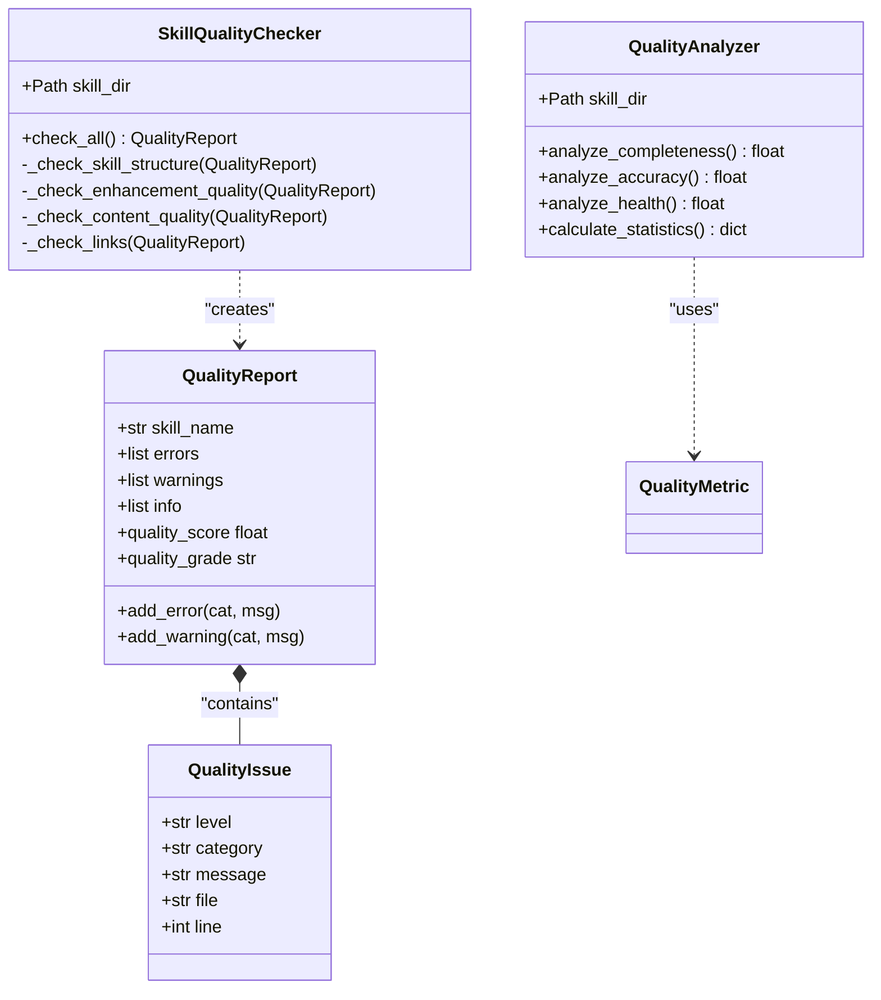

<!-- source: DeepWiki mcp.deepwiki.com · repo yusufkaraaslan/Skill_Seekers · page 9.1 Quality Validation & Checks · fetched 2026-10-26 -->

# Quality Validation & Checks

Relevant source files

The following files were used as context for generating this wiki page:

- [src/skill_seekers/cli/parsers/quality_parser.py](src/skill_seekers/cli/parsers/quality_parser.py)
- [src/skill_seekers/cli/quality_checker.py](src/skill_seekers/cli/quality_checker.py)
- [src/skill_seekers/cli/quality_metrics.py](src/skill_seekers/cli/quality_metrics.py)
- [tests/test_quality_checker.py](tests/test_quality_checker.py)
- [tests/test_quality_metrics.py](tests/test_quality_metrics.py)

## Purpose and Scope

Quality Validation is the automated pre-packaging inspection system that ensures skills meet technical and prose standards before distribution. This system validates the structural integrity of the skill directory, analyzes the readability and completeness of the `SKILL.md` content, and provides a quantitative score for production readiness.

## Overview

The quality validation system provides a detailed report including a 0-100 score and letter grade (A-F). It is integrated into the packaging workflow to prevent low-quality or incomplete skills from being deployed to agents.

**Key Features:**
- **Structure Validation**: Verifies directory layouts and required file presence [src/skill_seekers/cli/quality_checker.py:131-158]().
- **Content Analysis**: Heuristic analysis of prose, code blocks, and metadata [src/skill_seekers/cli/quality_checker.py:160-247]().
- **Readability Metrics**: Flesch Reading Ease and Grade Level calculations for English content [src/skill_seekers/cli/quality_checker.py:73-123]().
- **Link Integrity**: Validation of internal Markdown links between the skill and its references [src/skill_seekers/cli/quality_checker.py:249-276]().
- **Environment Health**: The `doctor` command for checking system-level dependencies and API keys [src/skill_seekers/cli/doctor.py:1-6]().

Sources: [src/skill_seekers/cli/quality_checker.py:2-9](), [src/skill_seekers/cli/doctor.py:1-6]()

## Quality Check Categories

The `SkillQualityChecker` [src/skill_seekers/cli/quality_checker.py:279]() performs checks in four primary categories:

### 1. Structure Validation
Verifies the presence of required files and directory layouts.
- **SKILL.md exists**: Main skill entry point must be present [src/skill_seekers/cli/quality_checker.py:134-137]().
- **references/ exists**: The directory containing source material must exist [src/skill_seekers/cli/quality_checker.py:139-144]().
- **references/ has files**: At least one Markdown reference file is required [src/skill_seekers/cli/quality_checker.py:145-150]().

### 2. Enhancement Verification
Checks for quality indicators typically added during the AI enhancement phase.
- **No template text**: Detects placeholders like "TODO:", "[Add description]", or "coming soon" [src/skill_seekers/cli/quality_checker.py:160-174]().
- **Code examples**: Verifies the presence of code blocks (at least 2 recommended) [src/skill_seekers/cli/quality_checker.py:182-198]().
- **Section count**: Checks for sufficient hierarchical sections (minimum 4 headers) [src/skill_seekers/cli/quality_checker.py:200-207]().

### 3. Content Quality & Readability
Validates formatting, metadata, and prose complexity.
- **YAML frontmatter**: Ensures frontmatter parses and includes the `name` field [src/skill_seekers/cli/quality_checker.py:210-247]().
- **Language tags**: Ensures all code blocks have language identifiers for syntax highlighting [src/skill_seekers/cli/quality_checker.py:239-247]().
- **Readability**: Calculates `reading_ease` and `grade_level` after stripping code blocks to avoid skewed heuristics [src/skill_seekers/cli/quality_checker.py:30-38](), [src/skill_seekers/cli/quality_checker.py:73-123]().

### 4. Link Validation
Validates internal markdown links between the main skill and references, ensuring no broken relative paths exist [src/skill_seekers/cli/quality_checker.py:249-276]().

Sources: [src/skill_seekers/cli/quality_checker.py:131-276]()

## Quality Scoring & Grading

The `QualityReport` [src/skill_seekers/cli/quality_checker.py:138]() class calculates the final score and grade.

### Scoring Algorithm
- **Base Score**: 100.0 [src/skill_seekers/cli/quality_checker.py:178]()
- **Deductions**: -15 per `error`, -5 per `warning` [src/skill_seekers/cli/quality_checker.py:181-182]()
- **Floor**: 0.0 [src/skill_seekers/cli/quality_checker.py:185]()

### Grade Mapping
| Score Range | Grade | Interpretation |
|-------------|-------|----------------|
| 90 - 100    | A     | Production-ready |
| 80 - 89     | B     | Good quality |
| 70 - 79     | C     | Acceptable |
| 60 - 69     | D     | Needs improvement |
| 0 - 59      | F     | Major issues |

Sources: [src/skill_seekers/cli/quality_checker.py:175-201](), [src/skill_seekers/cli/quality_metrics.py:82-94]()

## Environment Diagnostics (`doctor`)

The `skill-seekers doctor` command performs environment health checks to ensure the system is ready for scraping and enhancement [src/skill_seekers/cli/doctor.py:1-6]().

| Check | Description | File Reference |
|-------|-------------|----------------|
| Python Version | Ensures Python >= 3.10 | [src/skill_seekers/cli/doctor.py:81-87]() |
| Core Deps | Validates `requests`, `beautifulsoup4`, `PyGithub`, etc. | [src/skill_seekers/cli/doctor.py:115-143]() |
| Optional Deps | Checks for `mcp`, `chromadb`, `openai`, etc. | [src/skill_seekers/cli/doctor.py:146-173]() |
| API Keys | Checks `ANTHROPIC_API_KEY`, `GITHUB_TOKEN`, etc. | [src/skill_seekers/cli/doctor.py:176-215]() |
| MCP Server | Verifies if `server_fastmcp` is importable | [src/skill_seekers/cli/doctor.py:218-226]() |

Sources: [src/skill_seekers/cli/doctor.py:81-226]()

## Validation Workflow

### Packaging Sequence Diagram
Title: "Skill Packaging Validation Flow"

Sources: [src/skill_seekers/cli/quality_checker.py:279-300](), [tests/test_quality_checker.py:42-43]()

## Code Entity Space: Quality Classes

The validation logic is encapsulated in several data structures and analyzer classes.

### Quality Logic Relationship
Title: "Quality Validation Entity Mapping"

Sources: [src/skill_seekers/cli/quality_checker.py:127-158](), [src/skill_seekers/cli/quality_metrics.py:39-79]()

### Key Components Reference
| Component | Responsibility |
|-----------|----------------|
| `QualityIssue` | Data class representing a specific validation failure with level and category [src/skill_seekers/cli/quality_checker.py:127-135](). |
| `QualityReport` | Data class that aggregates issues and computes the final `quality_score` and `quality_grade` [src/skill_seekers/cli/quality_checker.py:138-201](). |
| `SkillQualityChecker` | The main engine that executes structural, prose, and link checks against a skill directory [src/skill_seekers/cli/quality_checker.py:279-300](). |
| `QualityAnalyzer` | Advanced metric engine for `completeness`, `accuracy`, and `coverage` tracking [src/skill_seekers/cli/quality_metrics.py:74-79](). |
| `_ReadabilityMetrics` | Internal container for reading ease and grade level values [src/skill_seekers/cli/quality_checker.py:62-71](). |

Sources: [src/skill_seekers/cli/quality_checker.py:127-300](), [src/skill_seekers/cli/quality_metrics.py:39-79]()

---

