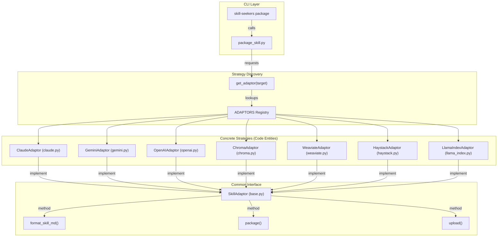
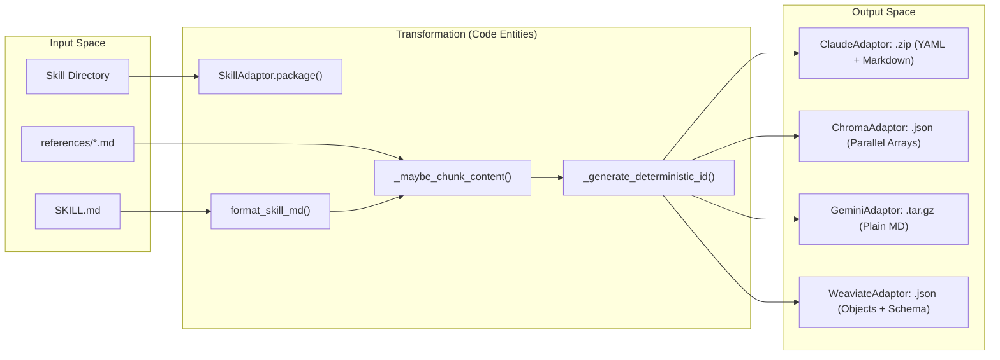
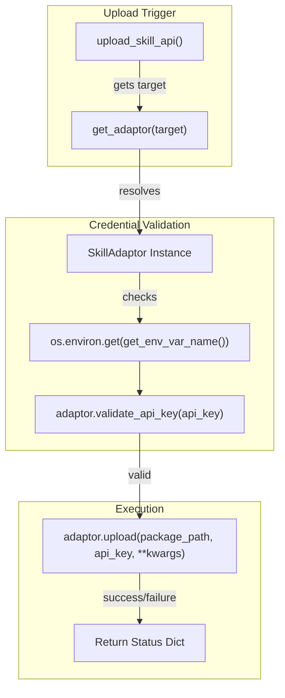

<!-- source: DeepWiki mcp.deepwiki.com · repo yusufkaraaslan/Skill_Seekers · page 9.2 Platform Adaptors & Strategy Pattern · fetched 2026-10-26 -->

# Platform Adaptors & Strategy Pattern

Relevant source files

The following files were used as context for generating this wiki page:

- [src/skill_seekers/cli/adaptors/base.py](src/skill_seekers/cli/adaptors/base.py)
- [src/skill_seekers/cli/adaptors/chroma.py](src/skill_seekers/cli/adaptors/chroma.py)
- [src/skill_seekers/cli/adaptors/claude.py](src/skill_seekers/cli/adaptors/claude.py)
- [src/skill_seekers/cli/adaptors/faiss_helpers.py](src/skill_seekers/cli/adaptors/faiss_helpers.py)
- [src/skill_seekers/cli/adaptors/gemini.py](src/skill_seekers/cli/adaptors/gemini.py)
- [src/skill_seekers/cli/adaptors/haystack.py](src/skill_seekers/cli/adaptors/haystack.py)
- [src/skill_seekers/cli/adaptors/langchain.py](src/skill_seekers/cli/adaptors/langchain.py)
- [src/skill_seekers/cli/adaptors/llama_index.py](src/skill_seekers/cli/adaptors/llama_index.py)
- [src/skill_seekers/cli/adaptors/openai.py](src/skill_seekers/cli/adaptors/openai.py)
- [src/skill_seekers/cli/adaptors/qdrant.py](src/skill_seekers/cli/adaptors/qdrant.py)
- [src/skill_seekers/cli/adaptors/weaviate.py](src/skill_seekers/cli/adaptors/weaviate.py)
- [src/skill_seekers/cli/enhance_command.py](src/skill_seekers/cli/enhance_command.py)
- [src/skill_seekers/cli/upload_skill.py](src/skill_seekers/cli/upload_skill.py)
- [tests/test_adaptors/test_adaptors_e2e.py](tests/test_adaptors/test_adaptors_e2e.py)
- [tests/test_adaptors/test_claude_adaptor.py](tests/test_adaptors/test_claude_adaptor.py)
- [tests/test_adaptors/test_openai_adaptor.py](tests/test_adaptors/test_openai_adaptor.py)
- [tests/test_enhance_command.py](tests/test_enhance_command.py)
- [tests/test_rag_chunker.py](tests/test_rag_chunker.py)

## Purpose and Scope

This page documents the platform adaptor architecture that enables Skill Seekers to export documentation to over 20 different platforms using a unified Strategy Pattern implementation. This includes traditional LLM platforms (Claude, Gemini, OpenAI, minimax, openai_compatible, ibm_bob, atlas, markdown), RAG frameworks (LangChain, LlamaIndex, Haystack), and vector databases (Chroma, Weaviate, Qdrant, FAISS, Pinecone). Each platform adaptor handles platform-specific packaging formats, metadata structures, ID generation, and upload logic.

Sources: [src/skill_seekers/cli/adaptors/base.py:56-65](), [src/skill_seekers/cli/upload_skill.py:32-44]()

---

## Architecture Overview

The platform adaptor system uses the **Strategy Pattern** with a **Factory Method** to support multiple platforms through a single, consistent interface. The `ADAPTORS` registry maps platform strings to concrete classes inheriting from `SkillAdaptor` [src/skill_seekers/cli/adaptors/base.py:56-65]().

### Natural Language to Code Entity Space: Packaging & Adaptor Flow

This diagram bridges the conceptual "Export" phase to the specific code entities involved in packaging and adapting skills.

Sources: [src/skill_seekers/cli/adaptors/base.py:56-149](), [src/skill_seekers/cli/adaptors/chroma.py:18-28](), [src/skill_seekers/cli/adaptors/claude.py:18-27]()

---

## Base Adaptor Interface & Metadata

The `SkillAdaptor` abstract base class defines the contract that all platform adaptors must implement, accompanied by the `SkillMetadata` dataclass and atomic file-saving routines [src/skill_seekers/cli/adaptors/base.py:19-65]().

### Core Abstract Methods

| Method | Purpose | File Reference |
|--------|---------|----------------|
| `format_skill_md()` | Format SKILL.md with platform-specific frontmatter/structure | [src/skill_seekers/cli/adaptors/base.py:81-98]() |
| `package()` | Package skill into platform-specific archive (ZIP, JSON, etc.) | [src/skill_seekers/cli/adaptors/base.py:100-128]() |
| `upload()` | Upload packaged skill to platform API | [src/skill_seekers/cli/adaptors/base.py:130-149]() |

### Common Helper Methods and Utilities

*   `save_skill_md_atomic()`: Atomically replaces `SKILL.md` by writing to a temporary file, backing up the original via copy, and executing an atomic replacement [src/skill_seekers/cli/adaptors/base.py:19-42]().
*   `SkillMetadata`: Dataclass holding `name`, `description`, `version`, `doc_version`, `author`, and `tags` [src/skill_seekers/cli/adaptors/base.py:44-54]().
*   `validate_api_key(api_key)`: Default implementation checks for non-empty strings [src/skill_seekers/cli/adaptors/base.py:151-164]().
*   `get_env_var_name()`: Returns `{PLATFORM}_API_KEY` [src/skill_seekers/cli/adaptors/base.py:166-173]().

Sources: [src/skill_seekers/cli/adaptors/base.py:19-200]()

---

## Concrete Implementations

### LLM Platform Adaptors

*   **ClaudeAdaptor**: Implements YAML frontmatter formatting for `SKILL.md`, `.zip` packaging containing `SKILL.md`, `references/`, `scripts/`, and `assets/`, and direct upload to the Anthropic Skills API [src/skill_seekers/cli/adaptors/claude.py:18-167]().
*   **GeminiAdaptor**: Formats plain markdown without YAML frontmatter, packages skills into `.tar.gz` archives with `system_instructions.md` and `gemini_metadata.json`, and uploads to the Google Gemini Files API [src/skill_seekers/cli/adaptors/gemini.py:19-178]().
*   **OpenAIAdaptor**: Formats assistant instructions, packages into `.zip` files with `assistant_instructions.txt` and `vector_store_files/*.md`, and uploads to create an OpenAI Assistant with a Vector Store [src/skill_seekers/cli/adaptors/openai.py:18-192]().

Sources: [src/skill_seekers/cli/adaptors/claude.py:18-167](), [src/skill_seekers/cli/adaptors/gemini.py:19-178](), [src/skill_seekers/cli/adaptors/openai.py:18-192]()

### Vector Database & RAG Framework Adaptors

*   **ChromaAdaptor**: Inherits from `StreamingAdaptorMixin` and `SkillAdaptor`. Formats documentation into parallel arrays of `documents`, `metadatas`, and `ids` alongside collection naming [src/skill_seekers/cli/adaptors/chroma.py:18-148]().
*   **WeaviateAdaptor**: Generates Weaviate class schemas with properties (`content`, `source`, `category`, `file`, `type`, `version`, `doc_version`) and packages objects with deterministic UUIDs [src/skill_seekers/cli/adaptors/weaviate.py:18-126]().
*   **HaystackAdaptor**: Formats skill data into a JSON array of Haystack `Document` objects containing `content` and `meta` fields [src/skill_seekers/cli/adaptors/haystack.py:18-130]().
*   **LlamaIndexAdaptor**: Formats skill data into an array of LlamaIndex `TextNode` objects containing `text`, `metadata`, and stable hashed `id_` fields [src/skill_seekers/cli/adaptors/llama_index.py:18-149]().
*   **QdrantAdaptor**: Formats skill data into Qdrant collection points with deterministic UUIDv5 point IDs and rich payload metadata [src/skill_seekers/cli/adaptors/qdrant.py:18-122]().
*   **FAISSHelpers**: Manages local FAISS index metadata packages with parallel document/metadata/id arrays and configuration hints [src/skill_seekers/cli/adaptors/faiss_helpers.py:18-161]().
*   **LangChainAdaptor**: Formats skills into JSON arrays of LangChain `Document` objects with `page_content` and `metadata` [src/skill_seekers/cli/adaptors/langchain.py:18-120]().

Sources: [src/skill_seekers/cli/adaptors/chroma.py:18-148](), [src/skill_seekers/cli/adaptors/weaviate.py:18-126](), [src/skill_seekers/cli/adaptors/haystack.py:18-130](), [src/skill_seekers/cli/adaptors/llama_index.py:18-149](), [src/skill_seekers/cli/adaptors/qdrant.py:18-122](), [src/skill_seekers/cli/adaptors/faiss_helpers.py:18-161](), [src/skill_seekers/cli/adaptors/langchain.py:18-120]()

---

## Data Flow: From Skill Directory to Package

This diagram maps the data transformation from a local directory through adaptor methods to a platform-ready package.

Sources: [src/skill_seekers/cli/adaptors/base.py:101-128](), [src/skill_seekers/cli/adaptors/chroma.py:47-68](), [src/skill_seekers/cli/adaptors/gemini.py:90-113](), [src/skill_seekers/cli/adaptors/weaviate.py:115-135]()

---

## Upload Execution Flow

The `upload_skill_api` function coordinates platform-specific uploads by instantiating the appropriate adaptor, validating API credentials, and executing remote calls [src/skill_seekers/cli/upload_skill.py:32-111]().

Sources: [src/skill_seekers/cli/upload_skill.py:32-111](), [src/skill_seekers/cli/adaptors/base.py:130-164]()

---

## Summary of Adaptor Capabilities

| Platform / Adaptor | Target Key | Package Format | API Upload Support | RAG / Chunking Support |
|-------------------|------------|----------------|---------------------|------------------------|
| **Claude AI** | `claude` | `.zip` | Yes (`upload()`) | Optional |
| **Google Gemini** | `gemini` | `.tar.gz` | Yes (`upload()`) | Optional |
| **OpenAI ChatGPT** | `openai` | `.zip` | Yes (`upload()`) | Optional |
| **Chroma DB** | `chroma` | `.json` | Local / Self-Hosted | Native Chunks |
| **Weaviate** | `weaviate` | `.json` | Cloud / Self-Hosted | Native Chunks |
| **Haystack** | `haystack` | `.json` | No (Code Import) | Native Chunks |
| **LlamaIndex** | `llama-index` | `.json` | No (Code Import) | Native Chunks |
| **LangChain** | `langchain` | `.json` | No (Code Import) | Native Chunks |

Sources: [src/skill_seekers/cli/adaptors/base.py:175-200](), [src/skill_seekers/cli/adaptors/chroma.py:18-33](), [src/skill_seekers/cli/adaptors/claude.py:18-32]()

---

