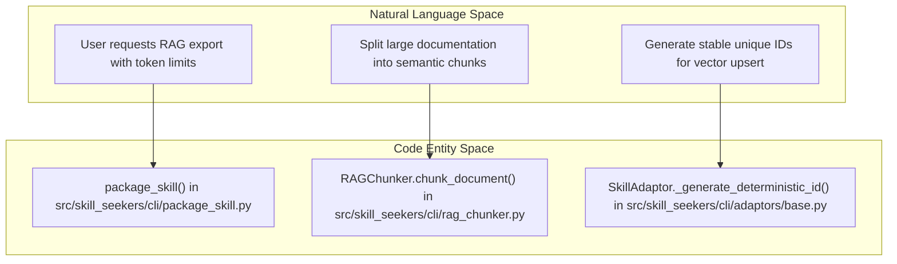
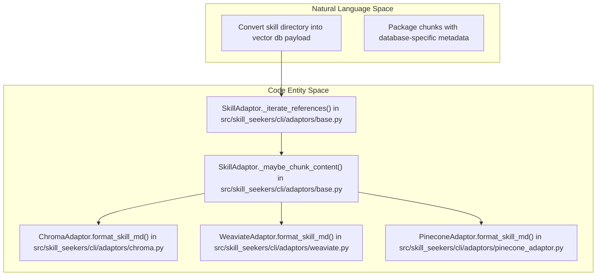

<!-- source: DeepWiki mcp.deepwiki.com · repo yusufkaraaslan/Skill_Seekers · page 9.3 Chunking & Vector Database Export · fetched 2026-10-26 -->

# Chunking & Vector Database Export

<details>
<summary>Relevant source files</summary>

The following files were used as context for generating this wiki page:

- [docs/integrations/CHROMA.md](docs/integrations/CHROMA.md)
- [docs/integrations/FAISS.md](docs/integrations/FAISS.md)
- [docs/integrations/HAYSTACK.md](docs/integrations/HAYSTACK.md)
- [docs/integrations/QDRANT.md](docs/integrations/QDRANT.md)
- [docs/integrations/WEAVIATE.md](docs/integrations/WEAVIATE.md)
- [examples/haystack-pipeline/requirements.txt](examples/haystack-pipeline/requirements.txt)
- [src/skill_seekers/cli/adaptors/base.py](src/skill_seekers/cli/adaptors/base.py)
- [src/skill_seekers/cli/adaptors/chroma.py](src/skill_seekers/cli/adaptors/chroma.py)
- [src/skill_seekers/cli/adaptors/faiss_helpers.py](src/skill_seekers/cli/adaptors/faiss_helpers.py)
- [src/skill_seekers/cli/adaptors/haystack.py](src/skill_seekers/cli/adaptors/haystack.py)
- [src/skill_seekers/cli/adaptors/langchain.py](src/skill_seekers/cli/adaptors/langchain.py)
- [src/skill_seekers/cli/adaptors/llama_index.py](src/skill_seekers/cli/adaptors/llama_index.py)
- [src/skill_seekers/cli/adaptors/pinecone_adaptor.py](src/skill_seekers/cli/adaptors/pinecone_adaptor.py)
- [src/skill_seekers/cli/adaptors/qdrant.py](src/skill_seekers/cli/adaptors/qdrant.py)
- [src/skill_seekers/cli/adaptors/weaviate.py](src/skill_seekers/cli/adaptors/weaviate.py)
- [tests/test_adaptors/test_chroma_adaptor.py](tests/test_adaptors/test_chroma_adaptor.py)
- [tests/test_adaptors/test_faiss_adaptor.py](tests/test_adaptors/test_faiss_adaptor.py)
- [tests/test_adaptors/test_haystack_adaptor.py](tests/test_adaptors/test_haystack_adaptor.py)
- [tests/test_adaptors/test_langchain_adaptor.py](tests/test_adaptors/test_langchain_adaptor.py)
- [tests/test_adaptors/test_llama_index_adaptor.py](tests/test_adaptors/test_llama_index_adaptor.py)
- [tests/test_adaptors/test_qdrant_adaptor.py](tests/test_adaptors/test_qdrant_adaptor.py)
- [tests/test_adaptors/test_streaming_mixin_formats.py](tests/test_adaptors/test_streaming_mixin_formats.py)
- [tests/test_adaptors/test_weaviate_adaptor.py](tests/test_adaptors/test_weaviate_adaptor.py)
- [tests/test_chunking_integration.py](tests/test_chunking_integration.py)
- [tests/test_pinecone_adaptor.py](tests/test_pinecone_adaptor.py)
- [tests/test_upload_integration.py](tests/test_upload_integration.py)

</details>


This page covers the RAG (Retrieval-Augmented Generation) chunking subsystem and the vector database and framework adaptors (`ChromaAdaptor`, `WeaviateAdaptor`, `QdrantAdaptor`, `PineconeAdaptor`, `FAISSHelpers`, `LangChainAdaptor`, `LlamaIndexAdaptor`, `HaystackAdaptor`) that consume it. It explains how documentation and reference files are split into token-bounded chunks, how deterministic IDs are generated for idempotent vector upserts, and what output schemas each adaptor produces.

For the general adaptor pattern and abstract interface, see [9.2](). For upstream packaging and upload CLI commands, see [9.4](). For streaming ingestion, see [13.5]().

---

## Overview

When packaging a skill for a RAG platform or vector database, every markdown file in the skill directory (`SKILL.md` and all files under `references/`) is processed through two core concerns:
1. **Semantic Chunking**: Splitting large documents into token-bounded pieces while preserving code blocks and paragraph boundaries.
2. **Format Conversion**: Wrapping each piece into the object schema expected by the target vector database or framework.

These operations are managed through the following core components:

| Subsystem | Class / Function | File Path |
|---|---|---|
| Semantic Chunking | `RAGChunker` | [src/skill_seekers/cli/rag_chunker.py:27-36]() |
| Chunking Gate | `SkillAdaptor._maybe_chunk_content` | [src/skill_seekers/cli/adaptors/base.py:278-285]() |
| ID Generation | `SkillAdaptor._generate_deterministic_id` | [src/skill_seekers/cli/adaptors/base.py:398-405]() |
| Vector DB Adaptors | `ChromaAdaptor`, `WeaviateAdaptor`, `QdrantAdaptor`, `PineconeAdaptor`, `FAISSHelpers`, `LangChainAdaptor`, `LlamaIndexAdaptor`, `HaystackAdaptor` | `src/skill_seekers/cli/adaptors/` |

Chunking is disabled by default and is auto-enabled when a RAG platform target is specified [tests/test_chunking_integration.py:56-76]().

Sources: [src/skill_seekers/cli/adaptors/base.py](), [src/skill_seekers/cli/rag_chunker.py](), [tests/test_chunking_integration.py]()

---

## Natural Language to Code Entity Space: Chunking & Formatting

The following diagram bridges user intent (Natural Language Space) to the exact codebase symbols (Code Entity Space) involved in processing and chunking documentation for vector export.

**Diagram: Natural Language to Code Mapping for Chunking**



Sources: [src/skill_seekers/cli/package_skill.py:116-167](), [src/skill_seekers/cli/rag_chunker.py:27-138](), [src/skill_seekers/cli/adaptors/base.py:278-434]()

---

## The `RAGChunker` Class & Chunking Pipeline

`RAGChunker` performs intelligent text segmentation. It is invoked via `_maybe_chunk_content` on `SkillAdaptor` [src/skill_seekers/cli/adaptors/base.py:278-351]().

### Parameters and Token Estimation

| Parameter | Default | Description |
|---|---|---|
| `chunk_size` | `512` | Target chunk size in tokens (approx.) |
| `chunk_overlap` | `50` | Overlap between consecutive chunks in tokens |
| `preserve_code_blocks` | `True` | Extract code fences before splitting, re-insert after |
| `preserve_paragraphs` | `True` | Use paragraph breaks (`\n\n`) as preferred split points |
| `min_chunk_size` | `100` | Discard chunks smaller than this (tokens) |

Token count is estimated as `len(text) // 4` (four characters per token) [src/skill_seekers/cli/rag_chunker.py:63-75]().

### Chunking Pipeline

**Diagram: `RAGChunker.chunk_document` internal pipeline**


Sources: [src/skill_seekers/cli/rag_chunker.py:77-138]()

#### Code Block Preservation

`_extract_code_blocks` uses regex `` r"```[^\n]*\n.*?```" `` with `re.DOTALL` to isolate fenced code blocks [src/skill_seekers/cli/rag_chunker.py:202](). Each block is replaced with a placeholder `<<CODE_BLOCK_{idx}>>`. After chunking, `_reinsert_code_blocks` substitutes the blocks back, guaranteeing that no code fence is split across chunk boundaries [src/skill_seekers/cli/rag_chunker.py:185-238]().

Sources: [src/skill_seekers/cli/rag_chunker.py:185-238]()

---

## Deterministic ID Generation

`_generate_deterministic_id` in `base.py` produces stable IDs from content and metadata, ensuring idempotent database upserts [src/skill_seekers/cli/adaptors/base.py:398-434]().

| Format | Used By | Output Type |
|---|---|---|
| `"hex"` | `ChromaAdaptor`, `LangChainAdaptor`, `LlamaIndexAdaptor`, `FAISSHelpers` | 32-character MD5 hex string [src/skill_seekers/cli/adaptors/chroma.py:45](), [src/skill_seekers/cli/adaptors/langchain.py:44](), [src/skill_seekers/cli/adaptors/llama_index.py:44](), [src/skill_seekers/cli/adaptors/faiss_helpers.py:48]() |
| `"uuid"` | `WeaviateAdaptor` | MD5 formatted as an RFC 4122 UUID [src/skill_seekers/cli/adaptors/weaviate.py:46]() |
| `"uuid5"` | `QdrantAdaptor` | RFC 4122 UUID v5 (SHA-1 based) [src/skill_seekers/cli/adaptors/qdrant.py:46]() |

Sources: [src/skill_seekers/cli/adaptors/base.py:398-434](), [src/skill_seekers/cli/adaptors/chroma.py:45](), [src/skill_seekers/cli/adaptors/weaviate.py:46](), [src/skill_seekers/cli/adaptors/qdrant.py:46]()

---

## Vector Database & Framework Adaptors

**Diagram: Natural Language to Code: Adaptor Formatting Pipeline**



Sources: [src/skill_seekers/cli/adaptors/base.py:200-351](), [src/skill_seekers/cli/adaptors/chroma.py:47-150](), [src/skill_seekers/cli/adaptors/weaviate.py:115-180](), [src/skill_seekers/cli/adaptors/pinecone_adaptor.py:95-170]()

### `ChromaAdaptor`
* **Class**: `ChromaAdaptor` in [src/skill_seekers/cli/adaptors/chroma.py:18]()
* **Format**: Parallel JSON arrays for `documents`, `metadatas`, `ids`, and `collection_name` [src/skill_seekers/cli/adaptors/chroma.py:69-147]().
* **Streaming**: Implements `StreamingAdaptorMixin` [src/skill_seekers/cli/adaptors/chroma.py:18]().

### `WeaviateAdaptor`
* **Class**: `WeaviateAdaptor` in [src/skill_seekers/cli/adaptors/weaviate.py:18]()
* **Schema**: Auto-generates a Weaviate schema with properties for `content`, `source`, `category`, `file`, `type`, `version`, and `doc_version` [src/skill_seekers/cli/adaptors/weaviate.py:58-113]().

### `QdrantAdaptor`
* **Class**: `QdrantAdaptor` in [src/skill_seekers/cli/adaptors/qdrant.py:18]()
* **Format**: Uses a `points` array where each point contains an `id`, `vector` (null for user embedding generation), and `payload` [src/skill_seekers/cli/adaptors/qdrant.py:108-121]().

### `PineconeAdaptor`
* **Class**: `PineconeAdaptor` in [src/skill_seekers/cli/adaptors/pinecone_adaptor.py:22]()
* **Format**: Namespace-aware JSON export with vector objects containing `id` and `metadata` (including text truncation to stay within Pinecone's 40KB metadata limit) [src/skill_seekers/cli/adaptors/pinecone_adaptor.py:22-118]().

### `FAISSHelpers`
* **Class**: `FAISSHelpers` in [src/skill_seekers/cli/adaptors/faiss_helpers.py:18]()
* **Format**: JSON package containing `documents`, `metadatas`, `ids`, and a `config` hint dictionary for index setup [src/skill_seekers/cli/adaptors/faiss_helpers.py:56-60]().

### Framework Adaptors (`LangChain`, `LlamaIndex`, `Haystack`)
* **`LangChainAdaptor`**: Exports an array of JSON objects with `page_content` and `metadata` keys [src/skill_seekers/cli/adaptors/langchain.py:39-43]().
* **`LlamaIndexAdaptor`**: Exports an array of JSON objects with `text`, `metadata`, and `id_` keys [src/skill_seekers/cli/adaptors/llama_index.py:52-58]().
* **`HaystackAdaptor`**: Exports an array of objects with `content` and `meta` keys [src/skill_seekers/cli/adaptors/haystack.py:39-43]().

Sources: [src/skill_seekers/cli/adaptors/chroma.py](), [src/skill_seekers/cli/adaptors/weaviate.py](), [src/skill_seekers/cli/adaptors/qdrant.py](), [src/skill_seekers/cli/adaptors/pinecone_adaptor.py](), [src/skill_seekers/cli/adaptors/faiss_helpers.py](), [src/skill_seekers/cli/adaptors/langchain.py](), [src/skill_seekers/cli/adaptors/llama_index.py](), [src/skill_seekers/cli/adaptors/haystack.py]()

---

## Streaming Ingestion & Large Datasets

For large documentation sets, Skill Seekers provides streaming ingestion to maintain low memory overhead [src/skill_seekers/cli/streaming_ingest.py:73]().

### Streaming Components
* **`ChunkMetadata`**: Dataclass tracking `chunk_id`, `source`, `category`, `file`, `chunk_index`, and offsets [src/skill_seekers/cli/streaming_ingest.py:18-29]().
* **`IngestionProgress`**: Tracks processed chunks, bytes, and estimates ETAs [src/skill_seekers/cli/streaming_ingest.py:32-71]().
* **`StreamingAdaptorMixin`**: Mixin utilized by RAG adaptors to enable chunk-by-chunk packaging via `package_streaming` [src/skill_seekers/cli/adaptors/streaming_adaptor.py:17-37]().

Sources: [src/skill_seekers/cli/streaming_ingest.py:1-73](), [src/skill_seekers/cli/adaptors/streaming_adaptor.py:17-37]()

---

