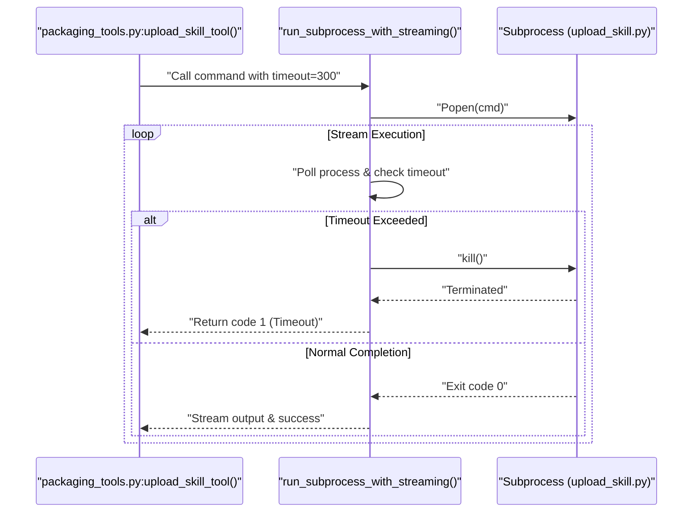

<!-- source: DeepWiki mcp.deepwiki.com · repo yusufkaraaslan/Skill_Seekers · page 9.4 Uploading to Platforms · fetched 2026-10-26 -->

# Uploading to Platforms

<details>
<summary>Relevant source files</summary>

The following files were used as context for generating this wiki page:

- [src/skill_seekers/cli/adaptors/claude.py](src/skill_seekers/cli/adaptors/claude.py)
- [src/skill_seekers/cli/adaptors/gemini.py](src/skill_seekers/cli/adaptors/gemini.py)
- [src/skill_seekers/cli/adaptors/openai.py](src/skill_seekers/cli/adaptors/openai.py)
- [src/skill_seekers/cli/arguments/package.py](src/skill_seekers/cli/arguments/package.py)
- [src/skill_seekers/cli/arguments/upload.py](src/skill_seekers/cli/arguments/upload.py)
- [src/skill_seekers/cli/enhance_command.py](src/skill_seekers/cli/enhance_command.py)
- [src/skill_seekers/cli/estimate_pages.py](src/skill_seekers/cli/estimate_pages.py)
- [src/skill_seekers/cli/upload_skill.py](src/skill_seekers/cli/upload_skill.py)
- [tests/test_adaptors/test_openai_adaptor.py](tests/test_adaptors/test_openai_adaptor.py)
- [tests/test_enhance_command.py](tests/test_enhance_command.py)
- [tests/test_estimate_pages.py](tests/test_estimate_pages.py)
- [tests/test_package_skill.py](tests/test_package_skill.py)
- [tests/test_parallel_scraping.py](tests/test_parallel_scraping.py)
- [tests/test_setup_scripts.py](tests/test_setup_scripts.py)
- [tests/test_upload_skill.py](tests/test_upload_skill.py)
- [tests/test_utilities.py](tests/test_utilities.py)

</details>


This page details the implementation of skill distribution and platform deployment within `skill-seekers`, focusing on the core `upload_skill_api` function, environment variable and API key validation, transient error handling via `retry_with_backoff`, platform-specific upload adaptors, and the Model Context Protocol (`upload_skill`) tool integration.

For packaging mechanics, see [9.2 Platform Adaptors & Strategy Pattern](). For vector database export formats, see [9.3 Chunking & Vector Database Export](). For local agent installations, see [9.5 Installing to AI Agents]().

---

## Upload Entry Points & Execution Flow

Skills packaged as archives (`.zip` or `.tar.gz`) are dispatched to remote LLM platforms or vector stores through either the command-line interface or the MCP server abstraction layer.

| Interface | Entry Point | Code Reference |
|---|---|---|
| CLI Command | `skill-seekers upload <package>` | [src/skill_seekers/cli/upload_skill.py:113-169]() |
| Direct Script | `skill-seekers-upload <package>` | [src/skill_seekers/cli/upload_skill.py:113-169]() |
| MCP Tool | `upload_skill` | [src/skill_seekers/mcp/tools/packaging_tools.py:160-245]() |

Sources: [src/skill_seekers/cli/upload_skill.py:113-169](), [src/skill_seekers/mcp/tools/packaging_tools.py:160-245]()

---

## Core Upload Function: `upload_skill_api`

The function `upload_skill_api()` in `src/skill_seekers/cli/upload_skill.py` serves as the orchestration center for all target platforms [src/skill_seekers/cli/upload_skill.py:32-111](). It retrieves the appropriate `SkillAdaptor` subclass from the registry, validates platform credentials, verifies package existence, and executes the upload routine.

```mermaid
flowchart TD
    Start[""upload_skill_api(package_path, target, api_key, **kwargs)""] --> GetAdaptor[""get_adaptor(target)""]
    GetAdaptor --> CheckKey{"Target requires API key?\n('claude', 'gemini', 'openai')"}
    CheckKey -- "Yes" --> ReadEnv[""os.environ.get(adaptor.get_env_var_name())""]
    ReadEnv --> ValidateKey[""adaptor.validate_api_key(api_key)""]
    ValidateKey -- "Invalid" --> FailKey[""Return (False, 'Invalid API key format')""]
    ValidateKey -- "Valid" --> CheckFile[""Path(package_path).exists()""]
    CheckKey -- "No (Chroma / Weaviate)" --> CheckFile
    CheckFile -- "Missing" --> FailFile[""Return (False, 'File not found')""]
    CheckFile -- "Exists" --> DoUpload[""adaptor.upload(package_path, api_key, **kwargs)""]
    DoUpload -- "Success" --> SuccessOut[""Return (True, 'Upload successful')""]
    DoUpload -- "Failure" --> FailUpload[""Return (False, result['message'])""]
```

Sources: [src/skill_seekers/cli/upload_skill.py:32-111](), [src/skill_seekers/cli/adaptors/base.py:1-50]()

---

## API Key Validation & Environment Fallbacks

API key enforcement is restricted to managed cloud platforms (`claude`, `gemini`, and `openai`). Local or vector database targets (`chroma`, `weaviate`) bypass strict token checks unless cloud clusters are configured.

Each concrete `SkillAdaptor` defines its environment variable mapping and validation logic:

- `get_env_var_name()`: Returns the expected environment variable name (e.g., `ANTHROPIC_API_KEY`, `GOOGLE_API_KEY`, `OPENAI_API_KEY`) [src/skill_seekers/cli/adaptors/claude.py:31-31](), [src/skill_seekers/cli/adaptors/gemini.py:32-32](), [src/skill_seekers/cli/adaptors/openai.py:31-31]().
- `validate_api_key(api_key)`: Validates string format and non-empty constraints [src/skill_seekers/cli/upload_skill.py:66-67]().

If `api_key` is omitted in function arguments, `upload_skill_api` falls back to `os.environ` using `adaptor.get_env_var_name()` [src/skill_seekers/cli/upload_skill.py:57-58]().

Sources: [src/skill_seekers/cli/upload_skill.py:57-68](), [src/skill_seekers/cli/adaptors/claude.py:31-31](), [src/skill_seekers/cli/adaptors/gemini.py:32-32](), [src/skill_seekers/cli/adaptors/openai.py:31-31]()

---

## Resilient Execution: Retry and Timeout Mechanisms

Network requests during uploads and API interactions utilize backoff strategies to handle transient HTTP failures or rate-limiting.

### `retry_with_backoff`
The `retry_with_backoff` and `retry_with_backoff_async` utilities wrap network operations, progressively increasing wait times between retry attempts [tests/test_utilities.py:18-19]().

### Subprocess Timeouts
When packaging or uploading operations are initiated via MCP tool wrappers, `run_subprocess_with_streaming()` monitors child process execution and enforces timeouts to prevent hanging threads [src/skill_seekers/mcp/tools/packaging_tools.py:16-91]().



Sources: [tests/test_utilities.py:18-19](), [src/skill_seekers/mcp/tools/packaging_tools.py:16-91]()

---

## Platform-Specific Upload Procedures

The platform selection pattern resolves string identifiers to concrete adaptor instances implementing `SkillAdaptor.upload()` [src/skill_seekers/cli/upload_skill.py:46-54]().

```mermaid
flowchart LR
    CLIEntry[""skill-seekers upload""] --> API[""upload_skill_api()""]
    API --> Factory[""get_adaptor(target)""]
    Factory --> Claude[""ClaudeAdaptor.upload()\n(Anthropic Skills API)""]
    Factory --> Gemini[""GeminiAdaptor.upload()\n(Google Gemini Files API)""]
    Factory --> OpenAI[""OpenAIAdaptor.upload()\n(Assistants API + Vector Store)""]
```

### Claude AI (Anthropic)
`ClaudeAdaptor.upload()` packages reference files and `SKILL.md` into a `.zip` archive, posting it to the Anthropic Skills API endpoint (`https://api.anthropic.com/v1/skills`) with required headers (`x-api-key`, `anthropic-version`, `anthropic-beta`) [src/skill_seekers/cli/adaptors/claude.py:31-32](), [src/skill_seekers/cli/adaptors/claude.py:156-215]().

### Google Gemini
`GeminiAdaptor.upload()` validates `.tar.gz` archive structures and uploads grounding files to the Google Gemini Files API (`https://generativelanguage.googleapis.com/v1beta/files`) using the `google-generativeai` SDK [src/skill_seekers/cli/adaptors/gemini.py:32-33](), [src/skill_seekers/cli/adaptors/gemini.py:166-209]().

### OpenAI ChatGPT
`OpenAIAdaptor.upload()` creates an OpenAI Assistant configured with the `file_search` tool, provisions an OpenAI Vector Store, and uploads reference documentation from the packaged ZIP archive [src/skill_seekers/cli/adaptors/openai.py:31-32](), [src/skill_seekers/cli/adaptors/openai.py:177-184]().

Sources: [src/skill_seekers/cli/upload_skill.py:46-54](), [src/skill_seekers/cli/adaptors/claude.py:31-32](), [src/skill_seekers/cli/adaptors/claude.py:156-215](), [src/skill_seekers/cli/adaptors/gemini.py:32-33](), [src/skill_seekers/cli/adaptors/gemini.py:166-209](), [src/skill_seekers/cli/adaptors/openai.py:31-32](), [src/skill_seekers/cli/adaptors/openai.py:177-184]()

---

## MCP Tool Integration: `upload_skill`

The Model Context Protocol exposes skill deployment via the `upload_skill` tool defined in `src/skill_seekers/mcp/tools/packaging_tools.py` [src/skill_seekers/mcp/tools/packaging_tools.py:160-245]().

```mermaid
flowchart LR
    Agent[""AI Coding Agent""] -->|"Call upload_skill tool"| Server[""server_fastmcp.py""]
    Server --> ToolImpl[""packaging_tools.py:upload_skill_tool()""]
    ToolImpl --> Api[""upload_skill.py:upload_skill_api()""]
    Api --> Adaptor[""SkillAdaptor.upload()""]
```

### Tool Parameter Schema
- `skill_zip` (`str`): Absolute or relative path to the packaged `.zip` or `.tar.gz` archive.
- `target` (`str`): Target platform identifier (`auto`, `claude`, `gemini`, `openai`, `chroma`, `weaviate`). Defaults to auto-detection.
- `api_key` (`str`, optional): Platform API key. If omitted, resolved from environment variables.

Sources: [src/skill_seekers/mcp/tools/packaging_tools.py:160-245](), [src/skill_seekers/cli/upload_skill.py:32-111]()

---

