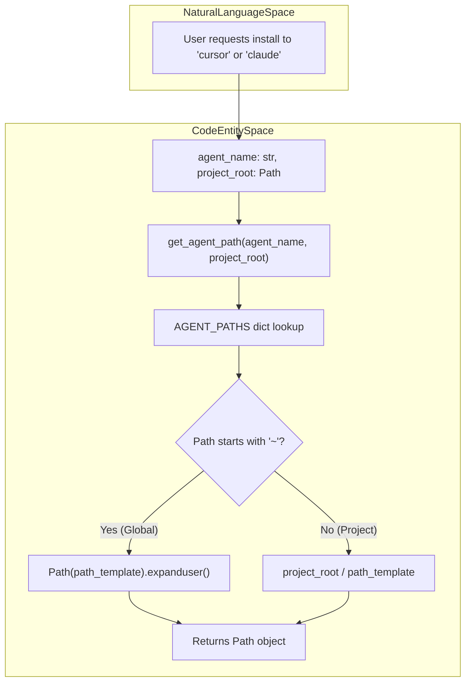
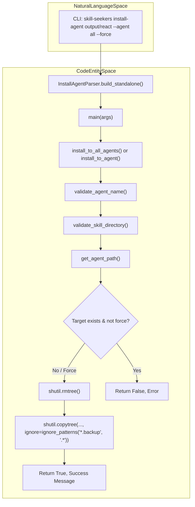

<!-- source: DeepWiki mcp.deepwiki.com · repo yusufkaraaslan/Skill_Seekers · page 9.5 Installing to AI Agents · fetched 2026-10-26 -->

# Installing to AI Agents

Relevant source files

The following files were used as context for generating this wiki page:

- [src/skill_seekers/cli/adaptors/ibm_bob.py](src/skill_seekers/cli/adaptors/ibm_bob.py)
- [src/skill_seekers/cli/install_agent.py](src/skill_seekers/cli/install_agent.py)
- [src/skill_seekers/cli/install_skill.py](src/skill_seekers/cli/install_skill.py)
- [src/skill_seekers/cli/parsers/install_agent_parser.py](src/skill_seekers/cli/parsers/install_agent_parser.py)
- [tests/test_adaptors/test_base.py](tests/test_adaptors/test_base.py)
- [tests/test_adaptors/test_ibm_bob_adaptor.py](tests/test_adaptors/test_ibm_bob_adaptor.py)

This page documents the **install-agent** command and underlying python modules that deploy packaged skills to AI coding agents. After creating and packaging a skill, this subsystem installs it to one of 19 supported AI coding agents by copying skill files to agent-specific global or project directories [src/skill_seekers/cli/install_agent.py:3-7]().

## Supported Agent Directories

The system maintains a registry of **19 AI coding agents** mapped to their respective directory structures. These are split into global (user home directory) and project-relative paths [src/skill_seekers/cli/install_agent.py:34-54]():

| Agent Name | Installation Scope | Code Path Template (`AGENT_PATHS`) | IDE / Platform |
| :--------- | :----------------- | :--------------------------------- | :------------- |
| `claude` | Global (home) | `~/.claude/skills/` [src/skill_seekers/cli/install_agent.py:35]() | Claude Code |
| `cursor` | Project-relative | `.cursor/skills/` [src/skill_seekers/cli/install_agent.py:36]() | Cursor IDE |
| `vscode` | Project-relative | `.github/skills/` [src/skill_seekers/cli/install_agent.py:37]() | VS Code |
| `copilot` | Project-relative | `.github/skills/` [src/skill_seekers/cli/install_agent.py:38]() | GitHub Copilot |
| `amp` | Global (home) | `~/.amp/skills/` [src/skill_seekers/cli/install_agent.py:39]() | Amp Editor |
| `goose` | Global (home) | `~/.config/goose/skills/` [src/skill_seekers/cli/install_agent.py:40]() | Goose AI |
| `opencode` | Global (home) | `~/.opencode/skills/` [src/skill_seekers/cli/install_agent.py:41]() | OpenCode |
| `letta` | Global (home) | `~/.letta/skills/` [src/skill_seekers/cli/install_agent.py:42]() | Letta |
| `aide` | Global (home) | `~/.aide/skills/` [src/skill_seekers/cli/install_agent.py:43]() | Aide |
| `windsurf` | Global (home) | `~/.windsurf/skills/` [src/skill_seekers/cli/install_agent.py:44]() | Windsurf / Codeium |
| `neovate` | Global (home) | `~/.neovate/skills/` [src/skill_seekers/cli/install_agent.py:45]() | Neovate |
| `roo` | Project-relative | `.roo/skills/` [src/skill_seekers/cli/install_agent.py:46]() | Roo Code (Cline fork) |
| `cline` | Project-relative | `.cline/skills/` [src/skill_seekers/cli/install_agent.py:47]() | Cline AI |
| `aider` | Global (home) | `~/.aider/skills/` [src/skill_seekers/cli/install_agent.py:48]() | Aider CLI |
| `bolt` | Project-relative | `.bolt/skills/` [src/skill_seekers/cli/install_agent.py:49]() | Bolt.new / Bolt.diy |
| `kilo` | Project-relative | `.kilo/skills/` [src/skill_seekers/cli/install_agent.py:50]() | Kilo Code |
| `continue` | Global (home) | `~/.continue/skills/` [src/skill_seekers/cli/install_agent.py:51]() | Continue.dev |
| `kimi-code` | Global (home) | `~/.kimi/skills/` [src/skill_seekers/cli/install_agent.py:52]() | Kimi Code |
| `bob` | Project-relative | `.bob/skills/` [src/skill_seekers/cli/install_agent.py:53]() | IBM Bob |

Sources: [src/skill_seekers/cli/install_agent.py:34-54]()

---

## Agent Path Resolution (`get_agent_path`)

The `get_agent_path()` function translates a user-specified agent name into an absolute filesystem path [src/skill_seekers/cli/install_agent.py:57-90](). It handles global home directory expansion via `Path.expanduser()` [src/skill_seekers/cli/install_agent.py:83-84]() and project-relative paths using `project_root` or `Path.cwd()` [src/skill_seekers/cli/install_agent.py:87-90]().

Title: Agent Path Resolution Bridge
Sources: [src/skill_seekers/cli/install_agent.py:57-90]()

---

## Validation Systems (`validate_agent_name` & `validate_skill_directory`)

Before writing any files, the system validates both the target agent name and the source directory package [src/skill_seekers/cli/install_agent.py:103-170]().

### Agent Name Validation
`validate_agent_name()` checks case-insensitive matches against `AGENT_PATHS` and supports the special keyword `"all"` [src/skill_seekers/cli/install_agent.py:118-124](). If an unknown name is provided, it applies `difflib.get_close_matches()` with a cutoff of `0.6` to offer corrections [src/skill_seekers/cli/install_agent.py:127-141]().

### Skill Directory Validation
`validate_skill_directory()` verifies that the input path:
1. Exists on disk [src/skill_seekers/cli/install_agent.py:159]().
2. Is a valid directory [src/skill_seekers/cli/install_agent.py:162]().
3. Contains a `SKILL.md` file [src/skill_seekers/cli/install_agent.py:166]().

Sources: [src/skill_seekers/cli/install_agent.py:103-170]()

---

## Installation Workflow (`install_to_agent` & `install_to_all_agents`)

The core execution function `install_to_agent()` manages directory creation, conflict checking (`--force`), and selective file copying (`shutil.copytree` with exclusion patterns) [src/skill_seekers/cli/install_agent.py:172-252]().

Title: Installation Pipeline Code Mapping
Sources: [src/skill_seekers/cli/install_agent.py:172-310](), [src/skill_seekers/cli/parsers/install_agent_parser.py:6-34]()

---

## End-to-End Orchestration (`install_skill_tool`)

The higher-level command `skill-seekers install` uses `src/skill_seekers/cli/install_skill.py` to invoke the `install_skill_tool` defined in the MCP server [src/skill_seekers/cli/install_skill.py:34-40](). 

### Execution Steps
1. **Dependency Check:** Verifies MCP package availability [src/skill_seekers/cli/install_skill.py:46-56]().
2. **Platform Auto-Detection:** Calls `AgentClient.detect_default_target()` if `--target` is omitted [src/skill_seekers/cli/install_skill.py:65-70]().
3. **Config Resolution:** Identifies whether `--config` points to a local JSON file path or a built-in config name [src/skill_seekers/cli/install_skill.py:71-81]().
4. **Tool Execution:** Executes `asyncio.run(install_skill_tool(tool_args))` to scrape, enhance, package, and install [src/skill_seekers/cli/install_skill.py:94-95]().

Sources: [src/skill_seekers/cli/install_skill.py:1-116]()

---

## IBM Bob Adaptor Specialization

Platform targets like IBM Bob handle integration by packaging the skill directly into a project or global `.bob/skills/` directory structure [src/skill_seekers/cli/adaptors/ibm_bob.py:6-24]().

- **Name Normalization:** `IBMBobAdaptor._to_skill_dir_name()` normalizes skill names into kebab-case slugs [src/skill_seekers/cli/adaptors/ibm_bob.py:31-38]().
- **Frontmatter Injection:** Formats `SKILL.md` with strict YAML frontmatter enclosing `name`, `description`, `version`, and `tags` [src/skill_seekers/cli/adaptors/ibm_bob.py:46-73]().
- **Local Fallback:** Since IBM Bob utilizes local file folders rather than a cloud upload endpoint, `upload()` returns a local file path success message [src/skill_seekers/cli/adaptors/ibm_bob.py:126-135]().

Sources: [src/skill_seekers/cli/adaptors/ibm_bob.py:1-148](), [tests/test_adaptors/test_ibm_bob_adaptor.py:15-123]()

---

