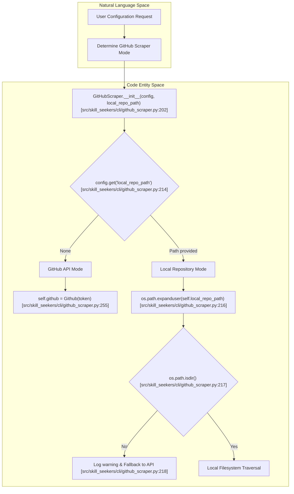
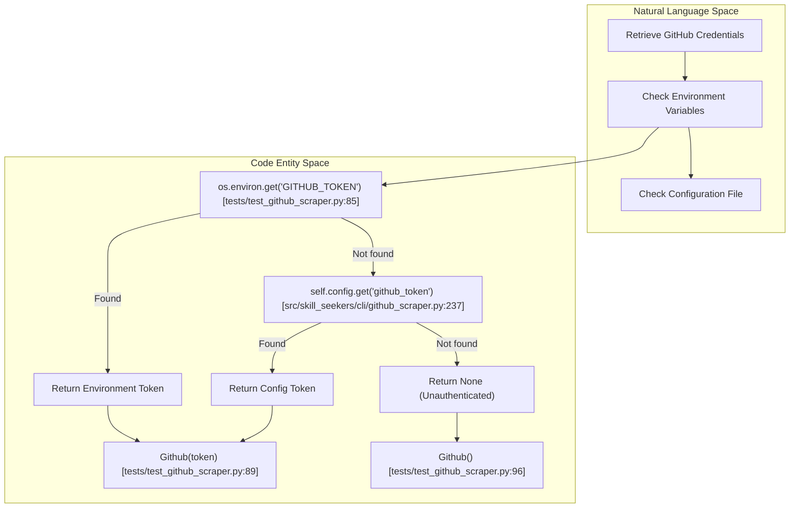
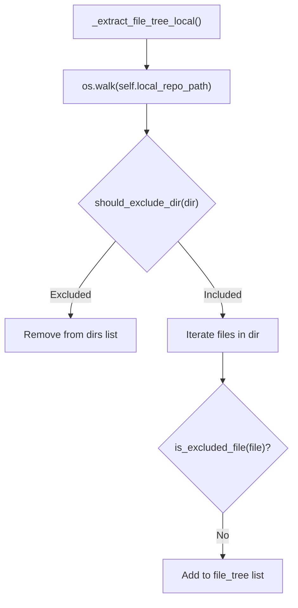
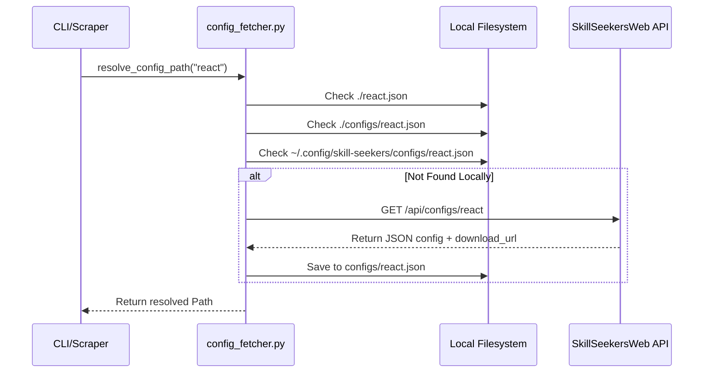

<!-- source: DeepWiki mcp.deepwiki.com · repo yusufkaraaslan/Skill_Seekers · extra page GitHub API vs Local Mode · fetched 2026-10-26 -->

# GitHub API vs Local Mode

Relevant source files

The following files were used as context for generating this wiki page:

- [src/skill_seekers/cli/config_validator.py](src/skill_seekers/cli/config_validator.py)
- [src/skill_seekers/cli/generate_router.py](src/skill_seekers/cli/generate_router.py)
- [src/skill_seekers/cli/github_scraper.py](src/skill_seekers/cli/github_scraper.py)
- [src/skill_seekers/cli/pdf_scraper.py](src/skill_seekers/cli/pdf_scraper.py)
- [src/skill_seekers/cli/presets/github_presets.py](src/skill_seekers/cli/presets/github_presets.py)
- [src/skill_seekers/cli/presets/scrape_presets.py](src/skill_seekers/cli/presets/scrape_presets.py)
- [src/skill_seekers/cli/split_config.py](src/skill_seekers/cli/split_config.py)
- [tests/test_github_scraper.py](tests/test_github_scraper.py)

This page explains the two operating modes of the `GitHubScraper` component: **GitHub API mode** (remote access via GitHub's REST API using PyGithub) and **Local mode** (direct filesystem access to a cloned repository). It details authentication resolution, rate-limit management strategies, directory exclusion filtering, and configuration fallback mechanisms.

---

## Mode Selection & Initialization

The `GitHubScraper` class [src/skill_seekers/cli/github_scraper.py:184]() supports two distinct operating modes determined by the presence of the `local_repo_path` configuration parameter during initialization via `__init__(config, local_repo_path)` [src/skill_seekers/cli/github_scraper.py:202-225]().

**Mode Selection Logic:** If a provided `local_repo_path` does not exist on the filesystem or is not a valid directory, the system logs a warning and automatically falls back to **GitHub API mode** [src/skill_seekers/cli/github_scraper.py:217-222]().

Sources: [src/skill_seekers/cli/github_scraper.py:184-225]()

---

## GitHub API Mode

GitHub API mode uses the `PyGithub` library [src/skill_seekers/cli/github_scraper.py:27-32]() to fetch repository contents remotely. This is the standard mode for cloud-based scraping where a local clone is unavailable.

### Authentication and Token Configuration

Token handling is managed by a hierarchy of sources, prioritized to ensure security and flexibility. The `GitHubScraper` retrieves the token via `_get_token()` [src/skill_seekers/cli/github_scraper.py:237]().

**Authentication Priority Order:**

| Priority | Source | Implementation | Rate Limit |
|----------|--------|----------------|------------|
| 1 | Environment Variable | `os.environ.get("GITHUB_TOKEN")` [tests/test_github_scraper.py:85]() | 5000/hour |
| 2 | Config File | `config["github_token"]` [src/skill_seekers/cli/github_scraper.py:237]() | 5000/hour |
| 3 | Unauthenticated | `Github()` [tests/test_github_scraper.py:96]() | 60/hour |

Sources: [src/skill_seekers/cli/github_scraper.py:237-251](), [tests/test_github_scraper.py:63-115]()

### Rate Limit Strategies

The `ConfigManager` allows per-profile configuration of `rate_limit_strategy`. The scraper explicitly handles `RateLimitExceededException` [src/skill_seekers/cli/github_scraper.py:29]() to prevent hard crashes during long extraction jobs by catching rate-limit blocks and applying waiting or token-switching strategies.

Sources: [src/skill_seekers/cli/github_scraper.py:27-32]()

---

## Local Repository Mode

Local mode analyzes a repository directly from the disk. This is significantly faster and bypasses all GitHub API constraints.

### File Tree Extraction (Local)

Local mode uses `os.walk()` for traversal and supports `.gitignore` filtering if `pathspec` is installed [src/skill_seekers/cli/github_scraper.py:37-42]().

**Directory Exclusion:** The scraper uses a predefined `EXCLUDED_DIRS` set [src/skill_seekers/cli/github_scraper.py:56-100]() to avoid processing massive build artifacts or dependency folders (e.g., `node_modules`, `venv`, `Library`, `.godot`).

### Advantages of Local Mode

| Advantage | Implementation Detail |
|-----------|----------------------|
| **No Rate Limits** | File content is read via standard I/O, avoiding network bottlenecks. |
| **Full Codebase Analysis** | Enables `CodeAnalyzer` to perform deep AST parsing on the entire project [src/skill_seekers/cli/github_scraper.py:47-52](). |
| **No Auth Required** | Works on private repositories as long as they are cloned locally. |
| **Speed** | Traversing local storage is orders of magnitude faster than sequential REST API calls. |

Sources: [src/skill_seekers/cli/github_scraper.py:37-100](), [src/skill_seekers/cli/github_scraper.py:213-225]()

---

## Configuration Fallback & Resolution

When the CLI is invoked with a config reference, configuration resolution handles locating local files or fetching remote templates seamlessly.

Sources: [src/skill_seekers/cli/config_validator.py:78-102]()

---

