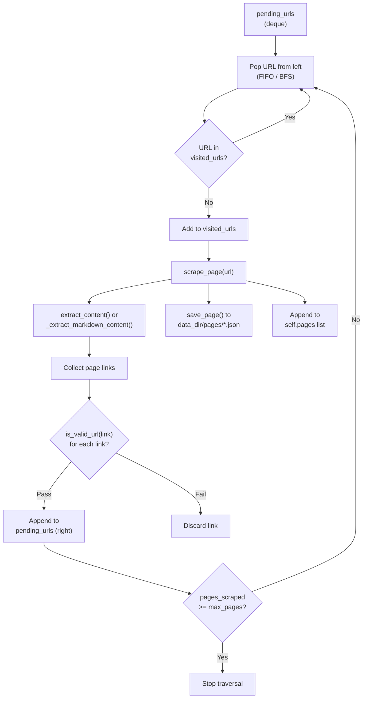
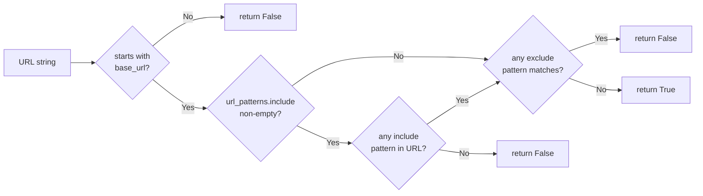
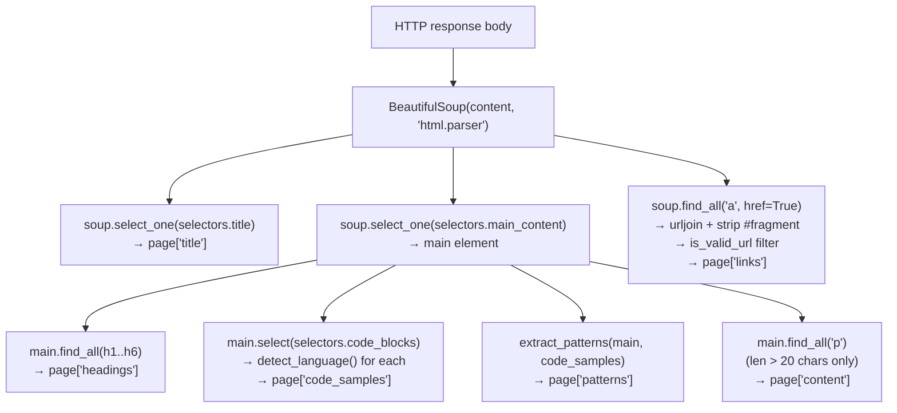
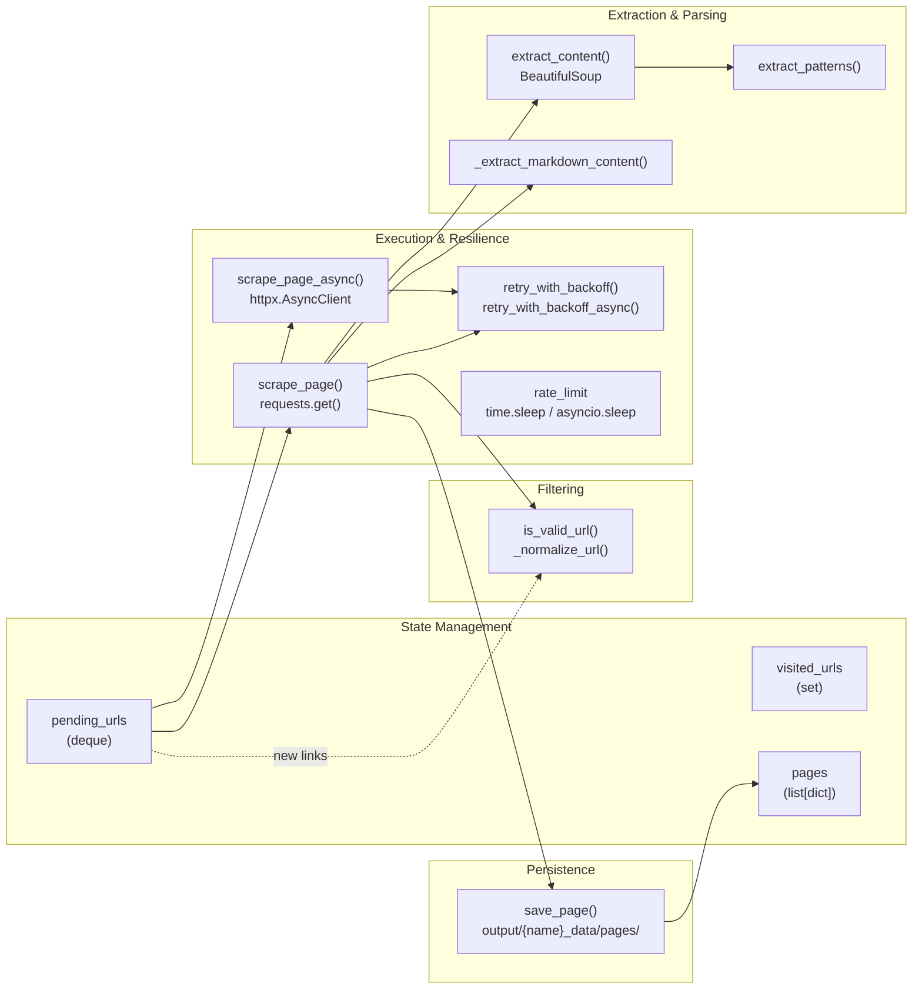

<!-- source: DeepWiki mcp.deepwiki.com · repo yusufkaraaslan/Skill_Seekers · extra page HTML Scraping & BFS Traversal · fetched 2026-10-26 -->

# HTML Scraping & BFS Traversal

<details>
<summary>Relevant source files</summary>

The following files were used as context for generating this wiki page:

- [docs/features/UNIFIED_SCRAPING.md](docs/features/UNIFIED_SCRAPING.md)
- [src/skill_seekers/cli/doc_scraper.py](src/skill_seekers/cli/doc_scraper.py)
- [src/skill_seekers/cli/scraper_utils.py](src/skill_seekers/cli/scraper_utils.py)
- [src/skill_seekers/cli/unified_scraper.py](src/skill_seekers/cli/unified_scraper.py)
- [src/skill_seekers/cli/unified_skill_builder.py](src/skill_seekers/cli/unified_skill_builder.py)
- [tests/test_c3_integration.py](tests/test_c3_integration.py)
- [tests/test_multi_source.py](tests/test_multi_source.py)
- [tests/test_scraper_utils.py](tests/test_scraper_utils.py)
- [tests/test_unified.py](tests/test_unified.py)
- [tests/test_unified_scraper_orchestration.py](tests/test_unified_scraper_orchestration.py)

</details>


This page covers the BFS URL traversal algorithm, URL filtering, HTML content extraction pipeline, rate limiting, concurrency modes, retry logic, and page state management implemented in `DocToSkillConverter`. It focuses specifically on how the scraper discovers and processes documentation pages from HTML sources. For the higher-level `DocToSkillConverter` architecture (initialization, llms.txt detection, checkpoint system, and `build_skill` output), see page [5.1](). For language detection from code blocks, see [5.1.3](). For smart page categorization, see [5.1.4]().

---

## BFS Queue Structure & State Management

The scraper uses a breadth-first search strategy to crawl documentation websites. All traversal state is held on the `DocToSkillConverter` instance, tracking pending work, visited URLs, accumulated pages, and rate limits.

| Attribute | Type | Purpose |
|---|---|---|
| `pending_urls` | `collections.deque` | FIFO frontier queue for BFS traversal |
| `visited_urls` | `set[str]` | Prevents re-processing identical URLs |
| `pages` | `list[dict]` | In-memory accumulator for extracted page data |
| `pages_scraped` | `int` | Counter used to enforce the `max_pages` limit |

The queue is initialized from configuration options at construction time:

[src/skill_seekers/cli/doc_scraper.py:240-241]()

```python
start_urls = config.get("start_urls", [self.base_url])
self.pending_urls = deque(start_urls)
```

When no `start_urls` key is present in configuration, `base_url` is used as the sole seed. Multiple starting points are fully supported by pre-populating the deque before traversal begins.

**BFS traversal execution flow:**



Sources: [src/skill_seekers/cli/doc_scraper.py:203-263](), [src/skill_seekers/cli/doc_scraper.py:648-707]()

---

## URL Filtering & Normalization

Every candidate URL—whether discovered from link extraction or pre-loaded via `llms.txt`—passes through `is_valid_url` before entering `pending_urls`. Tracking parameters are stripped beforehand using `_normalize_url`.

[src/skill_seekers/cli/doc_scraper.py:218-237]()
[src/skill_seekers/cli/doc_scraper.py:105-119]()

The validation logic applies three sequential checks:
1. **Base URL prefix check** — The URL must start with `self.base_url` to constrain the crawl scope.
2. **Include pattern check** — If `url_patterns.include` is non-empty, the URL must match at least one inclusion substring.
3. **Exclude pattern check** — The URL must not match any exclusion substring in `url_patterns.exclude`.



Sources: [src/skill_seekers/cli/doc_scraper.py:218-237]()

Anchor fragments are stripped from URLs during link collection:

[src/skill_seekers/cli/doc_scraper.py:350-355]()

```python
href = href.split("#")[0]
if self.is_valid_url(href) and href not in page["links"]:
    page["links"].append(href)
```

Sources: [src/skill_seekers/cli/doc_scraper.py:350-355]()

---

## Content Extraction Pipeline

When a URL is fetched, the scraper invokes either the Markdown extraction path or the default HTML extraction path (`extract_content`).

[src/skill_seekers/cli/doc_scraper.py:294-357]()

The extraction routine parses the response with `BeautifulSoup` and targets the main content area using `selectors.main_content` or `FALLBACK_MAIN_SELECTORS` (`main`, `article`, `div[role="main"]`, etc.) [src/skill_seekers/cli/doc_scraper.py:61-69](). Extracted dictionaries contain titles, headings, code samples, patterns, filtered paragraph text, and absolute links.



Sources: [src/skill_seekers/cli/doc_scraper.py:294-357](), [src/skill_seekers/cli/doc_scraper.py:61-69]()

---

## Scraping Execution Modes, Rate Limiting & Retry Logic

`DocToSkillConverter` supports synchronous single-threaded, multi-threaded, and asynchronous execution modes controlled by `workers` and `async_mode` configuration parameters.

| Mode | Trigger | Implementation Details |
|---|---|---|
| Single-threaded | `workers == 1` (default) | Sequential `scrape_page()` execution |
| Multi-threaded | `workers > 1` | `threading.Lock` protection on shared collections |
| Async | `async_mode == True` | `scrape_page_async()` with `asyncio.Semaphore` and `httpx.AsyncClient` |

### Retry Logic & Rate Limiting

Network requests incorporate automatic resilience via decorators (`retry_with_backoff` and `retry_with_backoff_async`) imported from `skill_seekers.cli.utils` [src/skill_seekers/cli/utils.py:52-53](). 

Rate limiting is enforced at the conclusion of each page processing block:

[src/skill_seekers/cli/doc_scraper.py:697-699]()

```python
rate_limit = self.config.get("rate_limit", DEFAULT_RATE_LIMIT)
if rate_limit > 0:
    time.sleep(rate_limit)
```

Sources: [src/skill_seekers/cli/doc_scraper.py:697-699](), [src/skill_seekers/cli/utils.py:52-53]()

---

## Page State Persistence & Checkpoints

Successfully parsed pages are saved to disk via `save_page()`. Pages with content lengths under 50 characters are filtered out.

[src/skill_seekers/cli/doc_scraper.py:631-646]()

Valid pages are stored as JSON files under `output/{name}_data/pages/` using a filename hash derived from the target URL: `{safe_title}_{url_hash}.json`. This provides the foundation for the checkpoint and resumption system described in Section [13.2]().

Sources: [src/skill_seekers/cli/doc_scraper.py:631-646]()

---

## Code Entity Map



Sources: [src/skill_seekers/cli/doc_scraper.py:105-357](), [src/skill_seekers/cli/doc_scraper.py:631-754](), [src/skill_seekers/cli/utils.py:52-53]()

---

