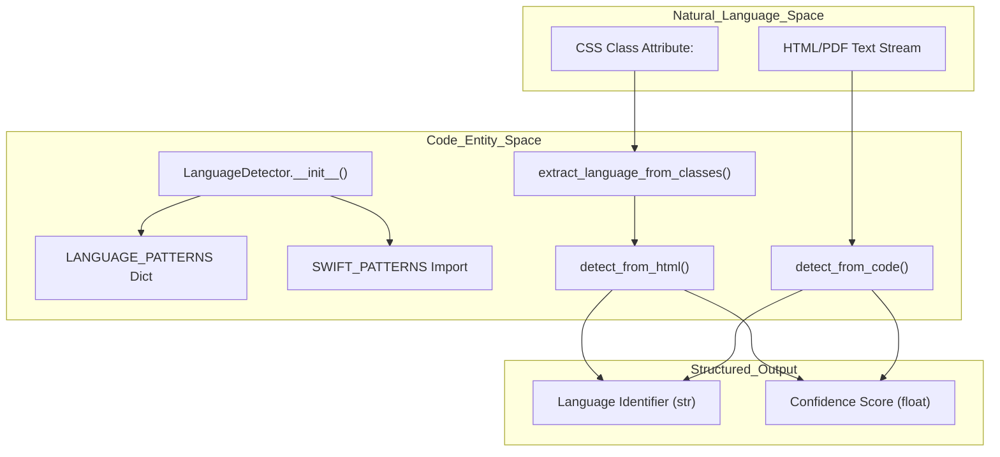
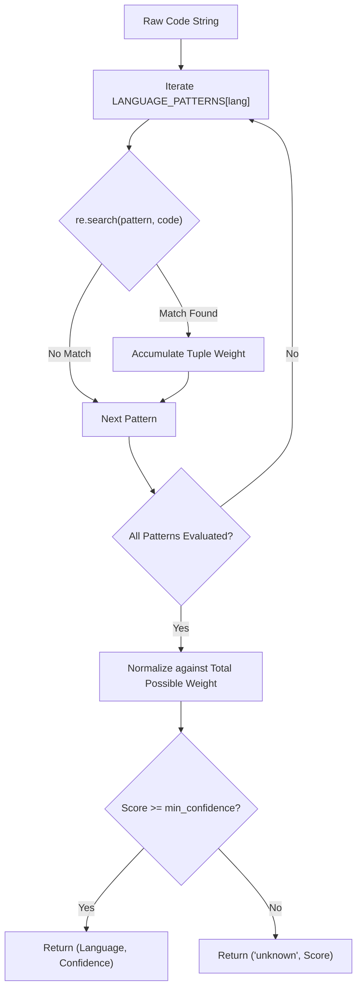
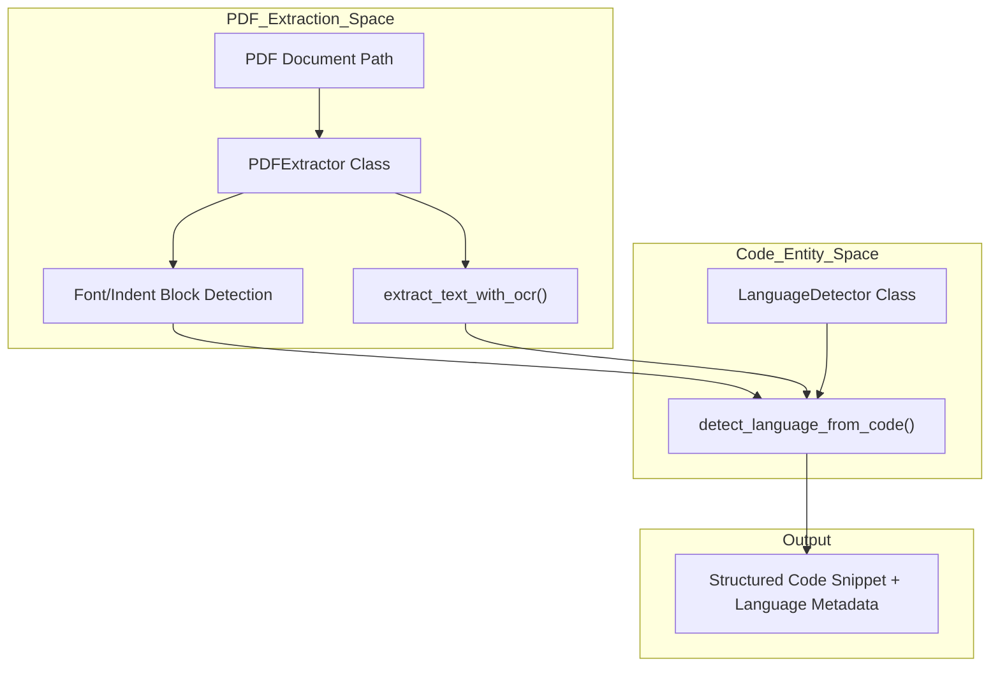

<!-- source: DeepWiki mcp.deepwiki.com · repo yusufkaraaslan/Skill_Seekers · extra page Language Detection & Code Extraction · fetched 2026-10-26 -->

# Language Detection & Code Extraction

Relevant source files

The following files were used as context for generating this wiki page:

- [docs/UML/exports/04_analysis.png](docs/UML/exports/04_analysis.png)
- [src/skill_seekers/cli/language_detector.py](src/skill_seekers/cli/language_detector.py)
- [src/skill_seekers/cli/pdf_extractor_poc.py](src/skill_seekers/cli/pdf_extractor_poc.py)
- [src/skill_seekers/cli/swift_patterns.py](src/skill_seekers/cli/swift_patterns.py)
- [tests/test_pdf_extractor.py](tests/test_pdf_extractor.py)
- [tests/test_swift_detection.py](tests/test_swift_detection.py)

## Purpose and Scope

This page details the implementation of the `LanguageDetector` class, its associated pattern dictionaries (`LANGUAGE_PATTERNS` and `SWIFT_PATTERNS`), confidence scoring algorithms, and code block extraction workflows used across documentation scrapers (HTML and PDF). These mechanisms bridge raw documentation input with structured metadata required for precise syntax highlighting and code organization.

Sources: [src/skill_seekers/cli/language_detector.py:3-10](), [src/skill_seekers/cli/pdf_extractor_poc.py:3-17]()

---

## `LanguageDetector` Architecture and Initialization

The `LanguageDetector` class [src/skill_seekers/cli/language_detector.py:10-10]() is instantiated by documentation extraction pipelines such as `PDFExtractor` [src/skill_seekers/cli/pdf_extractor_poc.py:154-154](). It loads language-specific regex patterns from `LANGUAGE_PATTERNS` [src/skill_seekers/cli/language_detector.py:54-608]() and safely imports supplementary token sets like `SWIFT_PATTERNS` via a fork-friendly modular architecture [src/skill_seekers/cli/language_detector.py:16-30]().

### Natural Language Space to Code Entity Space Bridge

The following diagram maps raw input artifacts (Natural Language/HTML space) to internal class execution routines and code metadata structures (Code Entity Space).

Sources: [src/skill_seekers/cli/language_detector.py:16-45](), [src/skill_seekers/cli/language_detector.py:54-608](), [tests/test_swift_detection.py:23-54]()

---

## `LANGUAGE_PATTERNS` and Confidence Scoring Mechanics

`LANGUAGE_PATTERNS` [src/skill_seekers/cli/language_detector.py:54-608]() stores weighted regex tuples mapped to language keys. Each tuple assigns an integer weight from 1 to 5 based on structural specificity:
- **Weight 5**: Unique structural identifiers (e.g., `using UnityEngine` [src/skill_seekers/cli/language_detector.py:58-58](), `protocol` [src/skill_seekers/cli/swift_patterns.py:41-42]()).
- **Weight 4**: Strong syntactic indicators (e.g., `MonoBehaviour` [src/skill_seekers/cli/language_detector.py:59-59](), `guard let` [src/skill_seekers/cli/swift_patterns.py:51-51]()).
- **Weight 3**: Common language idioms.
- **Weight 2 & 1**: Generic tokens and weak indicators.

### Scoring Flow

Sources: [src/skill_seekers/cli/language_detector.py:54-608](), [tests/test_pdf_extractor.py:41-101]()

---

## `detect_from_html` vs `detect_from_code`

`LanguageDetector` implements distinct ingestion pathways depending on whether the source document is markup-based or raw text:

1.  **`detect_from_html`**: Inspects DOM elements (such as `code` or `pre` tags) to extract explicit metadata prior to heuristics. It invokes `extract_language_from_classes` to parse CSS class tokens like `language-swift` or `lang-python` [tests/test_swift_detection.py:23-54](). If an explicit CSS class matches a known syntax identifier, confidence is immediately set to `1.0`.
2.  **`detect_from_code`**: Operates on raw text strings without DOM annotations. It evaluates regex matches against `LANGUAGE_PATTERNS` and computes a normalized confidence score. If the aggregate score fails to clear `min_confidence` (default `0.15` [src/skill_seekers/cli/pdf_extractor_poc.py:154-154]()), it returns `"unknown"` [tests/test_pdf_extractor.py:99-99]().

Sources: [tests/test_swift_detection.py:23-54](), [tests/test_pdf_extractor.py:41-101](), [src/skill_seekers/cli/pdf_extractor_poc.py:154-154]()

---

## Code Block Extraction in PDF and HTML Scrapers

Specialized extraction handlers manage code isolation before passing blocks to `LanguageDetector`:

- **HTML Doc Converter (`DocToSkillConverter`)**: Traversing Document Object Models via BeautifulSoup, identifying `pre` and `code` tags, parsing CSS hints, and falling back to heuristic scanning [tests/test_scraper_features.py:91-118]().
- **PDF Extractor (`PDFExtractor`)**: Implements font metrics, indentation checks, and block merging across page boundaries [src/skill_seekers/cli/pdf_extractor_poc.py:10-17](). For image-based or scanned documentation pages, `extract_text_with_ocr` invokes `pytesseract` to recover extractable character buffers before language identification [src/skill_seekers/cli/pdf_extractor_poc.py:161-193]().

### PDF Extraction & Language Resolution Pipeline

Sources: [src/skill_seekers/cli/pdf_extractor_poc.py:87-154](), [src/skill_seekers/cli/pdf_extractor_poc.py:161-193](), [tests/test_pdf_extractor.py:41-56]()

---

