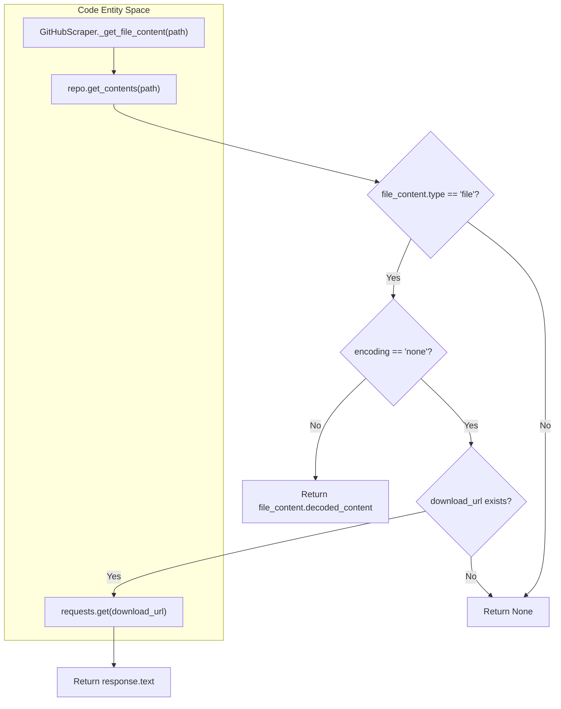
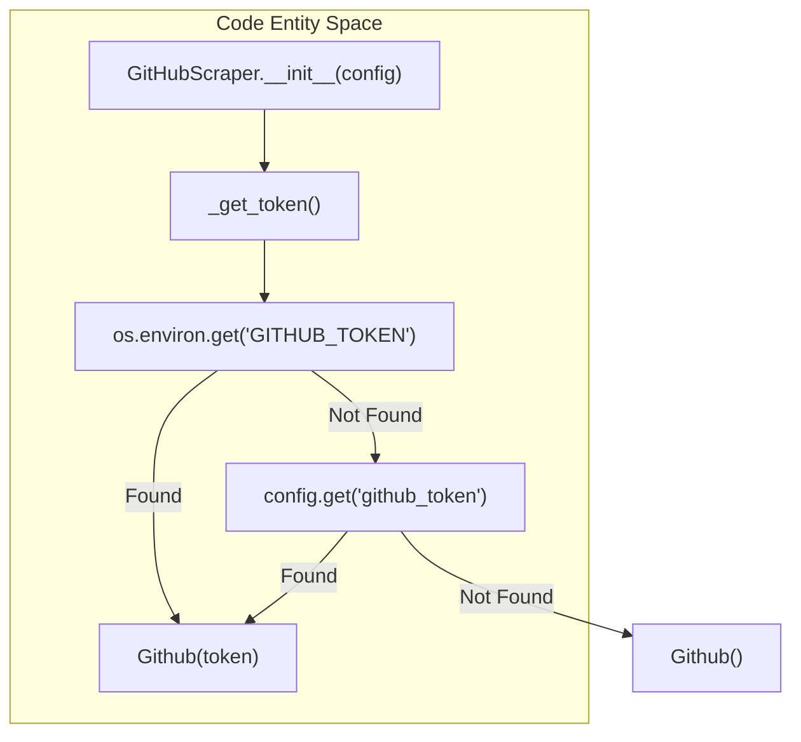
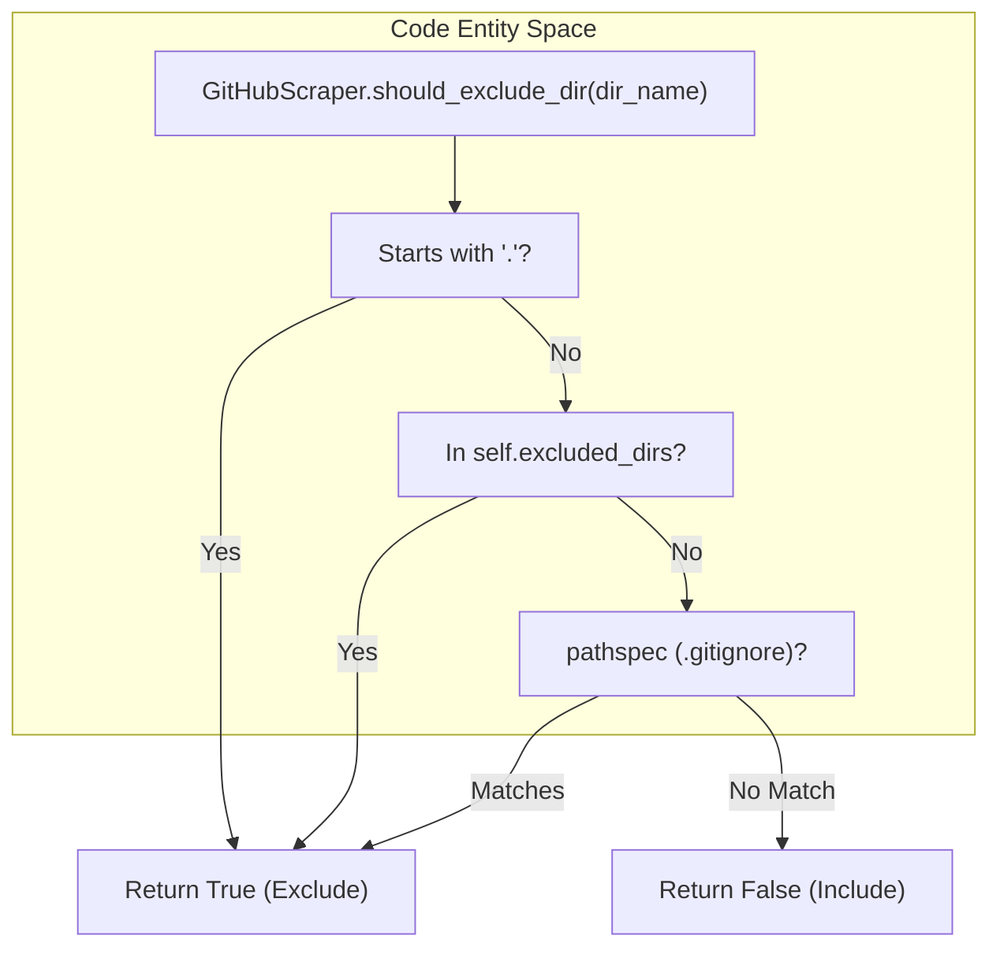

<!-- source: DeepWiki mcp.deepwiki.com · repo yusufkaraaslan/Skill_Seekers · extra page Large File Handling & Rate Limits · fetched 2026-10-26 -->

# Large File Handling & Rate Limits

Relevant source files

The following files were used as context for generating this wiki page:

- [src/skill_seekers/cli/config_validator.py](src/skill_seekers/cli/config_validator.py)
- [src/skill_seekers/cli/generate_router.py](src/skill_seekers/cli/generate_router.py)
- [src/skill_seekers/cli/github_scraper.py](src/skill_seekers/cli/github_scraper.py)
- [src/skill_seekers/cli/pdf_scraper.py](src/skill_seekers/cli/pdf_scraper.py)
- [src/skill_seekers/cli/split_config.py](src/skill_seekers/cli/split_config.py)
- [tests/test_excluded_dirs_config.py](tests/test_excluded_dirs_config.py)
- [tests/test_github_scraper.py](tests/test_github_scraper.py)

## Overview

The GitHub scraper (`GitHubScraper`) must handle two critical operational constraints when interacting with the GitHub API and local codebases: handling large files (>1MB) where standard base64 content retrieval is bypassed by the API, and managing rate limits that restrict hourly requests. Additionally, the ingestion pipeline must prune noise such as build artifacts, virtual environments, and `.gitignore`-excluded paths.

This page covers the technical implementation of `_get_file_content` symlink and large-file fallback handling, rate limit strategies, authentication priority, configuration-driven directory exclusions, and object limiting (`max_issues`).

Sources: [src/skill_seekers/cli/github_scraper.py:1-218](), [tests/test_github_scraper.py:1-137]()

---

## Large File Handling & `download_url` Fallback

When retrieving files via PyGithub (`self.repo.get_contents()`), GitHub's API returns an `encoding` field set to `"none"` for files exceeding 1MB. For these large files, `.content` or `.decoded_content` are unavailable on the `ContentFile` object.

### Detection and Download Flow

`GitHubScraper._get_file_content()` detects this condition by checking the `encoding` field and falls back to fetching the raw content via `requests.get()` using the `download_url` attribute.

Title: Large File Fallback Logic in GitHubScraper

Sources: [src/skill_seekers/cli/github_scraper.py:184-212](), [tests/test_github_scraper.py:148-185]()

---

## Symlink Resolution

When the repository traversal encounters entries with `type == "symlink"`, the scraper reads the target path from the content of the symlink file itself. It then recursively invokes `_get_file_content()` on the resolved target path to extract the actual linked content rather than the symlink pointer.

Sources: [src/skill_seekers/cli/github_scraper.py:184-212]()

---

## Rate Limit Management & Authentication Priority

`GitHubScraper` relies on PyGithub to query the GitHub REST API. Unauthenticated requests are strictly throttled to 60 requests per hour, whereas authenticated requests enjoy 5,000 requests per hour.

### Authentication Priority Chain

The scraper resolves the GitHub token using the following precedence order:

| Priority | Source | Implementation Mechanism |
|----------|--------|--------------------------|
| 1 | Environment Variable | `os.environ.get("GITHUB_TOKEN")` |
| 2 | Configuration Dictionary | `config.get("github_token")` |
| 3 | Unauthenticated Fallback | `Github()` with no arguments |

Title: Token Resolution in GitHubScraper

Sources: [src/skill_seekers/cli/github_scraper.py:202-218](), [tests/test_github_scraper.py:53-115]()

---

## Directory Exclusion & `.gitignore` / `.excluded_dirs` Support

During local repository analysis, the scraper filters out non-source files and massive build/cache directories using the `EXCLUDED_DIRS` registry and `pathspec` for `.gitignore` integration.

### EXCLUDED_DIRS Registry

Default exclusions span virtual environments, package managers, IDE caches, and game engine build directories:

| Category | Excluded Patterns |
|----------|-------------------|
| **Virtual Environments** | `venv`, `env`, `.venv`, `.env`, `.tox`, `.nox` |
| **Caches** | `__pycache__`, `.pytest_cache`, `.mypy_cache`, `.ruff_cache` |
| **Game Engines** | `Library`, `Temp`, `Logs`, `Intermediate`, `Saved`, `.godot` |
| **Build Artifacts** | `node_modules`, `build`, `dist`, `*.egg-info` |

Sources: [src/skill_seekers/cli/github_scraper.py:56-100](), [tests/test_excluded_dirs_config.py:12-56]()

### Exclusion Decision Logic

The `should_exclude_dir()` method determines if a path should be skipped, enforcing dot-prefix rules, static list matches, and custom overrides (`exclude_dirs` vs `exclude_dirs_additional`).

Title: Directory Filtering Flow in GitHubScraper

Sources: [src/skill_seekers/cli/github_scraper.py:17-43](), [tests/test_excluded_dirs_config.py:57-167]()

---

## Issue & Object Limiting (`max_issues`, `max_releases`)

To prevent excessive API consumption and output bloat, GitHub object extraction honors specific limits defined in the configuration schema:
* `max_issues`: Caps the number of repository issues processed (default: `20`).
* `max_releases`: Caps the number of release notes extracted (default: `20`).
* `issue_state`: Restricts fetched issues by state (default: `"open"`).

Sources: [src/skill_seekers/cli/github_scraper.py:184-212](), [tests/test_github_scraper.py:116-137]()

---

## Data Persistence & Cache Resumption

Extracted repository payloads are serialized to disk to allow rapid iteration without re-querying the GitHub API.

* **Data File**: Saved to `github_data.json` within the designated output directory.
* **Directory Safeguard**: The `_save_data()` method ensures parent directories are created recursively, preventing `FileNotFoundError` during nested output path evaluations.
* **Cache Reusability**: When `skip_scrape` is active, converters bypass remote extraction and reload directly from the cache.

Sources: [src/skill_seekers/cli/github_scraper.py:184-218](), [tests/test_github_scraper.py:116-137]()

---

