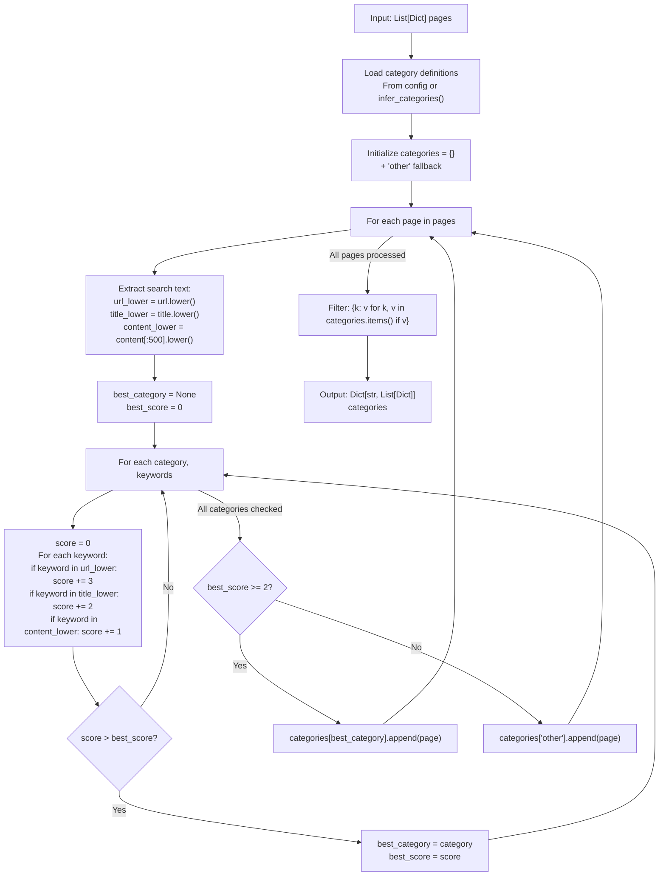
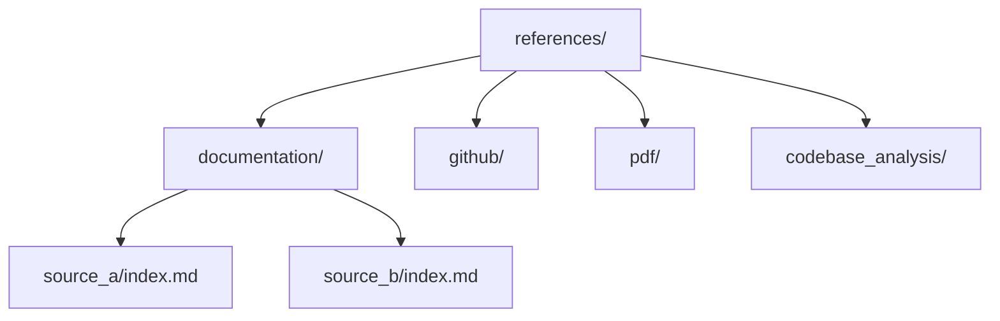

<!-- source: DeepWiki mcp.deepwiki.com · repo yusufkaraaslan/Skill_Seekers · extra page Smart Categorization · fetched 2026-10-26 -->

# Smart Categorization

<details>
<summary>Relevant source files</summary>

The following files were used as context for generating this wiki page:

- [src/skill_seekers/cli/doc_scraper.py](src/skill_seekers/cli/doc_scraper.py)
- [src/skill_seekers/cli/unified_scraper.py](src/skill_seekers/cli/unified_scraper.py)
- [src/skill_seekers/cli/unified_skill_builder.py](src/skill_seekers/cli/unified_skill_builder.py)
- [tests/test_c3_integration.py](tests/test_c3_integration.py)
- [tests/test_multi_source.py](tests/test_multi_source.py)
- [tests/test_unified.py](tests/test_unified.py)
- [tests/test_unified_scraper_orchestration.py](tests/test_unified_scraper_orchestration.py)

</details>


## Purpose and Scope

Smart categorization is the algorithm that classifies scraped documentation pages into logical categories (e.g., `getting_started`, `api`, `guides`) for organized reference file generation. The `smart_categorize()` method in `DocToSkillConverter` uses a weighted scoring system that prioritizes URL structure over content, ensuring accurate classification even when page content is ambiguous.

This system operates during the Build Phase after pages have been scraped and cached, but before reference files are generated. In multi-source scenarios, `UnifiedSkillBuilder` also leverages categorization logic to organize references by source type and repository ID.

Sources: [src/skill_seekers/cli/doc_scraper.py:1-50](), [src/skill_seekers/cli/unified_skill_builder.py:26-70]()

---

## Algorithm Overview

The categorization algorithm processes each page through a scoring pipeline that evaluates URL path, page title, and content against category-specific keywords. Each page is assigned to exactly one category based on the highest score, with an `other` fallback for unclassified pages.

### Categorization Workflow



Sources: [src/skill_seekers/cli/doc_scraper.py:1-50]()

---

## Input Data Structure

Each page dictionary passed to `smart_categorize()` contains:

```python
{
  "url": str,           # Full page URL
  "title": str,         # Extracted page title
  "content": str,       # Cleaned paragraph text
  "headings": List[Dict],  # Hierarchical structure (h1-h6)
  "code_samples": List[Dict],  # Code blocks with language and content
  "links": List[str]    # Outbound links for BFS discovery
}
```

**Category Definitions** are provided either from configuration or auto-generated by helper mechanisms:

```python
{
  "getting_started": ["intro", "tutorial", "getting-started"],
  "api": ["api", "reference", "class"],
  "guides": ["guide", "how-to"]
}
```

Sources: [src/skill_seekers/cli/doc_scraper.py:1-50](), [src/skill_seekers/cli/unified_scraper.py:41-76]()

---

## Weighted Scoring System

The scoring algorithm evaluates each page against category keywords using three data sources with different weights. The system uses a constant `MIN_CATEGORIZATION_SCORE` (defaulting to 2) to ensure high-confidence matches.

### Score Weights Table

| Match Location | Weight | Rationale | Example |
|----------------|--------|-----------|---------|
| URL path | +3 | Most reliable indicator of page purpose | `/api/reference` → "api" category |
| Page title | +2 | Strong signal of content type | "API Reference" → "api" category |
| Content (first 500 chars) | +1 | Confirms topic but prone to noise | "This API documentation..." → "api" |

**Classification Threshold:** A page requires a score ≥ `MIN_CATEGORIZATION_SCORE` (2) to be assigned to a category. This prevents false positives from content-only keyword matches.

### Scoring Implementation

```python
# Implementation pattern from doc_scraper.py constants and parsing logic
for category, keywords in category_defs.items():
    score = 0
    for keyword in keywords:
        if keyword in url_lower:
            score += 3  # URL match: highest priority
        if keyword in title_lower:
            score += 2  # Title match: medium priority
        if keyword in content_lower:
            score += 1  # Content match: lowest priority
    
    if score > best_score:
        best_score = score
        best_category = category

if best_score >= MIN_CATEGORIZATION_SCORE:  # Minimum threshold (2)
    categories[best_category].append(page)
else:
    categories['other'].append(page)
```

Sources: [src/skill_seekers/cli/doc_scraper.py:35-44](), [src/skill_seekers/cli/constants.py:1-10]()

---

## Category Inference

When configuration does not specify categories, inference logic automatically generates them by analyzing URL patterns across all scraped pages.

### Inference Logic Details

**1. URL Segment Extraction**
The algorithm splits the URL path and filters out common non-informative segments like `en`, `stable`, or version numbers (e.g., `v1`).

```python
segments = urlparse(page['url']).path.split('/')
for seg in segments:
    seg = seg.lower().strip()
    if seg and seg not in ['en', 'stable', 'latest', 'docs']:
        if not (seg.startswith('v') and any(c.isdigit() for c in seg)):
            url_segments[seg] += 1
```

**2. Frequency-Based Selection**
- Sort segments by occurrence count.
- Select top frequent segments as potential category names.
- Require minimum occurrences to prevent outliers.

**3. Standard Category Defaults**
If certain keywords are detected in any URL, standard categories are automatically appended to the definition set to ensure consistency.

Sources: [src/skill_seekers/cli/doc_scraper.py:1-50]()

---

## Multi-Source Reference Organization

In the `UnifiedScraper` workflow, categorization extends to how files are bucketed into the `references/` directory via `UnifiedSkillBuilder`.

### Unified Directory Structure



Sources: [src/skill_seekers/cli/unified_skill_builder.py:61-70](), [tests/test_multi_source.py:103-140]()

---

## Reference File Generation

The reference generation mechanism creates markdown files per category or source, consolidating pages with structured formatting.

### File Naming and Organization

Reference files are named after their category key: `{category}.md`.
- Category `getting_started` → `references/getting_started.md`
- Category `api` → `references/api.md`
- Category `other` → `references/other.md`

Each file contains the page title, the source URL, a table of contents based on page headings, and truncated content followed by code samples.

Sources: [src/skill_seekers/cli/doc_scraper.py:1-50](), [src/skill_seekers/cli/unified_skill_builder.py:108-123]()

---

## Performance and Error Handling

### Performance Characteristics
The build phase operates efficiently on local JSON caches.
- **Categorization:** Occurs in-memory across the scraped pages.
- **Pattern Extraction:** Scales linearly with page and code block counts.

### Error Handling
The build pipeline implements graceful degradation:
- **Load Errors:** If a specific cached page JSON is corrupted, logs the error and continues with the next file.
- **Empty Data:** If no pages are loaded, execution exits early with a status warning.
- **Category Cleanup:** Categories with zero pages are automatically filtered out before file generation.

Sources: [src/skill_seekers/cli/doc_scraper.py:1-50](), [src/skill_seekers/cli/unified_skill_builder.py:108-123]()

---

