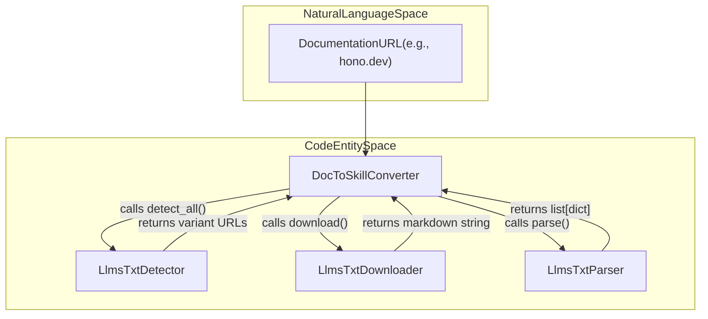
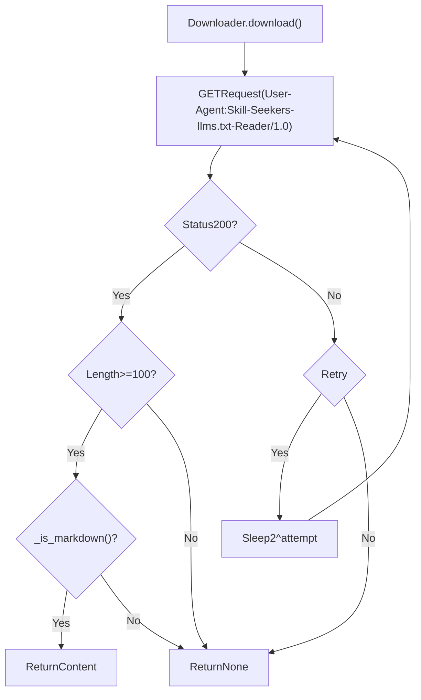
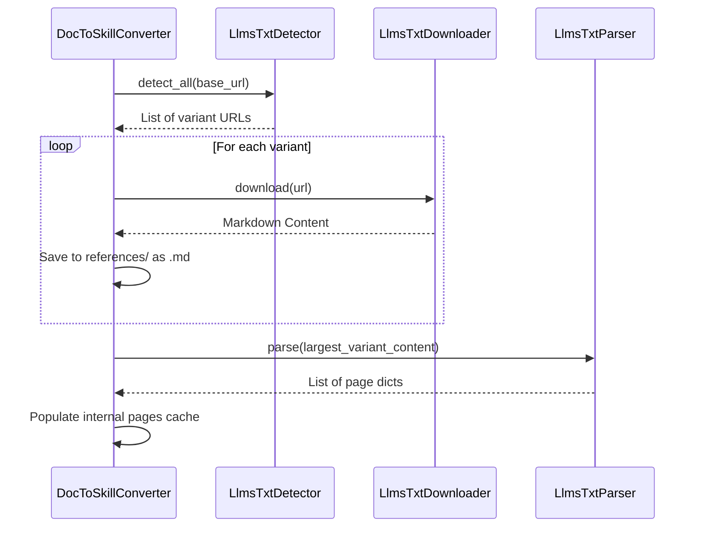

<!-- source: DeepWiki mcp.deepwiki.com · repo yusufkaraaslan/Skill_Seekers · extra page llms.txt Detection & Processing · fetched 2026-10-26 -->

# llms.txt Detection & Processing

<details>
<summary>Relevant source files</summary>

The following files were used as context for generating this wiki page:

- [configs/claude-code.json](configs/claude-code.json)
- [src/skill_seekers/cli/ai_enhancer.py](src/skill_seekers/cli/ai_enhancer.py)
- [src/skill_seekers/cli/config_enhancer.py](src/skill_seekers/cli/config_enhancer.py)
- [src/skill_seekers/cli/config_extractor.py](src/skill_seekers/cli/config_extractor.py)
- [src/skill_seekers/cli/llms_txt_downloader.py](src/skill_seekers/cli/llms_txt_downloader.py)
- [src/skill_seekers/cli/llms_txt_parser.py](src/skill_seekers/cli/llms_txt_parser.py)
- [src/skill_seekers/cli/pattern_recognizer.py](src/skill_seekers/cli/pattern_recognizer.py)
- [src/skill_seekers/cli/test_example_extractor.py](src/skill_seekers/cli/test_example_extractor.py)
- [tests/test_install_agent.py](tests/test_install_agent.py)
- [tests/test_integration.py](tests/test_integration.py)
- [tests/test_issue_219_e2e.py](tests/test_issue_219_e2e.py)
- [tests/test_llms_txt_downloader.py](tests/test_llms_txt_downloader.py)
- [tests/test_skip_llms_txt.py](tests/test_skip_llms_txt.py)
- [tests/test_test_example_extractor.py](tests/test_test_example_extractor.py)

</details>


## Purpose and Scope

This page documents the `llms.txt` detection and processing system, which provides a fast-path alternative to HTML scraping. When documentation sites publish LLM-optimized markdown files following the [llms.txt convention](https://llmstxt.org/), Skill Seeker automatically detects and downloads these files instead of crawling the entire site, resulting in significantly faster skill creation with high content fidelity.

**Scope:** This page covers the detection algorithm, multi-variant downloading, content validation, and integration with the main scraping pipeline via `DocToSkillConverter`.

Sources: [src/skill_seekers/cli/llms_txt_downloader.py:1-5](), [src/skill_seekers/cli/llms_txt_parser.py:1-1]()

---

## What is llms.txt?

The `llms.txt` convention is a standard for publishing documentation in LLM-optimized markdown format. Documentation sites typically place markdown files at their root domain:

| Variant | File | Purpose |
|---------|------|---------|
| Full | `llms-full.txt` | Complete documentation, no truncation. |
| Standard | `llms.txt` | Core concepts and API reference. |
| Small | `llms-small.txt` | Curated essentials, quick reference. |

**Key Benefits:**
- **Performance:** Faster than HTML scraping as it avoids BFS traversal and complex CSS selector parsing.
- **Fidelity:** Content is already in Markdown, eliminating HTML-to-Markdown conversion artifacts.
- **Variants:** Users can choose appropriate detail levels (full, standard, or small).

Sources: [src/skill_seekers/cli/llms_txt_downloader.py:16-27](), [tests/test_llms_txt_downloader.py:170-196]()

---

## System Architecture

The following diagram illustrates how `DocToSkillConverter` interacts with the `llms.txt` components to transition from a documentation URL to structured skill data, bridging natural language input to code entity execution.

Title: "Natural Language to Code Entity Mapping for llms.txt Processing"



Sources: [src/skill_seekers/cli/doc_scraper.py:773-800](), [src/skill_seekers/cli/llms_txt_downloader.py:63-69](), [src/skill_seekers/cli/llms_txt_parser.py:100-106]()

---

## Component 1: LlmsTxtDetector

The `LlmsTxtDetector` identifies available `llms.txt` variants at a documentation site. It extracts the root domain from a provided `base_url` and probes for standard filenames.

### Key Methods

- **`detect()`**: Returns the first available variant found, prioritizing `full` → `standard` → `small`.
- **`detect_all()`**: Returns a list of all available variants discovered on the server.

Sources: [src/skill_seekers/cli/llms_txt_downloader.py:1-25]()

---

## Component 2: LlmsTxtDownloader

The `LlmsTxtDownloader` handles the retrieval of the `.txt` files with built-in retry logic and markdown validation.

### Download Logic & Retry Flow

The downloader uses exponential backoff to handle transient network issues.

Title: "LlmsTxtDownloader Download and Validation Flow"



Sources: [src/skill_seekers/cli/llms_txt_downloader.py:63-104](), [tests/test_llms_txt_downloader.py:89-105]()

### Content Validation

- **Length Check**: Content shorter than 100 characters is rejected as likely invalid or a placeholder [src/skill_seekers/cli/llms_txt_downloader.py:80-82]().
- **Markdown Detection**: The `_is_markdown()` method checks for patterns like `# `, `## `, ` ``` `, and `* ` while specifically rejecting HTML tags like `<!DOCTYPE html>` or `<html>` to avoid redirect traps [src/skill_seekers/cli/llms_txt_downloader.py:40-61]().
- **Extension Renaming**: The `get_proper_filename()` method converts `.txt` extensions to `.md` for the final skill directory [src/skill_seekers/cli/llms_txt_downloader.py:16-38]().

Sources: [src/skill_seekers/cli/llms_txt_downloader.py:16-61](), [tests/test_llms_txt_downloader.py:198-214]()

---

## Component 3: LlmsTxtParser

The `LlmsTxtParser` converts raw markdown content into structured page data that the `DocToSkillConverter` can use to build a skill.

### Parsing Logic

1.  **URL Extraction**: `extract_urls()` finds both markdown links `[text](url)` and bare URLs. It resolves relative paths using a `base_url` and cleans malformed anchors (e.g., stripping `#section/path.md`) [src/skill_seekers/cli/llms_txt_parser.py:16-57]().
2.  **Section Splitting**: The `parse()` method splits the content by H1 headers (`# Title`) [src/skill_seekers/cli/llms_txt_parser.py:100-124]().
3.  **Structured Data**: Each section is parsed into a dictionary containing:
    *   `title`: The H1 text.
    *   `content`: Paragraphs (with code blocks removed for plain text storage).
    *   `code_samples`: Extracted from triple-backtick blocks.
    *   `headings`: Sub-headings (H2, H3) for navigation.

Sources: [src/skill_seekers/cli/llms_txt_parser.py:100-160]()

---

## Integration: DocToSkillConverter

The `DocToSkillConverter` coordinates the entire process via the `_try_llms_txt()` method.

### Processing Workflow

Title: "DocToSkillConverter Integration Sequence"



Sources: [src/skill_seekers/cli/doc_scraper.py:773-976]()

### Skipping Detection
Users can explicitly skip this process using the `skip_llms_txt` configuration option. This is useful if the site's `llms.txt` is known to be broken or if a full HTML crawl is preferred for specific selectors [src/skill_seekers/cli/doc_scraper.py:175-183](), [tests/test_skip_llms_txt.py:1-8]().

Sources: [src/skill_seekers/cli/doc_scraper.py:175-183](), [tests/test_skip_llms_txt.py:1-8]()

### URL Normalization
The system uses `_convert_to_md_urls()` to ensure that URLs extracted from `llms.txt` are normalized (stripping fragments and ensuring `.md` or `/index.html.md` suffixes) before being added to the `pending_urls` queue for BFS processing if the parser finds external links [src/skill_seekers/cli/doc_scraper.py:705-746]().

Sources: [src/skill_seekers/cli/doc_scraper.py:705-746]()

---

