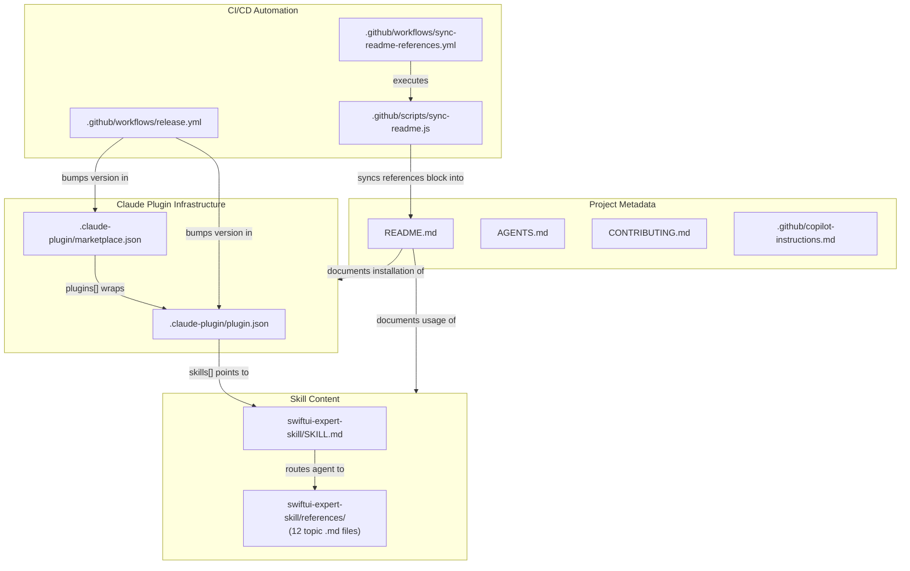
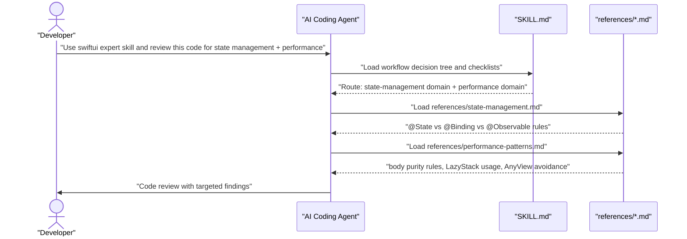

<!-- source: DeepWiki mcp.deepwiki.com · repo AvdLee/SwiftUI-Agent-Skill · page 1 Overview · fetched 2026-10-26 -->

# Overview

Relevant source files

The following files were used as context for generating this wiki page:

- [README.md](README.md)
- [swiftui-expert-skill/SKILL.md](swiftui-expert-skill/SKILL.md)

This page describes the purpose, architecture, and major subsystems of the `SwiftUI-Agent-Skill` repository. It covers what the skill is, the open format it follows, and how its four subsystems fit together. For installation steps, see [Installation & Usage](#2). For the full knowledge base content, see [SwiftUI Reference Content](#3). For plugin registration details, see [Claude Plugin Integration](#4). For CI/CD automation, see [Automation & Maintenance](#5).

---

## What This Repository Is

`SwiftUI-Agent-Skill` is an **AI agent skill** that provides practical SwiftUI guidance to AI coding tools. It targets correctness and performance without mandating a specific architecture or code style.

The skill is built on the [Agent Skills open format](https://agentskills.io/home), which defines a standard way to package domain knowledge so that multiple AI coding tools (Claude Code, Codex, Cursor, etc.) can consume it.

**Target audience:**
- Teams adopting modern SwiftUI APIs who want correct defaults
- Developers reviewing or refactoring SwiftUI views and data flow
- Anyone shipping performant lists, scrolling, sheets, and navigation in SwiftUI

Sources: [README.md:1-11]()

---

## The Agent Skills Open Format

The Agent Skills format specifies a directory containing:

1. A **`SKILL.md` entrypoint** — YAML frontmatter identifying the skill, followed by workflow decision trees, core guidelines, and a review checklist.
2. A **`references/` subdirectory** — topic-specific Markdown files that the agent loads on demand.

A compliant AI tool reads `SKILL.md` first, then navigates to the relevant reference file based on the task at hand. The `swiftui-expert-skill/` directory in this repository is the complete implementation of one such skill.

Sources: [swiftui-expert-skill/SKILL.md:1-4](), [README.md:109-128]()

---

## Two-Layer Architecture

The skill content is split into two layers:

| Layer | File(s) | Role |
|---|---|---|
| **Dispatch layer** | `swiftui-expert-skill/SKILL.md` | Workflow decision trees, core guidelines, quick-reference tables, review checklist |
| **Reference layer** | `swiftui-expert-skill/references/*.md` (12 files) | Deep-dive content for each SwiftUI topic domain |

`SKILL.md` routes the agent to one or more reference files based on the task type (review, improve, or implement). The reference files are loaded lazily — only the files relevant to the task are read.

Sources: [swiftui-expert-skill/SKILL.md:11-37](), [swiftui-expert-skill/SKILL.md:197-209]()

**Diagram: SKILL.md as Dispatch Layer**

```mermaid
graph TD
    SKILLMD["swiftui-expert-skill/SKILL.md
    (entrypoint: frontmatter, workflow trees, checklist)"]

    subgraph state_data["Data & State"]
        SM["references/state-management.md"]
    end

    subgraph ui["UI Components"]
        LP["references/list-patterns.md"]
        SP["references/scroll-patterns.md"]
        SNP["references/sheet-navigation-patterns.md"]
    end

    subgraph perf["Performance"]
        PP["references/performance-patterns.md"]
        IO["references/image-optimization.md"]
    end

    subgraph layout["Layout & Composition"]
        VS["references/view-structure.md"]
        LBP["references/layout-best-practices.md"]
    end

    subgraph anim["Animation"]
        AB["references/animation-basics.md"]
        AA["references/animation-advanced.md"]
        AT["references/animation-transitions.md"]
    end

    subgraph ios26["iOS 26+"]
        LG["references/liquid-glass.md"]
    end

    SKILLMD --> SM
    SKILLMD --> LP
    SKILLMD --> SP
    SKILLMD --> SNP
    SKILLMD --> PP
    SKILLMD --> IO
    SKILLMD --> VS
    SKILLMD --> LBP
    SKILLMD --> AB
    SKILLMD --> AA
    SKILLMD --> AT
    SKILLMD --> LG
```

Sources: [swiftui-expert-skill/SKILL.md:197-209](), [README.md:110-128]()

---

## Repository Subsystems

The repository is composed of four subsystems:

| Subsystem | Key Files | Responsibility |
|---|---|---|
| **Skill Content** | `swiftui-expert-skill/SKILL.md`, `swiftui-expert-skill/references/*.md` | The agent knowledge base |
| **Claude Plugin Infrastructure** | `.claude-plugin/plugin.json`, `.claude-plugin/marketplace.json` | Packages and registers the skill for Claude Code |
| **CI/CD Automation** | `.github/workflows/release.yml`, `.github/workflows/sync-readme-references.yml`, `.github/scripts/sync-readme.js` | Version management and documentation sync |
| **Project Metadata** | `README.md`, `AGENTS.md`, `CONTRIBUTING.md`, `.github/copilot-instructions.md` | Installation docs, contribution guidelines, agent behavior rules |

**Diagram: Top-Level Subsystem Map**

Sources: [README.md:17-82](), [README.md:130-134]()

---

## Agent Runtime Flow

When a developer invokes the skill, the agent loads `SKILL.md` first, then follows the workflow decision tree to determine which reference files to read.

**Diagram: Agent Invocation Sequence**

Sources: [swiftui-expert-skill/SKILL.md:11-37](), [README.md:28-30]()

---

## Skill Content Summary

`SKILL.md` defines three workflow modes, each routing to a different subset of the reference files:

| Workflow | Trigger | Key Reference Files |
|---|---|---|
| **Review existing code** | Agent is asked to review a view or feature | `state-management.md`, `view-structure.md`, `performance-patterns.md`, `list-patterns.md`, `animation-basics.md`, `liquid-glass.md` |
| **Improve existing code** | Agent is asked to refactor or optimize | `state-management.md`, `view-structure.md`, `performance-patterns.md`, `list-patterns.md`, `image-optimization.md` |
| **Implement new feature** | Agent is asked to build something new | `state-management.md`, `view-structure.md`, `layout-best-practices.md`, `animation-basics.md`, `animation-transitions.md`, `animation-advanced.md`, `liquid-glass.md` |

The skill's philosophy (stated in `SKILL.md`) is to focus on **facts and best practices**, not architectural opinions — it does not enforce MVVM, VIPER, or any other pattern.

Sources: [swiftui-expert-skill/SKILL.md:11-37](), [swiftui-expert-skill/SKILL.md:211-218]()

---

## Claude Plugin Infrastructure

The skill is also published as a Claude Code plugin. Two JSON files in `.claude-plugin/` handle registration:

- **`.claude-plugin/plugin.json`** — plugin identity (`name: swiftui-expert`, `version`, `description`, keywords, `skills[]` array pointing to `swiftui-expert-skill/`)
- **`.claude-plugin/marketplace.json`** — marketplace manifest (`name: swiftui-expert-skill`, `owner: Antoine van der Lee`, `plugins[]` wrapping `plugin.json`)

The `marketplace.json` validates against an external Anthropics schema. The `plugin.json` `skills[]` field uses `source: './'` to co-locate the manifest with the implementation directory.

For full details, see [Claude Plugin Integration](#4).

Sources: [README.md:32-67]()

---

## CI/CD Automation

Two GitHub Actions workflows automate maintenance:

| Workflow File | Trigger | What It Does |
|---|---|---|
| `.github/workflows/release.yml` | Manual `workflow_dispatch` | Validates semver, bumps version in `plugin.json` and `marketplace.json`, commits to `main`, creates GitHub release |
| `.github/workflows/sync-readme-references.yml` | PR modifying `swiftui-expert-skill/references/**` | Runs `sync-readme.js` to rebuild the `<!-- BEGIN REFERENCE STRUCTURE -->` block in `README.md` |

For full details, see [Automation & Maintenance](#5).

Sources: [README.md:109-128]()

---

