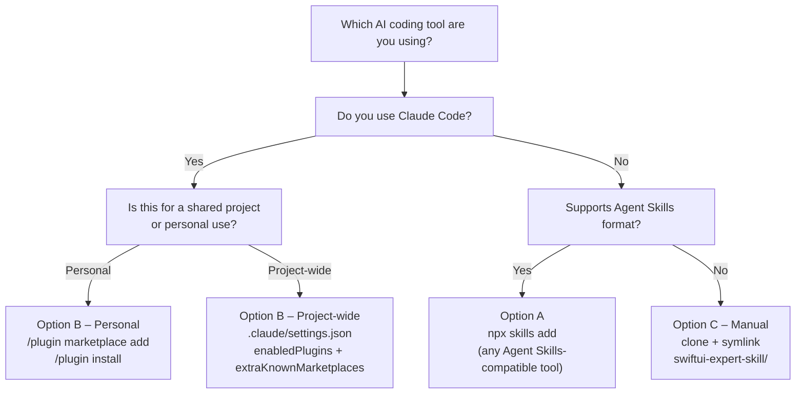
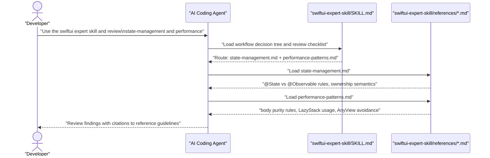
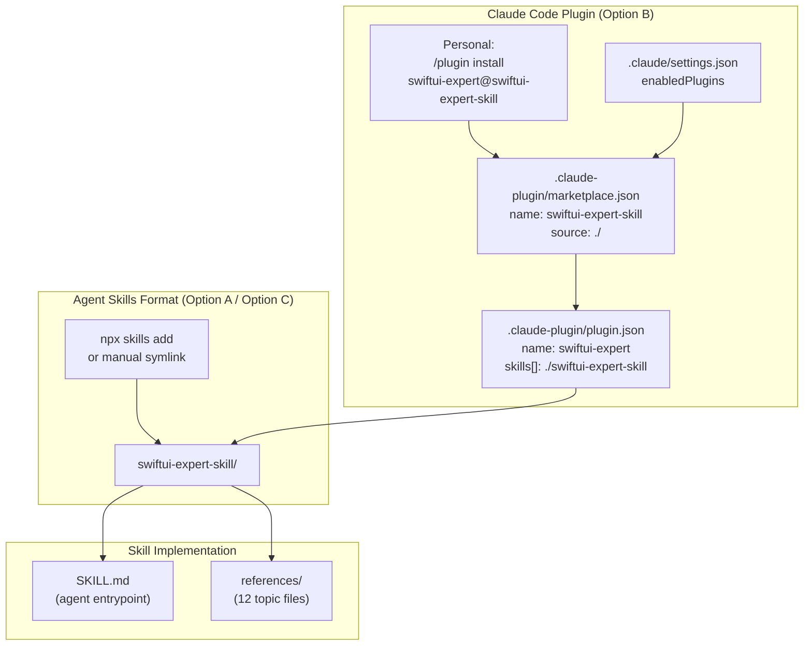

<!-- source: DeepWiki mcp.deepwiki.com · repo AvdLee/SwiftUI-Agent-Skill · page 2 Installation & Usage · fetched 2026-10-26 -->

# Installation & Usage

<details>
<summary>Relevant source files</summary>

The following files were used as context for generating this wiki page:

- [.claude-plugin/marketplace.json](.claude-plugin/marketplace.json)
- [.claude-plugin/plugin.json](.claude-plugin/plugin.json)
- [README.md](README.md)

</details>


This page covers how to install the `swiftui-expert-skill` into an AI coding tool and how to invoke it once installed. It describes all three supported installation methods, the required configuration for each, and example invocation prompts.

For details on what the skill contains once loaded (the knowledge base structure, reference files, and workflow modes), see [SwiftUI Reference Content](#3). For how the Claude plugin manifests are structured, see [Claude Plugin Integration](#4).

---

## Installation Methods Overview

The skill can be installed three ways. The method you choose depends on your toolchain.

| Method | Best For | Key File(s) |
|---|---|---|
| **Option A**: `npx skills add` | Any agent that supports the Agent Skills open format | `swiftui-expert-skill/SKILL.md` + `references/` |
| **Option B**: Claude Code Plugin | Claude Code users, personal or project-wide | `.claude-plugin/plugin.json`, `.claude-plugin/marketplace.json` |
| **Option C**: Manual clone/symlink | Any agent tool with custom skills path support | `swiftui-expert-skill/` directory |

**Installation method decision diagram**



Sources: [README.md:19-82]()

---

## Option A: skills.sh / npx

This is the recommended method for any agent tool that supports the [Agent Skills open format](https://agentskills.io/home).

Run the following command in your terminal:

```bash
npx skills add https://github.com/avdlee/swiftui-agent-skill --skill swiftui-expert-skill
```

This command fetches the `swiftui-expert-skill/` directory from the repository and registers it with the local skills runtime. No further configuration is required.

After installation, verify the skill is recognized by asking your agent to reference the workflow in `swiftui-expert-skill/SKILL.md`.

Sources: [README.md:19-29]()

---

## Option B: Claude Code Plugin

The skill is packaged as a Claude Code plugin. The plugin identity is defined in [.claude-plugin/plugin.json:1-27]() and the marketplace manifest in [.claude-plugin/marketplace.json:1-45]().

### Personal Installation

Run these two commands inside Claude Code:

```
/plugin marketplace add AvdLee/SwiftUI-Agent-Skill
/plugin install swiftui-expert@swiftui-expert-skill
```

- `/plugin marketplace add` registers the GitHub repository `AvdLee/SwiftUI-Agent-Skill` as a source.
- `/plugin install swiftui-expert@swiftui-expert-skill` installs the `swiftui-expert` plugin, loading the `swiftui-expert-skill` entry from the `skills[]` array in `plugin.json`.

### Project-Wide Installation

To make the skill available to every developer working in a repository, add the following to `.claude/settings.json` in the project root:

```json
{
  "enabledPlugins": {
    "swiftui-expert@swiftui-expert-skill": true
  },
  "extraKnownMarketplaces": {
    "swiftui-expert-skill": {
      "source": {
        "source": "github",
        "repo": "AvdLee/SwiftUI-Agent-Skill"
      }
    }
  }
}
```

When a team member opens the project in Claude Code, Claude Code will detect the `enabledPlugins` entry and prompt them to install the skill automatically.

**How plugin.json maps to the install command**

```mermaid
graph LR
    CMD["\"swiftui-expert@swiftui-expert-skill\"\n(install command)"]
    PJ["plugin.json\nname: swiftui-expert"]
    SK["skills[]\n./swiftui-expert-skill"]
    DIR["swiftui-expert-skill/\nSKILL.md + references/"]
    MJ["marketplace.json\nplugins[0].name: swiftui-expert"]

    CMD -->|"resolves plugin name via"| MJ
    MJ -->|"wraps"| PJ
    PJ -->|"skills[] points to"| SK
    SK -->|"loads from disk"| DIR
```

Sources: [README.md:31-67](), [.claude-plugin/plugin.json:1-27](), [.claude-plugin/marketplace.json:1-45]()

---

## Option C: Manual Clone / Symlink

1. Clone the repository:

   ```bash
   git clone https://github.com/AvdLee/SwiftUI-Agent-Skill.git
   ```

2. Install or symlink the `swiftui-expert-skill/` directory into the location your tool expects for skills. Refer to the official documentation for your tool:

   | Tool | Documentation |
   |---|---|
   | Codex | Where to save skills |
   | Claude | Using Skills |
   | Cursor | Enabling Skills |

3. Instruct your agent to use the `swiftui-expert` skill for SwiftUI tasks.

The directory that must be registered with the tool is `swiftui-expert-skill/`, which contains `SKILL.md` as the agent entrypoint and a `references/` subdirectory with twelve topic-specific files.

Sources: [README.md:69-82]()

---

## Verifying Installation

After any installation method, confirm the skill is active by asking your agent:

> "Use the swiftui expert skill and review the state management in this file."

A correctly installed skill causes the agent to:

1. Load `swiftui-expert-skill/SKILL.md` to read the workflow decision tree.
2. Identify the relevant topic domains (e.g., `state-management`).
3. Load the corresponding reference file (e.g., `swiftui-expert-skill/references/state-management.md`).
4. Apply the checklist and guidelines from that file to the provided code.

If the agent does not reference `SKILL.md` or the reference files, the skill directory is not correctly registered.

Sources: [README.md:80-82]()

---

## Invoking the Skill

Once installed, invoke the skill by explicitly naming it in your prompt. The agent uses the skill name as a signal to load `SKILL.md` before proceeding.

### Example Prompts

| Task | Example Prompt |
|---|---|
| Review existing code | `Use the swiftui expert skill and review the current SwiftUI code for state-management and performance improvements` |
| Improve a specific area | `Use the swiftui expert skill and suggest improvements to this view's composition and layout` |
| Implement a new feature | `Use the swiftui expert skill and implement a sheet-based navigation flow for this screen` |
| iOS 26+ adoption | `Use the swiftui expert skill and apply Liquid Glass effects to this view with appropriate fallbacks` |

### Agent Resolution Flow

**Skill invocation sequence**



Sources: [README.md:17-82](), [.claude-plugin/plugin.json:24-26]()

---

## Relationship Between Installation Options and Repository Files



Sources: [README.md:19-82](), [.claude-plugin/plugin.json:1-27](), [.claude-plugin/marketplace.json:1-45]()

---

