<!-- source: DeepWiki mcp.deepwiki.com · repo AvdLee/SwiftUI-Agent-Skill · page 3 SwiftUI Reference Content · fetched 2026-10-26 -->

# SwiftUI Reference Content

Relevant source files

The following files were used as context for generating this wiki page:

- [README.md](README.md)
- [swiftui-expert-skill/SKILL.md](swiftui-expert-skill/SKILL.md)

This page is the index for the full SwiftUI knowledge base inside this repository. It covers how `SKILL.md` acts as a dispatch layer, how it routes an agent to one of twelve topic-specific reference files, and what workflow mode governs the routing logic.

For implementation details of `SKILL.md`'s internal structure (YAML frontmatter, review checklist, property wrapper table), see [Skill Structure](#3.1).
For plugin registration and marketplace manifests, see [Claude Plugin Integration](#4).

---

## How Routing Works

`swiftui-expert-skill/SKILL.md` is the agent entrypoint. When an agent loads this skill, it reads a workflow decision tree that maps the task type to one or more reference files under `swiftui-expert-skill/references/`. The agent does not load all reference files — it loads only the ones relevant to the task.

**Dispatch diagram: SKILL.md to reference files**

```mermaid
graph TD
    SKILL["swiftui-expert-skill/SKILL.md"]

    subgraph state_data["State & Data Flow"]
        SM["references/state-management.md"]
    end

    subgraph ui["UI Components"]
        LP["references/list-patterns.md"]
        SP["references/scroll-patterns.md"]
        SNP["references/sheet-navigation-patterns.md"]
    end

    subgraph perf["Performance"]
        PP["references/performance-patterns.md"]
        IO["references/image-optimization.md"]
    end

    subgraph layout["Layout & Composition"]
        VS["references/view-structure.md"]
        LBP["references/layout-best-practices.md"]
    end

    subgraph anim["Animation"]
        AB["references/animation-basics.md"]
        AT["references/animation-transitions.md"]
        AA["references/animation-advanced.md"]
    end

    subgraph ios26["iOS 26+"]
        LG["references/liquid-glass.md"]
    end

    SKILL --> SM
    SKILL --> LP
    SKILL --> SP
    SKILL --> SNP
    SKILL --> PP
    SKILL --> IO
    SKILL --> VS
    SKILL --> LBP
    SKILL --> AB
    SKILL --> AT
    SKILL --> AA
    SKILL --> LG
```

Sources: [swiftui-expert-skill/SKILL.md:197-209](), [README.md:110-128]()

---

## Twelve Reference Files

Each file is a self-contained topic reference. The table below maps each file to the wiki sub-page that documents it in detail.

| File | One-Line Description | Wiki Page |
|---|---|---|
| `references/state-management.md` | Property wrapper selection, ownership semantics, `@Observable` vs legacy patterns | [3.2](#3.2) |
| `references/view-structure.md` | View extraction, view identity, modifier ordering, `@ViewBuilder` conventions | [3.3](#3.3) |
| `references/performance-patterns.md` | Body purity, `LazyVStack`/`LazyHStack`, `Self._printChanges()`, update fan-out reduction | [3.4](#3.4) |
| `references/list-patterns.md` | `ForEach` stable identity, `Identifiable`, `.indices` risks, `AnyView` avoidance | [3.5](#3.5) |
| `references/sheet-navigation-patterns.md` | `.sheet(item:)`, `@Environment(\.dismiss)`, `NavigationStack`, `NavigationPath` | [3.6](#3.6) |
| `references/scroll-patterns.md` | `ScrollViewReader`, `proxy.scrollTo`, `scrollTargetBehavior`, `PreferenceKey` threshold tracking | [3.7](#3.7) |
| `references/layout-best-practices.md` | `GeometryReader`, `containerRelativeFrame()`, context-agnostic views, logic separation | [3.8](#3.8) |
| `references/animation-basics.md` | `.animation(_:value:)`, `withAnimation`, timing curves | [3.9.1](#3.9.1) |
| `references/animation-transitions.md` | `AnyTransition`, asymmetric transitions, `Animatable` protocol | [3.9.2](#3.9.2) |
| `references/animation-advanced.md` | `Transaction`, `phaseAnimator`, `keyframeAnimator`, completion handlers | [3.9.3](#3.9.3) |
| `references/image-optimization.md` | `AsyncImage` phase handling, off-main-thread downsampling, SF Symbol rendering | [3.10](#3.10) |
| `references/liquid-glass.md` | `.glassEffect`, `GlassEffectContainer`, `glassEffectID`, iOS 26+ availability gating | [3.11](#3.11) |

Sources: [swiftui-expert-skill/SKILL.md:197-209](), [README.md:110-128]()

---

## Three Workflow Modes

`SKILL.md` defines three named workflows. Each routes the agent to a different subset of reference files based on task intent.

**Workflow routing diagram**

```mermaid
flowchart TD
    Task["Agent receives task"]

    Task --> W1["Workflow 1: Review existing code"]
    Task --> W2["Workflow 2: Improve existing code"]
    Task --> W3["Workflow 3: Implement new feature"]

    W1 --> R1A["references/state-management.md"]
    W1 --> R1B["references/view-structure.md"]
    W1 --> R1C["references/performance-patterns.md"]
    W1 --> R1D["references/list-patterns.md"]
    W1 --> R1E["references/animation-basics.md"]
    W1 --> R1F["references/animation-transitions.md"]
    W1 --> R1G["references/liquid-glass.md"]

    W2 --> R2A["references/state-management.md"]
    W2 --> R2B["references/view-structure.md"]
    W2 --> R2C["references/performance-patterns.md"]
    W2 --> R2D["references/list-patterns.md"]
    W2 --> R2E["references/animation-basics.md"]
    W2 --> R2F["references/animation-transitions.md"]
    W2 --> R2G["references/image-optimization.md"]

    W3 --> R3A["references/state-management.md"]
    W3 --> R3B["references/view-structure.md"]
    W3 --> R3C["references/layout-best-practices.md"]
    W3 --> R3D["references/animation-basics.md"]
    W3 --> R3E["references/animation-transitions.md"]
    W3 --> R3F["references/animation-advanced.md"]
    W3 --> R3G["references/liquid-glass.md"]
```

Sources: [swiftui-expert-skill/SKILL.md:12-37]()

### Workflow 1: Review Existing Code

Triggered when the user asks the agent to audit or inspect existing SwiftUI code.

Steps defined in `SKILL.md` [swiftui-expert-skill/SKILL.md:13-20]():

1. Check property wrapper usage → `references/state-management.md`
2. Verify view composition rules → `references/view-structure.md`
3. Check performance patterns → `references/performance-patterns.md`
4. Verify list identity stability → `references/list-patterns.md`
5. Check animation patterns → `references/animation-basics.md`, `references/animation-transitions.md`
6. Inspect Liquid Glass usage → `references/liquid-glass.md`
7. Validate `#available` gating for iOS 26+

### Workflow 2: Improve Existing Code

Triggered when the user asks the agent to refactor or optimize existing SwiftUI code.

Steps defined in `SKILL.md` [swiftui-expert-skill/SKILL.md:23-30]():

1. Audit state management → `references/state-management.md`
2. Extract complex views → `references/view-structure.md`
3. Refactor hot paths → `references/performance-patterns.md`
4. Ensure `ForEach` stable identity → `references/list-patterns.md`
5. Improve animation patterns → `references/animation-basics.md`, `references/animation-transitions.md`
6. Suggest image downsampling when `UIImage(data:)` is present → `references/image-optimization.md`
7. Liquid Glass adoption only if explicitly requested by the user

### Workflow 3: Implement New Feature

Triggered when the user asks the agent to build a new SwiftUI view or feature from scratch.

Steps defined in `SKILL.md` [swiftui-expert-skill/SKILL.md:32-37]():

1. Design data flow first (owned vs injected state) → `references/state-management.md`
2. Structure for optimal diffing → `references/view-structure.md`
3. Keep business logic in services/models → `references/layout-best-practices.md`
4. Use correct animation patterns → `references/animation-basics.md`, `references/animation-transitions.md`, `references/animation-advanced.md`
5. Apply glass effects after layout/appearance modifiers → `references/liquid-glass.md`
6. Gate iOS 26+ features with `#available` and provide fallbacks

---

## Reference Coverage by Domain

The following table shows which reference files are consulted in each workflow mode.

| Reference File | Review | Improve | Implement |
|---|:---:|:---:|:---:|
| `state-management.md` | ✓ | ✓ | ✓ |
| `view-structure.md` | ✓ | ✓ | ✓ |
| `performance-patterns.md` | ✓ | ✓ | |
| `list-patterns.md` | ✓ | ✓ | |
| `animation-basics.md` | ✓ | ✓ | ✓ |
| `animation-transitions.md` | ✓ | ✓ | ✓ |
| `animation-advanced.md` | | | ✓ |
| `layout-best-practices.md` | | | ✓ |
| `image-optimization.md` | | ✓ (conditional) | |
| `liquid-glass.md` | ✓ | ✓ (on request) | ✓ |
| `sheet-navigation-patterns.md` | (via checklist) | | |
| `scroll-patterns.md` | (via checklist) | | |

Sources: [swiftui-expert-skill/SKILL.md:12-37](), [swiftui-expert-skill/SKILL.md:135-195]()

---

## Review Checklist Sections

In addition to the workflow decision tree, `SKILL.md` contains a structured review checklist [swiftui-expert-skill/SKILL.md:135-195]() that the agent applies during code review. The checklist is organized into the following sections, each of which cross-references the relevant reference file:

| Checklist Section | Reference File |
|---|---|
| State Management | `references/state-management.md` |
| Sheets & Navigation | `references/sheet-navigation-patterns.md` |
| ScrollView | `references/scroll-patterns.md` |
| View Structure | `references/view-structure.md` |
| Performance | `references/performance-patterns.md` |
| List Patterns | `references/list-patterns.md` |
| Layout | `references/layout-best-practices.md` |
| Animations | `references/animation-basics.md`, `references/animation-transitions.md`, `references/animation-advanced.md` |
| Liquid Glass (iOS 26+) | `references/liquid-glass.md` |

The checklist provides concrete boolean assertions (e.g., `@State` properties are `private`, `ForEach` uses stable identity, `#available(iOS 26, *)` is present for glass effects) that an agent can evaluate against any given view file.

Sources: [swiftui-expert-skill/SKILL.md:135-195]()

---

